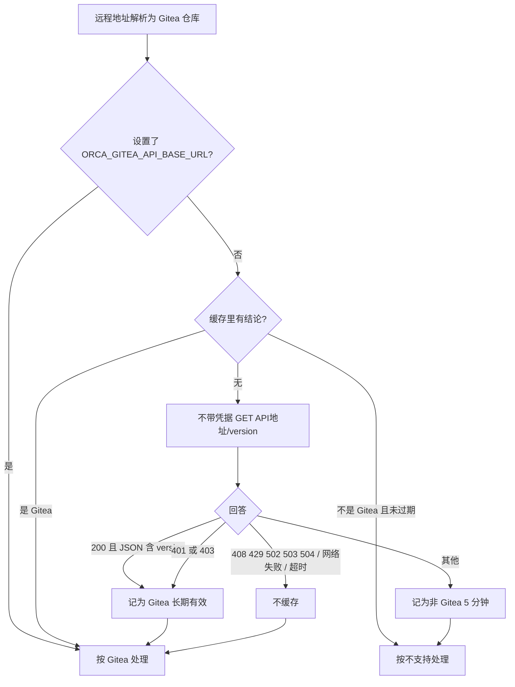

# Gitea 主机识别方案

## 现状

托管评审的平台识别在 `src/main/source-control/forge-provider.ts`：按 GitLab → GitHub → Bitbucket → Azure DevOps → Gitea 的顺序，各平台的 `resolveRepository` 依次判断远程地址。Gitea 排在最后，`src/main/gitea/repository-ref.ts` 只排除几个公共域名，其余任何主机都解析成 Gitea 仓库，`getGiteaRepoSlug` 原样返回。识别结果决定卡片 PR 状态、Checks、「创建 PR」走哪个平台。

## 方案

在 `getGiteaRepoSlug` 里加一道确认：解析出 Gitea 仓库后，交给功能模块 `src/main/gitea-host-verification/gitea-host-probe.ts` 的 `confirmGiteaRepoRef`。只有主机明确回答「不是 Gitea」时返回 null，其余情况原样放行。

### 判定依据

2026-11-03 实测：

| 主机                    | `/api/v1/version` 回答                  | 判定       |
| ----------------------- | --------------------------------------- | ---------- |
| codeberg.org（Forgejo） | 200 JSON `{"version":"…+gitea-1.22.0"}` | Gitea      |
| gitea.com               | 200 JSON `{"version":"…"}`              | Gitea      |
| 公司内部自建代码平台    | 500 text/plain                          | 不是 Gitea |
| gitlab.com              | 302 跳到登录页 HTML                     | 不是 Gitea |

401/403 归为 Gitea：开启「必须登录才能浏览」的 Gitea 对匿名请求就是这样回答的，保持原行为对它们最安全。网关、限流和网络问题说明不了对方是什么，同样保持原行为。

### 缓存与请求节制

- 以 API 地址为键，同一主机下的多个仓库共用一个结论；最多保留 256 个，超出淘汰最旧的。
- 并发探测用现有的 `runCoalescedProbe` 合并。
- 「不是 Gitea」的有效期复用 `remote-ref-probe-cache.ts` 的 `NEGATIVE_ENTRY_TTL_MS`（5 分钟），与远程地址探测的否定结论同一节奏，主机换成 Gitea 后不用重启就能恢复。
- 下一次询问只由正常的评审刷新触发，模块内没有定时器，也不重试。

### 凭据

探测请求不带任何认证头。`ORCA_GITEA_TOKEN` 只随确认之后的 Gitea API 请求发出，不会因为这一步发给陌生主机。

## 由哪台机器执行

| 动作                         | 本地工作区       | SSH 工作区               | 配对 runtime 工作区 |
| ---------------------------- | ---------------- | ------------------------ | ------------------- |
| 读 git 远程地址              | 本机             | SSH 主机（沿用现有通道） | runtime 主机        |
| 版本接口探测、Gitea API 请求 | 本机 Orca 主进程 | Orca 客户端主进程        | runtime 主机进程    |
| 结论缓存                     | 本机进程内存     | 客户端进程内存           | runtime 进程内存    |
| 读 `ORCA_GITEA_*` 环境变量   | 本机进程         | 客户端进程               | runtime 进程        |

不读写任何文件，不监听端口，不访问 `127.0.0.1` 上的服务（除非远程地址本身指向它）。SSH 断开时远程地址读不到，`getGiteaRepoRef` 先返回空，不会发探测。

## 改动范围

- 功能目录：`src/main/gitea-host-verification/`（实现与测试）。
- 接缝：`src/main/gitea/client.ts` 的 `getGiteaRepoSlug` 调用 `confirmGiteaRepoRef`。
- 上游测试：`src/main/gitea/client.test.ts`、`client-scan-invalidation.test.ts` 测的是确认之后的扫描缓存，把探测替换成原样放行；`src/main/source-control/hosted-review-gitea.integration.test.ts` 的假 Gitea 服务补上 `/api/v1/version`，并断言探测不带令牌。

## 没选的做法

- 只认显式配置的 Gitea：会让依赖自动识别的 Gitea/Forgejo 用户（如 codeberg.org）全部失效。
- 带令牌请求 `/repos/{owner}/{repo}` 来确认：要把令牌先发给陌生主机，正是要避免的事。
- 在 `forge-provider.ts` 的 Gitea 条目里判断：`getGiteaRepoSlug` 还被 PR 读缓存清理复用，放在这里一处生效。

## 风险

真 Gitea 在反向代理后偶发 500（非网关类错误码）时，会被判为非 Gitea 5 分钟，期间卡片不显示 PR，5 分钟后自动恢复。
