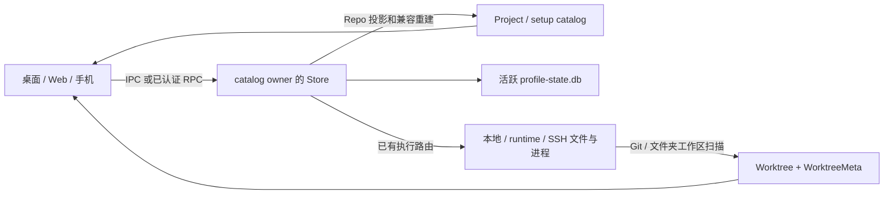

# 项目目录工作区与属性归属现状

调研对象：原生 Project、目录登记、工作区和属性所有权。目的：为用户要求重写的[归属方案](../solutions/原生项目归属方案-10-23.md)提供当前代码事实，关联 REQ-611 至 REQ-615。基线为功能工作树 `3f0e3c1ccad6` 加旧原型未提交修改；不读取在线 profile、不部署应用。以下为源码事实，历史机器数据与未知运行时状态另列。

## 1. 结论先行

当前逻辑项目主要是 Repo 的身份投影，执行目录与工作区会话仍有各自稳定身份。

- `Project` 没有 path；`Repo` 登记具体主机上的 Git checkout 或普通目录。repo-backed setup 从 Repo 重建，一条 Repo 产生一条 ready setup。
- Project ID 使用 GitHub 身份、Git remote canonical key 或 Repo ID；目录名称不参与身份。单 runtime 的标题来自首条成员 Repo，跨 runtime 合并又可被后来的项目行覆盖。
- 普通 `kind=folder` Repo 也使用 Worktree/WorktreeMeta 模型；旧 ProjectGroup/FolderWorkspace 是另一套并存模型。
- 当前工作区 metadata 可存旧 projectId，renderer 补全优先采用这个字段。discovery 有修复逻辑，但它不是设置归属接口内对全部工作区的一次迁移。
- 当前 update API 没有归属字段和 durable 确认；Store 已有可等待落盘的串行 mutation 机制。SSH 既有远端 managed runtime owner，也有遗留 direct SSH 登记，二者所有权不同。

## 2. 术语表

| 术语 | 当前含义 | 与易混项的区别 |
| --- | --- | --- |
| Project | 跨来源逻辑身份及汇总元数据 | 不是目录、Repo 或 ProjectGroup |
| Repo | 具体目录登记，含 Git/folder 两种 kind | 不等于 Git 仓库的同义词 |
| ProjectHostSetup | 项目在 host 上的位置；可为 Repo 派生或独立占位 | repo-backed projectId 不是独立权威 |
| Worktree | 应用工作区返回模型，既可来自 Git，也可来自普通目录 | 普通目录 Worktree 没有 Git head/branch |
| WorktreeMeta | 用户工作区属性与实例、项目/host/setup stamp | 并非完整扫描结果或磁盘文件 |
| FolderWorkspace | 挂 ProjectGroup 的旧目录工作区实体 | 不等于 kind=folder Repo 的 Worktree |
| catalog owner | 保存与管理该登记的 profile/runtime | 不一定与文件/进程 execution host 相同 |

## 3. 现状全景

### 3.1 对外行为

同 ID 的 Project 在 catalog 中归并，工作区仍通过原 Repo 与主机定位。相同显示名不会建立关联。旧原型额外应用 `sidebar-merged:*` 的显示投影，host 原始项目身份未因此改变。

现有普通目录关联有仓库身份项目时，原生流程会匹配 GitHub / Git remote 身份；人工纯目录共享 ID 没有匹配分支。其他 host 设置位置入口也排除了 `repo:*` 项目。

### 3.2 系统总览

| 模块 | 职责 | 调用边界 |
| --- | --- | --- |
| shared project projection | 从 Repo 生成项目和位置 | main、renderer fallback、mobile 共用 |
| Store compatibility | 维护派生状态并保留独立行和项目偏好 | 活跃 profile 内 |
| endpoint adoption / catalog merge | 投影 runtime 别名和执行来源，合并多 host 刷新 | RPC 到客户端 |
| registration / setup controller | 检查目录、去重、识别仓库、登记与关联 | 对应 owner 的本机路径 |
| worktree listing | 扫描并补元数据、返回当前工作区 | 文件/Git 所在执行 host |
| profile authority | SQLite 持久化与 generation 确认 | Store 单 writer |

## 4. 技术链路

### 4.1 目录到项目身份

`getProjectProviderIdentity` 先看 upstream，后看 GitHub 来源图标，再看 remote。`getProjectIdentityKey` 得到 `github:*` / `git:*` / `repo:*`。`projectHostSetupProjectionFromRepos` 按 ID 聚合 Project，并为每个 Repo 生成 `setup.id=repo.id` 的位置。

`createProjectFromRepo` 复制首个 Repo 的 displayName、badge、icon、kind 与 provider/remote 信息；后续 `mergeProjectRepo` 只追加成员和合并时间。`mergeProjectCompatibilityProject` 跨来源展开 overlay，后合入的 displayName 可覆盖 base。

### 4.2 持久化与读取重建

Repo 更新后，`syncProjectHostSetupCompatibilityState` 调用 `mergeProjectHostSetupCompatibilityState` 重建 repo-backed 行。独立 setup 的 `repoId` 为空，单独保留。

客户端 `fetchRepoCatalogForTarget` 先取 Repo，再通过 `fetchProjectHostSetupCompatibility` 取项目/setup。失败时回退到 Repo 派生模型；shared `resolveProjectHostSetupProjection` 还会按 Repo 身份归一化 hydrated 行。只改一个持久化 Project/setup 数组不是完整身份变更。

活跃 desktop/orcad 都由 startup factory 创建 live SQLite Store；数据库 `profile_state_documents` 按顶层 domain 保存 JSON 文档，另有 revision 和 automation 专表。`orca-data.json` 是历史导入/兼容导出路径。部分旧源码注释仍沿用 JSON 主写描述，与活跃 factory 不一致。

### 4.3 工作区、文件和会话

Git Worktree 是当前 Git 信息加 WorktreeMeta 的合成结果。普通 Repo 的 root ID 为 `repoId::path`，附加工作区使用 `::workspace:<uuid>`，这些工作区可以共用 Repo.path。旧 FolderWorkspace 有独立 id/name/folderPath/projectGroupId，session key 为 `folder:<uuid>`。

`mergeWorktree` / `mergeFolderWorkspace` 复制 metadata 中的项目 stamp；renderer `withRepoHostOwnership` 使用 `worktree.projectId ?? setup?.projectId`。discovery 的 `getProjectHostSetupMetaUpdates` 在 setup 身份匹配时会修复过时 projectId，但需要进入扫描/发现链路。

WorkspaceSessionState 保存活动 Repo、工作区、tab 以及工作区下的终端、编辑器、浏览器和布局；非本地 session 按 host 分区。文件属于工作区的实际文件系统；PTY 与进程执行端独立于客户端显示名。

### 4.4 新目录关联

local 入口经 `setupProjectExistingFolder → addLocalRepoFromPath → alignRepoWithRequestedProject`；runtime 入口经 setup RPC 到 `RuntimeProjectHostSetupController → RuntimeRepositoryRegistrationController.add → linkRepo`。目标项目 provider 描述会随请求传到尚无该项目行的 owner。

两条链路都依赖 `resolveImportedFolderProjectLink`：GitHub 可写匹配的 upstream，其他 Git 需要相同 canonical key；纯人工 ID 抛身份不匹配错误。现有 registration 先 addRepo，再异步准备工作区根和补关联，不是单次“登记与归属”提交。

## 5. 关键规则与语义

| 属性 | 当前事实源与规则 |
| --- | --- |
| displayName | Project 复制首条 Repo；Repo 名独立于文件夹 basename；WorktreeMeta 可保存固定工作区名 |
| 路径和 host | Repo.path/executionHost；setup 复制；工作区路径可与 Repo root 不同；执行端解析真实路径 |
| hooks / worktreeBasePath | Repo override 与全局默认、工作区 `orca.yaml` 共同生效；相对工作区根按原执行端规则解析 |
| sourceControlAi | Repo override 与全局 settings 合成；不存为 Project 统一值 |
| Windows runtime preference | 当前 Project 的独立用户配置；客户端跨 host 合并保护本地值不被远端 local 值覆盖 |
| upstream / Git remote / 账号 | Repo；upstream 既影响 fork/provider，也参与当前自动项目身份 |
| 工作区属性 | WorktreeMeta 或旧 FolderWorkspace 各自保存名字、任务、归档、固定、排序与活动信息 |
| manualRepoOrder / workspaceHostOrder | 客户端本地 UI 偏好，不是跨 host 的归属事实；前者按 host+repoId |
| collapsedGroups | 保存 section key；项目 key、host key 与额外 setup key 均可能出现 |
| active selection / filterRepoIds | 使用原 Repo、workspace、tab 键；不是 activeProjectId；过滤器当前仍含 raw Repo ID |
| quick commands | 定义的 scope 存 Repo ID；匹配函数通过当前 setup 的 projectId 扩展同项目跨 Repo/host 的可见范围 |
| ProjectGroup 继承 | 未显式分组的 fetched Repo 按 `getProjectIdentityKey` 继承客户端已有组，跳过 `repo:*` |
| AI Vault / runContext | 当前搜索范围可同时读 setup、Project 成员与 metadata；自动化实际目标在 runContext，旧 Automation.projectId 仍是 Repo ID 槽 |

## 6. 面向后续方案的现状接口

- `projectHostSetup.update` 可以主机限定更新 repo-backed setup 属性，并转写 Repo；RPC schema 无 projectBinding 字段，未知字段会被剥离。
- setup create 对 `(projectId,hostId)` 拒绝重复；Repo projection 本身仍可生成同 host 的多个同项目 setup，两条路径约束不同。
- `carryProjectStateThroughIdentityChange` 仅继承 Windows preference：exact ID 优先，新 ID 按重叠数、updatedAt、ID 字典序选择单一消失前身。它没有通用迁移所有项目引用。
- `runDurableMutation` 已经串行准入 mutation callback，支持 `persist:false`、条件 rollback 和 durable generation 等待；indeterminate 写入不自动回滚。
- 当前 setup/repo update 只 scheduleSave，1 秒 debounce、5 秒 max wait，没有返回 durable ack 或归属 revision。
- 当前能力包含 project-host-setup、host-target 和 workspace-run-context，不能证明新增字段被识别。
- managed orcad 的 catalog 在 SSH 远端；遗留 direct SSH 行可由桌面 catalog 持有。endpoint adoption 给 runtime 行加入客户端别名与 transport 来源，不改变远端文件位置。
- 正常新增 UI 禁用纯 ssh 行，采用 managed runtime。当前 `repo.addRemote → addSshRepo` 无条件拒绝，不能作为现成 direct SSH 新增能力。

## 7. 冲突与未知项

### 7.1 已确认冲突

| 对象 | 证据事实 |
| --- | --- |
| 原稿“复用身份继承” | 对单前身晋级有效；本地 WSL + 更新 SSH 合并复现选择 SSH，偏好丢失 |
| “普通目录”命名 | folder Repo 的 Worktree 与旧 FolderWorkspace 是不同实体，不能由名称推断存储 |
| “SSH 主机”命名 | managed runtime 与遗留 direct SSH 的 catalog owner 不同 |
| “保存成功” | 当前返回值先于延迟落盘；内存读回不证明 durable |

### 7.2 未知项

本轮没有读取当前用户 profile 或窗口，因此当前主机连通性、部署版本、UI 状态、历史目录是否有后续变化未知。2026-10-22 的五个成员与配置修复可由历史 JSON 读回记录支持；它们不代表本轮实时验收。

归属新接口、版本矩阵、落盘失败注入和新 UI 都尚未实现，不能从上述源码事实推断已通过。GitHub/GitLab 具体命令执行和 SSH 服务部署细节没有展开：本轮未修改相关实现，调研终点在现有归属与路由边界。

## 8. 自校验与验证状态

2026-10-23 完成类型、投影、持久化、两条 setup 导入、endpoint adoption、工作区 metadata 优先级和当前 API schema 的源码回读。最小源码探针实际得到：

1. 本地 `{kind:wsl,distro:Ubuntu}` 与更新时间更晚 SSH 项目合并，继承结果 preference 为 null。
2. 普通目录关联 `project:manual-example` 和另一 `repo:*` 项目均抛 `Imported folder does not match the selected project identity.`。
3. 现有 update schema 解析包含 projectBinding 的请求后得到 `updates: {}`。

探针不接触用户数据，不启动应用；结果见过程证据目录。未运行新功能 E2E；本文件无该功能通过声明。

## 9. 关键文件索引

| 章节 | 文件 | 关键符号 / 职责 |
| --- | --- | --- |
| 2–5 | `src/shared/project-types.ts` [打开](../../../../src/shared/project-types.ts)、`src/shared/repo-types.ts` [打开](../../../../src/shared/repo-types.ts) | 模型、更新参数与持久化字段 |
| 2–4 | `src/shared/project-host-setup-projection.ts` [打开](../../../../src/shared/project-host-setup-projection.ts) | getProjectIdentityKey / createProjectFromRepo / createSetupFromRepo |
| 4 | `src/main/persistence/tracking-repos/project-host-compatibility.ts` [打开](../../../../src/main/persistence/tracking-repos/project-host-compatibility.ts) | 重建派生行与保留独立 setup |
| 4–6 | `src/main/persistence/tracking-repos/project-host-setup-update.ts` [打开](../../../../src/main/persistence/tracking-repos/project-host-setup-update.ts)、`src/main/persistence/tracking-repos/project-host-operations.ts` [打开](../../../../src/main/persistence/tracking-repos/project-host-operations.ts) | Repo 转写、独立行与重复检查 |
| 4 | `src/shared/project-host-setup-hydration.ts` [打开](../../../../src/shared/project-host-setup-hydration.ts)、`src/shared/project-compatibility-host-merge.ts` [打开](../../../../src/shared/project-compatibility-host-merge.ts)、`src/shared/project-compatibility-merge.ts` [打开](../../../../src/shared/project-compatibility-merge.ts) | 读取归一化、owner 刷新和 overlay |
| 4–6 | `src/shared/endpoint-catalog-adoption.ts` [打开](../../../../src/shared/endpoint-catalog-adoption.ts)、`src/renderer/src/store/projects/project-host-routing.ts` [打开](../../../../src/renderer/src/store/projects/project-host-routing.ts) | runtime 别名、真实执行 host、读取 fallback |
| 4–5 | `src/shared/worktree/types.ts` [打开](../../../../src/shared/worktree/types.ts)、`src/shared/worktree/meta-types.ts` [打开](../../../../src/shared/worktree/meta-types.ts)、`src/shared/folder-workspace-types.ts` [打开](../../../../src/shared/folder-workspace-types.ts) | 当前工作区与旧目录模型 |
| 4 | `src/main/ipc/worktrees/folder-workspace-model.ts` [打开](../../../../src/main/ipc/worktrees/folder-workspace-model.ts)、`src/main/ipc/worktree-metadata-merge.ts` [打开](../../../../src/main/ipc/worktree-metadata-merge.ts) | 应用工作区合成 |
| 4–5 | `src/renderer/src/store/slices/worktrees/listing/worktree-host-ownership.ts` [打开](../../../../src/renderer/src/store/slices/worktrees/listing/worktree-host-ownership.ts)、`src/main/ipc/worktrees/listing/worktree-discovery-metadata.ts` [打开](../../../../src/main/ipc/worktrees/listing/worktree-discovery-metadata.ts) | 旧 stamp 优先与扫描修复 |
| 4–6 | `src/main/ipc/repos/local-repo-registration.ts` [打开](../../../../src/main/ipc/repos/local-repo-registration.ts)、`src/main/runtime/runtime-repository-registration-controller.ts` [打开](../../../../src/main/runtime/runtime-repository-registration-controller.ts)、`src/main/runtime/runtime-project-host-setup-controller.ts` [打开](../../../../src/main/runtime/runtime-project-host-setup-controller.ts) | 路径检查、去重、登记、关联 |
| 4 | `src/shared/imported-folder-project-identity.ts` [打开](../../../../src/shared/imported-folder-project-identity.ts)、`src/renderer/src/lib/project-host-setup-options.ts` [打开](../../../../src/renderer/src/lib/project-host-setup-options.ts) | Git 身份限制与 repo:* 入口限制 |
| 5–6 | `src/shared/project-identity-succession.ts` [打开](../../../../src/shared/project-identity-succession.ts)、`src/shared/project-execution-runtime.ts` [打开](../../../../src/shared/project-execution-runtime.ts) | 单前身偏好继承与运行环境解析 |
| 5 | `src/shared/manual-repo-order.ts` [打开](../../../../src/shared/manual-repo-order.ts)、`src/shared/project-section-grouping.ts` [打开](../../../../src/shared/project-section-grouping.ts)、`src/shared/pairing-local-ui-fields.ts` [打开](../../../../src/shared/pairing-local-ui-fields.ts)、`src/shared/workspace-session-state-types.ts` [打开](../../../../src/shared/workspace-session-state-types.ts) | 排序、折叠、过滤与活动键 |
| 5 | `src/renderer/src/lib/terminal-quick-command-project-scope.ts` [打开](../../../../src/renderer/src/lib/terminal-quick-command-project-scope.ts)、`src/shared/project-group-inheritance.ts` [打开](../../../../src/shared/project-group-inheritance.ts)、`src/shared/task-source-context.ts` [打开](../../../../src/shared/task-source-context.ts) | 同项目消费范围与执行/来源区分 |
| 6 | `src/main/persistence/loading-store/primary-state-writes.ts` [打开](../../../../src/main/persistence/loading-store/primary-state-writes.ts)、`src/main/persistence/loading-store/write-flush-barriers.ts` [打开](../../../../src/main/persistence/loading-store/write-flush-barriers.ts) | 串行 mutation、generation、rollback |
| 4、6 | `src/shared/rpc-contract/project-runtime-params.ts` [打开](../../../../src/shared/rpc-contract/project-runtime-params.ts)、`src/shared/worktree-runtime-capabilities.ts` [打开](../../../../src/shared/worktree-runtime-capabilities.ts) | 可写字段与能力声明 |
| 3、6 | `src/shared/managed-orcad-execution-host.ts` [打开](../../../../src/shared/managed-orcad-execution-host.ts)、`src/renderer/src/components/sidebar/add-repo-host-availability.ts` [打开](../../../../src/renderer/src/components/sidebar/add-repo-host-availability.ts) | SSH/runtime 显示和新增入口 |
| 3–4 | `src/main/persistence/profile-state/profile-state-startup-authority.ts` [打开](../../../../src/main/persistence/profile-state/profile-state-startup-authority.ts)、`src/main/persistence/profile-state/profile-state-live-store-factory.ts` [打开](../../../../src/main/persistence/profile-state/profile-state-live-store-factory.ts)、`src/shared/profile-state-storage-paths.ts` [打开](../../../../src/shared/profile-state-storage-paths.ts) | 当前 SQLite 权威与路径 |

## 10. 关联文档与过程件

- [需求](../requirements/requirement.md)、[方案](../solutions/原生项目归属方案-10-23.md)、[Journal](../journal.md)。
- 本工作树过程件与探针：`.docs/sidebar-project-merge-ui-validation/2026-10-23/`，含 repo-profile、trace-log、open-questions、源码探针与结果。
- 主工作树历史快照：`.docs/sidebar-project-grouping-ui-validation/2026-10-22/`；历史配置修复：`.docs/sidebar-project-config/2026-10-22/`。
