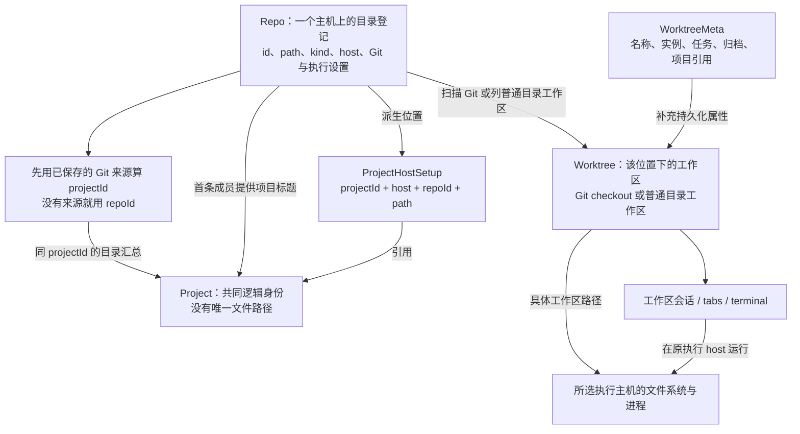
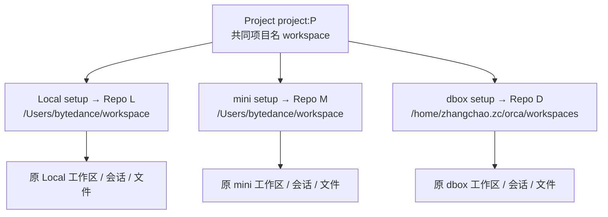
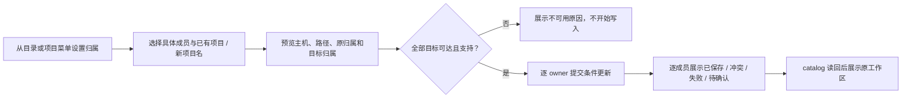
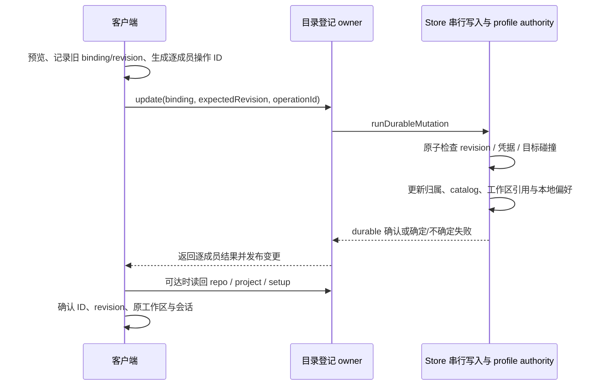

# 原生项目归属方案：项目、目录、工作区与属性

> 已被[项目归并最小改动方案](项目分组最小改动方案-10-23.md)替代。当前 D-005 使用已有显示名称补充侧栏归并，重名合并、改名分开，保留同仓库自动逻辑。下文原生 binding、工作区引用和业务属性迁移仅保留作历史，不再作为实施范围；中间提出的人工成员名单也已撤回。

- 状态：已被替代的历史稿；下文“目标”“新增”“调整”是当时的设计，未实现或部署，不代表当前范围。
- 本地文件：`docs/issue/侧栏项目合并/solutions/原生项目归属方案-10-23.md`。
- 作者：Codex；需求与修订来源：用户本次对话及[原生项目归属需求](../requirements/requirement.md)。
- 源码基线：`feat/sidebar-project-merge`，HEAD `3f0e3c1ccad6`，工作树含旧侧栏原型的未提交修改。
- 事实来源：[源码调研](../research/项目目录工作区与属性归属现状.md)；模型背景取自 2026-10-22 快照。用户随后授权“先让它独立”，2026-10-23 已读取当前 App 并调整 dbox 的现有登记，结果和残留问题见第 3.1 节；新归属机制仍未实现。
- 飞书：未关联；本轮交付仓库内文档，没有指定外部存档目标。

## 1. 先明确这次究竟改什么

**把“一个目录属于哪个逻辑项目”从 Git 身份的自动推导，扩展为可显式配置的原生关系。三个 workspace 共用项目 ID，各自的目录、工作区、文件和执行环境继续独立。**

当前不是“一个项目只有一个文件夹”。Orca 已经有逻辑项目 `Project`、主机上的目录登记 `Repo`、项目在该主机上的位置 `ProjectHostSetup`，以及位置下面的工作区。缺少的是：几个没有共同 Git 身份的目录，不能明确声明属于同一个项目。

本方案的变化只有一个核心关系：`目录登记 → 逻辑项目`。为使它真实生效，还必须同步更新派生 catalog、工作区中保存的项目引用和项目级状态。仅改标题或 setup 中的 `projectId` 都不完整。

| 用户关心的问题            | 当前                                                                                                                                                  | 改造后                                             |
| ------------------------- | ----------------------------------------------------------------------------------------------------------------------------------------------------- | -------------------------------------------------- |
| 三个 workspace 为什么分开 | Local Mac 与 mini 没有可识别的 Git 仓库来源，各自按 Repo ID 成项目；dbox 原来借 upstream 归到 orca，10-23 按用户授权清除关联后也按自身 Repo ID 成项目 | 三个目录显式引用同一个 `project:<UUID>`            |
| 项目对应哪个路径          | 一个 Project 可以对应多个主机路径，本身没有唯一根目录                                                                                                 | 继续如此；选定主机和工作区以后才有具体路径         |
| 文件会放到哪里            | 在所选工作区的文件系统中                                                                                                                              | 文件位置不变，也不跨机器同步                       |
| 名称为什么会乱            | 项目名从目录名派生，跨主机元数据合并会覆盖名称                                                                                                        | 显式项目名独立保存，目录刷新不再覆盖它             |
| 工作目录怎么选            | 由所选 setup、工作区路径和执行 host 决定                                                                                                              | 保留相同的定位关系和本地主机运行偏好               |
| Git、账号、hooks 等跟谁走 | 大部分属于具体 Repo 或工作区                                                                                                                          | 继续由具体执行目标决定，不提升为所有成员共用的属性 |

本期要交付的是原生归属能力和三个目录的配置结果；旧版 `sidebarProjectMerges` 显示投影不再作为最终方案。

这里“可识别的 Git 仓库来源”指 Orca 能从目录登记里的 upstream、GitHub 图标身份或 Git remote 元数据判断“它对应哪个代码仓库”。Local Mac 与 mini 的 workspace 在已有快照中都没有这些信息，代码就各用自己的 Repo ID 建立项目。原稿的“无远端身份”指缺少这类 Git 仓库标识，与机器能否联网、能否连接 mini 无关。

## 2. 现在的模型是什么

### 2.1 六种对象，不能混称为“项目”

| 对象                        | 当前职责与身份                                                                            | 路径、持久化与关系                                                                                                                      |
| --------------------------- | ----------------------------------------------------------------------------------------- | --------------------------------------------------------------------------------------------------------------------------------------- |
| `Project` 逻辑项目          | 将被认定为“同一个项目”的多个目录登记汇总在一起；有共同 `id`、项目标题、成员和部分项目设置 | 一个 Project 可对应多个主机上的 Repo；它本身没有唯一 `path`。已有目录的 Project 主要从 Repo 分组生成                                    |
| `Repo` 目录登记             | Orca 保存的一条具体目录记录，回答“哪台机器上的哪个目录”；`kind` 可以是 `git` 或 `folder`  | 一个已登记 Repo 当前归到一个 Project；多个 Repo 可以归到同一个 Project。保存自身的 `id/path/displayName`、执行 host、upstream、hooks 等 |
| `ProjectHostSetup` 主机位置 | 把一个项目放到具体 host、repo、path；repo-backed setup 的 `id = repo.id`                  | repo-backed 行从 Repo 派生，`projectId` 随推导变化；另有独立的未设置/预配置位置，不可混作已存在目录                                     |
| `Worktree` 应用工作区       | Git checkout 或普通目录会话空间的统一返回模型；有名称、路径和会话关联                     | 常规 ID 是 `repoId::path`；普通目录还可带 `::workspace:<UUID>`，多个工作区可以共用同一物理目录                                          |
| `WorktreeMeta` 工作区元数据 | 保存工作区名称、instanceId、归档/固定/排序、任务关联，以及可选项目/主机/setup 引用        | 存在所属 catalog owner 的 profile 状态里；不是文件夹，也不是 Git metadata                                                               |
| 会话、tab、terminal         | 属于某个稳定工作区键、主机和实例；PTY 与进程由执行主机持有                                | 活动选择和 tabs 多以 worktree ID / WorkspaceKey 为键，不以项目标题为键                                                                  |

对这些已有目录，关系可以读成：**一个 Project 汇总多个 Repo，每条 repo-backed setup 把其中一个 Repo 的主机和路径挂到该 Project 上。** 在文件树或终端中真正使用的仍是所选 Repo/工作区的路径。

例如，mini 的 `/Users/bytedance/dev/Movo` 和 dbox 的 `/home/zhangchao.zc/ai_work/Movo` 是两条不同 Repo；此前配置修复后，两条记录都算出 `github:mangi-11/eta`，因此显示为同一个 Movo Project。选择 mini 工作区就操作 mini 文件，选择 dbox 工作区就操作 dbox 文件。两条同名 workspace 目录若算出的 ID 不同，则仍是两个 Project。

还存在旧的 `ProjectGroup → FolderWorkspace`：它按 `projectGroupId` 组织目录，使用 `folder:<UUID>` 会话键。**它与 `Repo.kind = folder` 不是一套对象。** 本次三个 workspace 是后者，不把它们改造成旧 FolderWorkspace，也不借 ProjectGroup 做跨主机归属。



### 2.2 项目 ID 和项目标题现在怎样产生

**先计算“哪些目录是同一个项目”，再决定“这个项目显示什么标题”。两件事使用不同字段。** 计算函数读取 Repo 里已保存的元数据，目录名本身不作为合并依据。

项目 ID 按以下顺序产生，命中一项就停止：

| 顺序 | 检查哪项登记信息                                                | 怎样计算项目 ID                                                                                                  |
| ---- | --------------------------------------------------------------- | ---------------------------------------------------------------------------------------------------------------- |
| 1    | `upstream` 中有 owner/repo，表示登记关联的 GitHub 上游仓库      | 如 `{owner: stablyai, repo: orca}`，得到 `github:stablyai/orca`                                                  |
| 2    | 没有有效 upstream，但 GitHub 来源图标的 label 能给出 owner/repo | 用该 GitHub 仓库身份生成 `github:*`；普通图标不参与                                                              |
| 3    | 前两项都没有，但保存的 Git remote 元数据可识别仓库              | GitHub remote 得到 `github:*`；其他 Git 服务得到 `git:<canonicalKey>`，如 `git:code.byted.org/zhangchao.zc/octo` |
| 4    | 上述信息都没有                                                  | 用登记自身的 ID：`repo:<repoId>`，只让这条登记独立成项目                                                         |

Git remote 是 Git 中 origin/upstream 这类远程仓库地址；这里使用的是 Orca 已采集的仓库元数据。企业 GitHub 和别名继续遵循现有主机归一化规则。代码按计算结果汇总：相同 projectId 进入同一个 Project，不同 ID 即使显示名相同也分开。

**套到 10-22 的三个 workspace：** Local Mac 得到 `repo:4fddd9a4-…`，mini 得到 `repo:ddccd957-…`，因为两条记录都没有前述仓库来源。dbox 当时命中第一项，直接得到 `github:stablyai/orca`。该函数不要求 `kind` 必须为 git，也不根据路径里是否带 `orca` 来分组，所以普通目录也会得到这个结果。10-23 清除该 upstream 后，dbox 命中第四项，变为 `repo:6f8a0c72-…`。

**dbox 这项关联是怎样来的？** 2026-10-22 10:03 UTC 的首次目录快照中，该 Repo 已经保存以下关键字段：

```json
{
  "path": "/home/zhangchao.zc/orca/workspaces",
  "kind": "folder",
  "upstream": { "owner": "stablyai", "repo": "orca" },
  "projectHostSetupMethod": "imported-existing-folder"
}
```

现有“把目录关联到已有 GitHub 项目”的代码，会通过 `resolveImportedFolderProjectLink` 把目标项目的 owner/repo 写入该目录登记的 upstream，再记录导入方式；下一次项目计算就命中上表第一项。因此当前能证实的原因是：**登记里保存了 orca 的仓库关联，自动计算据此将 D 归到 orca。** 普通目录参与项目关联时，现有代码借用了原本表示 Git 上游的字段。

快照里的导入标记与这条代码路径一致，但它不是操作审计，不能据此断定最初是谁、在哪次操作里写入关联。现有记录能证明该值在首次快照时已经存在；随后 11:28 UTC 的标题修复只改了 `displayName`，没有新建此关联。这也是本方案要为普通目录新增独立 `projectBinding` 的原因：项目归属有自己的字段，不再借用 Git upstream 表达。

项目标题则来自 `displayName`：单个 runtime 从 Repo 投影时，第一条成员提供项目名；跨 runtime 汇总 Project 时，后合入的同 ID 项目行可以覆盖名称。此前 dbox 的登记名为 `work-dbox`，所以能把共同 orca 标题覆盖成 work-dbox；将登记名修正为 orca 只影响标题，项目 ID 仍由上述 upstream 算出。

源码依据：[身份与项目投影](../../../../src/shared/project-host-setup-projection.ts)的 `getProjectProviderIdentity`、`getProjectIdentityKey`、`createProjectFromRepo`；[导入目录关联](../../../../src/shared/imported-folder-project-identity.ts)的 `resolveImportedFolderProjectLink`。历史原因与 10-23 操作后的配置分别记录在第 3 节。

### 2.3 路径与属性现在存在哪里

| 内容                               | 事实所有者                               | 当前来源 / 存放处                                                                                                         |
| ---------------------------------- | ---------------------------------------- | ------------------------------------------------------------------------------------------------------------------------- |
| 源文件、`.git`、工作区内配置文件   | 文件所在执行主机                         | 实际 `Repo.path` 或 checkout 的 `Worktree.path`；项目标题下不存在额外公共目录                                             |
| Repo、Project、setup、WorktreeMeta | 管理该目录登记的 catalog owner           | owner 活跃 profile 的 `<userData>/profiles/<profileId>/profile-state.db`；顶层状态域分别保存，不能把它当成同名 SQL 实体表 |
| 旧 JSON 配置                       | 对应 profile                             | `orca-data.json` 是迁移/导入导出兼容路径；当前活跃 SQLite profile 不以它为权威                                            |
| `.yaml` 项目配置、脚本和工作区文件 | 对应目录所在主机                         | 沿现有执行链读取所选 Repo / 工作区的配置；归组不会复制一台机器的配置到另一台                                              |
| UI 排序、折叠、活动选择、过滤偏好  | 使用界面的客户端及其既有 session/UI 分区 | `manualRepoOrder` 按 host/repo；`collapsedGroups` 按 section key；tab 与活动工作区按稳定工作区键                          |
| 终端进程当前 cwd、环境变量         | 正在运行的进程所在主机                   | 创建时使用选定工作区路径；用户后来执行 `cd` 的结果不由归属变更重置                                                        |

“文件在谁那里”与“哪台机器保存目录登记”可以不同。尤其是遗留 direct SSH：目录登记在桌面 profile，文件和进程在 SSH 远端。主机路由详见第 6 节。

## 3. 这三台机器现在是什么，最终要是什么

### 3.1 已有记录，而不是根据名字猜关系

以下是 2026-10-22 已采集记录；此前单独完成的名称/upstream 修复一并列出，部署前还要重新读回。

| 成员代号  | 执行主机与登记路径                        | 类型   | 目录登记名 / 工作区名                   | 原生项目身份                                                               |
| --------- | ----------------------------------------- | ------ | --------------------------------------- | -------------------------------------------------------------------------- |
| L         | Local Mac `/Users/bytedance/workspace`    | folder | workspace / workspace                   | `repo:4fddd9a4-af3c-45ab-9ed5-8b3c8c439f41`                                |
| M         | mini `/Users/bytedance/workspace`         | folder | workspace / workspace                   | `repo:ddccd957-c85d-4ed9-8425-1df6406caa37`                                |
| D         | dbox `/home/zhangchao.zc/orca/workspaces` | folder | work-dbox，后已修正为 orca / workspaces | `github:stablyai/orca`，Repo ID 为 `6f8a0c72-0303-440b-8be3-5c0ac05077d2`  |
| mini Movo | `/Users/bytedance/dev/Movo`               | git    | Movo / feat/chat-mode                   | `github:mangi-11/eta`                                                      |
| dbox Movo | `/home/zhangchao.zc/ai_work/Movo`         | git    | Movo / main                             | 最初 `github:fartown/movo`；补齐真实 upstream 后已是 `github:mangi-11/eta` |

三个目录各有一个已记录的普通目录工作区，ID 分别为原 `repoId::path`，instanceId 也各不相同。dbox 的工作区名 `workspaces` 来自工作区元数据，和目录登记名 `orca` 是不同属性。Movo 的两个分支名是工作区差异，不是项目必须分开的理由。

**2026-10-23 的实际变更：** 用户要求先将 D 独立。当前 App 的“设置 → orca → dbox 对应目录”能改名称，但没有解除归属控件。已在该页把 D 的 `displayName` 改为 `workspaces`，再通过已连接 dbox 的现有 `repo.update` RPC 将 `upstream` 清为 `null`。`project.list` 回读 D 只属于 `repo:6f8a0c72-0303-440b-8be3-5c0ac05077d2`，标题为 workspaces，无 providerIdentity；侧栏辅助功能树也已出现独立 workspaces 项目。原路径、Repo ID、工作区 ID/instanceId 和三个终端的 PTY/实例/tab/leaf 均保留，三个终端回读均为连接、可写、非孤儿。

本次仍有两项限制：`worktree.list` 返回的旧 `projectId=github:stablyai/orca` 尚未随 Repo 自动修复，不能把 catalog 分离等同于全部消费者归属一致；现有 `worktree.set` 不开放该字段，本次未绕过 API 直接改数据库。窗口演示后段的侧栏滚动未得到画面确认，随后辅助功能读取持续报 `permission_denied`，但权限查询仍为 granted，原因未查明。因此当前已证实配置与侧栏控件树分离，未完成最终可见画面展示。主工作树证据为 `.docs/sidebar-project-config/2026-10-23/`。

### 3.2 配置前后对照

```text
10-22 配置修复之后、10-23 独立操作之前：

orca [github:stablyai/orca]
  orca / fork/integration 等真正 orca 工作区
  workspaces [dbox]                    ← D，普通目录，upstream 指向 orca
workspace [repo:L]
  workspace [Local Mac]
workspace [repo:M]
  workspace [mini]
Movo [github:mangi-11/eta]
  feat/chat-mode [mini]
  main [dbox]
```

```text
10-23 已完成的 catalog 分离（工作区旧项目标记仍待修复）：

workspaces [repo:D]
  workspaces [dbox]
orca [github:stablyai/orca]
  orca / fork/integration 等真正 orca 工作区
workspace [repo:L]
  workspace [Local Mac]
workspace [repo:M]
  workspace [mini]
```

```text
未来应用本方案后：

workspace [project:P]                  ← 新的共同逻辑身份
  workspace [Local Mac]               ← L 原工作区与原会话
  workspace [mini]                    ← M 原工作区与原会话
  workspaces [dbox]                   ← D 原工作区与原会话
orca [github:stablyai/orca]
  orca / fork/integration 等真正 orca 工作区
Movo [github:mangi-11/eta]
  feat/chat-mode [mini]
  main [dbox]
```

`P` 是创建时生成一次的 UUID，不是目录名，也不因机器名变化而重算。树中主机标签沿用现有工作区行，不增加必须点击的“主机文件夹”层级。octo 保留当前按 Git 身份归并的结果。

### 3.3 三个成员具体改哪些字段

| 数据                                                    | L / M / D 的改造                                                                                      |
| ------------------------------------------------------- | ----------------------------------------------------------------------------------------------------- |
| `Repo.projectBinding`                                   | 都写入同一个 `{projectId: project:P, displayName: workspace}`                                         |
| 原生 `Project.id` / 项目名                              | 三端分别返回 `project:P` / workspace；客户端按该 ID 合成一个项目                                      |
| `ProjectHostSetup.projectId`                            | 都变为 `project:P`；setup ID、host、repoId、path 保持原值                                             |
| 现有 `WorktreeMeta.projectId`、返回工作区的当前项目引用 | 对选定成员改为 `project:P`，防止旧引用压过新 setup                                                    |
| `Repo.id/path/kind/displayName/upstream`                | 保持实施时读回的原值；10-23 操作后 D 的登记名为 workspaces、upstream 为 null，工作区名仍是 workspaces |
| worktree ID、instanceId、工作区名、会话/tab/PTY ID      | 保持原值；归属变化不调用关闭、重建或迁移会话接口                                                      |
| 文件、Git remote、Git 分支和进程 cwd                    | 不写入、不移动、不重置                                                                                |

Movo 本期不再修改 upstream；只验证此前正确身份和两端 worktree 仍然存在。

## 4. 目标模型与完整属性归属

目标关系是 `一个 Project → 多个主机位置 → 各自 Repo → 各自工作区`。共同项目只统一身份和项目标题，不产生共同执行目录。



| 属性                                                 | 改造后的归属与取值规则                                                              | 合并时怎么处理                                                                                                                                     |
| ---------------------------------------------------- | ----------------------------------------------------------------------------------- | -------------------------------------------------------------------------------------------------------------------------------------------------- |
| 逻辑项目 ID、项目标题                                | Project；显式值来源于成员 Repo 的 binding                                           | 所选成员统一 ID 与标题；目录名变化不再改显式项目标题                                                                                               |
| 登记路径、目录名称、kind                             | 对应 Repo / repo-backed setup                                                       | 原值保留；不把 Project.displayName 回写到 Repo.displayName                                                                                         |
| 执行 host、runtime transport、SSH connection         | 对应 setup 与现有主机路由                                                           | 原值保留；客户端 `runtime:*` 别名不写作服务端永久 host 身份                                                                                        |
| 工作区路径、名称、branch、instanceId                 | 对应 Worktree / WorktreeMeta                                                        | 原值保留；同一 Repo 的全部现有工作区一起改变项目归属                                                                                               |
| upstream、Git remote、fork 关系、账号、issue source  | 对应 Repo 的真实仓库与所选执行主机                                                  | 不改写为其他成员的值；PR/MR/Git 命令始终定位具体 Repo                                                                                              |
| 项目上的 provider 信息                               | 自动 Git 项目按原身份；人工 `project:*` 项目无共同 Git provider/remote              | 人工 workspace 不从 D 的旧 upstream 取得 orca 的项目能力；成员的 Git 能力仍逐 Repo 判断                                                            |
| hooks、worktreeBasePath、Git 用户名、sourceControlAi | 对应主机位置，持久化来源仍为 Repo；与现有全局默认合成                               | 不互相复制；相对路径在原执行主机按现有规则解析                                                                                                     |
| `orca.yaml`、脚本、workspace 环境                    | 所选目录和工作区所在主机                                                            | 继续读取原文件；项目名相同不代表配置文件内容相同                                                                                                   |
| 本地 Windows/WSL 运行偏好                            | 该 catalog owner 的本地成员所使用的 Project 设置                                    | 跟随本地成员转移，不从 SSH 或其他 runtime 的记录继承，详见第 7 节                                                                                  |
| badge、图标                                          | 现有 Repo 个性化信息；作为项目头的展示属性                                          | 优先保留客户端本地成员的 badge；其余按稳定主机/Repo 键取展示值。人工项目使用中性项目图标，不用某个成员的 Git 图标宣称共同 provider；不新增颜色体系 |
| 工作区归档、固定、排序、任务关联                     | 原 WorktreeMeta / 旧 FolderWorkspace 各自实体                                       | 原值保留；只更新属于当前归属的项目引用，不改外部任务来源                                                                                           |
| 快捷命令                                             | 定义仍由原 settings host 保存，scope 仍存 Repo ID；项目匹配使用当前 setup.projectId | 沿现有原生语义，L/M/D 的项目命令可互相显示；预览说明此范围变化，命令项显示来源主机，点击后发给当前选中终端，不自动执行或改写其中路径               |
| 旧 ProjectGroup 的展示位置                           | Repo 原 group 字段与客户端手动排序 anchor                                           | 保留成员字段；共同 section 跟随现有 anchor 的 group，预览明确最终位置；人工 binding 不触发新的跨主机 group 继承，改序/拆分仍按原 anchor 规则       |
| AI Vault 项目分类和搜索                              | 当前 owner/host/setup/工作区路径决定当前项目范围                                    | D 路径的会话归入 workspace；原 transcript、provider session ID 与历史内容不迁移，刷新旧/新范围缓存                                                 |
| 项目排序、折叠、过滤、活动选择                       | 界面客户端的 UI/session 分区                                                        | 沿稳定 host/repo/workspace 键保留；section key 的拆分与合并按第 7 节处理                                                                           |

文件读写、打开文件、创建终端的目标必须由 **catalog owner + 原执行 host + setup/repo + 工作区路径** 确定。不得用 `Project.sourceRepoIds[0]` 或项目标题选择执行机器。已有终端继续运行，新建终端才按新的项目引用和原运行偏好构造上下文。

## 5. 归属数据怎样保存与推导

### 5.1 使用已有 Repo 作为来源，不另外保存侧栏成员名单

新增字段均为拟议契约，当前版本还不能写：

| 字段                               | 含义                                                                                                                            |
| ---------------------------------- | ------------------------------------------------------------------------------------------------------------------------------- |
| `Repo.projectBinding?`             | `{projectId, displayName}`；显式项目描述；缺省表示自动归属                                                                      |
| `Repo.projectBindingRevision?`     | owner 内单调递增的归属修订号，旧记录视为 0；清除 binding 后仍保留修订号                                                         |
| `Repo.projectBindingLastMutation?` | 最近操作 ID、请求摘要、beforeBinding 和结果修订号；与 binding 同次落盘。普通内存读到它不等于 durable，须由 owner 的提交状态核对 |
| `Project.explicitDisplayNames?`    | 该来源见到的显式项目名去重集合；投影元数据，用于跨来源合并时保留标题来源与冲突信息                                              |

例如，D 的 Repo 保持旧 id/path/kind/upstream，只增加：

```json
{
  "projectBinding": { "projectId": "project:P", "displayName": "workspace" },
  "projectBindingRevision": 1
}
```

这里只用 `P` 表达同一个 UUID。实际实现须生成并验证标准 UUID，不能把示例字符串直接作为配置。

`projectBinding = null` 是更新接口的“解除”指令，持久化时移除 binding；不清零 revision，也不删除最后操作凭据。新建人工项目使用 `project:<UUID>`；选择已有 `project:*` 或 Git 身份项目则复用实际 ID。**选择 `repo:*` 普通目录项目作为跨主机目标时，先将其提升为一个新的 `project:<UUID>`，同时给原目录和新增成员写同一 binding**，避免继续把一个主机本地 ID 当作跨主机身份。

### 5.2 统一所有计算路径

1. Repo 有有效 binding：使用 binding 的项目 ID；没有则沿现有 `github:` / `git:` / `repo:` 顺序。
2. repo-backed setup 用相同函数生成 `projectId`。持久化同步、启动 hydration、profile transfer 重建、renderer fallback、mobile/shared catalog 必须使用同一规则。
3. `project:*` 项目的 `providerIdentity`、`gitRemoteIdentity` 和整体 `kind` 不从任意成员复制；目录/Git 能力下沉到具体 Repo。加入现有 Git 身份项目时，共同 provider 只能对应目标 ID，不能由新成员的另一个 upstream 覆盖。
4. 合并成员使用 owner 限定的 setup/Repo 关系，`sourceRepoIds` 只是兼容汇总字段，不能替代主机限定定位。
5. 同 ID 的 `explicitDisplayNames` 求并集；存在显式名时优先于自动目录名，多个显式名时按固定字典序选展示名并显示冲突。写入前要求目标名称一致；本期不提供跨主机广播改名功能。

无 binding 的自动 Git 项目保持现有规则。本方案的稳定标题承诺针对显式归属项目，不宣称已解决所有自动项目的目录别名冲突。

### 5.3 同主机碰撞与已有多 setup 数据

新的**显式加入**按 owner 看到的真实执行 host 检查目标项目已有 setup。若同一 host 已有另一个独立 Repo，拒绝本次加入并返回冲突 setup，不能靠 `.find()` 隐藏一个目录。已有同身份 Git checkout 可能已经投影出多个 setup，本期保留原有分行行为，不把它们删除或视为全局数据损坏。

解除 binding 恢复自动 Git 身份允许回到原生多 checkout 状态，不受“新增任意并入”限制；仍检查目录/迁移锁及第 7.3 节运行偏好一致性。若恢复的是旧显式绑定，额外传 `restoreOfOperationId`，owner 仅在当前 revision、最近操作和保存的 beforeBinding 一致时允许恢复原关系。无该证据的请求按普通显式加入检查，不能用“恢复”绕过碰撞校验。这样先移出既有 checkout、再解除或精确恢复不会被错误拦住。

匹配使用服务端自己的 host 表示；配对入口不能把客户端 `runtime:<environment-id>` 原样保存。能力是每个 catalog owner 声明的，预检不能消除并发，owner 写入时仍要重查碰撞。跨 owner 的未知/离线目录不主动扫描；本期不允许把客户端同时看到属于同一机器的多个目录当作不同机器绕过限制。

## 6. 每台机器负责什么，操作如何到达它

### 6.1 catalog owner 与执行 host 分开

| 场景                         | 目录登记和 binding 的 owner                               | 文件、Git、进程所在机器                | 本功能写入路径                                            |
| ---------------------------- | --------------------------------------------------------- | -------------------------------------- | --------------------------------------------------------- |
| 本地目录                     | 本机活跃 profile/runtime                                  | 本机；Windows 的具体运行环境按本地偏好 | 现有本地 IPC / Store                                      |
| 配对 mini / dbox             | 对应远端 runtime 的活跃 profile                           | 对应 runtime 所管理的执行 host         | 已认证 runtime RPC；服务端将自身本机归一为 `local`        |
| SSH 隧道连接的 managed orcad | SSH 远端 orcad 的 profile；客户端把它投影成 runtime       | SSH 远端                               | 现有 SSH 连接层和 managed runtime RPC；归属功能不另建连接 |
| 遗留 direct SSH 目录         | 保存该登记的桌面或上级 runtime profile                    | SSH 远端                               | 更新原 owner 的 Repo 元数据；不把远端文件复制到客户端     |
| 手机/Web                     | 所连接 runtime 是业务 catalog owner；界面有自己的展示状态 | 由所选 setup 决定                      | 使用同一能力声明和写接口，不本地伪造归属                  |

主机展示名不等于 owner ID。配对 runtime 内还可能有旧 SSH 目录，路由要保留 `runtimeOwnerEnvironmentId` 与真实 execution host，不能只取一个 host 字符串就跨 owner 写入。

本功能不新增生产服务、端口、环境变量。测试机 `127.0.0.1:2222` 属于现有测试 SSH 服务；通过 SSH 转发的 runtime 端口属于该连接层，不能解释为客户端本地目录的端口。

### 6.2 设置已有目录归属

在已有目录/项目菜单提供“项目归属”。目录入口操作一个选定 host/repo；项目入口先明确勾选具体成员，不默认移动该项目在所有机器上的所有成员。预览显示共同项目名、每个目录的 host/path、原项目与目标项目。

这是待实现入口。10-23 当前安装版本没有解除归属按钮；此次通过现有 RPC 清除旧 upstream 的方式只用于这条已授权的普通目录配置修正，不能当作新功能的用户操作流程。



### 6.3 将新目录加入已有人工项目

这条链路必须一起修改，不能只做旧 Repo 的 update：

- Local：复用 `addLocalRepoFromPath` 的路径检查、Git/普通目录识别和去重准备。
- 配对 runtime / managed orcad：复用 `RuntimeRepositoryRegistrationController.add` 和 `setupExistingFolder` 的本机目录准备；从客户端传入目标 binding，远端以自己的本机路径处理。
- 现有 `resolveImportedFolderProjectLink` 只会用 Git 身份关联目录。增加显式 binding 分支：登记后设置目标归属，不向 Repo 伪写 upstream，不再因 `project:*` 没有 Git 身份而拒绝。
- 当前登记函数会先加入 Repo，再准备工作区根并发出通知。将其拆成“检查/准备”和“单次提交”，最终 Repo、binding、setup、工作区初始引用一起经过第 8 节的持久化边界。验证失败不留下半登记目录；已有 Repo 不重复导入，也不删除其会话。
- 正常 SSH 新增目录使用现有 managed orcad 入口。当前产品没有可用的 direct SSH 新增链路，本期不恢复它；遗留 direct SSH 已有目录仍支持归属更新。未建立 runtime 的 SSH 主机由现有连接界面处理，本功能只显示不可用，不自行重连或部署服务。
- 为目标项目在其他主机设置位置的 UI，改用“支持显式归属且目标 owner 可用”的判断；选择已有 `repo:*` 时按第 5.1 节提升身份，不能继续一律隐藏入口。

这些是拟议的接入变化，不能把现有 `repo.addRemote` 兼容方法当作已可工作的 direct SSH 登记实现。

## 7. 迁移工作区引用与项目状态

### 7.1 工作区归属不能只靠 catalog 改名

当前 WorktreeMeta 已可保存 `projectId`；renderer 又优先使用 `worktree.projectId`，之后才回退到 setup。桌面 discovery、普通目录 listing 和 SSH fallback 在 setup 相同或未设置时会修复旧项目引用；runtime 的 `listRuntimeFolderWorkspaces` 对已有 instanceId 的记录直接复用 metadata，没有同样的归属修复。10-23 已实测 dbox Repo/Project 分离后，runtime 的 `worktree.list` 仍返回旧 orca 项目标记，重复读取也未修复。不能依赖后续刷新，更不能把所有路径概括为都会自动修复。

本次复用 discovery 的同 setup 校验和主机限定 metadata 定位逻辑，把选定成员的当前归属修复纳入显式提交，不等待下一次扫描。

owner 一次归属提交必须完成：按原 host + repo/setup 找到该成员的全部 WorktreeMeta，将其中表示**当前归属**的 `projectId` 更新为新值；复用现有 host-qualified metadata accessors，保留 canonical `wt2:<host>:<instance>` 及原兼容 locator 键，不能只按 raw repoId 或路径批量匹配；身份不足以唯一定位时拒绝并保留原状态。setup ID、工作区 ID、instanceId 保持原值。已存在独立 FolderWorkspace 不参与这次批量改写。读路径在能唯一匹配当前权威 setup 时采用当前归属，持久化旧 stamp 只作为旧版/缺 catalog 时的兼容回退。

### 7.2 每类引用的处理规则

| 引用或状态                                                                     | 本次处理                                                                                                                                                                                      |
| ------------------------------------------------------------------------------ | --------------------------------------------------------------------------------------------------------------------------------------------------------------------------------------------- |
| `WorktreeMeta.projectId`、工作区返回值当前项目字段                             | 按迁移成员更新；广播 catalog 与工作区归属变更，刷新缓存而不删除工作区                                                                                                                         |
| 当前自动化的 `runContext` / 其他保存的运行目标                                 | 用稳定的 owner/host/setup/repo/path 解析当前归属；同 owner 持久化当前项目字段，其他 owner 在读取时解析，不跨权威修改记录                                                                      |
| 历史 automation run、会话创建来源、外部 `TaskSourceContext`                    | 保留历史含义和来源，不因运行目录归组而改写外部任务/账号归属                                                                                                                                   |
| `manualRepoOrder`、workspace host order、repo 过滤器                           | 保留原稳定键；项目手动位置继续由现有成员 rank 规则决定                                                                                                                                        |
| 旧 ProjectGroup / 快捷命令                                                     | 按第 4 节明确的 anchor 展示和同项目命令匹配，不复制定义、账号或目录设置；改序、拆分时重新计算                                                                                                 |
| AI Vault 当前项目筛选 / 搜索缓存                                               | 同时失效旧项目和新项目范围；按 host+setup+path 重新分类，不能把同路径的另一机器会话带入。旧项目仍有成员时保留该筛选；旧项目消失且筛选有唯一成员锚点时跟随新归属，否则回到全部项目并保留查询词 |
| `collapsedGroups` 中的项目/host section key                                    | 按实际成员映射处理：旧项目仍有成员则保留旧 key；新项目不存在时继承被移动来源的折叠状态；合并多个来源时仅当来源全部折叠才折叠，保留活动工作区可见                                              |
| `activeRepoId/activeWorktreeId/activeWorkspaceKey/activeTabId` 和 tabs/layouts | 不换 ID；通过原 host/repo/workspace 找新项目并展开祖先；不调用 session replace/close                                                                                                          |
| 独立的未设置 setup 占位行                                                      | 不按旧项目 ID 整体搬走；保留原项目配置，只有用户明确选中的 repo-backed 成员移动                                                                                                               |

不使用一个全局 `oldProjectId → newProjectId` 替换表处理拆分。例如只移走 D 时，orca 在 L/mini 的项目引用仍然是 orca。

### 7.3 Windows/WSL 偏好跟随本地成员

现有身份继承按重叠成员和更新时间选择单一前身。复现中，本地 WSL 项目与较新 SSH 项目合并后会丢失 WSL 偏好。本次显式归属不能走该启发式作为最终规则。提交前在 owner 内记录“原本地 setup → 原项目当前偏好”，投影重建后按相同稳定 setup 写入新项目；读取的是本次串行提交内的最新值，包含字段缺省语义，不能先被旧 succession 覆盖再尝试找回。

| 归属变化                              | `localWindowsRuntimePreference` 规则                                |
| ------------------------------------- | ------------------------------------------------------------------- |
| 本地成员 A 移到新项目 P               | 把 A 所在原项目的当前本地偏好带到 P，包括“无覆盖、继承全局”的语义   |
| SSH 成员加入已有本地项目 P            | P 的本地偏好保持原值；SSH 来源不覆盖它                              |
| 本地成员加入原来只有 SSH 成员的项目 P | 本地成员的当前偏好成为该 owner 上 P 的本地偏好，不取 SSH 项目残留值 |
| 只把 SSH 成员移走                     | 不改任何本地运行偏好                                                |
| 本地成员拆出、解除绑定或恢复旧绑定    | 当前本地偏好随该本地成员转移；不按旧项目名或更新时间猜前身          |

普通显式加入时，若目标已有另一个本地 Repo，按同 host 碰撞拒绝。第 5.3 节的自动多 checkout 解除/精确恢复例外，还要比较源与目标的规范化运行偏好策略：一致才恢复；若 A 移出后单独改过 WSL，和原组 B 的策略已不同，则在预检及 owner 提交时明确拒绝恢复，并说明需先统一运行偏好。不能把一个 Project 的单份偏好同时解释成两份配置，也不能按更新时间择一。每个远端 runtime 也只迁移自身拥有的本地设置；客户端聚合时不能让远端的“local”偏好覆盖客户端自己的本地偏好。已有进程环境不重注入；未来新建执行使用更新后的项目引用与相同运行环境。

## 8. 写入、并发和断连恢复的确定契约

### 8.1 扩展现有路由，不增加平行管理系统

扩展 `projectHostSetup.update`，原有 setup 更新保留原行为；带新字段的请求要求新增能力 `project-binding.v1`。该能力表示此节全部语义和第 7 节迁移均受支持，不能用旧的 `project-host-setup.v1` 代替。

| 请求/响应                             | 新增内容                                                                                                                                                                  |
| ------------------------------------- | ------------------------------------------------------------------------------------------------------------------------------------------------------------------------- |
| 请求 target                           | 原 setupId、owner 路由、服务端 host 限定；同 ID 多主机时不能省略实际目标                                                                                                  |
| 请求 `updates.projectBinding`         | 对象表示设置，`null` 表示解除，省略不改归属                                                                                                                               |
| 请求 `expectedProjectBindingRevision` | 归属更新必填；由 owner 在写入回调内检查                                                                                                                                   |
| 请求 `projectBindingOperationId`      | 同一成员操作重试使用同一个 ID；不同请求内容不能复用 ID                                                                                                                    |
| 请求 `restoreOfOperationId?`          | 精确恢复最近操作前的绑定，owner 核对 beforeBinding 与当前 revision；不是任意历史撤销                                                                                      |
| `projectHostSetup.list` 可选核对参数  | 在现有 list 增加按 setup/operation 的 `includeBindingCommitStatus`；响应区分当前内存值与 owner authority 已持久化的 binding/revision/operation ID，读路径不主动写入或重试 |
| 成功响应                              | 保留 `{project, setup, repo}`，新增归属 revision 与该 operation ID 的 durable 确认；返回更新后的真实项目                                                                  |
| 预期拒绝                              | 不支持、目标不存在、revision 冲突、同 host setup 冲突、名称冲突、迁移锁定；附可展示的具体原因                                                                             |

原生 CLI 复用此请求及能力判断；实现时登记具体命令参数。本文不把拟议 flags 当作当前已有命令。

### 8.2 owner 内的一次持久化提交

复用已有 `Store.runDurableMutation`：在它串行准入的同步回调里重新定位目标、检查操作凭据和 revision、检查同 host 碰撞及迁移锁，再修改 binding、修订号、派生项目/位置、工作区引用和本地偏好。所有受影响域通过既有 profile authority 写同一持久化快照；成功等待 durable generation 后才返回确认。

持久化和通知是两个边界。现有 setter 的 scheduleSave 会立即触发状态通知，runDurableMutation 自身也不替所有消费者延后通知。因此归属提交使用该 mutation 范围内的静默批量写入适配，暂存 repos/worktrees/projectCatalog 的变更信号，不直接串调会提前广播的 setter；该适配复用现有投影、校验和 dirty-domain 机制。durable 成功后合并发布，确定失败在条件回滚后发布已恢复状态；不确定结果发布“待确认”而不是已保存。普通 catalog 读不是 durable 承诺，提交状态由下述 authority 核对提供。

同 operation ID + 同请求摘要不再重复迁移，但仍须确认当前对应 revision 已 durable；若首次结果不确定，重试以该 mutation 的 `persist: if-dirty` 和 generation 屏障确认后才返回成功，不能仅命中内存凭据就 `persist: false` 返回。authority 已拒绝写入或无法确认时继续返回待确认。同 ID 不同摘要拒绝；普通 CAS 不匹配返回冲突而不改状态。这样比较与修改之间没有客户端先读再写的竞争窗口。已知未提交的落盘失败使用该 mutation 的条件 rollback；结果不确定的写入按现有 authority 规则保留待确认，不擅自回滚可能已落盘的数据。

提交状态读取经 owner 现有 profile authority 的持久化快照读取能力核对；不绕开其 writer 另开可写数据库。它返回磁盘已确认的记录和当前是否仍有该成员未决写入：内存中匹配而磁盘未确认时只能返回 pending。只有已确认持久化的匹配 operation/revision 才能作为成功证据。

旧接口的 `scheduleSave()` 与立即读回只证明内存变化，不能当作持久化确认。本方案的能力声明必须在 durable 返回、重启读回和多域一致性验证全部覆盖后启用。



### 8.3 跨主机逐项提交，结果明确区分

一次合并使用同一个目标描述，每个成员有自己的操作 ID 和预期 revision。客户端先在自己的持久化 UI 分区记录该次操作的旧绑定、成员目标和进度；该记录只用于恢复与展示，不参与项目归属推导、不配对同步，也不另建侧栏成员系统。

| 结果   | 判定与后续                                                           |
| ------ | -------------------------------------------------------------------- |
| 已保存 | 收到 durable 确认，读回目标归属；重启后仍可核对                      |
| 冲突   | owner 明确拒绝前置条件；刷新该可达 owner 的当前值后，用户重新提交    |
| 失败   | 收到确定未提交的错误；保留其他机器成功项                             |
| 待确认 | 请求发出后失联、超时或不确定落盘；不能断言失败，也不能把旧值覆盖回去 |

待确认项在公共连接层报告恢复可达后，读取包含 binding commit status 的现有 setup list。**只有 owner 已持久化的凭据和 revision 匹配才确认成功**；只有内存匹配时保持待确认。已确认仍为旧值且没有未决写入时，可由用户点击重试、使用原操作 ID 重提；已被其他修改推进则显示冲突，不声称能重放更早操作的完整历史。最后凭据只保存最近一次，revision 永不回退，因此不会因“先解除、再写回同值”把旧请求当成新请求。

恢复旧绑定使用新操作 ID，并以本次已保存结果的 revision 作为预期值；发现后续用户修改就拒绝恢复。解除绑定按**当前**自动规则预览目标：以 10-23 已清除 upstream 的 D 为例，将回到自身 `repo:D` 项目；不能沿用历史快照断定它会回到 orca。客户端取消只停止尚未发送的成员，已经确认的结果保留；不伪装为跨主机数据库事务。

功能不独立重连、不轮询失联主机、不自动定时重试。离线不删除成员，不据此判断终端退出。操作日志记录 operation ID、owner/setup/revision、结果和耗时，不记录会话正文。

## 9. 兼容、实施边界和旧原型处理

| 组合                | 明确行为                                                                                                         |
| ------------------- | ---------------------------------------------------------------------------------------------------------------- |
| 新客户端 + 新 owner | 能力满足后读写，按新归属规则展示                                                                                 |
| 新客户端 + 旧 owner | 继续原目录展示；不发送新字段，不显示已合并成功；提示需要 owner 支持                                              |
| 旧客户端 + 新 owner | 新字段保持可选；owner 保留 binding，旧写请求省略该字段不能清除它；旧客户端可能按旧算法重新分组，不承诺旧界面一致 |
| owner 程序降级      | 支持新机制的程序先按条件恢复旧 binding 并备份 profile，再降级；不承诺任意旧程序会保留并正确理解新增字段          |
| 手机/Web            | 新版本消费同一原生 catalog，并遵循相同写能力；旧版本按上表降级；窄屏用已有选择/确认组件验证                      |

能力按 catalog owner 判断。遗留 direct SSH 的 binding 保存在旧桌面 owner，不要求远端 relay 理解该字段；managed orcad 的 owner 在远端，必须支持新机制。不能把“SSH 执行通了”当作“owner 已支持归属”。

实现前更新 fork registry、feature-owned 路径与 upstream seams。新逻辑放在现有功能所属的 `src/shared/sidebar-project-merge/`、`src/main/sidebar-project-merge/`、`src/renderer/src/sidebar-project-merge/`，原生文件只做必要接入。随后替换旧专用设置页、`sidebarProjectMerges`、`sidebar-merged:*` 投影；先更新登记和策略，再移除其旧 requiredFiles，保留历史测试记录。

| 实施模块           | 具体接缝与完成结果                                                                                                      |
| ------------------ | ----------------------------------------------------------------------------------------------------------------------- |
| 归属类型与解析     | Repo/Project 类型、RPC/IPC schema、hydration/序列化/transfer 白名单；字段缺省、清除和未知字段保留明确                   |
| 统一项目投影       | projection、persistence compatibility、hydration、cross-host merge、shared/mobile catalog；显式标题和 provider 规则一致 |
| 当前归属与状态迁移 | WorktreeMeta、worktree 读取补全、保存的运行目标、section 状态、Windows 偏好；稳定执行身份前后一致                       |
| 条件持久化写入     | setup update、Store.runDurableMutation、能力列表、事件发布、CLI；返回 durable 与 revision 结果                          |
| 新目录接入         | Local/runtime registration 的准备与提交、imported-folder 链路、项目位置选择；人工项目可继续加目录                       |
| 操作入口           | 现有菜单的成员选择、预览、逐项结果、解除；不新建通用管理页                                                              |

不修改 Git 命令、分支或 provider 自动识别规则；回归需覆盖 GitHub、GitLab/内部 Git。Windows/WSL 使用原有路径、运行环境和迁移锁，不以 Mac 示例路径实现判断。同一执行主机多个独立 Repo 的任意合并是后续范围，本期新增操作明确拒绝该碰撞。

## 10. 验收与部署

本节是实施时的验证要求，不是本轮测试通过记录。关联 REQ-611 至 REQ-615；旧原型的 Test Run 不能替代以下证据。

| 场景               | 必须证明的结果                                                                                                                                             |
| ------------------ | ---------------------------------------------------------------------------------------------------------------------------------------------------------- |
| 三 workspace       | 三个 owner 原生接口中对应成员同属 `project:P`；真实侧栏三个工作区可见                                                                                      |
| 文件与执行         | 每个成员打开文件、新建终端都命中原 host/path；已有终端保持交互与其当前 cwd                                                                                 |
| 工作区引用         | 预先保存旧 projectId 的 WorktreeMeta 也变成新当前归属；ID/instanceId/名称/任务和 tabs 保留                                                                 |
| orca / Movo / octo | D 单独移出，orca 剩余成员仍在；Movo 两个 worktree 和 octo 归并不受影响                                                                                     |
| 其他项目消费者     | 快捷命令范围、来源提示与实际终端 host 正确；多 ProjectGroup 来源按 anchor 预览、改序与拆分可解释；AI Vault 旧新范围更新，原日志未移动                      |
| 本地与 SSH         | 后台隔离 App 覆盖本地、真实 SSH managed runtime 以及遗留 direct SSH 归属更新；核对 catalog owner 与执行 host 两个维度                                      |
| 新目录             | Local 与 SSH runtime 的普通目录能加入人工项目；校验失败无半登记，已登记目录不重复创建                                                                      |
| 合并/拆分/解除     | 新建目标、加入已有目标、repo:* 提升、移出单成员、清除后按当前自动归属回退，均有前后成员证据；同 host 既有多 checkout 的移出和解除/精确恢复可回到原状态     |
| Windows/WSL        | 本地指定 WSL + 较新 SSH 来源合并、只移 SSH、加入已有目标、拆分后，运行环境与 distro 均保持；解除回多 checkout 组时若策略冲突，原子拒绝并保留当前两边配置   |
| 并发与断连         | 同 revision 两次不同写仅一项成功；重试幂等；提交后断线为待确认；内存已有凭据但磁盘未提交不能确认成功；失败前不发布已保存结果；后续修改不能被旧恢复请求覆盖 |
| 持久化/兼容        | 真正落盘后完整退出重启；刷新顺序置换；新旧端矩阵、旧请求省略字段、程序回退流程                                                                             |
| shared/Web/mobile  | 原生 ID 一致，当前成员/标题/执行目标一致；桌面与窄屏分别记录交互结果                                                                                       |

证据放 `.docs/sidebar-project-merge-ui-validation/<date>/{scripts,evidence,build}` 并附 README。Electron 测试与应用用 `ORCA_BACKGROUND_LAUNCH=1`，隐藏 renderer 通过 CDP 验证，不激活用户窗口。SSH 使用仓库现有 `127.0.0.1:2222` fixture；不把 SSH 验证转交用户。

实现完成须通过类型检查、功能专项检查、三项本地化、architecture/fork-features/fork-docs 门禁。监测每次成员更新的成功/冲突/待确认数、durable 耗时及请求量；一次失联不能触发无界请求。

部署先确认所有目标 owner 版本和能力，备份 profile 并读回三个目录的真实 ID/路径/工作区实例；再通过正式接口写入并检查真实侧栏和原会话。若部署需要退出用户当前应用，另遵仓库授权规则。回退在支持版本中按 revision 条件恢复原绑定，验证身份后再回退程序；此前独立完成的 Movo/upstream 和 orca 名称修复保留。

## 11. 依据、评审问题处理与本轮交付

| 原评审问题                   | 本稿已写定的处理                                                                          |
| ---------------------------- | ----------------------------------------------------------------------------------------- |
| 本地 WSL 偏好被 SSH 前身覆盖 | 第 7.3 节按本地成员所有权迁移，显式操作不使用旧前身启发式                                 |
| 读后恢复会覆盖并发修改       | 第 8 节 owner 内 CAS、修订号、操作凭据、durable 与待确认结果                              |
| 新人工项目不能走目录导入     | 第 6.3 节扩展 registration/imported-folder 与位置选择；区分 managed SSH 和遗留 direct SSH |
| 当前模型、路径和属性讲不清   | 第 2 节现状模型，第 3 节真实记录和逐字段变化，第 4 节目标所有权矩阵                       |
| 已有工作区保留旧 projectId   | 第 7.1 节同步当前归属引用与读取优先级，保留实例/会话身份                                  |

关键源码与当前调用链集中在[现状调研的文件索引](../research/项目目录工作区与属性归属现状.md#9-关键文件索引)。历史机器记录位于主工作树 `.docs/sidebar-project-grouping-ui-validation/2026-10-22/` 和 `.docs/sidebar-project-config/2026-10-22/`；旧原型验证位于本工作树 `.docs/sidebar-project-merge-ui-validation/2026-10-22/`。重写前稿与本轮最小复现位于同目录的 `2026-10-23/`。

本轮交付为方案、上游事实调研和需求/Journal 更新。新字段、新接口、新操作入口与迁移行为均未实现；用户 profile 和运行应用没有被修改。文档验证只能说明结构和引用正确，不能替代新功能实机验收。

## 12. 变更记录

| 时间       | 原因                                      | 变更                                                                                                                  | 影响                                                       |
| ---------- | ----------------------------------------- | --------------------------------------------------------------------------------------------------------------------- | ---------------------------------------------------------- |
| 2026-10-23 | 原稿首次形成                              | 提出 Repo 显式归属方向                                                                                                | 尚未实现                                                   |
| 2026-10-23 | 用户要求重写，评审发现模型与契约不完整    | 重写现状/目标模型、逐字段归属、实际目录变化；写定工作区引用、本地偏好、目录导入、CAS/durable/断线恢复；保留重写前快照 | 设计与文档，不含部署或在线配置变化                         |
| 2026-10-23 | 用户对四处术语和因果提出批注              | 补清 Repo 与 Project 的关系、仓库来源含义、ID/标题计算顺序，以及 dbox upstream 的已知证据与原始操作来源边界           | 解释性修订，归属设计与在线配置未改变                       |
| 2026-10-23 | 用户要求先让 dbox 目录独立并演示 App 操作 | UI 改名、现有 RPC 清除 upstream；记录 catalog 分离、三终端保留、runtime 工作区旧标记及后段 AX 读取失败                | 已修改该目录在线配置，新归属功能未实现，最终可见画面未完成 |
| 2026-10-23 | 用户要求保留同仓库自动归并与其他归属逻辑  | 本稿标记 superseded，转向显式项目展示分组；不实施本文原生绑定和业务引用迁移                                           | 见新的最小改动方案与 D-004                                 |
