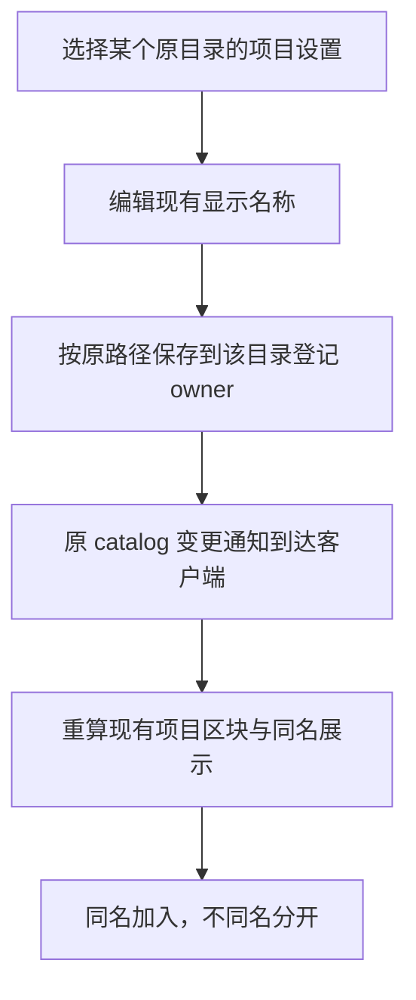

# 项目归并最小改动方案：同仓库沿用，同显示名称补充归并

- 状态：用户授权后已实现，并完成隔离 Electron、SSH 传输与移动端模型验证；用户当前安装的 App 未替换，在线名称未修改。
- 本地文件：`docs/issue/侧栏项目合并/solutions/项目分组最小改动方案-10-23.md`。
- 作者：Codex；来源：[当前需求 REQ-611 至 REQ-615](../requirements/requirement.md)、用户提供的“项目设置 → 身份 → 显示名称”截图与“重名合并，改名分开”。
- 决策：[Journal D-005](../journal.md#d-005-复用显示名称归并改名解除同名归并)；源码背景：[现状调研](../research/项目目录工作区与属性归属现状.md)。
- 飞书：未关联；按用户指定在仓库内维护。此前原生归属迁移和人工成员名单建议均保留为历史，不再实施。

## 1. 用户规则与实际效果

**保留已有的同仓库自动归并，再把显示名称相同的项目在侧栏放到一起。想解除同名归并，就修改已有“显示名称”。不增加成员名单或合并设置。**

这里的目录就是电脑上实际存文件的文件夹；侧栏项目是 Orca 将相关目录和工作区组织在一起的界面项。归并后继续选择原电脑上的原工作区，没有共同文件根目录。

### 1.1 workspace 现在为什么没有合并

改造前代码依据仓库身份产生项目 ID，不依据显示名称合并。三个普通目录没有共同的 Git 仓库身份，各自回退到 `repo:<自己的目录登记ID>`，因此本机和 mini 即使都叫 workspace，也仍分开。dbox 原来借 upstream 归到 orca，先前按用户授权独立后也回到自己的项目。

本次会话已取得的配置如下；本轮不再次访问 App 或改名：

| 电脑      | 真实目录路径                         | 当前显示名称 | 本方案启用后的效果                                        |
| --------- | ------------------------------------ | ------------ | --------------------------------------------------------- |
| Local Mac | `/Users/bytedance/workspace`         | workspace    | 与 mini 同名，自动放在一项下                              |
| mini      | `/Users/bytedance/workspace`         | workspace    | 与 Local Mac 同名，自动放在一项下                         |
| dbox      | `/home/zhangchao.zc/orca/workspaces` | workspaces   | 名字多一个 s，仍单独显示；把显示名称改成 workspace 即加入 |

所以实际配置只需把 dbox 的**显示名称**从 workspaces 改成 workspace。磁盘路径 `/home/zhangchao.zc/orca/workspaces` 保持原样。当前安装版本尚无新的同名归并规则，单独改名还不能代替功能实现。

### 1.2 之后如何加入与分开

```text
三个显示名称都为 workspace：         把 dbox 显示名称改为 workspace-dbox：

workspace                          workspace
  workspace [Local Mac]              workspace [Local Mac]
  workspace [mini]                   workspace [mini]
  workspaces [dbox]                 workspace-dbox
                                     workspaces [dbox]
```

工作区名 workspaces 可以继续保留；它与设置中的项目显示名称是不同属性。加入、改名、分开都复用原来的改名入口，不需要“新建合并”“选择成员”或“解除绑定”操作。

**改名解除的是同名产生的展示归并。** Movo 这类原本就按同仓库合在一起的项目，继续按原规则处理，单改一端名称不用于强行拆散同仓库关系。

## 2. 为什么这是当前需求下更合适的方案

它直接表达用户已经确认的习惯：同名意味着希望放在一起，改名意味着希望区分。数据里已有显示名称，UI 已有编辑入口，远端已有保存和通知链路，无须再维护名称、分组 ID、成员名单等两套信息。

它适合本次侧栏组织需求，并不宣称名称是通用业务身份。不同仓库若同名，也会合并展示，这是用户指定的规则；需要区分时改显示名称。底层业务继续按原 ID、原主机和原目录识别，不把可改的名字当成执行或权限边界。

与上一稿相比，撤回 `Repo.projectBinding`、原生项目 ID 迁移、WorktreeMeta 项目引用修复、运行偏好迁移、AI Vault 重新分类、跨主机归属事务，以及 `sidebarProjectMerges` 人工成员名单建议。

## 3. 归并依据与优先级

### 3.1 第一阶段完全复用原逻辑

[project-host-setup-projection.ts](../../../../src/shared/project-host-setup-projection.ts)继续按现有顺序读取 upstream、GitHub 来源图标、Git remote 等元数据，生成原生仓库项目；没有仓库来源时回退自身 Repo ID。Movo、GitLab、内部 Git、fork 与主机/路径的原有处理均不改变。

[project-section-grouping.ts](../../../../src/shared/project-section-grouping.ts)继续产生原项目区块，保留同一主机多个独立 checkout、WSL surface 等原有拆分例外。不能先取消这些例外，再以“同仓库”概括为全部强制合并。

### 3.2 第二阶段仅组合展示区块


比较的是第一阶段区块的**有效显示名称**：

- 单目录项目使用用户截图中的 `Repo.displayName`。
- 已按同仓库归并的项目使用原逻辑已经选出的项目头名称；不改变现有多端标题来源，也不把其他副本的别名当成额外归并键。
- 只去除首尾空白，其他字符精确比较。workspace 与 workspaces、workspace 与 Workspace 不同；空名和无法解析的占位名称不触发新归并。
- 不读取磁盘文件夹 basename 代替显示名称，不按路径相似度或仓库名字片段归并。
- 原有为区分同一执行面上的独立 checkout 而产生的保护性分区仍保留；名称补充归并不能绕过它。普通目录和不同原项目的同名区块可参与，未命中名称条件的区块原样返回。

先完成原有自动区块，再按区块的一个有效名称归并，避免链式误并。例如同一仓库的两个副本分别保存 Alpha/Beta，不能因此把另一个叫 Beta 的仓库自动串入一个标题为 Alpha 的区块；第二阶段只认当前实际显示的那个名称。

两个不同原生项目名称相同，表示可合并展示，不表示它们共享 Git 仓库、账号、任务来源或项目设置。

### 3.3 展示键和原身份分开

多个区块同名时可派生 `sidebar-name:<编码后的名称>` 作为侧栏折叠/显示定位键。它由名称计算，不单独保存成员或生成共同业务 Project ID；一个区块时继续复用原键。

展示输出保留来源区块、原项目/主机/setup/repo 与原工作区行引用。不创建伪造的业务 Project，不修改 `setup.projectId`、`worktree.projectId`，也不把展示键传给新建工作区、终端、设置或 Git 接口。

现有同仓库多端名称不一致时，改其中一端会按原来的标题选择逻辑刷新；新功能不承诺跨主机统一改名。三个 workspace 各自是单目录项目，不存在这一标题来源歧义。

## 4. 会影响哪些逻辑

| 行为                           | 新增影响                                                               | 保留的依据                                                   |
| ------------------------------ | ---------------------------------------------------------------------- | ------------------------------------------------------------ |
| 侧栏项目头与工作区行位置       | 同名区块合为一个头，原行放在该头下                                     | 原工作区内容、host/repo/worktree 身份不变                    |
| 项目排序、分组内顺序           | 合并头沿用原区块中最靠前的排序位置；成员沿用现有排序                   | 不重写原 manualRepoOrder、工作区排序或顶层 ProjectGroup 归属 |
| 折叠与展开                     | 同名区块共用一个展示折叠键；首次合并时，全部来源都折叠才折叠，否则展开 | 改名拆开后按原区块偏好显示，不改归档/固定状态                |
| 键盘上下导航、“显示活动工作区” | 跟随新的显示区块顺序和定位                                             | 活动选择仍使用原工作区/tab，不丢当前会话                     |
| 活动数量、过滤后可见行         | 在同名头下展示来源区块按原规则得到的结果                               | 原任务、归档、固定、lineage occurrence 和过滤条件不扩大      |
| 项目头菜单、改名与设置         | 多来源时列出原目录的电脑/路径，让用户选择要操作的那一个                | 不默认拿第一个成员作为全部成员的执行目标                     |
| 移动端侧栏                     | 支持新算法的手机同名归并；旧版继续原布局                               | 原 catalog 与工作区操作标识不改变                            |

改名自身继续触发原有显示名称更新：设置页、项目标题和原来使用该名称的标签会更新。这是既有改名行为，新归并逻辑不改变该字段的存储职责。

以下逻辑不因同名归并修改：文件路径和内容、终端进程/cwd/环境变量、工作区/实例/会话/tab/PTY ID、Git remote/upstream/分支、PR/MR/provider/账号、任务来源、AI Vault 分类与搜索范围、快捷命令匹配、自动化归属、hooks/orca.yaml、Git 用户名、工作树根及 Windows/WSL 运行偏好。

这些功能继续按原生身份计算；不能把同名侧栏组合结果注入它们的 catalog 或 scope。底层原生 Project ID 继续各自保留，是控制影响面的技术边界，用户只需要操作现有显示名称。

## 5. 用户操作与保存在哪



沿用当前设置页的保存机制、校验、失败提示和 owner 路由，不新增分组数据库、配置字段、后台服务或生产端口。

| 场景           | 名称保存 owner                                           | 文件与执行 owner |
| -------------- | -------------------------------------------------------- | ---------------- |
| 本机目录       | 当前管理该登记的本机 profile                             | 原本机工作区     |
| 配对 mini/dbox | 对应 runtime 管理的目录登记 profile                      | 对应原执行主机   |
| SSH 目录       | 现有 catalog owner：managed runtime 或遗留桌面登记 owner | 原 SSH 执行主机  |
| 手机修改/显示  | 复用手机已有设置与 catalog 来源                          | 原工作区目标     |

同名头下点击设置或改名时列出具体目录，选择后打开原设置页。只修改选中的登记，不自动给组内所有主机改名。空名、无权限、保存失败或主机不在联系中，继续按原设置逻辑处理，不伪装为已改名成功。

远端只在共享连接层认定可达时读取；失联使用已有缓存并保留原不可用状态。同名归并只消费现有通知，不重连、不新增轮询，也不据此判断终端退出。

## 6. 最小接缝、旧原型与兼容

| 模块                                                    | 本期处理                                                                          |
| ------------------------------------------------------- | --------------------------------------------------------------------------------- |
| 原生 Repo/Project/setup 生成与持久化、repo/worktree RPC | 算法和业务数据不改；改名继续用原入口                                              |
| `src/shared/sidebar-project-merge/`                     | 在已有 feature-owned 路径实现纯显示名称组合；输入原区块，输出展示区块与原来源引用 |
| 侧栏项目区块与 WorktreeList 接缝                        | 原生 ownership/过滤计算完成后，接入展示组合；原行及操作目标保留                   |
| `rendered-sidebar-worktree-order`、活动工作区 reveal    | 消费同一展示结果，保证渲染、导航、定位一致                                        |
| 手机侧栏计算                                            | 复用同一名称规则；现有项目名称/成员信息已足够，不新增归属协议或改变 wire ID       |
| 旧人工合并设置与 `sidebarProjectMerges`                 | 从新主链路退出，不另做成员编辑页；旧 payload 不自动清除，保留回退资料             |

[旧原型](../../../../src/shared/sidebar-project-merge/sidebar-project-merges.ts)会用人工成员配置生成 `sidebar-merged:*` Project 并复制 setup 改写项目 ID；该方式不用于本稿。名称组合应留在视图区块层，尤其不能改动 `buildProjectOwnershipIndex` 等被业务语义复用的原归属索引。

实施已先更新 fork registry 和架构策略，登记名称组合与目录选择器接缝；旧专用设置和同步门从活动链路退出，旧持久化字段及兼容测试保留。没有删除用户 payload 或迁移业务身份。

旧远端已有显示名称及原 catalog 能力，无须为名称归并升级身份算法；负责渲染的客户端/手机需要新逻辑。旧客户端仍显示原分区，数据可正常往返；不向旧端发送伪造原生项目或新 stream opcode。客户端和远端版本不齐时，改名遵循原接口的支持情况。

macOS、Linux、Windows/WSL 和 SSH 使用相同字符串规则，不用路径分隔符判定名称。旧 ProjectGroup/FolderWorkspace 继续各自的归属，不能仅因也有“项目”一词而统一迁移。

## 7. 异常与验证范围

| 情况                     | 预期                                                       |
| ------------------------ | ---------------------------------------------------------- |
| 名称不同、空名或占位数据 | 返回原区块，不增加业务请求                                 |
| 不同仓库同名             | 按用户规则合并展示；菜单操作仍区分原仓库                   |
| 同仓库但名称不同         | 保留原自动归并及原有例外，不以改名强行拆仓库               |
| 改名后归并键变化         | 重算展示，不改变当前工作区选择和终端实例                   |
| 主机断联/保存失败        | 保留原缓存或原名称并显示既有错误，不主动重连或偷偷改其他端 |
| 升级前存在人工合并记录   | 不作为新名称规则的隐形覆盖，也不自动删除 payload           |

实现后的验收重点：

- REQ-611、REQ-612：本机与 mini 的 workspace 先归并；dbox 的 workspaces 在改为 workspace 后加入，改为 workspace-dbox 后分开。路径和工作区名分别保留。
- REQ-614：Movo、GitHub/GitLab/内部 Git/fork 原自动结果不变；同主机多 checkout、WSL 等原保护分区不被同名规则取消；不存在任意别名串组。
- REQ-613/615：组合前后原生 Repo/Project/setup/WorktreeMeta、原实例/会话/tab/PTY 和业务请求目标比对一致。原已有名称变更只改变原来允许变的显示字段。
- REQ-615：项目头、排序/折叠、导航/reveal、计数/过滤、设置目标、手机布局分别验证；AI Vault、快捷命令、自动化、Git 与运行偏好继续使用原 scope。
- Local 与真实 SSH 的 Git/普通目录、断联及客户端/远端混合版本必须覆盖；后台启动隔离 App，以 CDP 截图采证，不操作用户当前窗口。证据位于 `.docs/<topic>-ui-validation/<date>/`。

当前验证见[TC-611 至 TC-617](../tests/cases/同显示名称项目归并.md)和[本轮 Test Run](../tests/runs/2026-10-23-同显示名称项目归并.md)。已通过 257 项根项目回归、48 项移动端模型测试及 2 项隐藏 Electron 场景；真实 SSH 转发覆盖普通目录和 Git 的展示与原执行目标。三主机场景使用显式夹具，未连接用户的 mini/dbox；手机原生 UI、新 SSH 服务安装、异机网络故障和所有旧版本二进制组合不在本轮实机覆盖内。此前 dbox 工作区旧 projectId 的一致性问题仍作为已有缺口保留，不在本功能中改数据库修复。

实现位置：共享名称组合在 `src/shared/sidebar-project-merge/sidebar-project-name-groups.ts`；`project-section-grouping.ts` 保留原生索引并在展示阶段组合；桌面项目头使用 `SidebarProjectNameActions.tsx` 选择原电脑/目录；移动列表复用同一共享规则。原仓库身份算法和 RPC 归属协议未改。

诊断记录名称归并前后区块数、计算耗时与改名保存结果即可；不增加遥测服务或记录终端正文。回退时移除新增的同名组合步骤，保留用户通过正常设置保存的显示名称，原归属数据没有迁移可回滚。

## 8. 变更记录

| 日期       | 来源                                         | 变化与影响                                                                                              |
| ---------- | -------------------------------------------- | ------------------------------------------------------------------------------------------------------- |
| 2026-10-23 | 用户要求少改原逻辑                           | 讨论展示层补充，保留仓库自动归并                                                                        |
| 2026-10-23 | 用户指定截图中的显示名称，重名合并、改名分开 | 采用 D-005：不加成员名单，使用现有有效显示名称；列清现状、优先级、受影响 UI 与原业务边界                |
| 2026-10-23 | 用户授权实施                                 | 名称组合、目录操作选择器、导航/折叠和移动列表实现；完成单测、类型与隐藏应用验证，记录实际覆盖及部署边界 |
