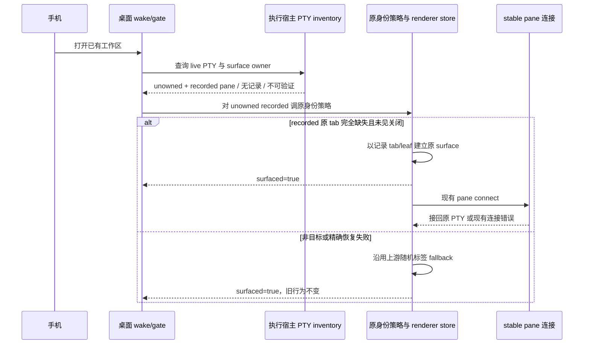
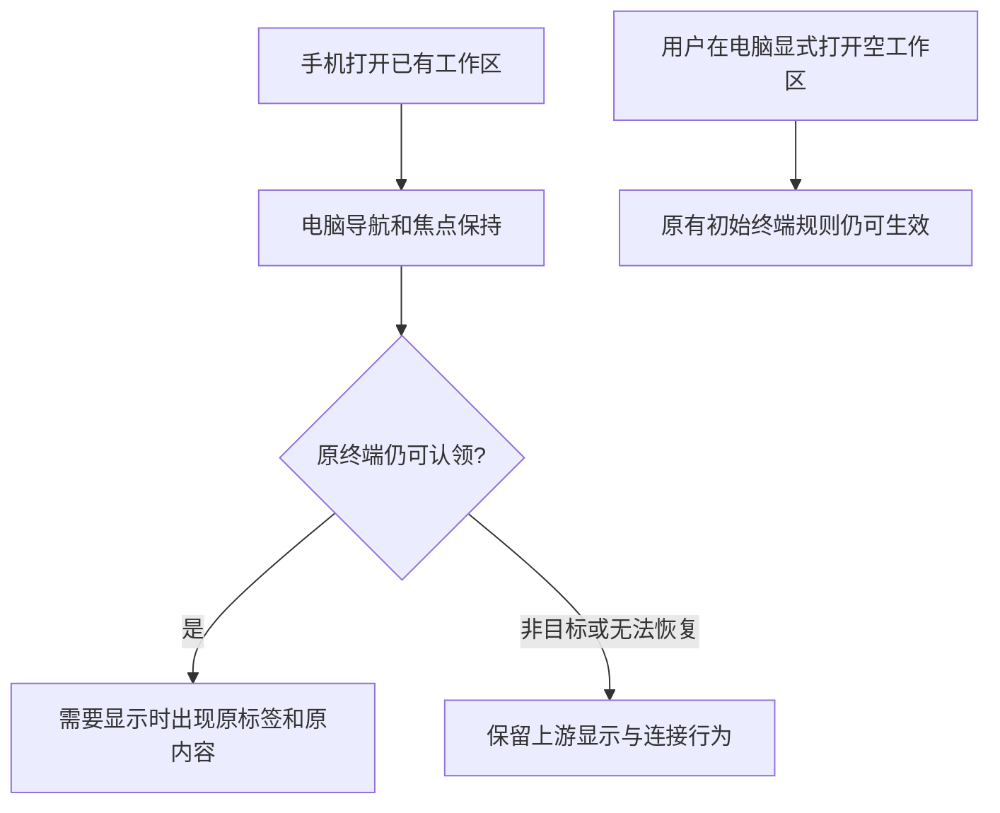

# 手机工作区原终端身份恢复方案

## 0. 摘要

本稿是临时止血方案，基于当前 Fork integration `f3a9db157f`。手机后台打开已访问工作区时，宿主仍有 live PTY 及原 tab/leaf 记录，而桌面 renderer 缺原标签；现有认领兜底用随机 tabId `createTab(initialPtyId)`，本机数字 PTY 随后可能新开空 shell。上游 `79b87c4f7c` 的三组本机对照显示：发布版三次新增三个 shell，布局 owner 暗开关版无增生但立即桌面 reveal，单文件实验补丁版按原 tab/leaf 接回且无增生。证据范围见[调研](../research/手机激活终端认领证据.md)。

本轮将原 10 文件方案收缩为**一个上游产品接缝加 feature-owned 策略**：仅在宿主给出 live recorded pane、桌面完全缺原 tab 且关闭镜像未命中时，新增按原 tab/leaf 恢复的分支。原 `bindToRecordedSurface` 以及无 recorded、冲突、原 leaf 缺失、跨工作区等非目标情形的随机 fallback 保持上游行为。Claude 代码 review 用 daemon 实测证明旧随机标签可接回同一 PTY，因此先前“其他情况一律 decline”的建议已被反证。本机 numeric PTY 在不可恢复时仍可能沿旧路径产生空 shell，是明确残留。复用现有 stable pane，不新增 RPC、IPC 字段或布局 owner 暗开关。最终防御代码快照已获指定 Claude **APPROVE（0 P0、0 P1）**，范围和哈希见[最终报告](../../../../.docs/mobile-terminal-surface-recovery-ui-validation/2026-10-24/evidence/claude-code-review-final.md)与同目录 `code-review-manifest-final.json`；方案 `approved` 只代表该窄版设计/代码 review，Journal 仍 `testing`，宏观 REQ-001～006 未全量验收。

## 1. 目标与边界

- 对应[REQ-001～REQ-006](../requirements/手机打开工作区终端身份恢复.md)：目标 recorded pane 的首次恢复不因新分支铸造替代身份；原 tab/leaf、PTY/PID 与健康 sibling 连续；其余旧路径不宣称全量修复。
- 保留 background 创建时不即时桌面 reveal 的既有行为。后续 wake 或用户显示时可一次补回合法原标签；不改变电脑导航与焦点。
- **收窄 REQ-006**：新增原身份分支不引入第二 writer；非目标 fallback 保持上游。普通 deferred connect 的 unknown、无 PTY id、冷恢复 `--resume` 与本机 numeric 不可恢复时的旧空 shell 风险均不在本次止血改动内，不声称全局 no-fresh。
- 曾建议非目标统一 `declinedPtyIds`/`surfaced=false`，但 gate 可把它变成 `empty`：显式桌面激活可另 seed，手机后台 wake 不消费 `empty`，却可能在 gate 前挂载或在 gate 内 resume。daemon 实测还证明旧 fallback 能接回原进程。故本轮保留非目标路径的 `surfaced=true` 与随机 fallback；调用方边界仍需端到端验收。
- 现行 SSH runtime/orcad 工作区因 `runtimeEnvironmentId` 不进该 PTY gate；隔离实测已覆盖 Git worktree 与 folder repo 各三次 mobile E2EE executionHost 激活，远端原 PTY/incarnation 保持、本机和远端均无新 PTY。独立 `folder:<id>` 的 activate 被既有 `selector_not_found` 跳过，不能记为恢复分支通过；可能留存的直连 `ssh:` relay 真机仍未测。远端文件、PTY 与进程由执行主机拥有，不把失联当退出。

## 2. 现状、复用与设计原则

`worktree-agent-live-surface-adoption.ts` 已有 `bindLivePtyToExactSurface`、`adoptHostOwnedSurface` 和 `declinedPtyIds`，主进程 stable pane 已按原 owner、incarnation 接回。可直接复用这些入口，不平行开发 owner、session 库或连接协议。缺口在 `unowned + recorded` 的 renderer fallback：原 `bindToRecordedSurface` 要求旧 tab 已存在，失败后仍随机 `createTab(initialPtyId)`。

上游实验 `stopgap-experiment.patch` 在本机命中原记录时有效，未命中时保留随机 fallback。Claude 代码 review 的[daemon 对照](../../../../.docs/mobile-terminal-surface-recovery-ui-validation/2026-10-24/evidence/claude-code-review.md)证实旧 fallback 对 daemon 可以 `isReattach:true` 接回同一 PTY、无新增进程；此前派生的“非目标全部 decline”已撤销。策略放在 `src/renderer/src/mobile-terminal-surface-recovery/`，上游文件只作新增分支接线。owned 路径、唯一产品 seam、测试 seam 与实际依赖登记于 `config/fork-features.jsonc`。

主进程 `assertPaneStillExists`、`ptyBindingIsRefused` 在连接或绑定阶段检查关闭，不能倒推 renderer 建标签前的原子许可。renderer 的关闭镜像可降低误恢复，但可能陈旧；关闭竞态若实测失败，应只按失败点增最小接缝并重新评审，不回到旧 10 文件方案。

## 3. 交互链路

### 3.1 系统交互



### 3.2 用户动线



## 4. 改动与模块契约

```text
src/renderer/src/mobile-terminal-surface-recovery/
  recorded-live-terminal-surface.ts       [新增] 原 recorded surface 的准入与结果
  recorded-live-terminal-surface.test.ts  [新增] 原身份准入与不命中边界
src/renderer/src/lib/
  worktree-agent-live-surface-adoption.ts [修改] 唯一产品接缝，仅加缺原tab分支
  worktree-agent-activation-gate.test.ts  [修改] 只改缺原tab那一例的期望
```

| 模块                     | 输入与职责                                                                                          | 输出和依赖                                                                                            |
| ------------------------ | --------------------------------------------------------------------------------------------------- | ----------------------------------------------------------------------------------------------------- |
| feature-owned 原身份策略 | 工作区、宿主 `recorded`、renderer 关闭镜像与既有精确绑定回调；核对 paneKey/tab/leaf、关闭记录和占用 | 仅决定是否按原身份恢复；复用 `parsePaneKey`、`hasClosedTerminalTabRecord` 与现有 binder，不访问新 IPC |
| 上游 adoption 接缝       | 原 `bindToRecordedSurface` 优先；仅 recorded tab 完全缺失时尝试新增策略                             | 成功接回原 tab/leaf；不命中即沿用上游 `surfaced=true` 和随机 `createTab(initialPtyId)`                |
| gate 与调用方            | 继续使用现有 `adopted`/`empty`/`blocked`、resume、seed 规则                                         | 本轮不改 gate 产品代码；验证目标分支无新 writer，非目标 daemon 不被藏起来                             |

同数字 PTY ID 不足以证明同一会话；只接受宿主记录的 pane 身份和现有 owner/route 约束。策略不持久化新的状态、修订号或关闭表，不触碰 `terminal.adoptOrphans` 的旧客户端合同。原窗格成功恢复后依旧由 main stable pane 执行 attachOnly/incarnation 和关闭校验。

## 5. 失败、兼容与后续演进

| 情形                                              | 本轮行为                                  | 待验证风险                                                                                |
| ------------------------------------------------- | ----------------------------------------- | ----------------------------------------------------------------------------------------- |
| 无 recorded pane / 冲突 / 原 leaf 缺失 / 跨工作区 | 原身份新分支不接管，沿用随机 fallback     | daemon 旧行为可接回同 PTY；本机 numeric 可能留下旧空 shell                                |
| renderer 已见原 tab/pane 关闭                     | 原身份新分支不接管，沿用上游路径          | 镜像迟到时可能先短暂出现幽灵标签；other-client close-never-shown 需实测 main 最终成员关系 |
| 同一 tab 的多 leaf 分到不同 sweep                 | 首轮可按原身份恢复；后轮沿用上游 fallback | 不声称跨轮补齐同一 tab；记录标签与 PTY 结果                                               |
| SSH runtime/orcad                                 | 现有路由不进入本 gate                     | Git/folder repo 实测安全；独立 folder selector 跳过，SSH UI 映射未全测                    |
| 遗留直连 SSH relay                                | 若实际进入 gate，按同一策略处理           | host 分区、关闭镜像和执行主机原 PTY 要单独验证                                            |
| 普通连接 unknown / 无 ID / 无回放                 | 维持现状，不在本次策略中处理              | 已知第二 writer 风险另列后续任务，不把本轮判全量完成                                      |

不通过功能自己重连、定时轮询或读取失联 host。此临时接缝的**删除条件**是上游主进程布局 owner 正式翻转到可发布构建，且本机、folder、SSH、关闭与迁移场景完成实际验收；上游 PR 合入或暗开关构建通过本身不足以删除。

## 6. 验证、风险与评审

正式规格见[测试用例](../tests/cases/手机终端原身份恢复.md)，每条关联 REQ；实际结果与截图、进程/PID、PTY 列表及日志留在 `.docs/mobile-terminal-surface-recovery-ui-validation/2026-10-24/`，并由 Journal 引用。至少覆盖：本机已访问 folder 三次、daemon 非目标 fallback、Git 和独立 folder、other-client close-never-shown、冲突/原 leaf 缺失/跨工作区、同 tab 多 leaf 跨轮、显式桌面与手机后台、保存/重启、SSH runtime/orcad 与遗留 relay，以及混合版本。关闭竞态需同时观察 UI 标签是否短暂出现及主进程最终成员关系/关闭记录，不能只看最终 shell 数。

产品代码与测试完成后运行 `pnpm tc`、本功能 checks、`pnpm check:architecture-policies`、`pnpm check:fork-features`、`pnpm check:fork-docs`、三项本地化检查；以当前 integration 基线比较，不沿用旧 13 条架构失败记录。最终 Claude 代码 review 已通过；本机有效 recorded 单 pane、正常先关后开、SSH runtime Git/folder 的实际证据由 Journal 按 TC 粒度记录。legacy relay 真机、mixed peer、list→bind 微竞态、多 leaf 与所有普通连接异常未因局部通过而变成 PASS。

## 7. 变更记录与引用

- 2026-10-25：第 2 轮 Claude 代码 review APPROVE，第 3 轮针对 `isValidHostTerminalTabId` 防御维持 APPROVE；最终源码哈希与 manifest 一致，剩 P2-4 同 tab 多 leaf 的本机 numeric 残留。方案状态转 `approved`，整体仍 `testing`，实际验证按窄版 slice 计。
- 2026-10-25：首轮 Claude 代码 review 给出 REQUEST_CHANGES（0 P0、1 P1、3 P2）；daemon 上游实测推翻非目标全部 decline 的建议。本稿收窄为只新增缺原 tab 的恢复分支，保留其他随机 fallback；关闭镜像迟到与跨轮多 leaf 明列风险。
- 2026-10-24：原 10 文件方案获第三轮设计批准后被原评审人撤回；旧稿快照保存在 ignored 验证证据目录。依据上游三组对照和调用方反证，启动原身份止血方案；实施与测试由用户授权。
- 事实与限制：[调研](../research/手机激活终端认领证据.md)、[需求](../requirements/手机打开工作区终端身份恢复.md)、[Journal](../journal.md)。
