# 手机终端原身份恢复测试用例

本文件是长期测试规格，不记录本轮 PASS/FAIL。执行环境、源码提交、脚本、截图、PTY/PID 和每个实例的结果另存验证证据。`ready` 仅表示用例已列明输入、步骤和判定；旧 peer 构建及实际夹具须在对应执行记录中冻结，规格就绪不代表验收通过。

## 1. 范围与依据

- 当前临时修复范围：[REQ-001～REQ-006](../../requirements/手机打开工作区终端身份恢复.md) 与[方案](../../solutions/手机工作区原终端身份恢复方案.md)；重点是有效 recorded 且桌面缺原 tab 的新分支，以及非目标上游 fallback 不回归。
- 共同前置：`ORCA_BACKGROUND_LAUNCH=1` 隔离实例、隐藏 renderer/CDP；SSH 用[仓库 SSH 实例指南](../../../../reference/ssh-real-app-validation.md)的 root sshd `127.0.0.1:2222`。真实用户 app/终端不作为夹具。
- 每次记录：窗口图、tab/leaf、PTY id/incarnation、执行主机 PID、`pty:spawn` 与 shell 数、renderer 可见标签及导航/焦点。等待 host inventory、gate 和最终图更新的完成信号；执行器防挂上限单步 30 秒，超时记 BLOCKED 并保存原始事件，不自动判产品失败。
- 当前范围外：普通 deferred connect unknown/无 ID/无回放的通用冷恢复异常，另立后续任务；本轮只验证此次原身份兜底及其直接调用方。无真实 Claude/Codex 账号配置修改。

## 2. 覆盖映射

| 检查点                                                   | 需求/依据               | TC     | 未覆盖原因及影响                                           |
| -------------------------------------------------------- | ----------------------- | ------ | ---------------------------------------------------------- |
| 本机已访问工作区重复手机打开、reload 后原身份与 shell 数 | REQ-001/002，方案 §1/§4 | TC-001 | -                                                          |
| 静止内容、后续输出与 writer 连续                         | REQ-002                 | TC-016 | 当前本地三次/reload 证据未逐项断言                         |
| Git 与独立 folder 工作区入口                             | REQ-001/005             | TC-002 | -                                                          |
| 无 recorded 的 daemon fallback 与显式桌面路径            | REQ-006，方案 §1/§5     | TC-003 | -                                                          |
| 手机先关闭从未显示的 tab，再重复激活                     | REQ-003/006             | TC-004 | -                                                          |
| list→bind 微窗口关闭竞态                                 | REQ-003/006             | TC-012 | 当前正常先关后开证据不覆盖                                 |
| 桌面显示后关闭并重复手机激活                             | REQ-003/006             | TC-013 | -                                                          |
| 冲突时保留 fallback、split sibling、保存重启             | REQ-002/003/006         | TC-005 | -                                                          |
| SSH runtime/orcad Git/folder 路由与 PTY 连续             | REQ-004/005             | TC-006 | -                                                          |
| SSH runtime 的手机/桌面 UI 映射                          | REQ-002/005             | TC-017 | 当前 SSH 证据聚焦执行宿主列表与 PTY，不含完整 UI 显示断言  |
| SSH 独立 folder 的 activation selector 兼容              | REQ-005                 | TC-014 | 当前 `selector_not_found`，未进入目标恢复分支              |
| 遗留直连 relay 与失联                                    | REQ-004/005/006         | TC-007 | -                                                          |
| 完整配对后台创建/唤醒入口                                | REQ-001/002             | TC-008 | -                                                          |
| mixed peer 兼容                                          | REQ-005                 | TC-009 | 具体旧 peer 构建和能力矩阵待执行前冻结；该 TC 暂不能判就绪 |
| 本机 numeric 非目标 fallback 残留                        | REQ-001/006             | TC-010 | 已知旧行为，单列结果，不计为原身份分支通过                 |
| 同 tab 多 leaf 跨轮 sweep                                | REQ-002/006             | TC-011 | 本次实现不承诺修复，实测后按需求目标记录结果               |
| 同 tab 多 leaf 同轮 sweep                                | REQ-002/006             | TC-015 | Claude P2-4 指出本地 numeric 已知残留，当前未实测          |

## 3. 可执行用例树

### TC-001 本机已访问 folder 三次手机打开并 reload

- 关联需求：REQ-001, REQ-002, REQ-006
- 优先级：P0
- 分级依据：原故障核心路径，失败会反复新增空 shell。
- 预期来源：主需求 REQ-001/002/006；方案 §1、§4。

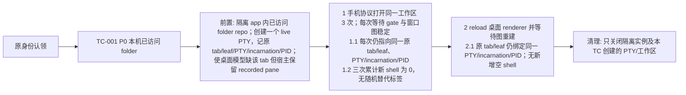

### TC-002 本机 Git 与独立 folder 入口

- 关联需求：REQ-001, REQ-002, REQ-005
- 优先级：P1
- 分级依据：两类常用工作区身份不能被 folder repo 对照替代。
- 预期来源：主需求 REQ-001/002/005。
- 参数实例：`git-worktree` 为 Git worktree；`folder-id` 为独立 `folder:<id>`。每个实例单独记录结果。

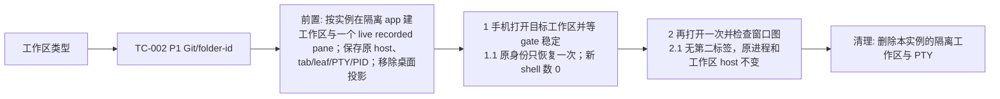

### TC-003 无 recorded 的 daemon 旧 fallback

- 关联需求：REQ-001, REQ-006
- 优先级：P1
- 分级依据：统一 decline 会把 daemon 上仍 live 的终端藏起来，是代码 review 已实测的回归。
- 预期来源：主需求 REQ-006；方案 §1、§5。

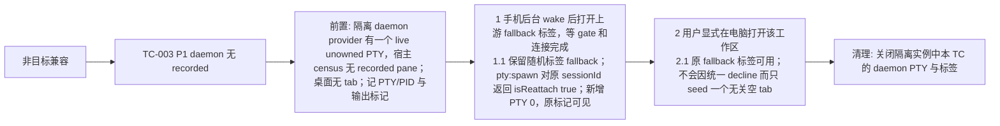

### TC-004 手机先关从未桌面显示的 tab

- 关联需求：REQ-003, REQ-006
- 优先级：P0
- 分级依据：已关闭终端复活违背用户明确意图，并可能启动替代进程。
- 预期来源：主需求 REQ-003/006；方案 §2、§5。

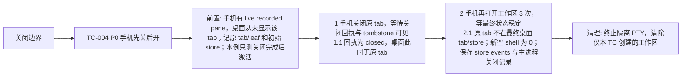

### TC-005 split 冲突与保存重启

- 关联需求：REQ-002, REQ-003
- 优先级：P1
- 分级依据：错误重绑可能覆盖健康 sibling 或在重启后重复标签。
- 预期来源：主需求 REQ-002/003。

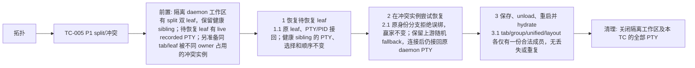

### TC-006 SSH runtime/orcad Git 与 folder 路由

- 关联需求：REQ-004, REQ-005
- 优先级：P1
- 分级依据：远端执行归属错误可在本机产生错误替代终端。
- 预期来源：主需求 REQ-004/005；方案 §1、§5。
- 参数实例：`ssh-git` 为 SSH Git worktree；`ssh-folder` 为 SSH folder workspace。每个实例单独记录结果。

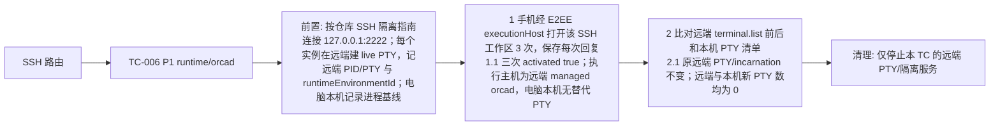

### TC-007 遗留直连 SSH relay 与失联

- 关联需求：REQ-003, REQ-004, REQ-005, REQ-006
- 优先级：P1
- 分级依据：旧 relay 仍可能进入 gate；失联时误判退出会生成第二进程。
- 预期来源：主需求 REQ-003/004/005/006。

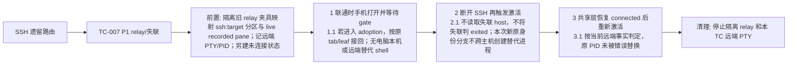

### TC-008 完整配对后台创建与 wake

- 关联需求：REQ-001, REQ-002
- 优先级：P1
- 分级依据：仅 `terminal.create` 的实验不能替代完整 agent 创建入口。
- 预期来源：主需求 REQ-001/002；方案 §1。

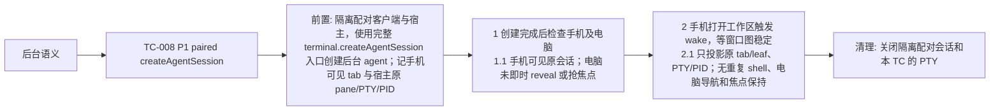

### TC-009 混合 peer 能力降级

- 关联需求：REQ-005
- 优先级：P2
- 分级依据：版本混用常见但本次不新增协议；需确认旧宿主仍按原合同工作。
- 预期来源：主需求 REQ-005。

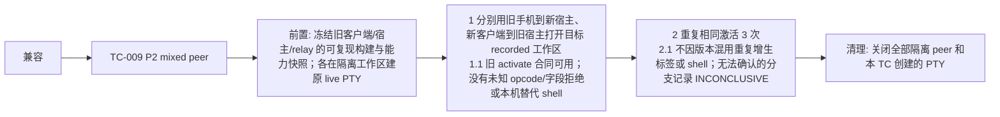

### TC-010 本机 numeric 的非目标旧 fallback 残留

- 关联需求：REQ-001, REQ-006
- 优先级：P1
- 分级依据：该路径可能重现空 shell，但属于此次精确身份分支之外的已知残留，必须量化而不能误报全量通过。
- 预期来源：主需求 REQ-001/006；方案 §1/§5 的非目标范围与 Claude 代码 review。

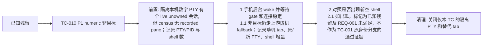

### TC-011 同 tab 双 leaf 分两轮被发现

- 关联需求：REQ-002, REQ-006
- 优先级：P2
- 分级依据：跨轮 split 较少见，但可能把第二 leaf 分到独立标签，影响原布局连续性。
- 预期来源：主需求 REQ-002；方案 §5 的已知边界与 Claude 代码 review P2-3。

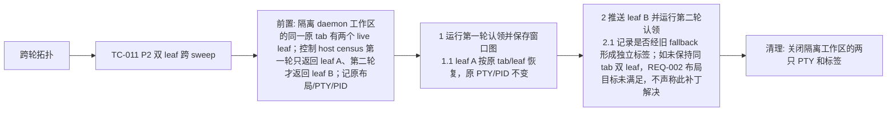

### TC-012 list→bind 间由另一客户端关闭

- 关联需求：REQ-003, REQ-006
- 优先级：P0
- 分级依据：微窗口可能把已关闭标签短暂写回 UI 或主会话，涉及用户明确关闭意图。
- 预期来源：主需求 REQ-003；方案 §5 的关闭镜像风险。

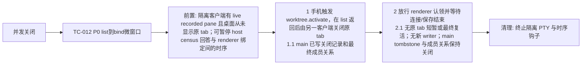

### TC-013 daemon 原标签关闭后重复手机打开

- 关联需求：REQ-001, REQ-003
- 优先级：P1
- 分级依据：已显示的 daemon 标签关闭后不得被后续激活重新带回。
- 预期来源：主需求 REQ-001/003；方案 §5。

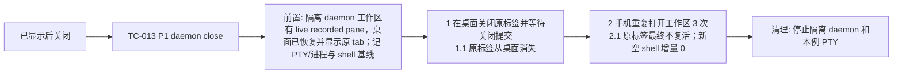

### TC-014 SSH 独立 folder 的 selector 兼容

- 关联需求：REQ-005
- 优先级：P1
- 分级依据：独立 `folder:<id>` 是需求指定工作区形态，现有 selector 可能不支持激活。
- 预期来源：主需求 REQ-005；方案 §1 的 SSH 范围。

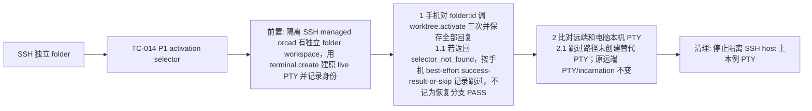

### TC-015 同 tab 双 leaf 同轮被发现

- 关联需求：REQ-002, REQ-006
- 优先级：P2
- 分级依据：本机数字 PTY 的第二个 leaf 可能沿旧 fallback 循环新开空 shell，是已知残留。
- 预期来源：主需求 REQ-002；Claude 代码 review P2-4；方案 §5。

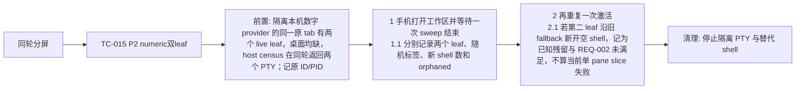

### TC-016 原会话内容与后续输出连续

- 关联需求：REQ-002
- 优先级：P1
- 分级依据：同 ID 但静止内容丢失或输出不再到原 pane，仍影响用户继续工作。
- 预期来源：主需求 REQ-002。

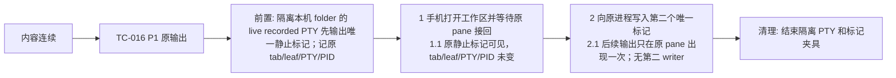

### TC-017 SSH 手机与桌面终端映射

- 关联需求：REQ-002, REQ-005
- 优先级：P1
- 分级依据：远端 PTY 未增生不能单独证明手机和桌面都能继续看到原内容。
- 预期来源：主需求 REQ-002/005。

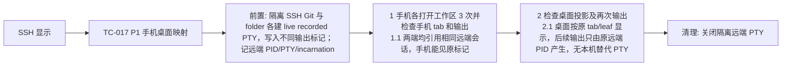

## 4. 交付检查

- 本次临时修复的本机、folder、daemon、SSH、关闭、调用方、配对来源和混合版本检查点均有 REQ 与 TC；普通连接 unknown 的后续任务未计入本次通过率。
- 规格统计：P0 3；P1 11；P2 3；P3 0。用例规格可用于后续执行，实际结果只在证据与 Journal 汇总；旧 peer 构建须在 TC-009 的执行记录中冻结，未执行实例不能判 PASS。
