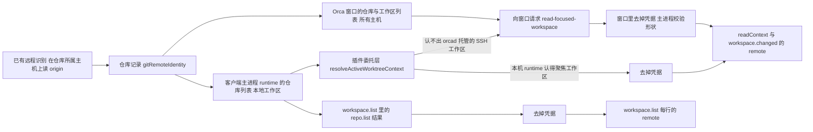

# 远程仓库字段方案

## 数据从哪来

仓库记录 `Repo.gitRemoteIdentity`（`{ canonicalKey, remoteName, remoteUrl }`）由已有的远程识别（`src/main/repo-git-remote-identity-enrichment.ts`）在仓库所属主机上读取后写入；`repo.list` 运行时方法返回的仓库对象里就带着它。本功能只读这份记录，不新增任何 git 读取。



本地工作区走上面那条：主进程 runtime 认得聚焦的工作区，委托层从它的仓库列表补 `remote`。

orcad 托管的 SSH 工作区（当前默认的 SSH 方式）归 SSH 主机上的 orcad 管，客户端主进程 runtime 里没有它的仓库和工作区，改动前 `readContext` 一直是 `null`。窗口则汇总了所有主机的仓库和工作区，所以本机 runtime 认不出聚焦工作区时，插件宿主沿用已有的「主进程问窗口」通道（`editor.open`、`commands.run` 用的那条）发 `read-focused-workspace`，窗口用自己的记录回答。

## 接口形状

```ts
remote?: { name: string; url: string }
```

- 加在 `pluginWorkspaceContextSchema`（`readContext` 结果与 `workspace.changed` 共用）和 `workspace.list` 的行上。
- 可选而不是可空：未知时不出现。现有插件和现有测试看到的结果完全不变；在旧版 Orca 上字段同样不存在，插件只需一种判断。
- host API 在 major 1 内只增不改，小版本号由各方法的 `since` 决定。本次只给已有结果加可选字段，不加方法、不动 `since`：fork 不占用上游下一个小版本号，同步上游时不会撞号。

## 改动点

| 位置                                                                                                                                                                                                                                       | 改动                                                                                                                                                                                                                               |
| ------------------------------------------------------------------------------------------------------------------------------------------------------------------------------------------------------------------------------------------ | ---------------------------------------------------------------------------------------------------------------------------------------------------------------------------------------------------------------------------------- |
| `src/shared/plugin-workspace-remote/plugin-workspace-remote.ts`（功能目录）                                                                                                                                                                | 字段 schema、从仓库记录到 `remote` 的投影与脱敏、按 worktree id 找仓库                                                                                                                                                             |
| `src/shared/plugins/workers/plugin-host-api.ts`                                                                                                                                                                                            | 上下文 schema 加 `remote`；该文件改动前已有 299 行有效代码（上限 300，仓库规定超限只能拆分），因此去掉一行等价别名 `workspaceReadContextResult`，`readContext` 直接引用 `pluginWorkspaceContextSchema`                             |
| `src/shared/plugins/workers/plugin-host-api-workspace-methods.ts`                                                                                                                                                                          | `workspace.list` 行加 `remote`                                                                                                                                                                                                     |
| `src/main/plugins/plugin-runtime-binding.ts`                                                                                                                                                                                               | 委托层的 `resolveActiveWorktreeContext` 用 `listVisibleRepos` 补上 `remote`；`readContext` 与 `workspace.changed` 都从这里取上下文                                                                                                 |
| `src/main/plugins/workers/plugin-host-service-bindings.ts`、`plugin-host-method-bindings.ts`、`plugin-workspace-projection.ts`                                                                                                             | 上下文类型加 `remote`，投影时原样带过                                                                                                                                                                                              |
| `src/main/plugins/workers/plugin-host-workspace-method-bindings.ts`                                                                                                                                                                        | 解析 `repo.list` 的 `gitRemoteIdentity`，为每个 worktree 行补 `remote`                                                                                                                                                             |
| `src/main/plugin-workspace-remote/plugin-focused-workspace.ts`（功能目录）                                                                                                                                                                 | 本机 runtime 认不出聚焦工作区时问窗口，投影成插件上下文，终端为空；没有窗口、窗口不答或答错都返回 `null`                                                                                                                           |
| `src/renderer/src/plugin-workspace-remote/plugin-focused-workspace.ts`（功能目录）                                                                                                                                                         | 窗口按 `activeWorktreeId` 找工作区记录和所属仓库，交出分支、显示名和去掉凭据的 `remote`；聚焦的是文件夹工作区或没有聚焦时答 `null`                                                                                                 |
| `src/main/plugins/workers/plugin-host-method-bindings.ts`、`src/main/plugins/plugin-runtime-binding.ts`                                                                                                                                    | `readContext` 与 `readPluginWorkspaceChange`（`workspace.changed` 和面板订阅回放共用）在本机上下文为空时调用上面的兜底；`agents.list`、`terminal.sendText` 不经过它                                                                |
| `src/shared/plugins/view/plugin-view-protocol.ts`、`src/main/plugins/view/plugin-view-reply-schema.ts`、`src/main/plugins/view/plugin-host-renderer-actions.ts`、`src/renderer/src/components/plugins/view/plugin-view-request-handler.ts` | 已有窗口请求通道加一种请求 `read-focused-workspace`，回复加可选 `workspace`，主进程的回复校验认这个字段（否则会被静默去掉）                                                                                                        |
| 生成物                                                                                                                                                                                                                                     | `docs/reference/plugin-host-api.md`、`resources/plugins/types/orca-host.d.ts`、`resources/plugins/declarative/orca.d.ts`、`skill-guides/orca-plugin-authoring/references/*`、`src/cli/bundled-skill-guides.ts`，由现有生成脚本产出 |

## 脱敏

复用 `src/shared/git-remote-error.ts` 的 `stripCredentialsFromMessage`：任何协议去掉 `user:password@`，HTTP(S) 去掉单独的 `user@`，SSH 的 `git@` 保留。去掉后为空或超长时不给字段。

## 由哪台机器执行

| 动作                            | 本地工作区                    | SSH 工作区（orcad 托管）                     |
| ------------------------------- | ----------------------------- | -------------------------------------------- |
| 读 origin（已有逻辑，非本功能） | 本机                          | SSH 主机上的 orcad                           |
| 仓库记录                        | 客户端主进程 runtime          | SSH 主机上的 orcad；客户端窗口里有它的副本   |
| 找聚焦工作区及其仓库            | 客户端主进程 runtime          | 客户端 Orca 窗口（渲染进程）                 |
| 去掉凭据                        | 客户端插件宿主（Orca 主进程） | 客户端 Orca 窗口；主进程按插件接口形状再校验 |
| 交给插件                        | 客户端插件宿主                | 客户端插件宿主                               |

本功能不执行命令、不发网络请求、不读写文件、不碰 `127.0.0.1` 端口与环境变量，也不连任何主机：窗口里的记录是它与主机保持联系时已经同步来的。SSH 断开不会触发重连或读取：窗口还列着这个工作区就照样给出，不列了就是 `null`。

没有窗口的无界面服务（headless serve）没有可问的窗口，SSH 工作区的 `readContext` 仍为 `null`。

## 没选的做法

- 新增方法 `workspace.readRemote`：要占用一个小版本号，与上游以后的新方法撞号；插件还要多一次调用。
- 让插件用 `terminal.create` 在工作区里跑 `git remote`：会在用户的工作区里凭空多一个终端，也违背「插件不自己连主机」。
- 交出完整 `gitRemoteIdentity`：`canonicalKey` 是 Orca 内部的比较键，不承诺对外格式。
- SSH 工作区由插件宿主直接调 SSH 主机上 orcad 的 runtime：等于新增一次主机读取，还要自己判断主机是否在联系中；窗口里已有同样的记录，不必再读。
- 把 SSH 主机上的工作区并进 `workspace.list`：列表里的 id 会被 `terminal.create`、`agent.launch`、`workspace.open` 拿去用，要先解决这些操作按主机路由，范围大得多；用户 2026-11-04 选定只补聚焦工作区。
- 兜底放进委托层的 `resolveActiveWorktreeContext`：`agents.list` 与 `terminal.sendText` 也走这里，会拿着 SSH 工作区的 id 去问本机 runtime 列终端、发输入，行为跟着变；只在 `readContext` 与 `workspace.changed` 两处兜底。
- 新开一条主进程到窗口的 IPC 通道：要改 preload 和窗口挂载点，接缝更多；已有通道本来就是插件宿主问窗口用的。
