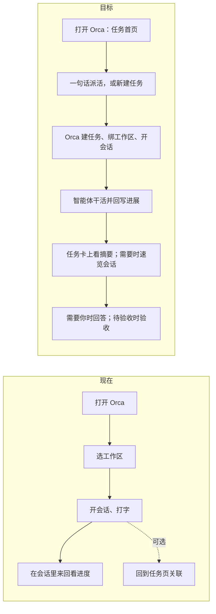
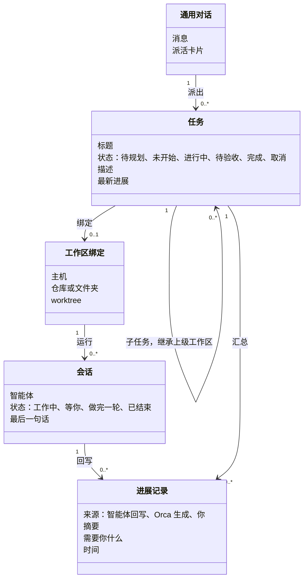
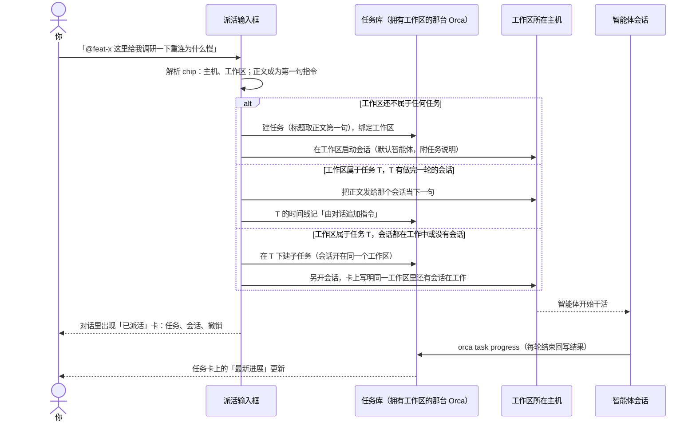
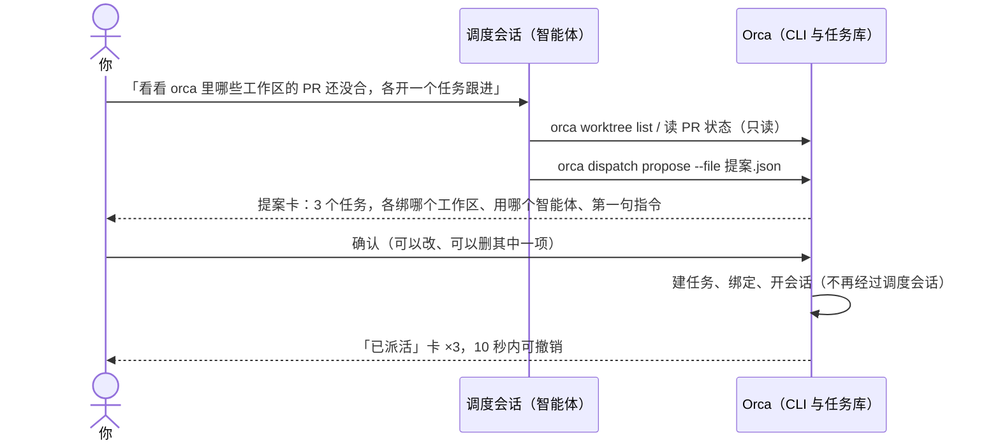
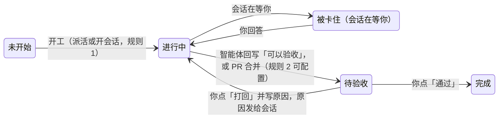

# 任务为主的工作流：产品方案

这份方案回应用户 2026-10-30 的要求：工作流要以任务为主，不再以对话为主。

- 进来先建任务，绑定工作区，启动会话；会话可以快捷查看，不想看时，任务下面就有进度摘要。
- 另外有一个通用对话，用来创建任务、开会话。例如在对话里 @ 某个仓库的某个工作区，说「这里给我调研一下 X」，Orca 就建一个任务、绑定这个工作区、在里面启动会话开始干活。

参考材料：

- Multica 调研：本机 `.docs/本地任务管理调研/2026-10-30-multica/README.md`；
- 本需求文档 `requirements/本地任务管理.md` 里的 REQ-001～REQ-025；
- Orca 现有机制的盘点，结论见 §11。

§12 的 11 个问题，用户 2026-11-01 已全部按默认做法确认。2026-11-02 的评审稿（`任务为主的工作流方案评审.md`）用户全部采纳，只改掉一处：任务模式里仍然用速览抽屉看会话，不改成「点会话就是标签」，因为后续要迁移到以任务为主的模式，任务视图不能长成工作区的样子。评审采纳的改动已并入本稿（§15 列了清单）和需求文档 REQ-026～REQ-030。代码等原型第二轮评审后再动。

## 1. 一句话

**任务是入口和记录，对话是手段。**

用户只做三件事：

- 说要做什么；
- 在智能体需要时回答；
- 验收。

开工、回写进展、提醒都由 Orca 和智能体完成，并记在任务上。

## 2. 为什么要改：现在是「对话为主」

| 现在                                                                               | 结果                                                   |
| ---------------------------------------------------------------------------------- | ------------------------------------------------------ |
| 打开 Orca，先看到的是工作区和会话标签。任务页是旁边的一个视图                      | 想知道「我手上有哪些事、各做到哪了」，要逐个点进会话看 |
| 要做一件事，常见做法是直接进工作区开会话、打字。建任务、关联是额外步骤，很多人跳过 | 事情只存在于对话里，过后找不到，也对不上账             |
| 任务上的进展只有会话状态点和智能体最后一句话                                       | 不看会话就不知道做成什么样                             |
| 没有不绑定工作区的对话入口。浮动终端是唯一近似的入口，而且只在本机                 | 「先说要做什么，再决定在哪做」做不到                   |

## 3. 设计原则（修订本需求的原则 2，待确认）

1. **任务优先**：任何会话都应属于某个任务。从通用对话或新建任务出发，任务和会话会一起建好。直接在工作区里开的会话，在任务模式侧栏的「未关联任务的会话」组里可以「记成任务」；会话头部不加入口（REQ-011 在 2026-10-30 定的，2026-11-02 评审后保持）。
2. **人说了才开工**：Orca 不因为状态变化、定时或主机恢复联系而自动开会话。派活一定来自用户的一句话、一次点击，或用户确认过的调度提案。
   - 这一点和 Multica 不同：它把「指派」当派发，由 daemon 排队认领。
3. **动作都留痕**：派活、开会话、回写、状态变化、验收，都在任务时间线上留一条记录，写明来源（你、手机、对话、智能体、规则）。
4. **进度只写明确的内容**：
   - 摘要来自智能体主动回写的结果；没有回写时，显示智能体每轮结束时的最后一句话（主机在会话每轮结束时落成一条「轮次结束」记录，见 §7.2）。
   - 让模型读会话再生成摘要是可选操作：用户点了才生成，并标明「Orca 生成」。
5. **完成由人定**：智能体最多把任务推进到「待验收」；标「完成」只能由人在桌面或手机界面上点。写入时的规则是「来自 CLI 的写入不能进入已完成类别」——CLI 分不清是人还是智能体在敲，所以把完成这一步只留给界面（2026-11-02 评审定）。
6. **不轮询、不重试、不排队**：主机不在联系时，派活和读取都不可用，并写明原因。恢复联系后只重读一次（AGENTS.md 的 Remote Host Reads）。
7. **本机、SSH、配对服务器、手机一视同仁**：任务存在拥有工作区的那台 Orca 上（D-008）。客户端在哪台机器上都能派活、看进度。

## 4. 对象模型

在现有模型（D-008）上的调整：

- **新增「进展记录」**：它是动态（REQ-005）的一种，只是在任务卡和详情顶部单独突出显示。
- **工作区和任务的对应关系不变**：一个任务最多一个工作区，一个工作区只属于一个任务（任意层级，D-008；2026-11-02 勘误：原文写的「顶层任务」和代码不符）。
  - 派活到一个已经属于任务 T 的工作区时：T 下有做完一轮的空闲会话，就把这句话发给它当下一句指令，不建任务，T 的时间线记「由对话追加指令」；没有空闲会话（都在工作中，或没有会话），才在 T 下建子任务、另开会话，并在卡上写明同一个工作区里还有会话在工作。详见 §6.3。
  - 子任务继承上级工作区，这是现有规则。这样不用放开「一个工作区多个任务」，也不会冲突。
- **任务建到哪个项目里**（2026-11-02 补）：工作区所在的仓库只挂在一个项目下就用它；挂在多个项目下，用最近派过活的那个，卡上可以改；一个项目都没挂时，派活卡先出一步「为仓库 X 建一个项目？」，确认后建项目再派（和 REQ-001 的推荐逻辑一致）。
- **新增「通用对话」**：它只是入口，不存任务数据。每次派活都在任务上留下「由对话派出」的记录，并能跳回那段对话。

## 5. 主要界面

### 5.1 任务首页（新的默认首页）

桌面启动后默认打开任务首页。实现上沿用上游「恢复上次视图」的机制，只加一个「启动时打开任务页」的设置，默认开，关掉就回到上游行为。手机首页不换：本地任务卡加「需要你」和最新进展，派活输入框放在本地任务页顶部（2026-11-02 评审定，理由见 REQ-017）。

自上而下三部分：

- **派活输入框**，也就是通用对话的入口：
  - 占位文字是「要做什么？@ 一个工作区或仓库，说一句话」；
  - 支持 @工作区、@仓库、@任务、@主机；
  - 回车派活；点「展开对话」进入通用对话，见 §6。
- **需要你**：分两组。「会话在等你」是 REQ-014 的 4 条：等你批准、等你回答、被卡住、做完一轮还没看；「任务在等你」按任务字段判定：待验收（§8），以及 REQ-023 的「等你决定」。条目正文优先用智能体回写里的「需要你什么」，没有才用最后一句话。
- **按状态分组的任务卡**：进行中、待验收、未开始……沿用现有列表和看板，切换方式不变。

任务卡内容：

- 标题；
- 状态；
- 工作区名和主机，主机不在联系时写「未连接」；
- 会话状态点；
- **最新进展一行**，例如「已定位到重连逻辑在 X，下一步写复现测试 · 5 分钟前」；
- 悬停或长按可以展开完整摘要。
- 有子任务的任务多一行「子任务 2 · 都做完一轮 · 最新：SHOP-14 …」。父任务自己有进展时先显示自己的，这一行放在下面；没有时取子孙里最近一条进展，并标明来自哪个子任务（2026-11-02 补）。

### 5.2 新建任务（一次流程，两屏）

2026-11-02 评审改法：原来想把「新建任务 → 开始做 → 开会话」三个对话框合成一个，但那会把上游新建工作区弹窗（基础分支、运行位置、创建自、智能体、第一句指令、setup 脚本）重画一个阉割版。改成一次流程、两屏，不重做：

1. **第一屏：新建任务**。标题必填，描述可以展开填写（没有「完成标准」，D-014）；下面是「在哪做」三选一：
   - **已有工作区**：当场选（可搜索，列出所有在联系的主机），下面出现「开工」段：智能体（默认你的默认智能体，可以选「先不开」）、第一句指令（默认「按任务说明开始」）、发送方式。主按钮「创建并开工」，建好任务、关联工作区、开会话，停在任务视图。
   - **新建工作区**：第一屏不再出现仓库、主机、名称、分支。主按钮「创建，下一步新建工作区」。
   - **稍后再定**：主按钮「创建」。
2. **第二屏：Orca 现有的新建工作区弹窗**。「创建自」里预选这个任务（REQ-009 在 2026-10-30 已经接好），智能体和第一句指令在这个弹窗里填。创建完成后关联并停在任务视图。

**发送方式**：从任务发起的会话，第一句指令默认直接发送，可以改成「放进输入框，我再看看」；手机只能直接发送（D-010）。这改掉了 REQ-009 在 2026-10-30 定的「放进草稿」，三处（REQ-009、开会话对话框、原型）统一（2026-11-02 用户定）。默认值放在「设置 → 本地任务」的「从任务发起的会话：直接发送 / 放进输入框」里；本功能自己的弹层（新建任务第一屏、开会话、打回开新会话）可以临时改；上游的新建工作区弹窗不加这个选项，按设置执行，免得多开一处接缝。

### 5.3 任务详情

自上而下：

2026-11-02 用户看了原型后要求减信息：这页要回答的只有「现在要我干什么、做到哪了、怎么进去干活」，其余都是次要的。逐块核对后的取舍：工作区在头部和右栏重复、同一个会话在标签、侧栏树、等你卡、会话列表出现四次、「验收」按钮在进行中也显示、系统事件（会话启动、规则改状态）占满动态、右栏属性很少看、原型里还有一批给评审看的注释。精简后只剩四块：

- **头部**：标题；属性 chips 一行（状态可点改；优先级、标签、上级任务设了才显示）；工作区一行（名称 · 主机 · 改动统计 · PR，没有的项不显示；点开有「打开工作区」「查看更改」；没有工作区时写「还没有工作区」）；右侧**一个主按钮**，按状态变：没有工作区 → 开始做，有工作区 → 开会话，待验收 → 验收，已完成或已取消 → 没有；「…」菜单里是设为目标（Goal；聊天型会话不支持，置灰并写原因）、取消任务、删除、复制链接、改标题。取消或删除时，任务下还有在跑的会话，确认框里给「同时停止 N 个会话」的勾选，默认不勾。右栏取消，创建和更新时间放到动态底部一行小字。
- **「现在」卡**：唯一一张卡。待验收任务的验收条在卡的最上面（§8）；然后是在等你什么（有才显示，带「速览」）；最新进展（有才显示：来源、时间、做了什么、结论、下一步、需要你什么；「全部进展 N」只在有记录时显示，「生成摘要」只在有会话内容时显示）；每个会话一行（智能体、终端或聊天、所属子任务、状态、一句话、速览）。没有会话也没有进展时整张卡只有一行「还没有会话」，不解释机制。
- **描述、子任务**：有内容才显示；为空时只有「添加」小链接。子任务含衍生问题（REQ-025）。没有「完成标准」这一块：2026-11-02 用户定不要这个东西（D-014），大多数任务定不出标准，验收看结果（§8）。
- **动态**：默认只显示你的评论、智能体回写、由对话派出或追加指令、验收通过或打回、记成任务；系统事件（新建、会话启动、规则改状态、关联与取消关联、撤销）折叠成一行「系统记录 N」，点开才列出。

界面里不出现需求编号和机制说明（「每条可以附证据」「粘贴多行可以一次加多个」这类提示一律去掉）。

### 5.4 会话速览

不离开任务就能看会话，并回一句话。速览在首页列表、任务概览和任务模式侧栏里都有；任务模式里点会话也是先开速览，不直接切到会话标签（2026-11-02 用户定：后续要迁移到以任务为主的模式，任务要一直是主体，会话是从属）。

速览就是**对话的小边框模式**（2026-11-02 用户定，D-014）：同一个会话挂在右侧浮层里，窄一点，什么都能做。桌面上是一个浮层两档宽度，加全屏；同一个终端或聊天实例只换宽度，不重新挂载：

| 级别 | 怎么进                           | 宽度                                                       | 内容与操作                                                                                                                      |
| ---- | -------------------------------- | ---------------------------------------------------------- | ------------------------------------------------------------------------------------------------------------------------------- |
| 速览 | 点会话、点「速览」、侧栏树点会话 | 窄，约 420px；主区往左让开，任务内容（含验收按钮）不被遮住 | 真实终端或聊天挂进来，**完整可操作**：终端有输入行（打字、方向键选菜单、批准），聊天有完整 composer（选项按钮、输入）；「停止」 |
| 加宽 | 速览里点「加宽」                 | 宽，约主区 2/3，盖在任务上                                 | 同一个实例，只是更宽                                                                                                            |
| 全屏 | 任一级点「全屏」                 | 占满主区                                                   | 任务模式下切到任务视图里这个会话的标签；工作区模式下跳到工作区的那个标签；标签顶部一条「收回侧边」回到浮层                      |

- **为什么不再限制回复**：REQ-015 的「只有做完一轮能回复」说的是另一条通道——一个单独的文本框把一句话一次性发进会话，终端里的提问多是菜单，发文字会发错。浮层里挂的是会话本身，输入走会话自己的通道，等你批准、等你回答、工作中都和在标签页里一样能操作，所以浮层里没有单独的回复框，也没有这条限制。
- **首页「需要你」行的「回复」**：就是打开速览并把光标放进输入，不再是另一个文本框。「任务在等你」的待验收行同样有「速览」，打开写了最新进展的那个会话（2026-11-03 补）。
- **切换会话**：任务有不止一个会话时（含子任务的），浮层头部会话名旁有下拉，可以在这些会话之间切换；只有一个会话时不显示。
- **内容**：聊天型会话复用结构化会话视图；终端型会话把真实终端直接挂进浮层（Activity 页 portal 终端的做法），不是文本快照，颜色和滚动都在。显示状态，以及「在等你什么」。
- **代价**：窄态下终端按浮层宽度重排（TUI 重画一次），和拖分屏一样。
- **手机**：底部抽屉里挂真实的会话视图，半屏就能回答；上拉到全屏就是会话页。
- **读取规则**：浮层打开且主机在联系时才读；有推送就跟随推送；主机不在联系时显示上次读到的内容，并写明「未连接」，不重试。

### 5.5 通用对话

见 §6。

### 5.6 主框架的「任务模式」（2026-11-02 用户提出）

用户希望把任务页里那列二级导航（需要你、状态视图、项目列表）挪进主框架的左侧栏，用「任务模式」直接显示任务。

- **切换**：在侧栏「项目」那一行的图标按钮里，加一个「按任务显示」按钮，放在铃铛前面，记住上次的选择（2026-11-02 用户定：用按钮，不用两段开关）。
  - 切到任务模式后，这一行的标题变成「任务」，同一个按钮高亮，再点一下切回去。右边保留「+」，用来新建任务。
  - 工作区模式和现在一样，「侧栏按任务分组」仍是它的一个选项；任务模式上线后看它还用不用得上，不用就走下线流程（它是登记过的功能，改注册表和 journal 后再删，2026-11-02 用户定）。
  - 任务模式下，「搜索、任务、自动化、手机端」这几个入口保留，「项目」区换成任务树。
  - 任务树每深一层缩进 20px，并有竖向引导线，层级关系一眼能看出来。
- **选中任务时主区显示什么**（2026-11-02，评审后修订）：打开这个任务的视图。任务是主体，会话是从属：默认看到的是「概览」，会话先用速览抽屉看，完整会话才是标签。
  - 标签依次是：「概览」（任务详情：现在卡、描述、子任务、动态），这个任务和它子任务下的每个会话各一个标签（子任务的会话标签带子任务标题，例如「Claude · 终端 · 后端」），最后是「+」。
  - 点任务（侧栏树或列表）一律打开「概览」，不自动跳到会话标签。有会话在等你时，「现在」卡先显示「在等你什么」，带「速览」。
  - 点侧栏里的会话：主区打开它所属任务的概览，右侧同时打开这个会话的速览浮层；浮层里「展开」变成完整会话，「全屏」才切到它的标签（§5.4 的三级）。
  - 标签栏只放这个任务和它子任务的会话。同一工作区里不属于这个任务的终端不出现，要看就切回工作区模式，或者在侧栏「未关联任务的会话」组里找。
  - 关闭会话标签就是关闭会话，和工作区模式一样；两种模式下是同一个标签，一边关了另一边也没了。
  - 「+」：任务有工作区时打开开会话弹层（REQ-010：智能体、第一句指令默认「按任务说明继续」、可选子任务）；任务没有工作区时「+」就是「开始做」。
  - 会话所在主机未连接时，它的标签置灰，悬停写明原因。
  - **实现口径**：任务视图就是这个任务工作区的 `WorktreeSplitSurface`，标签栏按任务过滤，再加一个「概览」伪标签。不另造一套任务标签集合，终端留在工作区的容器里不重新挂载（上游 `Tab.worktreeId` 必填；换容器挂载正是重连空白那类问题的来源）。
- **侧栏内容**：把任务页原有的那一列原样搬过来，再让每一行能展开（2026-11-02 用户定）。
  - 原有的那一列：需要你、全部、进行中、待规划、已完成、已取消，以及「项目」下的全部项目和各个项目。
  - **选中某一行就是筛选**：主区按选中的视图和项目显示，和原来点任务页那一列一样，左右始终一致。
  - **展开某一行**：列出属于它的任务。「需要你」下的任务带原因，比如「等你回答」「待验收」。
  - **展开任务**：直接看到它的会话，每行有状态点和一句话。点会话按上面的规则：概览加速览抽屉。子任务嵌在父任务下面。
  - **「未关联任务的会话」组**：树的最下面，列出没挂任务的工作区里的会话，否则在任务模式里找不到它们。每行悬停有「记成任务…」，打开新建任务第一屏，标题预填会话最后一句，「在哪做」预选那个工作区（这是原则 1 里「记成任务」唯一的入口）。
  - 工作区（worktree）不作为树的一层，只作为任务的属性出现：悬停卡片里的「在 某工作区 · 某主机」，以及任务详情的工作区卡。
  - 树用上游侧栏的虚拟列表行（fork 已有接缝），不另写滚动。
- **主区**：任务首页不再需要自己的二级导航列，派活输入框和列表、看板占满宽度。任务卡以标题、状态、会话状态和最新进展为主，工作区和主机降为次要信息。
- **跨主机**：未连接主机上的任务标「未连接」，它下面的会话置灰。读取规则同 §3 第 6 条。
- **手机**：首页不换，本地任务页本来就以任务为主，不另做任务模式。
- **隐藏来源**：本地任务来源在「设置 → 任务来源」里隐藏后，任务模式按钮、首页设置、派活输入框、Cmd+J 的「派活…」一并不出现（REQ-008 的规则）。
- **代码上的接缝**：上游侧栏主体加一个挂载点（任务模式时渲染本功能的任务树），侧栏标题行加一个按钮，标签栏加过滤，主区视图切换一处，设置一处；这一轮新增接缝控制在 6～8 处。开关存本功能自己的偏好键（和「按任务分组」一样），不碰上游只在内存的 `sidebarBody`。登记到 `config/fork-features.jsonc`，其余代码放在功能自有路径。

## 6. 通用对话

### 6.1 两条路径

通用对话的输入框，与任务首页顶部的派活输入框是同一个组件。发出去以后，按内容分两条路处理：

| 路径                 | 什么时候走                             | 谁来做                                         | 例子                                                         |
| -------------------- | -------------------------------------- | ---------------------------------------------- | ------------------------------------------------------------ |
| **A 直接派活**       | 提及了明确的工作区或仓库，话里是一件事 | Orca 直接执行，不经过额外的模型                | 「@orca/feat-x 这里给我调研一下重连为什么慢」                |
| **B 交给调度智能体** | 没有提及在哪做，或者要拆解、比较、查找 | 一个专门的「调度会话」理解、提方案，确认后执行 | 「看看 orca 仓库里哪些工作区的 PR 还没合，各开一个任务跟进」 |

为什么先有 A：大多数派活就是「在这里做这件事」，不需要先让一个模型理解一遍。A 快，结果可预期，也不多花一次模型调用。B 用来补 A 处理不了的情况。

### 6.2 @ 提及

- 输入 @ 弹出候选，按类型分组：工作区、仓库、任务、主机。候选来自所有在联系的主机；不在联系的主机置灰，并写明原因。
- 选中后变成一枚 chip，chip 里存的是确定的 id（主机 + 仓库 / worktree / 任务），不是文字。派活时不用再猜「指的是哪个」。
- 各类候选的含义（2026-11-02 定；原型第一轮把 @任务、@主机 悄悄转给了调度会话，用户不知情）：
  - **@工作区**：在这里派活，见 §6.3。
  - **@仓库**：为这个任务新建工作区再派活。
  - **@任务**：在它下面派活：建子任务，会话开在它的工作区；它没有工作区时先走开始做。
  - **@主机**：不是派活目标。选中后候选只剩这台主机的仓库和工作区，输入框左侧出现一个可去掉的筛选标签，主机不进 chip。
- **只问**：输入框有「派活 | 只问」两段开关，默认派活。切到「只问」时不建任务，把 chip 里的工作区作为上下文交给调度会话只读回答，例如「@feat-x 这个分支改了什么？」。这是规则，不靠模型猜用户是问还是做。
- 现状：原生 chat 的 @ 只能提及当前工作区里的文件，新建工作区的 @ 只能关联 issue 或 PR（§11）。这里的输入框是本功能自己的组件，只复用上游的弹层组件（`NativeChatAutocompleteMenus.tsx`）。

### 6.3 路径 A：直接派活

细节：

- **标题**：取正文第一句（截到 60 字），原句留在描述里。Orca 不另起模型调用起名：生成管线每次都是一次智能体 CLI 调用，上游的自动命名也只在本机、只对聊天型会话。任务说明里让干活的智能体开工后用 `orca task update --title` 改一个短标题；用户随时可以改（2026-11-02 评审改）。
- **派活到有空闲会话的工作区**：「空闲」只指做完一轮的会话（REQ-015 里只有这种能接下一句）。这句话发给它，不建任务；派活卡写「已发给 ORC-39 的 Claude 当下一句」，带「改为建子任务另开会话」和「撤销」。会话在工作中、等你批准、等你回答、被卡住时都不算空闲，走建子任务另开会话，并在卡上写明。
- **项目归属**：按 §4 的规则；仓库没挂项目时，卡片先出「为仓库 X 建一个项目？」一步，确认后继续。
- **提及仓库而不是工作区**：为这个任务新建工作区，名称来自任务编号和标题（复用现有的「开始做」）。
- **提及多个工作区**：建一个父任务，每个工作区一个子任务，各开一个会话；对话里出现一张汇总卡。多个工作区要在同一台任务库上（同一台 Orca 拥有）；不在同一台时，走调度会话，各台库里各建一个任务。
- **撤销**：派活卡上的「撤销」在 10 秒内有效。撤销时停止刚启动的会话、删除任务；新建的工作区保留，并提示用户可以删；智能体已经改过的文件不回滚，卡上写明；删掉的编号不复用（REQ-002）。撤销要在拥有库的那台 Orca 上删任务、在执行主机上停会话，主机不在联系时卡上写「某主机未连接，没有撤销」，不排队。
- **主机不在联系**：派活按钮置灰，写明「某主机未连接」，不排队、不重试。
- **任务说明**：会话启动时附在指令后面，内容见 §7.1。

### 6.4 路径 B：调度智能体

- **调度会话是什么**：一个普通的智能体会话，运行在 Orca 自己的目录里。做法参照浮动终端：它用固定的伪工作区和 `floatingTerminalCwd` 目录。
  - 默认用你的默认智能体，附一份「调度说明」skill：你的职责是理解请求、提方案、用 orca CLI 执行，自己不做具体工作。
- **先提方案，确认后由 Orca 执行**（2026-11-02 评审定）：
  - 只读的查询调度会话直接做。
  - 凡是要新建的东西（任务、工作区、会话），调度会话用 `orca dispatch propose --file 提案.json` 提交一份结构化提案，Orca 存起来并在对话里渲染成提案卡。你确认后由 Orca 直接建任务、关联、开会话，不再经过调度会话，也不多一轮模型调用。不让智能体输出约定格式的文字再解析，那样脆弱。
  - 设置里可以改成「直接执行」：提案提交后不等确认。
- **它跑在哪**：调度会话跑在桌面 Orca 的浮动伪工作区里（上游浮动工作区只在本机，结构化聊天必须有工作区 id）。手机经配对桌面；局域网网页客户端没有调度会话（上游不允许它在浮动工作区里开会话），只能直接派活。它派活到 SSH 主机或配对服务器时，靠 CLI 的 `--host` 和 `--environment` 指定目标，任务写进拥有工作区的那台 Orca 的库。
- **需要补的 CLI**（§11 盘点结论）：
  - `orca task create --parent`：RPC 已有，只缺 CLI；
  - `orca task link`：关联工作区，RPC 已有；
  - `orca task progress --file`：回写进展，RPC 和事件类型都要新加；
  - `orca task update --title`：改标题；
  - `orca dispatch propose --file`：提交提案。
  - 开会话复用现有的 `orca agent launch` 和 `orca worktree create --agent --prompt`；CLI 不能建文件夹工作区，派活到文件夹项目只能选已有的文件夹工作区（§10）。

### 6.5 对话本身怎么存

- 通用对话有自己的历史列表，按天分组；每段对话里能看到它派出的任务卡。
- 对话不是任务。但每个由对话派出的任务，时间线第一条都是「由对话派出」，点开能回到那段对话。
- 只聊天、没派活的对话，不留下任何任务。
- 上游没有会话级的自定义元数据，「这段对话派出了哪些任务」存在本功能的库里（对话的会话 id 对任务 id），不改上游 `AgentSessionRecord`。
- 派活到别的任务库（orcad 主机、配对服务器）时，任务在那台库里，对话记录在桌面；对方库里的「由对话派出」只带桌面的对话 id，在那台 Orca 上看不到那段对话。

## 7. 进度与摘要

### 7.1 任务说明与回写约定（参考 Multica）

从任务启动的每个会话，Orca 都在第一句指令后附一段任务说明。用户可以在设置里关掉；说明本身做成 skill，按需加载，免得提示词越写越长。内容：

- **任务**：任务编号，并告诉智能体「需要最新内容时运行 `orca task show 编号`」。指令里给的标题和描述只是开工那一刻的快照。编号直接给，不让它靠 `orca task current` 猜：`task current` 按工作区匹配，在子任务的会话里会返回父任务；它要改成先按会话关联找、找不到再按工作区（REQ-019）。
- **标题**：由对话派出的任务，标题是正文第一句；开工后用 `orca task update --title` 改一个不超过 30 字的短标题。
- **回写**：每一轮结束时，用 `orca task progress 编号 --file 摘要文件` 写一条结果。
  - 结果分三段：做了什么、结论或产出、下一步或需要你什么。
  - 终端里说的话用户看不到。
  - 中途进展不用写。这条照搬 Multica：它规定每轮只发一条结果，过程靠状态和日志呈现。
- **卡住时**：写明原因，然后结束这一轮。
- **回写失败时**：主机不在联系时命令会失败（例如直连 SSH 的工作区，任务在桌面的库里，桌面关了就写不进去）。把摘要写到工作区里的文件，继续干活，不重试、不等待。
- **状态**：
  - 状态真的变化了才写；只是回答问题时不改状态；
  - 交付最多到「待验收」，「完成」由人在界面上点；
  - 来自 CLI 的写入不能进入已完成类别，CLI 会拒绝并写明「完成要在界面上点」。
- **衍生问题**：发现这次不处理的问题，用 `orca task create --parent 编号` 记下。
- **正文写文件**：回写的正文先写成 UTF-8 文件再提交。原因是参数里内联的多行文本会被 shell 转义弄坏，Windows PowerShell 还会把中文变成问号。
- **报错写给智能体看**：CLI 报错时告诉它下一步该做什么。例如状态被人改过时，说明是谁、改成了什么，并让它这一轮不要再改状态，改为留一条评论。

### 7.2 任务卡上的「最新进展」取什么

按优先级取：

1. 最近一条智能体回写的进展；
2. 没有回写时，取「轮次结束」记录：拥有会话的主机在会话状态变成 done 时，把 hook 上报的最后一句话（`lastCompletedAssistantMessage`）落进任务库，每个会话只保留最近一条，卡上标注「最后一句话」。现在这句话只在主机内存里（`local-task-pane-memory.ts`），重启、离线后就没了，任务卡上也不显示，所以要落库（2026-11-02 评审定）；
3. 都没有时，只显示会话状态，比如「工作中 · 12 分钟」。

父任务没有自己的进展时，取子孙里最近一条，并标明来自哪个子任务（§5.1）。

### 7.3 「生成摘要」（可选，后做）

- 任务详情的进展卡上有「生成摘要」按钮，点了才生成。
- 生成方式复用 Orca 生成 commit 信息和 PR 描述的那条管线，也就是用你配置的智能体 CLI 一次性生成。
- 读的是这个任务下的会话记录。生成结果是一条来源为「Orca 生成」的进展。
- 默认不自动生成：会读会话内容，也要花模型调用。要不要自动生成，见 §12。

## 8. 验收与打回

- **待验收的任务**进入首页「需要你」。验收看结果，没有「完成标准」（D-014）。卡片上写明：
  - 合入位置；
  - 改动和 PR；
  - 最新进展里智能体的自检结论（任务说明要求它在交付那一轮写清楚验证了什么、怎么验的）；来源（哪个会话、第几次回写）可以点，打开那个会话的速览，验收时可以直接追问。追问不改任务状态：验收条留着，会话工作时验收条顶部显示「某智能体工作中」，它再回写时自检一行跟着更新；「通过」「打回」随时可点（2026-11-03 补：原型里待验收看不到会话，是遗漏）；
  - 在哪里验收（项目里配置的一句验收说明）。
- **打回**：原因记成一条评论，任务回到进行中类别的第一个状态。如果有「做完一轮」的会话，就把原因作为下一句指令发过去（REQ-015 的规则，多个时都发）；没有能回复的会话时，一键用打回原因加任务说明开一个新会话，不只是提示（2026-11-02 评审改）。
- **PR 合并后移到哪个状态**：在项目设置里选，可以是完成、待验收或不动。这一条借鉴 Multica，修订 REQ-013 的规则 2。规则当前的判定显示在待验收卡上，例如「PR #231 合并后按项目设置进入待验收」「项目关掉了这条规则」。规则只由桌面窗口读到 PR 状态时执行，只用手机的用户要等桌面打开（REQ-013）。

## 9. 与现有功能的关系

| 现有                                 | 在新方案里                                                                                                                                                                            |
| ------------------------------------ | ------------------------------------------------------------------------------------------------------------------------------------------------------------------------------------- |
| 任务页（REQ-006）                    | 成为首页；顶部加派活输入框，卡片加「最新进展」                                                                                                                                        |
| 开始做、开会话（REQ-009、REQ-010）   | 合进「新建任务」和任务详情；入口保留                                                                                                                                                  |
| 需要你（REQ-014）                    | 首页置顶分组，新增「待验收」（待确认）                                                                                                                                                |
| 侧栏按任务分组、会话 chip（REQ-016） | 保留；任务模式上线后评估「按任务分组」是否下线；chip 的弹层加最新进展                                                                                                                 |
| Cmd+J（REQ-007）                     | 保留；加一个「派活…」动作，跳到首页聚焦输入框。上游调色板只能加动作，不解析 @                                                                                                         |
| 新建工作区「创建自 → Local」         | 保留；这是先有工作区、再挂任务的路径                                                                                                                                                  |
| Goal（目标模式）                     | 任务上「设为目标」：验收文档在 Goal 里单独写（任务没有完成标准，D-014），守卫的结论作为进展回写。Goal 只绑终端（已核实：绑定契约只有 terminal），聊天型会话的「设为目标」置灰并写原因 |
| Automations                          | 后续可以「定时派活到任务」：每次运行都建或续一个任务。这次不做                                                                                                                        |
| 浮动终端                             | 调度会话参照它的「固定伪工作区 + 指定目录」做法，但不复用浮动终端的界面                                                                                                               |
| 手机首页本地任务卡                   | 首页不换；卡片加「需要你」和最新进展；派活输入框放本地任务页顶部                                                                                                                      |
| REQ-020～REQ-025 草稿                | 并入本方案：§7 回写、§8 验收、§6.3 衍生任务；完成标准（REQ-021）取消（D-014）。附件和截图（REQ-020）放到后面的切片                                                                    |

## 10. 跨主机、手机、文件夹工作区、新旧版本

- **SSH 主机和配对服务器**：
  - 派活的目标主机由 @ chip 决定，任务写进拥有那个工作区的 Orca 的库（D-008），会话在那台主机上启动。
  - 主机不在联系时，不能派活也不能速览，写明原因；恢复联系后只重读一次。
  - 调度会话跑在客户端连接的那台 Orca 上，用 CLI 的 `--host`、`--environment` 指定目标。
- **手机**：
  - 首页有派活输入框，@ 候选来自配对桌面能看到的主机；
  - 速览用底部抽屉；
  - 发起会话一律直接发送（D-010）。
- **文件夹工作区**：可以 @、可以绑定。提及文件夹「项目」时，没有「新建工作区」，改为选择已有的文件夹工作区。
- **直连 SSH（经 relay，主机上没有 orcad）**：任务在桌面的库里（REQ-018 补记）。智能体在 SSH 主机上跑 `orca task progress`，经 relay 回桌面写；桌面关着或断线时写入失败，任务说明里要求它写文件继续、不重试（§7.1）。手机上要能看出「桌面的库」和「主机自己的库」的区别：前者桌面关了就什么都看不到。
- **新旧版本混用**：
  - 新增的字段都是可选的；新的事件类型（progress、dispatch、acceptance）旧桌面和旧手机必须忽略而不是报错，列为开工前验证。
  - 新 RPC 和新 CLI 按能力位 `local-tasks.v2` 探测，不靠版本号判断。旧主机不支持 `progress` 时，任务卡退回显示「最后一句话」；不支持派活需要的能力时，候选里置灰，写明「更新那台主机的 Orca」。

## 11. 现有机制盘点（2026-10-30）

| 需要的能力             | 现状                                                                                                                                                                         | 可以复用               | 缺口                                                                                                                                                                                                                                           |
| ---------------------- | ---------------------------------------------------------------------------------------------------------------------------------------------------------------------------- | ---------------------- | ---------------------------------------------------------------------------------------------------------------------------------------------------------------------------------------------------------------------------------------------- |
| 不绑工作区的对话       | 没有。最近的是浮动终端：固定伪工作区 `global-floating-terminal`，只在本机（`src/shared/constants.ts`，`src/main/ipc/floating-workspace-directory.ts`）                       | 伪工作区和目录的做法   | 调度会话本身；远程主机上的调度                                                                                                                                                                                                                 |
| 智能体建工作区、开会话 | `orca worktree create --agent --prompt --host`；`orca agent launch --worktree`；`orca terminal send/read`；`orca orchestration worker-start/worker-read`（`src/cli/specs/`） | 全部                   | 给聊天型会话发消息的 CLI                                                                                                                                                                                                                       |
| 智能体读写任务         | `orca task list/show/current/comment/status`（`src/cli/local-tasks/local-task-command-specs.ts`）                                                                            | 读、评论、改状态       | `task create`（RPC 已有）、`task link`（RPC 已有）、`task progress`（RPC 和事件类型都没有）、`task update --title`、`dispatch propose`；拒绝 CLI 写入「完成」（现在 `task status 编号 completed` 能写进去）；`task current` 改为先按会话关联找 |
| @ 提及                 | 原生 chat 只能提及文件；新建工作区的 @ 只能关联 issue 或 PR                                                                                                                  | 弹层组件               | @工作区、@仓库、@任务、@主机                                                                                                                                                                                                                   |
| 进度信号               | hook 上报 `lastAssistantMessage`、`prompt`、`terminalTitle`、`interactivePrompt`、状态历史（`src/shared/agent-status-types.ts`）；任务进展目前直接取最后一句话               | 最后一句话作为兜底     | 回写记录；最后一句话只在主机内存（`local-task-pane-memory.ts`），要落成「轮次结束」记录                                                                                                                                                        |
| 模型生成文字           | commit 信息、PR 字段、分支名、会话名，都走 `runGenerationRequest`，调用用户配置的智能体 CLI（`src/main/text-generation/`）                                                   | 「生成摘要」和标题生成 | —                                                                                                                                                                                                                                              |
| Goal                   | 守卫智能体加验收文档，按「一轮结束、终端安静、每 15 分钟」唤醒，用 `orca terminal send` 驱动终端（`src/main/goals/`，`goal-mode/cli/`）                                      | 「设为目标」           | 和任务关联；聊天型会话不支持（已核实），置灰                                                                                                                                                                                                   |
| Automations            | 定时或手动，无界面地建工作区并启动智能体（`src/main/automations/`）                                                                                                          | 后续「定时派活」       | 和任务关联                                                                                                                                                                                                                                     |
| 手机首页               | 统计卡、主机列表、本地任务卡、快捷操作，没有对话入口                                                                                                                         | 本地任务卡             | 派活输入框、速览                                                                                                                                                                                                                               |

## 12. 已定（2026-11-01 用户：都按建议，括号里是采纳的做法）

1. **首页**：任务首页是否取代桌面的默认首页？（默认取代，可以在设置里改回）
2. **通用对话的两条路径**：是否同意「直接派活」和「调度智能体」并存？（同意。只提及一个工作区时直接派活，其余情况走调度智能体）
3. **派活前要不要确认**：（直接派活不确认，10 秒内可以撤销；调度智能体要新建东西时先出提案卡，等你确认）
4. **任务说明默认开还是关**：（默认开，用户可以关）
5. **摘要来源**：只用智能体回写加最后一句话，还是允许 Orca 读会话、用模型生成摘要？（两者都要。生成摘要要用户点了才做，不自动）
6. **智能体能不能标「完成」**：（不能。智能体最多推进到「待验收」，CLI 拒绝写入「完成」）
7. **「需要你」是否新增「待验收」**：这一类不是看智能体状态判定的，和 D-3 冲突。（加入，单独分组显示）
8. **原则修订**：原则 2「只做连接，不做流程」改为本方案 §3 的 7 条，D-1 同步修订。（同意修订）
9. **派活到已属于别的任务的工作区**：（建成那个任务的子任务，会话开在同一个工作区）
10. **调度会话用哪个智能体、跑在哪**：（你的默认智能体，跑在客户端连接的那台 Orca 上）
11. **是否新增全局快捷键**，用来聚焦派活输入框。之前 REQ-007 定的是不新增。（不新增；派活从首页输入框或 Cmd+J 输入 @ 开始）

## 13. 分期

| 切片                | 内容                                                                                                                                                                                            | 用户能感到的变化                                   |
| ------------------- | ----------------------------------------------------------------------------------------------------------------------------------------------------------------------------------------------- | -------------------------------------------------- |
| 3a 任务为主的骨架   | 任务首页与任务模式侧栏、任务视图；新建任务两屏流程；任务说明与 `orca task progress`（库 schema v6、进展事件类型、RPC、能力位 `local-tasks.v2`）；轮次结束记录；任务卡和详情的最新进展；会话速览 | 进来先看到任务；建任务时就开工；不进会话也知道进度 |
| 3b 直接派活         | 派活输入框；@工作区、@仓库、@任务、@主机；直接派活（单个和多个工作区）；撤销；`task create` 和 `task link` CLI                                                                                  | 一句话把事派出去                                   |
| 3c 调度智能体与验收 | 调度会话、提案卡、对话历史；待验收、通过和打回；规则 2 可配置；衍生任务                                                                                                                         | 复杂请求可以交给对话；完成由你验收                 |
| 3d 后续             | 生成摘要；截图附件与随手记；Goal 与任务打通；定时派活                                                                                                                                           | 按需要再排                                         |

每个切片都要覆盖：本机、SSH、配对服务器、手机，以及文件夹工作区。验收方式照现有约定：逐屏截图，并附计数证据。

3a 开工前验证两项：旧版本桌面和手机收到不认识的事件类型要忽略而不是报错；任务视图按任务过滤标签栏时，终端不发生重新挂载。

## 15. 2026-11-02 评审修订清单

评审稿 `任务为主的工作流方案评审.md` 的改动已并入本稿。用户全部采纳，只改掉一处：

- **改掉的**：评审建议「任务模式里点会话就是标签，不弹抽屉」。用户不同意：后续要迁移到以任务为主的模式，任务视图不能长成工作区的样子。最终规则见 §5.4 和 §5.6：点任务开概览，点会话开概览加速览抽屉，完整会话才是标签。
- **采纳的**：派活到正忙或空闲工作区的分岔（§4、§6.3）；@任务、@主机 的含义与「只问」（§6.2）；项目归属与首次使用（§4）；新建任务两屏（§5.2）；发送方式默认直接发送（§5.2）；任务视图的实现口径与子任务会话（§5.6）；标题不另起模型调用（§6.3）；轮次结束记录（§7.2）；CLI 写入规则与 `task current`（§7.1）；「按任务分组」评估下线（§5.6）；手机不换首页（§5.1）；Cmd+J 只加动作（§9）；提案由 Orca 执行（§6.4）；打回一键开新会话、规则判定显示（§8）；取消任务时停会话勾选（§5.3）；父任务进度汇总（§5.1）；撤销三条（§6.3）；隐藏来源规则（§5.6）；直连 SSH 回写与能力位（§10）。
- 需求文档同步：REQ-007、009、010、011、012、013、014、015、016、017、018、019、022、024 修订，新增 REQ-026～REQ-030。
- **原型第三轮之后用户再定两条**（2026-11-02，D-014）：速览就是对话的小边框模式，浮层窄态也完整可操作，没有单独的回复框和「只有做完一轮能回复」的限制（§5.4）；不要「完成标准」这个东西，REQ-021 取消，字段从任务上去掉，已有内容并入描述，验收看结果（§5.3、§8）。
- **原型第二轮之后用户再定两条**（2026-11-02，D-013）：看会话改成同一个右侧浮层的三级（速览 → 展开 → 全屏），完整会话也浮在任务上面（§5.4）；概览页减信息，只剩头部、「现在」卡、描述与标准与子任务、动态四块，右栏取消，系统事件折叠，去掉评审注释（§5.3）。

## 14. 成功标准

- 从「想到一件事」到「智能体在对应工作区开始干活」：派活输入框里 1 次输入，新建任务对话框 1 次提交。
- 不打开任何会话，也能在首页看出每个进行中任务做到了哪一步、是否需要你。
- 每个会话都属于某个任务；每次派活、回写、状态变化，都能在任务时间线上找到。
- 主机断开期间，任务首页和速览不发出任何读请求；恢复后只重读一次。
