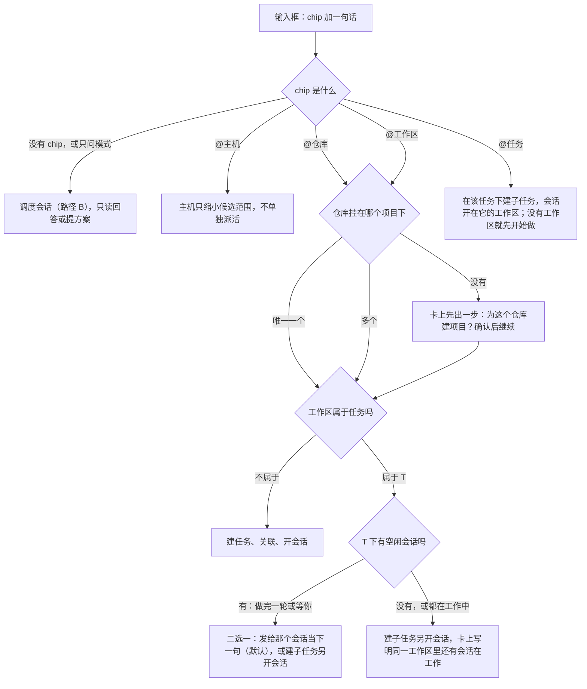

# 任务为主的工作流：方案评审

评审对象：`任务为主的工作流产品方案.md`（含 2026-11-02 的 §5.6 任务模式）和原型 `prototype-task-first`（桌面 d1～d14、手机 m1～m8）。

评审依据：需求 REQ-001～REQ-025、journal D-1～D-011、Multica 调研报告 §7 和 §10、两份代码盘点（上游机制 15 项、local-tasks 现状 14 项，结论已并入 §5 和 §6，文件路径都相对仓库根目录）。

## 0. 结论

方向成立，原型能回答「打开先看什么、一句话怎么变成会话、不进会话怎么知道进度、完成由谁定」这四个问题。但方案还差三类东西：

1. **用户故事只写了顺路，没写分岔**。派活到正忙的工作区、只想问不想派、第一次用还没有项目、父任务有多个子任务时进度怎么汇总、取消任务时会话怎么办，这些都没有写，原型里也就按最简单的一种做了。
2. **几条动线在重做 Orca 已有的东西**。新建任务对话框里又画了一遍新建工作区；任务视图想自带一套标签页，而上游的标签必须挂在工作区上；速览抽屉、任务视图标签、工作区标签三种看会话的方式并存；Cmd+J 要认 @，而上游调色板没有这个扩展点。
3. **几处文字和代码对不上**。工作区归属不限顶层；CLI 现在不拒绝「完成」；最后一句话只在内存里，重启就没了；路径 A 说「不多花一次模型调用」，但它的标题生成就是一次模型调用。

先要定的 10 条见 §1，全部改动清单见 §7。

## 1. 先定的 10 条

| #   | 问题                                                                                                                     | 建议                                                                                                                                                                        | 详见        |
| --- | ------------------------------------------------------------------------------------------------------------------------ | --------------------------------------------------------------------------------------------------------------------------------------------------------------------------- | ----------- |
| 1   | @ 一个已有会话在跑的工作区，方案和原型都直接再开一个会话，两个智能体同时改一个工作区                                     | 那个任务有空闲会话（做完一轮、等你）时，二选一：发给它当下一句，或建子任务另开会话；都在工作中时才另开，并在卡上写明                                                        | §2 S3       |
| 2   | @任务、@主机 在候选里，但路径 A 不处理它们，原型悄悄转给了调度智能体；「@工作区 + 一个问题」也会被当成派活               | @任务 = 在它下面派活；@主机 只用来缩小候选范围，不单独成为目标；加「只问」模式（不建任务，带着工作区上下文交给调度会话）                                                    | §4 I1       |
| 3   | 派活要往哪个项目里建任务？仓库可以挂在多个项目下，也可以一个都没有；第一次用根本没有项目                                 | 定一条归属规则，并把「没有项目」做成派活里的一步（确认后按仓库建项目，和 REQ-001 的推荐一致）                                                                               | §2 S11      |
| 4   | 新建任务对话框把新建工作区（仓库、主机、名称、分支）又画了一遍，和上游 composer 平行                                     | 保留「在哪做」三选一，选「新建工作区」就接上游 composer（创建自预选这个任务，智能体和第一句指令上游本来就有）；一次流程两屏，不重做                                         | §3 F3       |
| 5   | 任务视图想要自己的标签集合，而上游 `Tab.worktreeId` 必填，终端换容器挂载还会撞上重连空白那类问题                         | 任务视图 = 该任务工作区的 `WorktreeSplitSurface`，加一个「概览」伪标签，标签栏只按任务过滤，不另造标签集合；子任务的会话一起显示（和 §5.3、REQ-012 一致，改掉 §5.6 的那句） | §5.1 ②      |
| 6   | 路径 A 的标题用生成管线起名，就是一次模型调用（`runGenerationRequest` 调的是用户的智能体 CLI），而且上游自动命名只在本机 | 路径 A 不额外起名：标题取第一句（截 60 字），任务说明里让干活的智能体顺手 `orca task update --title` 改一个短标题；用户随时可改                                             | §6 ④        |
| 7   | 「最后一句话」只在主机内存里，重启、离线后任务卡就空了；回写进展需要新的事件类型和 RPC，新旧版本要能混用                 | 主机在会话每轮结束时把最后一句话落成一条「轮次结束」记录（只保留每个会话最近一条）；新增事件类型走能力位，旧客户端对不认识的事件类型要能忽略                                | §5.3        |
| 8   | 「CLI 拒绝写完成」现在没有，也没法区分是人还是智能体在敲 CLI；`orca task current` 在子任务的会话里返回的是父任务         | 规则写成「来自 CLI 的写入不能进入已完成类别，完成只在界面上点」；`task current` 先按会话关联找任务，找不到再按工作区                                                        | §6 ②、③     |
| 9   | 看会话有三种方式：速览抽屉、任务视图标签、工作区标签；侧栏又有「按任务分组」和「任务模式」两种按任务看的办法             | 任务模式里只用标签，速览只留在首页列表和手机；「按任务分组」在任务模式上线后评估下线（这是登记过的功能，要走下线流程）                                                      | §3 F1、F2   |
| 10  | 手机首页被整个换成任务首页；本地任务来源在设置里隐藏后，新入口怎么办没写；Cmd+J 认 @ 要改上游调色板                      | 手机保留上游首页，派活输入框放在本地任务页顶部；所有新入口都跟随 REQ-008 的隐藏规则；Cmd+J 只加一个「派活…」动作去聚焦输入框，不解析 @                                      | §4 I10、I12 |

## 2. 用户故事：补什么

方案 §1 把用户的事归成「说要做什么、需要时回答、验收」三件，但只有顺路的故事有动线。下面是评审时按「用户会怎么做」过了一遍，标出缺口。

| 编号 | 故事                                                   | 方案现状                                  | 缺口与建议                                                                                                                                                                                                                            |
| ---- | ------------------------------------------------------ | ----------------------------------------- | ------------------------------------------------------------------------------------------------------------------------------------------------------------------------------------------------------------------------------------- |
| S1   | 早上打开，先看有哪些事在等我                           | 首页「需要你」，含待验收                  | 够用。条目里有智能体回写的「需要你什么」时，显示它，而不是最后一句话                                                                                                                                                                  |
| S2   | 一句话派活到空闲的工作区                               | 路径 A1                                   | 够用。补两点：撤销不回滚智能体已经改过的文件，卡上写明；撤销后编号不复用（REQ-002），会留一个空号，接受即可                                                                                                                           |
| S3   | 派活到已经有会话在跑的工作区                           | 路径 A2：建子任务，再开一个会话           | **缺**。原型里 feat-reconnect 的 Claude 还在工作中，派活后变成两个智能体同时改一个工作区。Multica 的做法是人的话路由回同一个智能体、接着上次会话。建议见 §3 F8 的分岔图：任务有空闲会话时二选一，默认发给它；都在工作中时另开，并提示 |
| S4   | 在工作区里顺手开了会话，后来想记成任务                 | §3 原则 1 写「提示记成任务」              | **矛盾**。REQ-011 在 2026-10-30 定了「工作区没关联任务时，会话头部不显示 chip，不给每个会话头部加入口」。二选一：原则 1 去掉这句；或者只在任务模式下、侧栏「未关联任务的会话」组里提供「记成任务」。建议后者，入口只在任务模式里      |
| S5   | 在任务下再开一个会话（换智能体，或给子任务）           | 任务视图「+」、详情「开会话」             | 没写「+」开出来的会话带什么指令、属于哪个子任务。建议：「+」等于 REQ-010 的开会话，指令默认「按任务说明继续」，弹层里可以选子任务；任务没有工作区时「+」就是开始做                                                                    |
| S6   | 智能体问我问题，我回答一句                             | 速览回复框、任务视图标签                  | 够用。注意 D-007：回复只对「做完一轮」开放，等你批准、等你回答要进会话点；原型 d8 让「等你回答」直接在速览里发送，与 REQ-015 不符，要改成「打开会话」                                                                                 |
| S7   | 做完了，我验收                                         | §8                                        | 「打回」在会话不是「做完一轮」时只「提示你开新会话」，建议改成一键：用打回原因加任务说明开新会话                                                                                                                                      |
| S8   | 不想做了：取消或删除一个正在跑的任务                   | 没写                                      | **缺**。REQ-004 的删除不动会话。建议：取消或删除时，如果任务下有在跑的会话，确认框里给「同时停止 N 个会话」的勾选，默认不勾                                                                                                           |
| S9   | 一个任务拆了三个子任务，各自在跑，我想看整体做到哪了   | 任务卡只显示自己的最新进展                | **缺**。父任务自己往往没有会话。建议父任务卡显示「子任务 1/3 待验收 · 最新：ORC-43 …」，取子孙里最近一条进展，并标明来自哪个子任务                                                                                                    |
| S10  | 我只想问一句，不想建任务：「@feat-x 这个分支改了什么」 | 没写；原型会直接派活                      | **缺**。规则派活没法分辨问和做。建议输入框加「只问」模式（见 §4 I1）：不建任务，把工作区作为上下文交给调度会话只读回答                                                                                                                |
| S11  | 第一次用，还没有项目；或者仓库没挂到任何项目           | 没写                                      | **缺**。任务要有项目才能建。建议规则：工作区所在仓库挂在唯一一个项目下就用它；挂在多个项目下用最近派过活的那个，卡上可改；一个都没有时，派活卡先出「为仓库 X 建项目？」一步，确认后建项目再派（和 REQ-001 的推荐逻辑一致）            |
| S12  | 主机断了，我在手机上看                                 | §10                                       | 够用。补一句：直连 SSH 的工作区，任务在桌面的库里（REQ-018 补记），桌面关着时手机什么也看不到，这和 orcad 托管的主机不同，手机上要能看出区别                                                                                          |
| S13  | 我想回看：这件事当时是怎么派的、对话里说了什么         | §6.5 对话历史，时间线第一条「由对话派出」 | 够用                                                                                                                                                                                                                                  |
| S14  | 同一件事要在两个工作区做                               | 路径 A 多 @：父任务加子任务               | 够用。补：两个工作区在不同主机上时，父任务建在哪个库里要定（建议建在第一个 chip 所在的库，另一个子任务在另一台库里只记引用；或者干脆要求多 @ 的工作区在同一台库，否则走调度会话）                                                     |
| S15  | 智能体做完一轮但没有回写                               | §7.2 回退到最后一句话                     | 依赖 §5.3 的落库，否则重启后什么都没有                                                                                                                                                                                                |

## 3. 动线

### F1 按任务看的三个入口重叠

现在会同时存在：任务页（带二级导航列）、任务模式侧栏（同一列搬进侧栏）、工作区模式下的「按任务分组」（REQ-016，已上线）。方案 §5.6 说三者都保留。

- 建议：任务模式下任务页不再有二级导航列（方案已写）；「按任务分组」只在工作区模式里有，任务模式上线后看使用情况评估下线。它是登记过的功能，下线要改注册表和 journal，不要「顺手去掉」。
- 任务模式的开关存 fork 自己的偏好键（和「按任务分组」一样，`local-task-sidebar-grouping.ts` 的做法），不碰上游 `sidebarBody`（它只在内存，不持久化）。

### F2 看会话的三种方式

速览抽屉（§5.4）、任务视图标签（§5.6）、工作区标签，三者内容都是同一个终端或聊天。建议定规则：

- 任务模式：点会话就是标签，不弹抽屉；概览标签里会话列表的「速览」改成「切到标签」。
- 工作区模式的任务首页和任务详情：用速览抽屉，因为这时主区是任务页，不该切走。
- 手机：底部抽屉，一键进完整会话页。

### F3 新建任务「一次完成三步」

原型 d5 把新建工作区的仓库、主机、名称、分支都画进了任务对话框。上游 composer（`NewWorkspaceComposerCard.tsx`）还有基础分支、运行位置是否已配置、创建自、智能体、第一句指令等，这里重画就是一个阉割的平行实现，以后上游每加一项都对不上。

建议改成「一次流程，两屏」：

1. 新建任务屏：标题、描述、完成标准，加「在哪做」三选一（已有工作区、新建工作区、稍后再定）。
2. 选「已有工作区」：当场选，建完停在任务视图，开会话走 REQ-010。
3. 选「新建工作区」：建好任务后直接打开上游 composer，「创建自」预选这个任务（REQ-009 已经这样做），智能体和第一句指令在 composer 里填。创建完成后关联并停在任务视图。

这样「建任务时就开工」的体验不变，代码上只多一次串联。

另外要定一条：**从任务发起的会话，第一句指令默认直接发送还是放草稿。** 现在三处不一致：REQ-009 开始做是草稿（和上游从 issue 开工一致）；代码里的开会话对话框默认立即发送（`LocalTaskSessionDialog.tsx:72`）；原型 d5 默认直接发送。建议统一成「默认直接发送，可改草稿」，这改掉 REQ-009 在 2026-10-30 的决定，要用户点头。

### F4 派活后落在哪

路径 A 派活后停在首页，卡片在输入框下方，这没问题。任务模式下建议再做一件事：新任务在侧栏树里出现并短暂高亮，但不自动打开，免得打断连续派活。

### F5 调度会话的提案卡由谁执行

方案没写提案卡的数据从哪来、确认后谁执行。两种做法：

- 让智能体输出一段约定格式的文字，Orca 解析成卡片。脆弱，而且确认后还得再和它说一轮。
- **建议**：给调度智能体一条 `orca dispatch propose --file 提案.json`，提案存进任务库（或对话记录），聊天视图按它渲染卡片；用户确认后由 Orca 直接执行建任务、关联、开会话，不再经过智能体。智能体只负责理解和提方案，这和 §6.4「自己不做具体工作」一致，也省一次模型调用。

调度会话本身：上游的浮动伪工作区只在本机，结构化聊天必须有 `workspaceId`，配对网页客户端不能在浮动工作区里开会话（`client-creation-action-policy.ts:62`）。所以调度会话只在桌面上有，手机和网页客户端经桌面。方案 §6.4 说的是这个意思，但要写明「网页客户端没有」。

### F6 打回

「打回」原因作为下一句指令只在会话「做完一轮」时可发（D-007）。其他情况方案只提示「开新会话」。在以任务为主的动线里，打回是高频动作，建议做成一键：没有可回复的会话时，直接用打回原因加任务说明开一个新会话，和 S7 一致。

### F7 PR 合并后进待验收

规则 2 只由桌面窗口读 PR 时执行（REQ-013）。只用手机的用户要等桌面打开。方案 §8 没提，补一句，并在待验收卡上显示规则当前的判定（Multica 借鉴清单第 7 条）。

### F8 路径 A 的分岔

把 §1 第 1～3 条合起来，路径 A 的分岔应该是：

「发给那个会话」时也要留痕：在 T 的时间线上记一条「由对话追加指令」，这样 S13 的回看仍然成立。

### F9 撤销

- 10 秒内撤销只停会话、删任务，智能体已经改的文件不回滚，卡上写明。
- 撤销删掉的任务编号不复用（REQ-002），接受。
- 撤销要在远端库上删任务、在远端主机上停会话，两步都只在主机在联系时做；做不到时卡上写「某主机未连接，没有撤销」，不排队。

## 4. 交互（按界面）

### I1 派活输入框

- @ 候选分组里有任务和主机，但路径 A 只处理工作区和仓库，原型把 @任务、@主机 都转给了调度会话，用户不知情。定义：
  - @任务：在它下面派活（见 F8）。
  - @主机：选中后候选只剩这台主机的仓库和工作区，不作为派活目标；chip 里不显示主机。
- 「只问」模式：输入框右侧加一个切换（派活 / 只问），或用 `Shift+Enter` 发到「只问」。只问不建任务，把 chip 里的工作区作为上下文交给调度会话只读回答。这是规则，不是模型判断，和 §6.1「A 快、可预期」一致。
- 回车派活是实际启动智能体的动作，和上游聊天「回车发送」一致，靠撤销兜底，不改。

### I2 已派活卡

- 10 秒倒计时结束后卡片保留，直到用户关掉或再派一条。
- 标题变化：按 §1 第 6 条，不再「几秒后变成生成的短标题」；如果智能体改了标题，卡上更新即可。

### I3 任务卡

- 「最新进展」优先级按 §7.2，但第 2 级要靠 §5.3 落库才在重启和离线后可用。
- 父任务按 S9 显示子孙汇总。
- 悬停展开完整摘要，手机长按，原型已做。

### I4 需要你

- 条目正文：有回写的「需要你什么」时用它；没有才用最后一句话。
- 「待验收」单独分组（已定）。「等你决定」（REQ-023）如果也做，和待验收放一组，叫「任务在等你」，和「会话在等你」区分。

### I5 任务视图标签

- 关闭会话标签 = 关闭会话，和工作区模式一样；两种模式下是同一个标签，一边关了另一边也没了。
- 「+」按 S5。
- 标签顺序按会话启动顺序，「概览」固定在最前。
- 主机未连接时标签置灰并写原因（已定）。
- 子任务的会话一起显示，标签上带子任务标题（改掉 §5.6「子任务的会话在子任务自己的视图里」）。
- 任务没有工作区时只有「概览」，头部按钮是「开始做」。

### I6 速览抽屉

- 终端型：不要用 `terminal read --screen` 的文本快照，桌面上终端本来就挂在渲染进程里，用 Activity 页的做法把真实终端 portal 进抽屉（`activity-terminal-portal.ts`），颜色、滚动都在，也不多一次读取。
- 聊天型：复用结构化会话视图的只读模式，底下接回复框。
- 回复框只对「做完一轮」开放，其余显示「打开会话」（REQ-015）。原型 d8 要改。
- 读取规则照 §5.4，不重试。

### I7 验收条

- 通过：移到已完成类别第一个状态（REQ-013 口径）。
- 打回：移到进行中类别第一个状态，原因记评论，按 F6 发出或开新会话。
- 显示规则 2 当前的判定（F7）。

### I8 任务模式侧栏

- 「全部」展开后是整棵任务树，可能很长。上游侧栏是虚拟列表（`worktree-list/rows/virtual-row-dispatch.tsx`，fork 已有接缝），任务树也用它，不另写滚动。
- 树里的会话行显示状态点和一句话；会话行点开走 I5。
- 「未关联任务的会话」组：任务模式下也要能看到那些没挂任务的工作区会话，否则用户在任务模式里找不到它们；这个组同时承担 S4 的「记成任务」入口。

### I9 设置

- 「首页」这一项的实现见 §5.1 ③；
- 「任务说明」开关、「调度新建前先确认」、「规则 2 三选一」保留；
- 所有新入口（任务模式按钮、首页、派活输入框、手机入口）跟随 REQ-008「本地任务来源隐藏」规则，方案要写一句。

### I10 手机

- 原型 m1 把上游首页整个换掉，主机列表挪到底部。方案 §5.1 写的是「本地任务卡升级为任务首页入口」，§9 写的是「升级为手机任务首页」，两处不一致。建议：上游首页不动，本地任务卡加「需要你」和最新进展；派活输入框放在本地任务页顶部。理由：手机的数据模型是「每台主机一页」，@ 候选和任务库都按主机来，输入框放在主机页下面天然对得上；也不用在上游首页开新接缝。
- 手机上派活由配对桌面执行（已定），输入框上写明「由 某桌面 执行」。
- 手机只直接发送（D-010），已定。

### I11 通用对话视图

- 对话视图（d9）要复用原生聊天的消息渲染，不另写聊天 UI；只有提案卡和已派活卡是本功能的组件。
- 对话历史列表按天分组：上游没有会话级元数据，「这段对话派出了哪些任务」存在任务库里（会话 id 对任务 id），列表从本功能的库读，不改上游 `AgentSessionRecord`。

### I12 Cmd+J

方案 §9 写「输入以 @ 开头时直接进入派活」。上游调色板的扩展点只能加动作，不能加实体分区，认 @ 要改 `worktree-jump-palette-model.ts` 和输入解析。建议只加一个动作「派活…」，选中后跳到首页并聚焦输入框。§12 第 11 条已经说「派活从首页输入框开始」，这里对齐即可。

## 5. 复用与兼容

### 5.1 复用对照

| 方案里的能力          | 上游或 fork 现状                                                                                                                           | 复用方式                                                                                                                                                      | 新接缝                                                                        |
| --------------------- | ------------------------------------------------------------------------------------------------------------------------------------------ | ------------------------------------------------------------------------------------------------------------------------------------------------------------- | ----------------------------------------------------------------------------- |
| ① 侧栏任务模式        | 侧栏主体在 `sidebar/index.tsx`，在 `WorktreeList` 和 `SidebarAgentsList` 之间二选一；标题行按钮在 `SidebarHeader.tsx`；行渲染走虚拟列表    | 主体再加一个分支渲染本功能的任务树；标题行加一个按钮；开关存 fork 偏好键                                                                                      | `sidebar/index.tsx`、`SidebarHeader.tsx` 各 1 处                              |
| ② 任务视图与会话标签  | `Tab.worktreeId` 必填；`WorktreeSplitSurface(worktreeId)` 可以渲染任意工作区的标签；Activity 页用 portal 把别的工作区的终端挂进来          | 任务视图 = 任务工作区的 `WorktreeSplitSurface`，标签栏按任务过滤，加「概览」伪标签。不要像浮动终端那样再造一个伪工作区 id，那会让 tabs store 多一套归属       | 标签栏过滤 1～2 处；主区按视图切换 1 处                                       |
| ③ 默认首页            | 上游没有首页概念，启动恢复上次 `activeView`（`active-view.json`），没有默认页设置                                                          | 做成一个设置项「启动时打开任务页」，在 hydration 时把 `activeView` 置为 tasks 加本地来源。价值不高，接缝有限，也可以不做：用户上次停在任务页，下次就是任务页  | `ui-slice-hydration-sanitizers.ts` 或 `AppWorkspaceShell.tsx` 1 处，设置 1 处 |
| ④ 派活输入框与 @      | 原生聊天的 @ 只能提及当前工作区的文件，触发和数据都在 composer 内部；弹层组件 `NativeChatAutocompleteMenus.tsx` 可单独用                   | 输入框是本功能自己的组件，只复用弹层组件；手机用 sheet                                                                                                        | 0（只 import）                                                                |
| ⑤ 调度会话            | 浮动伪工作区只在本机；结构化聊天必须有 `workspaceId`；网页客户端不能在浮动工作区开会话                                                     | 桌面上在浮动伪工作区里开结构化聊天；提案走 `orca dispatch propose`，Orca 执行（F5）                                                                           | 0～1                                                                          |
| ⑥ 回写进展            | 事件类型 15 种，没有 progress；没有对应 RPC；CLI 只有 5 个子命令                                                                           | 新事件类型 progress、dispatch、acceptance；RPC `events.addProgress`；CLI `task create / link / progress --file / update --title`；能力位升到 `local-tasks.v2` | RPC 目录 1 处（已有同类接缝）                                                 |
| ⑦ 最后一句话          | `lastAssistantMessage` 只在主机内存（`local-task-pane-memory.ts`），不落库；任务卡上现在也不显示它                                         | 主机在会话状态变成 done 时，把 `lastCompletedAssistantMessage` 落成「轮次结束」记录，每个会话只留最近一条                                                     | 0                                                                             |
| ⑧ 标题与摘要生成      | `runGenerationRequest` 可复用，但每次都是一次智能体 CLI 调用；上游自动命名只在本机非 WSL、只对结构化聊天                                   | 路径 A 不起名（§1 第 6 条）；「生成摘要」用户点了才做，新加一个 operation                                                                                     | `text-generation/` 新文件，0 接缝                                             |
| ⑨ 速览抽屉            | `ui/sheet.tsx`，`AgentDashboardDrawer` 处理过 Esc 层级；终端可 portal                                                                      | Sheet 加 portal                                                                                                                                               | 0                                                                             |
| ⑩ 撤销                | `activity-clear-completed.ts` 的 sonner action 加延迟删除                                                                                  | 同一模式                                                                                                                                                      | 0                                                                             |
| ⑪ 开始做 / 新建工作区 | 开始做已复用上游 composer，「创建自 Local」已接；CLI `worktree create` 只能建 git worktree，文件夹工作区只有 RPC                           | F3 的两屏流程；调度会话派活到文件夹项目时只能选已有文件夹工作区（方案 §10 已写）                                                                              | 0                                                                             |
| ⑫ 开会话              | `launchLocalTaskSession` 包了上游 `planAgentSessionLaunch` 加 `launchAgentInNewTab`，本机、SSH、配对服务器都支持；主机拒绝开聊天时回退终端 | 直接复用；「+」和打回开新会话都走它                                                                                                                           | 0                                                                             |
| ⑬ 回复                | `sendLocalTaskReply` 调上游 `sendMessageToAgent`，只对「做完一轮」                                                                         | 速览、验收打回都走它                                                                                                                                          | 0                                                                             |
| ⑭ Goal「设为目标」    | Goal 只绑终端（`GoalBindingSchema` 要 terminal），结构化聊天不支持；验收文档可由用户填或生成                                               | 聊天型会话的「设为目标」置灰并写原因；完成标准导出成验收文档放 3d                                                                                             | 0                                                                             |
| ⑮ Automations         | 只起终端，支持 SSH                                                                                                                         | 3d 再说                                                                                                                                                       | —                                                                             |
| ⑯ 手机首页            | 上游首页没有输入入口；fork 的任务卡挂在 `MobileHomeListFooter.tsx`                                                                         | 不替换首页，输入框放本地任务页（I10）                                                                                                                         | 0                                                                             |
| ⑰ Cmd+J               | fork 已接任务行和两个动作；没有 @ 解析，也不能加实体分区                                                                                   | 只加「派活…」动作（I12）                                                                                                                                      | 0（已有接缝）                                                                 |

接缝预算：local-tasks 现在已有 126 条接缝、107 个上游文件。这一轮新增控制在 6～8 处，集中在侧栏主体、侧栏标题行、标签栏过滤、主区视图切换、设置。原型里其他的东西都应落在功能自有路径。

### 5.2 不要重做的清单

- 新建工作区表单（F3）。
- 聊天消息渲染（I11）。
- 终端文本快照（I6）。
- 会话归属元数据：上游没有统一的会话抽象，也没有会话级自定义字段，「属于哪个任务」继续放在 fork 的 `local_task_sessions` 表，不改上游 `AgentSessionRecord`。
- 侧栏滚动与行渲染（I8）。

### 5.3 版本兼容、SSH、隐藏来源

- **新事件类型**：旧桌面和旧手机收到 progress、dispatch、acceptance 时必须忽略而不是报错。要核对 `local-task-event-copy.ts`（手机）和桌面的动态渲染对未知 kind 的处理，列为开工前验证。
- **能力位**：新 CLI 和新 RPC 按 `local-tasks.v2` 能力位探测，旧主机不支持时候选置灰并写「更新那台主机的 Orca」，方案 §10 已有，补上能力位名字。
- **直连 SSH**：没有 orcad 的 SSH 主机，任务在桌面的库里（REQ-018 补记）。智能体在 SSH 主机上跑 `orca task progress`，走 relay 回到桌面；桌面没开或断线时写入失败。任务说明里要写：**写入失败就把摘要写到工作区里的文件，继续干活，不重试**。否则智能体会在一条失败的命令上打转，这正是 Remote Host Reads 禁止的行为被搬到了智能体侧。
- **orcad 托管与配对服务器**：各自的库，CLI 用 `--environment` 指定（已有）。调度会话派活到它们时，任务建在它们的库里，对话记录在桌面；两边各记一半，时间线上的「由对话派出」只能带桌面的对话 id，对方库看不到那段对话。方案 §6.5 要写明这一点。
- **多 @ 跨库**：S14。
- **隐藏来源**：REQ-008 的隐藏规则覆盖所有新入口（I9）。
- **Windows**：回写正文走 `--file`（方案已写）；Cmd+J 的组合键按平台显示（REQ-007 已定）。
- **文件夹工作区**：派活到文件夹项目只能选已有文件夹工作区（方案 §10 已写）；任务视图的 `WorktreeSplitSurface` 对文件夹工作区同样可用。

## 6. 文字和代码对不上的地方

| #   | 方案原文                                                      | 实际                                                                                                                        | 改法                                                                                                      |
| --- | ------------------------------------------------------------- | --------------------------------------------------------------------------------------------------------------------------- | --------------------------------------------------------------------------------------------------------- |
| ①   | §4「一个工作区只属于一个顶层任务」                            | D-008 后任意层级都能挂工作区，规则是「一个工作区只属于一个任务（任意层）」，由 `local_task_workspaces` 的主键和唯一索引保证 | 改成「任意层」；A2 的子任务挂在拥有工作区的那个任务下，不论它在哪一层                                     |
| ②   | §3 原则 5、§7.1「CLI 会拒绝智能体把任务写成完成」             | `orca task status 编号 completed` 现在能写进去；CLI 也分不清是人还是智能体在敲                                              | 规则写成「来自 CLI 的写入不能进入已完成类别，完成只在界面上点」；拒绝时按 Multica 第 3 条给智能体写下一步 |
| ③   | §7.1「需要最新内容时运行 `orca task show 编号`」              | 对；但 `orca task current` 按工作区匹配，在子任务的会话里返回的是父任务                                                     | `task current` 先按会话关联找（终端里有 Orca 的会话标识时），找不到再按工作区；任务说明里仍然直接给编号   |
| ④   | §6.1「A 不多花一次模型调用」，§6.3「用生成管线起短标题」      | 生成管线就是调用用户的智能体 CLI；上游自动命名只在本机非 WSL、只对结构化聊天                                                | 见 §1 第 6 条                                                                                             |
| ⑤   | §7.2「没有回写时取 hook 上报的最后一句话」                    | 它只在主机内存里，重启就没了；任务卡现在也不显示它，只在详情会话行和需要你里                                                | 见 §5.1 ⑦                                                                                                 |
| ⑥   | §11「`orca task create`：RPC 已有，只缺 CLI」                 | 对；`links.linkWorkspace` 也有；`progress` 既没有 RPC 也没有事件类型                                                        | §13 分期里 3a 要包含 schema v6、事件类型、RPC                                                             |
| ⑦   | §5.1 左侧视图「需要你、全部、进行中、待规划、已完成、已取消」 | 代码里没有「未开始」和「待验收」视图；首页按状态分组时「未开始」「待验收」是分组头，不是视图                                | 保持视图不变，分组头按类别出；或者加「待验收」视图，要定                                                  |
| ⑧   | §9「Goal 现在只绑终端，聊天型会话要另外核实」                 | 已核实：`GoalBindingSchema` 只有 terminal，结构化聊天不支持                                                                 | 改成定论，「设为目标」对聊天型会话置灰                                                                    |
| ⑨   | §5.4「终端型：显示 `terminal read --screen` 的同等内容」      | 桌面上终端已在渲染进程里，可以 portal；手机已有 xterm 视图                                                                  | 见 I6                                                                                                     |
| ⑩   | §9「Cmd+J 输入以 @ 开头时直接进入派活」                       | 调色板没有 @ 解析，扩展点只能加动作                                                                                         | 见 I12                                                                                                    |
| ⑪   | §6.4「做法参照浮动终端」                                      | 浮动工作区只在本机，网页客户端也不能在里面开会话                                                                            | 写明调度会话只在桌面有，手机和网页客户端经桌面                                                            |
| ⑫   | §5.6「子任务的会话在子任务自己的视图里」                      | §5.3 和 REQ-012 都是「列出这个任务和它子任务下的会话」                                                                      | 以 §5.3 为准，任务视图含子孙会话，标签上带子任务标题                                                      |

## 7. 改动清单（给方案作者）

按先后：

1. §3 原则 1：去掉或改写「直接在工作区里开的会话也提示记成任务」（S4）。
2. §4：工作区归属改成任意层（§6 ①）；补项目归属规则（S11）。
3. 新增 §「用户故事与动线」：S3、S5、S8、S9、S10、S11、S14 各一段，带 F8 那张分岔图。
4. §5.2：改成两屏流程（F3）；写明第一句指令的默认发送方式，并标为待用户确认。
5. §5.4：终端 portal、聊天只读视图、回复只对做完一轮（I6）。
6. §5.6：任务视图的实现口径改成「工作区表面加过滤」；含子孙会话；关闭标签语义；「+」语义；「未关联任务的会话」组；速览与标签的分工（F2、I5、I8）。
7. §6.2：@任务、@主机 的语义；只问模式（I1）。
8. §6.3：标题不起名；撤销三条（F9）；派活到有空闲会话的工作区的二选一。
9. §6.4：提案由 `orca dispatch propose` 存、Orca 执行；调度会话只在桌面（F5）。
10. §6.5：跨库时对话与任务各记一半（§5.3）。
11. §7.1：CLI 拒绝完成的真实规则；写入失败不重试、写文件继续；`task current` 的改法（§6 ②③）。
12. §7.2：最后一句话落库（§5.1 ⑦）。
13. §8：打回一键开新会话；显示规则 2 的判定；只用手机时要等桌面（F6、F7）。
14. §9：Cmd+J 改成一个动作；「按任务分组」的去留标为待定（I12、F1）。
15. §10：直连 SSH 的回写路径与失败行为；能力位 `local-tasks.v2`；手机上区分「桌面的库」和「主机自己的库」（§5.3、S12）。
16. 新增 §「隐藏来源与设置」：所有新入口跟随 REQ-008（I9）。
17. 手机：§5.1 和 §9 统一成「不替换首页」（I10）。
18. §13 分期：3a 加 schema v6、事件类型、RPC、能力位；把「旧客户端忽略未知事件类型」列为开工前验证。
19. 需求文档：REQ-009 的发送方式、REQ-011 的会话 chip 规则、REQ-012 的任务视图、REQ-014 的「任务在等你」分组、REQ-019 的 CLI 清单，等方案定稿后同步。

原型要跟着改的屏：d2（@ 候选的任务、主机语义，只问开关）、d3/d4（标题不再变化；A2 的二选一）、d5（两屏）、d8（等你回答只能打开会话）、d13-task（含子任务会话、未关联会话组）、m1（不替换首页）。
