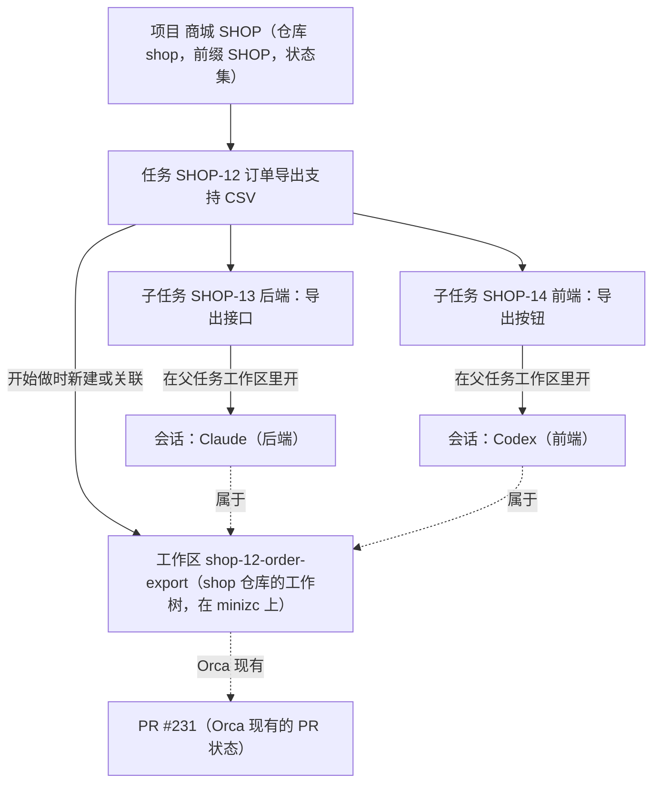

# 本地任务管理

## 1. 背景与目标

现在的 Orca 以项目和会话为中心：用户先选仓库、开工作区、开会话，「要做的事」散落在各个会话的对话里，没有地方统一记录、拆分和跟踪。原来 fork 里的「Issues 看板与会话」不好用，已于 2026-10-23 撤回（`revert(issues-board)`），这一版重新做。

**目标**：在 Orca 里加一个以任务为中心的本地任务管理。需求在这里记录、拆分、跟踪；开始做时，一键在 Orca 里开工作区和会话。之后写代码、看 diff、提 PR，都用 Orca 原有的功能，任务这边只负责把它们挂在一起、显示进展，并在会话需要人时告诉你。

**原则**：

1. 以任务为中心：从任务进入工作区和会话；工作区和会话也能看到自己属于哪个任务。
2. 只做连接，不做流程：任务这边不判断「做完没有」「做得对不对」，状态由用户决定，只保留两条可以关掉的自动规则（REQ-013）。
3. Orca 已有的不重做：diff、批注、提交、PR、Checks、智能体状态、通知，都直接用现有的。
4. 只记录明确的关联：工作区和会话只在两种时候挂到任务上，一是从任务里开，二是用户手动关联。不推断，不追踪会话身份。
5. 任务数据存在用户的桌面 Orca 上：执行主机不需要任何新能力；主机不在联系范围内时不读它。

产品方案与设计稿的讨论过程见 `.docs/本地任务管理调研/`（本机目录，不进仓库），主稿是 2026-10-24 目录下的 `产品方案-v4.md`，设计稿是同目录下的 `prototype-v4/`。

## 2. 用户场景

用户在商城项目（仓库 shop，前端在 `web/`，后端在 `api/`）里记录需求 SHOP-12「订单导出支持 CSV」，拆出两个子任务：SHOP-13 后端、SHOP-14 前端。在 SHOP-12 上点「开始做」，在 SSH 主机 minizc 上建出工作区 `shop-12-order-export`；再分别在 SHOP-13、SHOP-14 上「开会话」，Claude 做后端、Codex 做前端，两个会话在同一个工作区里同时运行。

之后用户不用盯着两个终端：任务列表上能看到两个会话的状态点；Codex 提问时，「需要你」里出现一条「等你回答」，用户在桌面或手机上直接回复；Claude 一轮做完，「需要你」里出现「做完一轮，你还没看」。PR 合并后 SHOP-12 自动移到已完成。

## 3. 范围

### In Scope

- 任务管理：项目、编号、可自定义的状态、任务、子任务、优先级、标签、评论与动态、列表、看板、详情、筛选、键盘操作、Cmd+J。
- 开始做：新建或关联工作区；在工作区里开会话，任务内容作为 prompt。
- 显示进展：任务上显示工作区、会话、PR 的现有状态，点击跳过去。
- 需要你：挂在任务上的会话等批准、等回答、被卡住，或做完一轮还没看时，进入「需要你」。
- 以任务为中心的导航：侧栏可以按任务分组；工作区卡片和会话头部显示所属任务。
- 手机端与桌面功能对齐。

### Out of Scope

- 评审与验收流程、PR 的创建与合并流程、提交、占用锁与排队、智能体交付约定、执行者预设、编排。
- 一个任务涉及多个仓库、任务专用目录。前后端在同一个仓库里由用户在工程上约束，任务功能不加锁。
- 任何新的主机侧能力（执行主机上不新增 RPC、文件、端口或服务）。
- 截止日期与提醒、保存视图、任务模板、从外部 issue 导入、任务依赖、在智能体仪表盘和 AI Vault 上显示任务编号。这些以后再说，本版不预先设计。

## 4. 对象与关系

| 对象   | 规则                                                                                                       |
| ------ | ---------------------------------------------------------------------------------------------------------- |
| 项目   | 对应一个 Orca 仓库（侧栏里的「项目」），一个仓库最多对应一个项目                                           |
| 任务   | 属于一个项目；层级只有两层：顶层任务和子任务，子任务下不能再建子任务                                       |
| 工作区 | 一个顶层任务最多关联一个工作区，一个工作区最多属于一个顶层任务；子任务不单独关联工作区，使用父任务的工作区 |
| 会话   | 工作区里的一个智能体标签，终端视图和聊天视图都算；任务和子任务都可以开会话，一个任务可以有多个会话         |

## 5. 需求点

以下「SSH 场景」指客户端是用户的桌面 Orca，工作区、会话和 PR 所在的执行主机是 SSH 主机；配对服务器与 SSH 主机遵守同样的规则。会话事实只用 `live`（在运行）、`unverifiable`（无法确认）、`exited`（已结束）三个词。

### REQ-001 项目与仓库一一对应

- 目标级别：P0；当前状态：部分实现（2026-10-26 切片 1：项目推荐、创建、改名、前缀与状态管理已实现，本机与 SSH 真机验证通过，见 TC-001；两条自动规则的开关随切片 2）。
- 描述：项目对应一个 Orca 仓库，字段有名称、仓库、前缀、状态集、两条自动规则的开关。一个仓库最多对应一个项目。第一次进入任务页时，按用户已有的仓库推荐生成项目，用户确认后才创建。设置 → 任务 → 项目可以改名称、前缀、状态和规则开关。
- 本机场景：本机仓库可以建项目。
- SSH 场景：SSH 主机上的仓库同样可以建项目；项目只记录仓库在 Orca 里的标识，不读主机上的任何文件。主机不在线时项目照常显示和编辑。
- 验收标准：同一个仓库不能建第二个项目，提示已属于哪个项目；推荐列表包含本机仓库和 SSH 仓库。

### REQ-002 编号与前缀

- 目标级别：P0；当前状态：已实现（2026-10-26 单测与真机验证通过，见 TC-002）。
- 描述：编号按项目递增（SHOP-1、SHOP-2……）。任务的身份是不可变的 ID，编号只用于显示和搜索。前缀可以改，改后旧前缀保留为这个项目的别名，旧编号仍能搜索和跳转；旧前缀不能再被其他项目使用。删掉的编号不复用。
- 本机场景与 SSH 场景：编号和前缀都在桌面 Orca 上分配，与执行主机无关，行为一致。
- 验收标准：SHOP 改成 MALL 后，搜索 SHOP-12 能打开 MALL-12；新项目不能使用前缀 SHOP。

### REQ-003 状态类别与自定义状态

- 目标级别：P0；当前状态：已实现（2026-10-26 单测与真机验证通过，见 TC-003）。
- 描述：状态有 6 个固定类别：待规划、未开始、进行中、评审、已完成、已取消。新项目默认 6 个状态，每个类别一个：待规划、待办、进行中、评审中、已完成、已取消。用户可以在类别里新增、改名、改颜色、排序（例如在进行中类别里加「联调中」）；状态不能换类别；每个类别至少保留一个状态。「评审」只是一个类别，不附带任何流程。看板的列就是项目的状态；跨项目查看时按类别出列。
- 本机场景与 SSH 场景：一致，与执行主机无关。
- 验收标准：加了「联调中」后，看板多出这一列；删除一个仍有任务的状态时，要求先把这些任务移到另一个状态。

### REQ-004 任务与子任务

- 目标级别：P0；当前状态：已实现（2026-10-26 单测与真机验证通过，见 TC-004、TC-005、TC-006）。
- 描述：
  - 字段：标题、描述、完成标准（可选，普通列表，不带勾选框）、状态、优先级（无、紧急、高、中、低）、标签、父任务。
  - 新建任务对话框带「继续创建」；在子任务输入框里粘贴多行文本，可以一次建多个子任务。
  - 删除任务只删任务记录，关联的工作区和会话都不动。删除带子任务的任务时，子任务一起删除，确认框写明会删几个子任务。
  - 一个仓库只对应一个项目，所以已关联工作区的任务不能移到别的项目，要先取消工作区关联再移。
  - 子任务完成不会带动父任务，父任务的状态由用户决定。
- 本机场景与 SSH 场景：一致。删除任务时不碰执行主机，主机不在线也能删。
- 验收标准：删除 SHOP-12 后，工作区 `shop-12-order-export` 和其中的会话仍在，工作区卡片不再显示任务编号。

### REQ-005 评论与动态

- 目标级别：P1；当前状态：部分实现（2026-10-26 切片 1：评论与属性动态已实现，见 TC-007；工作区、会话关联与自动规则的动态随切片 2）。
- 描述：任务详情下方是评论与动态。动态记录状态、优先级、父任务等属性变化，工作区和会话的关联与取消关联，以及自动规则触发的变化（例如「PR #72 合并后自动移到已完成」）。
- 本机场景与 SSH 场景：一致。动态里写明工作区所在的主机。
- 验收标准：自动规则改了状态时，动态里有一条记录写明触发原因。

### REQ-006 列表、看板与筛选

- 目标级别：P0；当前状态：部分实现（2026-10-26 切片 1：视图、列表、看板、分组、排序、筛选、批量与计数已实现，见 TC-008；会话状态点和 PR 随切片 2）。
- 描述：
  - 任务页左侧视图：需要你（带数字）、全部、进行中、待规划、已完成、已取消；下面是项目列表和「全部项目」。
  - 主区可以切换列表和看板，可以分组、排序、筛选，支持多选后批量改属性。
  - 列表默认按状态分组，子任务缩进在父任务下。每行显示优先级、编号、状态、标题、子任务进度、标签、会话状态点、PR、更新时间。
  - 看板的「已取消」列默认隐藏。
  - 计数口径：左侧视图、手机首页和分段控件上的数字，是当前项目范围内的任务总数（含子任务）；列表分组的数字是这一组实际显示的条目数，子任务跟着父任务显示时不单独计数；导航上「需要你」的数字是全局的，不分项目。
- 本机场景与 SSH 场景：列表和看板只读桌面 Orca 上的任务数据，打开和筛选都不访问执行主机。会话状态点按 REQ-012 显示。
- 验收标准：任意数据下，三处计数按上述口径互相对得上。

### REQ-007 键盘与 Cmd+J

- 目标级别：P1；当前状态：已实现（2026-10-26 真机验证通过，见 TC-009、TC-010；Cmd+J 只在 macOS 上验证，Windows、Linux 未覆盖）。
- 描述：
  - 任务页内的单键操作：C 新建、J/K 上下移动、Enter 打开、Space 预览、X 选中、S/P/L 改状态/优先级/标签、I 开始做、A 开会话、V 切换列表和看板、F 筛选、/ 搜索；在「需要你」里 E 标记已看、H 暂缓。单键只在任务页、且焦点不在输入框里时生效。
  - Cmd+J（其他平台按 Orca 现有映射显示）里加「新建任务…」「打开任务…」，并支持搜索本地任务。
  - 全局快捷键按快捷键 ID 注册，按平台显示，避开 Orca 已占用的组合键。
- 本机场景与 SSH 场景：一致。
- 验收标准：macOS、Windows、Linux 上 Cmd+J 菜单显示的组合键与平台一致；在输入框里按 C 不会新建任务。

### REQ-008 任务页入口

- 目标级别：P0；当前状态：部分实现（2026-10-26 切片 1：任务页「本地」来源已实现，见 TC-011；任务按钮上「需要你」的数字随切片 2）。
- 描述：Orca 现有的「任务」页新增来源「本地」，排在 GitHub、GitLab、Linear、Jira 前面。左侧栏的「任务」按钮上显示「需要你」的数字。GitHub、GitLab 等现有来源的行为不变。
- 本机场景与 SSH 场景：一致。
- 验收标准：切到「本地」来源时显示本地任务；切回 GitHub 时与改动前一致。

### REQ-009 开始做

- 目标级别：P0；当前状态：待实现。
- 描述：在顶层任务上点「开始做」（快捷键 I），打开 Orca 现有的新建工作区弹窗并预填：仓库为项目对应的仓库；运行位置为上次在这个仓库用的主机，可以改；名称由编号和标题生成（例如 `shop-12-order-export`），可以改；分支名由 Orca 按用户的分支前缀设置从名称生成（例如 `zc/shop-12-order-export`）；智能体可选，选了时任务的标题、描述和完成标准作为 prompt。弹窗里不显示「已链接的工作」：它只支持 GitHub、GitLab、Linear、Jira，任务和工作区的关联记在任务这边。创建成功后工作区关联到任务；创建失败或取消时不留关联。之后改标题，分支名不变。任务这边也可以选「用已有工作区」，走 REQ-011 的关联。子任务上没有「开始做」，入口是父任务的。项目对应的是文件夹（不是 git 仓库）时，「开始做」只提供「用已有工作区」，不新建，也没有分支。
- 本机场景：在本机仓库建工作树并关联。
- SSH 场景：运行位置选 SSH 主机时，工作树建在 SSH 主机上，用 Orca 现有的创建流程，不新增主机能力。主机未连接时「开始做」不可用，并说明「minizc 未连接」这类原因；不替用户重连。
- 验收标准：本机和 SSH 各开始做一次，工作区卡片显示正确的主机和分支；SSH 主机断开时按钮置灰并显示原因。

### REQ-010 开会话

- 目标级别：P0；当前状态：待实现。
- 描述：在任务或子任务上点「开会话」（快捷键 A），复用 Orca 现有的启动智能体：
  - 智能体默认为 Orca 设置里的默认智能体，可以改；
  - 位置是任务的工作区（子任务用父任务的），只读；
  - 显示方式（终端或聊天视图）跟随 Orca 的设置；
  - prompt 是任务的标题、描述、完成标准，子任务额外带上父任务的摘要；
  - 发送方式由用户选：直接发送，或只放进输入框当草稿。

  会话开起来后记在这个任务下。任务还没有工作区时，「开会话」先走一遍「开始做」。同一个工作区里可以同时运行多个会话。

- 本机场景：在本机工作区开会话。
- SSH 场景：在 SSH 工作区开会话，会话运行在 SSH 主机上。主机未连接时「开会话」不可用并说明原因。
- 验收标准：SHOP-13、SHOP-14 各开一个会话，两个会话同时运行、互不影响，分别显示在各自子任务下。

### REQ-011 关联已有工作区和会话

- 目标级别：P0；当前状态：待实现。
- 描述：
  - 已有工作区：在侧栏的工作区上右键 →「关联到任务…」，或在「开始做」弹窗里选「用已有工作区」。任务选择器可以搜索；已有工作区的任务置灰并说明原因。只能关联同一个仓库所在项目的顶层任务。
  - 已有会话：在会话头部的任务 chip 上选「关联到任务…」。可选范围只有会话所在工作区对应的那个任务及其子任务；工作区没关联任务时，先关联工作区。
  - 关联都可以取消。取消关联只删关联记录，不动工作区和会话。
- 本机场景：本机工作区和会话可以关联。
- SSH 场景：SSH 主机上的工作区和会话同样可以关联；关联记录存在桌面 Orca 上，关联时不需要主机在线。
- 验收标准：一个工作区不能关联第二个顶层任务，提示它已属于哪个任务。

### REQ-012 显示进展

- 目标级别：P0；当前状态：待实现。
- 描述：任务上只显示 Orca 已有的数据，不新增判断。
  - 列表行和看板卡片：工作区标记、会话状态点（复用 Orca 的智能体状态点）、PR 状态。
  - 任务详情右栏「工作区」：工作区名、主机、分支、改动统计、PR 和 Checks；操作有「打开工作区」和「看改动」（跳到 Orca 的源码管理）。
  - 任务详情「会话」：每个会话一行，显示智能体、所属子任务、状态点、最后一句话，点击跳到会话。
  - 子任务行显示它开的会话的状态点。
  - 筛选「有会话在等我」：任务的会话里有进入「需要你」的条目。
  - 例外状态：工作区被删除，显示「工作区已删除」，可以重新开始做；会话关闭了，显示「已结束」，可以再开一个；Orca 重启后找不到记录的会话，显示「找不到这个会话」，提供「打开工作区」；没有集成状态上报的智能体，显示「状态未知」。
- 本机场景：状态实时更新。
- SSH 场景：主机在联系范围内时，状态与本机一样实时更新。主机断开时，会话状态点和 PR 显示「无法确认」（`unverifiable`），不当成已结束；恢复联系后自动对上。断开期间不重连、不轮询、不读该主机。
- 验收标准：断开 SSH 后状态点变为「无法确认」，任务的状态不变；恢复联系后状态点回到真实状态。

### REQ-013 两条自动规则

- 目标级别：P1；当前状态：待实现。
- 描述：状态由用户改，只有两条自动规则，都可以在项目设置里关掉，默认都开：
  1. 从任务里「开始做」（新建或关联工作区，或开第一个会话），任务还在待规划或未开始类别时，移到进行中类别的第一个状态。
  2. 工作区关联的 PR 合并后，顶层任务移到已完成类别的第一个状态。

  规则触发时在动态里留一条记录（REQ-005）。

- 本机场景：本机工作区的 PR 合并后触发规则 2。
- SSH 场景：SSH 工作区的 PR 状态由 Orca 现有的 PR 读取提供；主机不在联系范围内时不读，恢复联系后读到「已合并」再触发，不补发、不重复触发。
- 验收标准：PR 合并后任务自动完成；关掉规则 2 后不再自动完成。

### REQ-014 需要你：判定

- 目标级别：P0；当前状态：待实现。
- 描述：完全使用 Orca 现有的智能体状态（hooks 优先，其次是终端里的 OSC 7501），不自己猜测。只看挂在任务上的会话。规则只有 4 条：

  | 类型               | 判定                                                                                                  | 何时自动消失                       |
  | ------------------ | ----------------------------------------------------------------------------------------------------- | ---------------------------------- |
  | 等你批准           | 状态为等待，原因是权限申请                                                                            | agent 回到工作中                   |
  | 等你回答           | 状态为等待，原因是提问，或 agent 没报原因；结构化聊天会话需要人处理时也归为这一类（这类会话不报原因） | 用户回答后 agent 继续              |
  | 被卡住             | 状态为阻塞，比如要登录、额度用完                                                                      | agent 恢复工作                     |
  | 做完一轮，你还没看 | 状态为完成，并且会话带 Orca 现有的「未读」标记                                                        | 用户打开会话看过，或给了下一句指令 |

  不进「需要你」的：正在工作的会话；已完成且看过的会话；主机断线的会话（显示「无法确认」）；Orca 刚重启、还没收到新状态的会话；没有挂在任务上的会话（仍由智能体仪表盘和现有通知负责，两边不重复）；没有集成状态上报的智能体（会话行显示「状态未知」）。

  「完成」只表示 agent 的这一轮结束了，不代表任务做完了：条目只写「Claude 停下了，最后一句：……」，任务状态不因此改变。每条显示任务编号和标题、类型、智能体和它的最后一句话、时间；同一个任务下的多条合并成一行。入口有左侧栏「任务」按钮上的数字、任务页的「需要你」视图、手机首页的任务卡片；系统通知沿用 Orca 现有的智能体通知设置，不新增开关。

- 本机场景：4 条规则都能触发，也都按上表自动消失。
- SSH 场景：判定用的状态由执行主机上报，与本机一致；主机断开时条目不再算「需要你」，改为在会话行显示「无法确认」；恢复联系后按真实状态重新判定。拿不到等待原因的主机，一律显示「等你回答」。
- 验收标准：本机和 SSH 下 4 条规则各触发一次，条目出现并按规则消失；Aider 这类没有集成的智能体不进「需要你」。

### REQ-015 需要你：操作

- 目标级别：P0；当前状态：待实现。
- 描述：每条可以：
  - 打开会话。
  - 回复：把文字送进会话，并显示送达状态（已送达、已发出未确认，或失败原因；失败时文字保留）。只有两类条目能回复：终端会话的「等你回答」，以及「做完一轮，你还没看」（给下一句指令）。其余只提供「打开会话」：
    - 等你批准：Orca 在智能体等权限确认时会拒绝写入，批准要在会话里点；
    - 被卡住：登录、额度这类问题要在会话里解决；
    - 菜单式的提问（例如 Claude 在终端里弹出的选项菜单）和结构化聊天会话的「等你回答」：后者拿不到原因，可能其实是批准请求。
  - 标记已看（E）：只把条目移出列表，不改变任何事实；同一个会话下次进入需要你的状态时会重新出现。
  - 暂缓（H）：1 小时、今晚、明天、下周，或自定义时间；到时间后条目回到列表（如果仍满足判定）。
- 本机场景：回复后显示送达状态。
- SSH 场景：主机在联系范围内时与本机一致。主机未连接时可以选「连接后发送」：回复暂存在桌面 Orca 上，发出前可以取消；恢复联系后，如果会话仍处在同一次等待里才发出，否则不发，提示用户并保留草稿。暂存期间不重连、不定时重试。
- 验收标准：手机上回复一次，看到送达；SSH 断开时选「连接后发送」，恢复联系后自动发出；期间 agent 状态已变的，不发出并提示。

### REQ-016 以任务为中心的导航

- 目标级别：P1；当前状态：待实现。
- 描述：
  - 左侧栏分组方式新增「按任务」：组头是任务，组内是现有的工作区卡片；没关联的放在「未关联任务」组。默认分组不变。
  - 关联了任务的工作区卡片显示任务编号和标题；按任务分组时组头已经显示了任务，卡片里只显示工作区名。
  - 会话头部显示任务 chip，例如「SHOP-13 · 后端：导出接口」，点开是任务小卡（父任务、打开任务）；没关联时提供「关联到任务…」。
- 本机场景与 SSH 场景：本机和 SSH 工作区都按关联记录分组和显示，主机断开时工作区卡片照常显示任务编号。
- 验收标准：切到「按任务」分组后，SHOP-12 组内是 `shop-12-order-export`，refund-webhook 在「未关联任务」组；切回默认分组与改动前一致。

### REQ-017 手机端

- 目标级别：P0；当前状态：部分实现（2026-10-26 切片 1：手机任务库已实现，协议层真机验证通过，见 TC-012、TC-013、TC-016；手机页面未上真机；切片 2 的功能待实现）。
- 描述：手机通过用户的桌面 Orca 读写任务，功能与桌面对齐：
  - 首页任务卡片显示「需要你」和进行中的数量，列出最急的 3 条；
  - 「需要你」页可以回复、打开会话，左滑可以标记已看或暂缓；
  - 任务页有项目切换、分段控件（需要你 / 进行中 / 全部）、列表、横向滑动的看板、详情、筛选；
  - 新建和编辑任务、子任务、评论用全屏表单；
  - 设置里管理项目与状态；
  - 详情页的「开始做」「开会话」，参数同桌面，由桌面 Orca 执行；
  - 跳到工作区和会话时打开现有的主机页和会话页；现有会话页顶部显示所属任务；主机页长按工作区可以「关联到任务」；文件夹工作区在主机页不能长按，改从任务详情的「关联已有工作区」关联。

  桌面 Orca 没开时，任务入口显示「mbp5 的 Orca 未打开」这类提示（机器名按实际显示）。桌面 Orca 版本过旧、不支持本地任务时，手机上不显示任务入口。

- 本机场景：手机连接桌面 Orca，操作本机工作区上的任务。
- SSH 场景：手机连接桌面 Orca，任务的工作区在 SSH 主机上；状态显示与桌面一致，主机断开时同样显示「无法确认」。
- 验收标准：手机上完成一次新建任务、开会话、回复「等你回答」并看到送达；桌面版本不支持时手机不出现任务入口。

### REQ-018 数据归属与跨机器

- 目标级别：P0；当前状态：已实现（2026-10-26 单测与本机、SSH、配对服务器真机验证通过，见 TC-013、TC-014、TC-015、TC-016）。
- 描述：任务数据以及任务与工作区、会话的关联都存在用户的桌面 Orca 上，每个 profile 一份。工作区、会话、PR 在执行主机上（本机、SSH 主机或配对服务器），全部用现有能力读取，执行主机不新增能力。多个客户端共享一台主机时，各自的任务互相独立。
- 本机场景：任务数据和工作区都在本机。
- SSH 场景：任务数据在桌面 Orca，工作区和会话在 SSH 主机；主机不在线时任务照常管理，「开始做」「开会话」不可用并说明原因；恢复联系后才读取，不重连、不轮询。
- 验收标准：SSH 主机上不出现任何任务数据文件；两台桌面 Orca 连同一台 SSH 主机时，彼此看不到对方的任务。

## 6. 边界情况

| 情况                           | 处理                                                                 |
| ------------------------------ | -------------------------------------------------------------------- |
| 关联的工作区被删除             | 任务上显示「工作区已删除」，可以重新开始做                           |
| 会话关闭了                     | 会话行显示「已结束」，可以再开一个                                   |
| Orca 重启后找不到记录的会话    | 显示「找不到这个会话」，提供「打开工作区」                           |
| 删除任务                       | 只删任务记录，工作区和会话都不动                                     |
| 一个工作区想关联第二个顶层任务 | 不允许，提示它已属于哪个任务                                         |
| 任务移到别的项目               | 已关联工作区的任务不能移，先取消工作区关联再移                       |
| 项目对应的仓库从 Orca 里移除   | 项目和任务保留，「开始做」不可用并提示仓库已移除                     |
| 执行主机断开                   | 任务照常管理；会话和 PR 显示「无法确认」；「开始做」「开会话」不可用 |

## 7. 交付切片

| 切片                 | 内容（桌面和手机一起交付）                                                                                | 覆盖的需求                                    |
| -------------------- | --------------------------------------------------------------------------------------------------------- | --------------------------------------------- |
| 1 任务库             | 项目、编号、状态、任务、子任务、列表、看板、详情、评论与动态、键盘、Cmd+J、设置、任务页入口、手机对应页面 | REQ-001～REQ-008、REQ-017 的任务部分、REQ-018 |
| 2 和工作区、会话结合 | 开始做、开会话、关联、进展显示、自动规则、需要你、侧栏按任务分组、卡片编号、会话 chip、手机对应功能       | REQ-009～REQ-016、REQ-017 的其余部分          |

## 8. 待确认问题

以下是本稿的默认做法和理由，用户确认或修改后再定稿。

1. 文件夹项目的「开始做」：只关联已有的文件夹工作区，不新建（已写进 REQ-009）。文件夹没有分支和 PR；替用户新建目录等于做「任务目录」，本版不做。
2. 第一次进入任务页：只推荐项目，用户确认后才建（已写进 REQ-001）。一个仓库只能对应一个项目，自动建会把不想管的仓库也塞进来。
3. 「做完一轮，你还没看」的未读标记：代码调研确认桌面上能按单个会话读取；SSH 和配对服务器上的会话是否都有，列为开工前验证（技术方案 §13）。读不到的主机上这条规则不生效，不去猜。
4. 桌面 Orca 关闭时手机是否显示缓存：不显示，只提示桌面未打开（已写进 REQ-017）。缓存里的「需要你」一定是过期的。
5. 删除带子任务的任务：子任务一起删除，确认框写明数量（已写进 REQ-004）。子任务没有自己的工作区，提升为顶层任务后会出现「顶层任务没有工作区、会话却在别人的工作区里」的情况。
