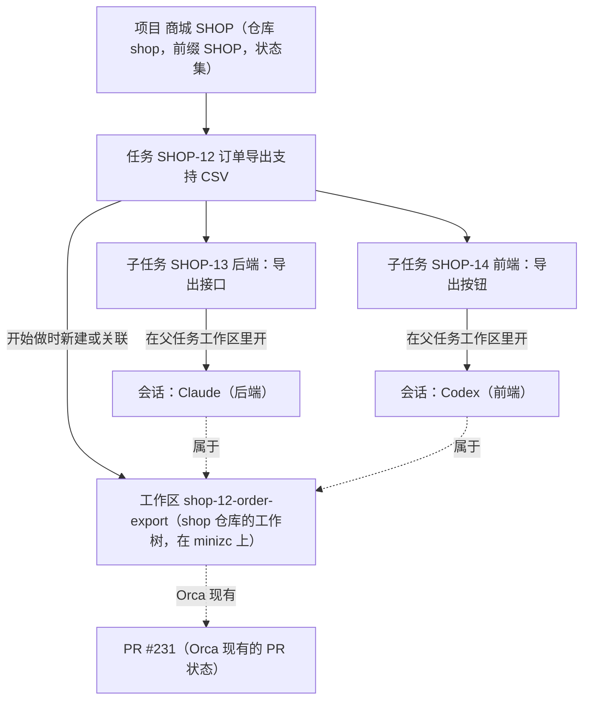
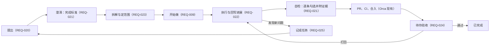

# 本地任务管理

## 1. 背景与目标

现在的 Orca 以项目和会话为中心：用户先选仓库、开工作区、开会话，「要做的事」散落在各个会话的对话里，没有地方统一记录、拆分和跟踪。原来 fork 里的「Issues 看板与会话」不好用，已于 2026-10-23 撤回（`revert(issues-board)`），这一版重新做。

**目标**：在 Orca 里加一个以任务为中心的本地任务管理。需求在这里记录、拆分、跟踪；开始做时，一键在 Orca 里开工作区和会话。之后写代码、看 diff、提 PR，都用 Orca 原有的功能，任务这边只负责把它们挂在一起、显示进展，并在会话需要人时告诉你。

**原则**：

1. 以任务为中心：从任务进入工作区和会话；工作区和会话也能看到自己属于哪个任务。
2. 只做连接，不做流程：任务这边不判断「做完没有」「做得对不对」，状态由用户决定，只保留两条可以关掉的自动规则（REQ-013）。
3. Orca 已有的不重做：diff、批注、提交、PR、Checks、智能体状态、通知，都直接用现有的。
4. 只记录明确的关联：工作区和会话只在两种时候挂到任务上，一是从任务里开，二是用户手动关联。不推断，不追踪会话身份。
5. 任务库和 Orca 的项目一样，是每台 Orca 自己的资源：项目在哪台 Orca 上，它的任务就存在哪台；其他客户端走现有的远程连接读写，主机不在联系范围内时不读它（D-008）。

产品方案与设计稿的讨论过程见 `.docs/本地任务管理调研/`（本机目录，不进仓库），主稿是 2026-10-24 目录下的 `产品方案-v4.md`，设计稿是同目录下的 `prototype-v4/`。

## 2. 用户场景

用户在商城项目（仓库 shop，前端在 `web/`，后端在 `api/`）里记录需求 SHOP-12「订单导出支持 CSV」，拆出两个子任务：SHOP-13 后端、SHOP-14 前端。在 SHOP-12 上点「开始做」，在 SSH 主机 minizc 上建出工作区 `shop-12-order-export`；再分别在 SHOP-13、SHOP-14 上「开会话」，Claude 做后端、Codex 做前端，两个会话在同一个工作区里同时运行。

之后用户不用盯着两个终端：任务列表上能看到两个会话的状态点；Codex 提问时，「需要你」里出现一条「等你回答」，用户点开会话回答；Claude 一轮做完，「需要你」里出现「做完一轮，你还没看」，用户在桌面或手机上直接给下一句指令。PR 合并后 SHOP-12 自动移到已完成。

## 3. 范围

### In Scope

- 任务管理：项目、编号、可自定义的状态、任务、子任务、优先级、标签、评论与动态、列表、看板、详情、筛选、键盘操作、Cmd+J。
- 开始做：新建或关联工作区；在工作区里开会话，任务内容作为 prompt。
- 显示进展：任务上显示工作区、会话、PR 的现有状态，点击跳过去。
- 需要你：挂在任务上的会话等批准、等回答、被卡住，或做完一轮还没看时，进入「需要你」。
- 以任务为中心的导航：侧栏可以按任务分组；工作区卡片和会话头部显示所属任务。
- 手机端与桌面功能对齐。

### Out of Scope

- 评审与验收流程、PR 的创建与合并流程、提交、占用锁与排队、智能体交付约定、执行者预设、编排。
- 一个任务涉及多个仓库、任务专用目录。前后端在同一个仓库里由用户在工程上约束，任务功能不加锁。
- 任何新的主机侧能力（执行主机上不新增 RPC、文件、端口或服务）。
- 截止日期与提醒、保存视图、任务模板、从外部 issue 导入、任务依赖、在智能体仪表盘和 AI Vault 上显示任务编号。这些以后再说，本版不预先设计。

## 4. 对象与关系

| 对象   | 规则                                                                                                       |
| ------ | ---------------------------------------------------------------------------------------------------------- |
| 项目   | 关联 0 到多个 Orca 仓库（侧栏里的仓库），一个仓库也可以被多个项目关联（D-008）                             |
| 任务   | 属于一个项目；层级不限，不能挂到自己或自己的下级下面（D-008）                                              |
| 工作区 | 每个任务最多关联一个工作区，一个工作区最多属于一个任务；没有自己工作区的任务，沿用最近一层上级任务的工作区 |
| 会话   | 工作区里的一个智能体标签，终端视图和聊天视图都算；任务和子任务都可以开会话，一个任务可以有多个会话         |

### 任务怎么展示（2026-10-30 定）

- 任务的主要信息是**标题**。凡是展示任务的地方，主文字都是标题；编号（如 `SHOP-12`）是辅助信息，用更小、更浅的字作为前缀或后缀，不能替代标题。
- 空间只够放一样时放标题，标题过长就截断，编号放进悬停提示。适用的地方包括：
  - 侧栏工作区卡片的任务标签；
  - 会话页头的任务 chip；
  - 侧栏「按任务分组」的组头；
  - 手机会话页任务条。
- 弹窗标题和提示里用标题指代任务，例如「删除『订单导出支持 CSV』？」，而不是「删除 SHOP-12？」。
- 编号只用在这些地方：
  - 搜索和跳转：Cmd+J 按编号直达，结果的主文字仍是标题；
  - 引用：分支名、prompt；
  - 列表、看板、子任务列表里，作为对齐用的小号灰色列；
  - 详情页顶部的位置标识，此时标题就在下方。

### 用词（2026-10-30 定）

桌面和手机、中文和英文都用同一套词，以本文的需求用词为准。

| 概念                               | 中文       | 英文                  |
| ---------------------------------- | ---------- | --------------------- |
| 新建工作区来做这个任务（快捷键 I） | 开始做     | Start work            |
| 不继承上级的工作区，自己开         | 单独开始做 | Start work separately |
| 工作区被删后再来一次               | 重新开始做 | Start work again      |
| 新开一个会话（快捷键 A）           | 开会话     | New session           |
| 跳到已有的会话                     | 打开会话   | Open session          |
| 任务的分组                         | 项目       | Project               |
| Orca 侧栏里的仓库                  | 仓库       | Repository            |
| 主机断开                           | 未连接     | not connected         |
| 主机断开或连接中断，状态看不到     | 无法确认   | Can’t confirm         |
| 智能体没有状态上报                 | 状态未知   | Status unknown        |
| 会话等人处理登录、额度等           | 被卡住     | Blocked               |
| 会话做完一轮                       | 做完一轮   | Finished a turn       |
| 会话退出                           | 已结束     | Ended                 |
| 任务与工作区、会话的关系           | 关联       | Link                  |
| 暂缓                               | 稍后提醒   | Snooze                |

- 本地任务界面里一律用「关联」。上游自己的「已链接的工作」等文案不改。
- 手机页面标题是「Local tasks」。

## 5. 需求点

以下「SSH 场景」指客户端是用户的桌面 Orca，工作区、会话和 PR 所在的执行主机是 SSH 主机；配对服务器与 SSH 主机遵守同样的规则。会话事实只用 `live`（在运行）、`unverifiable`（无法确认）、`exited`（已结束）三个词。

### REQ-001 项目与仓库

- 目标级别：P0；当前状态：部分实现（2026-10-26 切片 1：一个项目对应一个仓库的版本已实现并验证，见 TC-001；2026-10-28 改为项目可关联 0 到多个仓库（D-008），已随 PR #71 实现，真机证据在本机 `.docs/local-tasks-ui-validation/2026-10-28/codex-d008-verify/`，测试用例文档尚未补对应条目）。
- 描述：项目是任务的容器，字段有名称、前缀、状态集、两条自动规则的开关，以及关联的仓库（0 到多个 Orca 仓库，其中一个是默认仓库）。
  - 没有仓库的项目只做任务管理，比如调研、运营、写文档。
  - 多个仓库的项目用于前后端分仓等跨仓的情况；一个仓库也可以被多个项目关联。
  - 第一次进入任务页时，按用户已有的仓库推荐生成项目（每个仓库一个，用户确认后才创建）；也可以随时新建一个空项目，之后再关联仓库。
  - 在「设置 → 本地任务」分区里，可以改项目的名称、前缀、状态、规则开关和关联的仓库；「设置 → 任务来源」的本地任务卡片里，「管理项目与状态」也跳到这里。手机建项目时同样可以一次勾选多个仓库（2026-10-30）。
- 本机场景：本机仓库可以关联到项目。
- SSH 场景：SSH 主机上的仓库同样可以关联；项目只记录仓库在 Orca 里的标识。项目存在拥有它的那台 Orca 上（REQ-018）：桌面上的项目在 SSH 主机断开时照常显示和编辑；SSH 主机上的项目在断开时显示为未连接，不读也不写，恢复联系后再读。
- 验收标准：建一个没有仓库的项目，能建任务、改状态；建一个关联前端、后端两个仓库的项目，「开始做」时两个仓库都能选；推荐列表包含本机仓库和 SSH 仓库。

### REQ-002 编号与前缀

- 目标级别：P0；当前状态：已实现（2026-10-26 单测与真机验证通过，见 TC-002、TC-031、TC-033）。
- 描述：编号按项目递增（SHOP-1、SHOP-2……）。任务的身份是不可变的 ID，编号只用于显示和搜索。前缀可以改，改后旧前缀保留为这个项目的别名，旧编号仍能搜索和跳转；旧前缀不能再被其他项目使用。删掉的编号不复用。原项目删除后，只要仍有存活任务使用该前缀的历史编号，其他项目的新建或改前缀仍不能占用它。
- 本机场景与 SSH 场景：编号和前缀在拥有这个项目的那台 Orca 上分配（REQ-018）；不同主机上的任务库各自编号，前缀互不占用。有多台主机的任务时，编号旁显示主机名，例如「dbox · SHOP-12」。
- 验收标准：SHOP 改成 MALL 后，搜索 SHOP-12 能打开 MALL-12；新项目不能使用前缀 SHOP。

### REQ-003 状态类别与自定义状态

- 目标级别：P0；当前状态：已实现（2026-10-26 单测与真机验证通过，见 TC-003）。
- 描述：状态有 6 个固定类别：待规划、未开始、进行中、评审、已完成、已取消。新项目默认 6 个状态，每个类别一个：待规划、待办、进行中、评审中、已完成、已取消。用户可以在类别里新增、改名、改颜色、排序（例如在进行中类别里加「联调中」）；状态不能换类别；每个类别至少保留一个状态。「评审」只是一个类别，不附带任何流程。看板的列就是项目的状态；跨项目查看时按类别出列。
- 本机场景与 SSH 场景：一致，与执行主机无关。
- 验收标准：加了「联调中」后，看板多出这一列；删除一个仍有任务的状态时，要求先把这些任务移到另一个状态。

### REQ-004 任务与子任务

- 目标级别：P0；当前状态：部分实现（2026-10-26 两层版本已实现并验证，见 TC-004、TC-005、TC-006、TC-027、TC-030；2026-10-28 改为层级不限（D-008），已随 PR #71 实现，整棵子树防环，测试用例文档尚未补对应条目）。
- 描述：
  - 字段：标题、描述、完成标准（可选，普通列表，不带勾选框）、状态、优先级（无、紧急、高、中、低）、标签、父任务。
  - 层级不限：任何任务都可以有子任务。不能把任务挂到它自己或它的下级下面。列表按树缩进显示并可折叠，看板卡片和详情显示「上级 › 任务」路径。
  - 新建任务对话框带「继续创建」；在子任务输入框里粘贴多行文本，可以一次建多个子任务。手机多行创建会将表单中的状态、优先级、标签与完成标准应用到这些子任务；部分保存失败时明确保留未完成状态，重试不重复创建。
  - 删除任务只删任务记录，关联的工作区和会话都不动。删除带下级的任务时，所有下级一起删除，确认框写明总数。
  - 移到别的项目时，整棵子树一起移，各自拿到新项目的编号，旧编号仍能打开。已关联工作区的任务也能移，工作区关联保留。
  - 下级完成不会带动上级，上级的状态由用户决定。
- 本机场景与 SSH 场景：一致。删除任务时不碰执行主机，主机不在线也能删。
- 验收标准：删除 SHOP-12 后，工作区 `shop-12-order-export` 和其中的会话仍在，工作区卡片不再显示任务编号。

### REQ-005 评论与动态

- 目标级别：P1；当前状态：部分实现（2026-10-26 切片 1：评论与属性动态已实现，见 TC-007；2026-10-27 工作区、会话关联与规则触发的动态已接入，真实 PR 合并触发的动态未验收，见 TC-105）。
- 描述：任务详情下方是评论与动态。动态记录状态、优先级、父任务等属性变化，工作区和会话的关联与取消关联，以及自动规则触发的变化（例如「PR #72 合并后自动移到已完成」）。
- 本机场景与 SSH 场景：一致。动态里写明工作区所在的主机。
- 验收标准：自动规则改了状态时，动态里有一条记录写明触发原因。

### REQ-006 列表、看板与筛选

- 目标级别：P0；当前状态：部分实现（2026-10-26 切片 1：视图、列表、看板、分组、排序、筛选、批量与计数已实现，见 TC-008；2026-10-27 会话状态点、PR 徽标与「有会话在等我」筛选已接入，真实会话与 PR 状态的完整验收未覆盖，见 TC-104）。
- 描述：
  - 任务页左侧视图：需要你（带数字）、全部、进行中、待规划、已完成、已取消；下面是项目列表和「全部项目」。
  - 主区可以切换列表和看板，可以分组、排序、筛选，支持多选后批量改属性。
  - 列表默认按状态分组，子任务缩进在父任务下。每行显示优先级、编号、状态、标题、子任务进度、标签、会话状态点、PR、更新时间。
  - 看板的「已取消」列默认隐藏。
  - 计数口径：左侧视图、手机首页和分段控件上的数字，是当前项目范围内的任务总数（含子任务）；导航上「需要你」的数字是全局的，不分项目。
  - 列表分组的数字，是这一组的值（状态、优先级或项目）下有多少任务，子任务也算在内，和看板列的数字一致（2026-10-30 修订）。子任务的状态和父任务不同时，它仍显示在父任务下面，但计在自己状态的那一组里。原口径「只数顶层条目」的问题是：侧栏写「进行中 2」，分组头却写「进行中 1」，用户一眼看到就对不上。
- 本机场景与 SSH 场景：列表和看板读的是各台主机自己的任务库（REQ-018），只对在联系的主机请求；不在联系的主机，它的任务不显示新数据，标为未连接。打开和筛选不额外访问执行主机。会话状态点按 REQ-012 显示。
- 验收标准：任意数据下，三处计数按上述口径互相对得上。

### REQ-007 键盘与 Cmd+J

- 目标级别：P1；当前状态：已实现（2026-10-26 真机验证通过，见 TC-009、TC-010；Cmd+J 只在 macOS 上验证，Windows、Linux 未覆盖）。
- 描述：
  - 任务页内的单键操作：C 新建、J/K 上下移动、Enter 打开、Space 预览、X 选中、S/P/L 改状态/优先级/标签、I 开始做、A 开会话、V 切换列表和看板、F 筛选、/ 搜索；在「需要你」里 E 标记已看、H 暂缓。单键只在任务页、且焦点不在输入框里时生效；Enter、Space 聚焦按钮、链接、复选框等控件时保留控件自身行为，聚焦任务行时执行打开或预览。
  - Cmd+J（其他平台按 Orca 现有映射显示）里加「新建任务…」「打开任务…」，并支持搜索本地任务（2026-10-30 起对齐上游任务结果）：
    - 本地任务结果放在「任务」分组，排在上游结果前面。行的主文字是标题，编号是灰色前缀，副行写「本地任务 · 项目 · 状态」。
    - 回车：任务（或它的上级）有工作区，就跳到那个工作区；没有就打开任务。
    - Cmd/Ctrl+Enter：开始做。任务自己的工作区还在时，跳到那个工作区。主机不可达时说明原因。
    - 搜编号或标题，也能找到任务所属的工作区。
    - 本地任务来源在设置里被隐藏时，以上都不出现。
  - 不新增全局快捷键（2026-10-30 定）。上面的单键只在任务页里生效，不进 Orca 的快捷键设置；在任务页里，Cmd/Ctrl+F 聚焦搜索框，离开任务页后交还给 Orca。
  - 暂缓：本地任务详情不进 Orca 的前进/后退历史，鼠标侧键和 Cmd+[ 不能返回，需要在上游历史条目上加接缝，以后再做。
- 本机场景与 SSH 场景：一致。
- 验收标准：macOS、Windows、Linux 上 Cmd+J 菜单显示的组合键与平台一致；在输入框里按 C 不会新建任务。

### REQ-008 任务页入口

- 目标级别：P0；当前状态：已实现（2026-10-26 切片 1：任务页「本地」来源，见 TC-011、TC-028；2026-10-27 任务按钮上「需要你」的数字已接入，随需要你条目出现与消失，见 TC-106）。
- 描述：Orca 现有的「任务」页新增来源「本地」，排在 GitHub、GitLab、Linear、Jira 前面。左侧栏的「任务」按钮上显示「需要你」的数字，悬停时的来源快捷图标里也有「本地」，图标上带同一个数字；不能悬停的设备上，快捷图标按上游规则常显，数字也就看得到（2026-10-30）。用户在设置里隐藏了「任务」按钮时，数字不显示，入口仍在任务页和 Cmd+J。GitHub、GitLab 等现有来源的行为不变。
- 「设置 → 任务来源」的提供方卡片里有「本地任务」，排在 Jira 后面，和其他提供方一样可以显示或隐藏（2026-10-30 增补）：
  - 隐藏后，这些入口都不再出现：
    - 任务页来源栏、侧栏快捷图标、「需要你」数字；
    - Cmd+J 的本地动作和搜索；
    - 「添加引用」和「创建自」里的「本地」页签；
    - 侧栏右键「关联到任务…」（这个工作区已关联任务时除外）；
    - 手机首页卡片、手机任务页的来源选项、长按菜单里的「关联到任务…」（已关联任务的工作区除外，和桌面一致）。
  - 已经显示在工作区和会话上的关联保持不变：桌面卡片上的任务标签、手机工作区行的任务图标和长按详情里的任务行都照常显示。
  - 上游「至少保留一个提供方」的规则只看上游提供方，所以「只看本地、隐藏全部上游」做不到。
  - 选择存在本机任务库的偏好里；主机在 `localTasks.status` 里报告是否隐藏，手机据此跟随。
- 本机场景与 SSH 场景：一致。
- 验收标准：
  - 切到「本地」来源时显示本地任务；切回 GitHub 时与改动前一致。
  - 在设置里隐藏「本地任务」后，以上入口全部消失；重新显示后恢复。

### REQ-009 开始做

- 目标级别：P0；当前状态：部分实现（2026-10-27：开始做、无智能体创建与完成后关联已接入；本机与 SSH 的空终端真实界面回归通过；真实智能体启动未验收，见 TC-101、TC-110）。
- 描述：在任意一层任务上点「开始做」（快捷键 I），打开 Orca 现有的新建工作区弹窗并预填：仓库为项目的默认仓库，可以换成项目关联的其他仓库；项目没有仓库时从全部仓库里选；运行位置为上次在这个仓库用的主机，可以改；名称由编号和标题生成（例如 `shop-12-order-export`），可以改；分支名由 Orca 按用户的分支前缀设置从名称生成（例如 `zc/shop-12-order-export`）；智能体可选，选了时任务的标题、描述和完成标准放进智能体输入框当草稿，不直接发送（和上游从 issue 开工一致，2026-10-30 改）。
  - 2026-10-30 起，本地任务接入新建工作区的「创建自」，和 GitHub、Linear 等来源同一套交互：
    - 「开始做」打开弹窗时，在「创建自」里预选这个任务，显示来源胶囊（标题为主，编号是小号灰字）。
    - 「创建自」新增「本地」页签（和上游页签一样只写一个词），排在「智能」之后，按标题或编号搜索；「智能」页签的结果里不混入本地任务。
    - 清掉胶囊就是普通新建，不关联任务。文件夹和非 git 的创建目标不提供这个页签。
    - 在本地任务详情里按 Cmd+N，等于对这个任务开始做。
    - 关联仍记在任务库，不写进上游的「已链接的工作」，原因是旧版本会拒收或丢弃不认识的提供方。
    - 暂缓：从本地任务创建的工作区，在上游的创建统计里来源记为 `unknown`。改它要在上游的统计口径里加值，不由 fork 改。

  创建成功后工作区关联到任务；创建失败或取消时不留关联。之后改标题，分支名不变。任务这边也可以选「用已有工作区」，走 REQ-011 的关联。每个任务最多一个工作区；跨仓的工作拆成子任务，每个子任务在自己的仓库里开始做。没有自己工作区的任务，沿用最近一层上级任务的工作区。选中的仓库是文件夹（不是 git 仓库）时，只提供「用已有工作区」，不新建，也没有分支。

- 本机场景：在本机仓库建工作树并关联。
- SSH 场景：运行位置选 SSH 主机时，工作树建在 SSH 主机上，用 Orca 现有的创建流程，不新增主机能力。主机未连接时「开始做」不可用，并说明「minizc 未连接」这类原因；不替用户重连。
- 验收标准：本机和 SSH 各开始做一次，工作区卡片显示正确的主机和分支；SSH 主机断开时按钮置灰并显示原因。

### REQ-010 开会话

- 目标级别：P0；当前状态：部分实现（2026-10-27：开会话对话框、身份记录与结构化回退处理已接入并有受控测试；真实智能体启动未验收，见 TC-102、TC-113）。
- 描述：在任务或子任务上点「开会话」（快捷键 A），复用 Orca 现有的启动智能体：
  - 智能体默认为 Orca 设置里的默认智能体，可以改；
  - 位置是任务自己的工作区，没有就用最近一层上级任务的工作区，只读；
  - 显示方式（终端或聊天视图）跟随 Orca 的设置；
  - prompt 是任务的标题、描述、完成标准，子任务额外带上各级上级任务的摘要；
  - 发送方式由用户选：直接发送，或只放进输入框当草稿。

  会话开起来后记在这个任务下。任务和它的上级都还没有工作区时，「开会话」先走一遍「开始做」。同一个工作区里可以同时运行多个会话。

- 本机场景：在本机工作区开会话。
- SSH 场景：在 SSH 工作区开会话，会话运行在 SSH 主机上。主机未连接时「开会话」不可用并说明原因。
- 验收标准：SHOP-13、SHOP-14 各开一个会话，两个会话同时运行、互不影响，分别显示在各自子任务下。

### REQ-011 关联已有工作区和会话

- 目标级别：P0；当前状态：部分实现（2026-10-27：任务详情的手动关联、唯一性、取消关联与换父后的历史会话规则已接入并回归；2026-10-27 侧栏工作区卡片 chip、右键「关联到任务…」、终端会话头部 chip 已在真实界面验证，结构化聊天会话 chip 未实测；手机关联已有工作区含 SSH 与配对服务器上的工作区，见 TC-103、TC-109、TC-110、TC-112）。
- 描述：
  - 已有工作区（2026-10-30 起走 Orca 的「工作区详情 → 已链接的工作 → 添加引用 → 本地」）：
    - 侧栏右键「关联到任务…」打开这个弹窗并定位到「本地」页签；任务详情里也能选「用已有工作区」。
    - 页签可以按标题或编号搜索；关联了这个仓库的项目里的任务排在前面，其余任务也能选；已有工作区的任务置灰并说明原因。
    - 已关联的任务显示在「议题和任务」里，以标题为主，计入「已链接 N 项」，可以取消。
    - 改动是草稿，点「保存」才写入。选第二个任务时直接替换，并标「将替换」。任务这一步保存失败时弹窗不关。
    - 文件夹工作区同样可以关联。
    - 来源在设置里被隐藏时页签不出现，但已关联的任务仍显示，也能取消。
    - 任务库所在的 Orca 不在联系时，页签里的任务置灰并写明原因。
  - 已有会话：在会话头部的任务 chip 上选「关联到任务…」。可选范围是会话所在工作区所属的任务及其全部下级。工作区还没关联任务时，会话头部不显示 chip，要先从侧栏右键或工作区详情关联工作区（2026-10-30 定：不给每个会话头部加入口）。
  - 关联都可以取消。取消关联只删关联记录，不动工作区和会话；取消工作区关联时，这个任务及其子任务在该工作区里的会话关联一并取消。
  - 任务换上级时，它自己的工作区关联和已有的会话关联都保留（会话关联记的是它实际运行的工作区）；没有自己工作区的任务，之后新开的会话用新上级沿用下来的工作区。
- 本机场景：本机工作区和会话可以关联。
- SSH 场景：SSH 主机上的工作区和会话同样可以关联；关联记录和任务存在同一台 Orca 上（REQ-018），写入时这台主机要在联系；工作区所在的执行主机不在线也能关联。
- 验收标准：一个工作区不能关联第二个任务，提示它已属于哪个任务；父任务和两个子任务可以各自关联不同仓库的工作区。

### REQ-012 显示进展

- 目标级别：P0；当前状态：部分实现（2026-10-27：进展快照、列表/看板徽标和详情工作区/会话区域已接入；真实会话和 PR 状态的完整验收未覆盖，见 TC-104）。
- 描述：任务上只显示 Orca 已有的数据，不新增判断。
  - 列表行和看板卡片：工作区标记、会话状态点（复用 Orca 的智能体状态点）、PR 状态。
  - 任务详情右栏「工作区」：工作区名、主机、分支、改动统计（Orca 已读取过时才显示）、PR 和 Checks；操作有「打开工作区」和「看改动」（跳到 Orca 的源码管理）。
  - 任务详情「会话」：每个会话一行，显示智能体、所属子任务、状态点、最后一句话，点击跳到会话。
  - 子任务行显示它开的会话的状态点。
  - 筛选「有会话在等你」：任务的会话里有进入「需要你」的条目。
  - 例外状态：工作区被删除，显示「工作区已删除」，可以重新开始做；会话关闭了，显示「已结束」，可以再开一个；Orca 重启后找不到记录的会话，显示「找不到这个会话」，提供「打开工作区」；没有集成状态上报的智能体，显示「状态未知」。
- 本机场景：状态实时更新。
- SSH 场景：主机在联系范围内时，状态与本机一样实时更新。主机断开时，会话状态点和 PR 显示「无法确认」（`unverifiable`），不当成已结束；恢复联系后自动对上。断开期间不重连、不轮询、不读该主机。
- 验收标准：断开 SSH 后状态点变为「无法确认」，任务的状态不变；恢复联系后状态点回到真实状态。

### REQ-013 两条自动规则

- 目标级别：P1；当前状态：部分实现（2026-10-27：开始做规则已在本机实际界面验证，PR 规则维护与去重已接入；真实 PR 合并触发未验收，见 TC-105、TC-110）。
- 描述：状态由用户改，只有两条自动规则，都可以在项目设置里关掉，默认都开：
  1. 从任务里「开始做」（新建或关联工作区，或开第一个会话），任务还在待规划或未开始类别时，移到进行中类别的第一个状态。
  2. 工作区关联的 PR 合并后，关联这个工作区的任务移到已完成类别的第一个状态；它的上级不自动完成。（2026-10-30 提出改为移到「待验收」，见 REQ-024，待确认。）

  规则触发时在动态里留一条记录（REQ-005）。规则 2 由桌面窗口读到 PR 状态时执行：只用手机、桌面窗口一直没打开时，任务要等下次打开桌面窗口才会自动完成。

- 本机场景：本机工作区的 PR 合并后触发规则 2。
- SSH 场景：SSH 工作区的 PR 状态由 Orca 现有的 PR 读取提供；主机不在联系范围内时不读，恢复联系后读到「已合并」再触发，不补发、不重复触发。
- 验收标准：PR 合并后任务自动完成；关掉规则 2 后不再自动完成。

### REQ-014 需要你：判定

- 目标级别：P0；当前状态：部分实现（2026-10-27：桌面判定版本已接入；2026-10-28 改为由拥有会话的主机判定（D-008），已随 PR #71 实现，SSH 真机证据在本机 `.docs/local-tasks-ui-validation/2026-10-30/ui-final/ssh/`，测试用例文档尚未补对应条目）。
- 描述：判定在拥有会话（也就是拥有这个任务库）的那台 Orca 上做，桌面、手机、局域网网页版看到的是同一份结果。完全使用 Orca 现有的智能体状态（hooks 优先，其次是终端里的 OSC 7501），不自己猜测。只看挂在任务上的会话。规则只有 4 条：

  | 类型               | 判定                                                                                                  | 何时自动消失                                           |
  | ------------------ | ----------------------------------------------------------------------------------------------------- | ------------------------------------------------------ |
  | 等你批准           | 状态为等待，原因是权限申请                                                                            | agent 回到工作中                                       |
  | 等你回答           | 状态为等待，原因是提问，或 agent 没报原因；结构化聊天会话需要人处理时也归为这一类（这类会话不报原因） | 用户回答后 agent 继续                                  |
  | 被卡住             | 状态为阻塞，比如要登录、额度用完                                                                      | agent 恢复工作                                         |
  | 做完一轮，你还没看 | 状态为完成，并且这一轮还没人看过                                                                      | 用户在任意一端打开会话看过、标记已看，或给了下一句指令 |

  不进「需要你」的：正在工作的会话；已完成且看过的会话；主机断线的会话（显示「无法确认」）；Orca 刚重启、还没收到新状态的会话；没有挂在任务上的会话（仍由智能体仪表盘和现有通知负责）；没有集成状态上报的智能体（会话行显示「状态未知」）。

  「完成」只表示 agent 的这一轮结束了，不代表任务做完了：条目只写「Claude 停下了，最后一句：……」，任务状态不因此改变。每条显示任务标题和编号、类型、智能体和它的最后一句话、时间；同一个任务下的多条合并成一行。入口有左侧栏「任务」按钮上的数字、任务页的「需要你」视图、手机首页的任务卡片；系统通知沿用 Orca 现有的智能体通知设置，不新增开关。

  「需要你」与智能体仪表盘的「需要你」同名，口径不同（2026-10-30 定，不改名）：这里只看挂在任务上的会话，仪表盘看全部会话；挂在任务上的会话会在两边同时出现，这是预期的。在这里标记已看（E）只移出本地列表，不会清掉 Orca 的未读和仪表盘里的条目；反过来，在会话里看过会清掉这里的「做完一轮，你还没看」。

- 本机场景：4 条规则都能触发，也都按上表自动消失。
- SSH 场景：判定用的状态由执行主机上报，与本机一致；主机断开时条目不再算「需要你」，改为在会话行显示「无法确认」；恢复联系后按真实状态重新判定。拿不到等待原因的主机，一律显示「等你回答」。
- 验收标准：本机和 SSH 下 4 条规则各触发一次，条目出现并按规则消失；Aider 这类没有集成的智能体不进「需要你」。

### REQ-015 需要你：操作

- 目标级别：P0；当前状态：部分实现（2026-10-27：桌面暂存队列版本已接入；2026-10-28 改为照 Orca 现有会话发消息一次发送、失败退回文字（D-008），已随 PR #71 实现，暂存表已在库版本 4 删除，测试用例文档尚未补对应条目）。
- 描述：每条可以：
  - 打开会话。
  - 回复：和 Orca 现有的给会话发消息一样，直接发进会话，发一次，显示送达状态（已送达、已发出未确认，或失败原因）；发不出去时文字退回回复框，不排队、不自动重发。只有「做完一轮，你还没看」能回复（给下一句指令，终端和聊天视图都可以）。其余只提供「打开会话」：
    - 等你批准：Orca 在智能体等权限确认时会拒绝写入，批准要在会话里点；
    - 等你回答：终端里的提问几乎都是选项菜单或对话框，Orca 在这时同样拒绝写入；用一段文字提问时智能体已经结束这一轮，会归到「做完一轮，你还没看」；结构化聊天会话拿不到原因，可能其实是批准请求；
    - 被卡住：登录、额度这类问题要在会话里解决。
  - 标记已看（E）：只把条目移出列表，不改变任何事实；同一个会话下次进入需要你的状态时会重新出现。
  - 暂缓（H）：1 小时、今晚、明天、下周，或自定义时间；到时间后条目回到列表（如果仍满足判定）。
- 本机场景：回复后显示送达状态。
- SSH 场景：主机在联系范围内时与本机一致。主机未连接时与 Orca 现有的会话输入框一样：桌面回复框上方提示主机离线或重连中，发送失败时文字保留；手机回复框禁用并显示「重连中」。不暂存、不在恢复联系后自动发出。
- 验收标准：桌面和手机上各回复一次，看到送达；SSH 断开时回复，文字保留在回复框，恢复联系后可以再发。

### REQ-016 以任务为中心的导航

- 目标级别：P1；当前状态：部分实现（2026-10-27：按任务分组、组折叠、定位工作区时自动展开、分组时隐藏不适用的项目排序、工作区卡片与终端会话 chip 已在真实界面验证；结构化聊天会话 chip 未实测，见 TC-103、TC-108）。
- 描述：
  - 左侧栏分组方式新增「按任务」：组头是任务，组内是现有的工作区卡片；没关联的放在「未关联任务」组。默认分组不变。
  - 工作区卡片（2026-10-30 起）：
    - 关联了任务的卡片显示任务标题小标签，编号放进悬停提示，工作区名优先。
    - 按任务分组时，组头已经显示了任务，卡片里只显示工作区名。
    - 标签受「显示属性 / 卡片显示 → 本地任务」开关控制，默认显示；库里有项目时才出现这个开关。手机工作区行上的任务图标跟随同一个开关。
  - 卡片悬停详情显示所属任务，不受开关影响：
    - 工作区只挂了这个任务时，单独一个「本地任务」小节；
    - 挂了多项时，任务排在「议题和任务」第一行；
    - 只挂了本地任务的工作区也有悬停详情；
    - 任务库所在的 Orca 不在联系时，状态写「无法确认」。
  - 会话头部显示任务 chip，主文字是任务标题，点开是任务小卡（父任务、打开任务）。会话所在的工作区已关联任务、会话本身没关联时，chip 提供「关联到任务…」；工作区也没关联时不显示 chip（见 REQ-011）。
- 本机场景与 SSH 场景：本机和 SSH 工作区都按关联记录分组和显示，主机断开时工作区卡片照常显示任务标题。
- 验收标准：切到「按任务」分组后，SHOP-12 组内是 `shop-12-order-export`，refund-webhook 在「未关联任务」组；切回默认分组与改动前一致。

### REQ-017 手机端

- 目标级别：P0；当前状态：部分实现（切片 1、切片 2 手机功能已实现，协议层与云真机部分验证，见 TC-012、TC-013、TC-016、TC-026、TC-027、TC-035、TC-102、TC-109；2026-10-28 改为按主机读写任务库并支持树形层级（D-008），已随 PR #71 实现；2026-10-30 补齐与桌面对齐的细节，暂缓项见下文）。
- 描述：手机和查看项目、会话一样读写任务：在某台主机的页面里，看到这台主机的任务库，以及经它连接的服务器上的任务库；功能与桌面对齐：
  - 首页任务卡片显示「需要你」和进行中的数量，列出最急的 3 条；
  - 「需要你」页可以回复、打开会话，左滑可以标记已看或暂缓；
  - 任务页有项目切换、分段控件（需要你 / 进行中 / 全部）、列表、横向滑动的看板、详情、筛选；
  - 新建和编辑任务、子任务、评论用全屏表单；
  - 设置里管理项目与状态，包括与桌面一致的项目删除确认：写明任务数量，只删任务记录，保留 Orca 仓库与工作区；
  - 详情页的「开始做」「开会话」，参数同桌面，由拥有任务库的那台 Orca 执行；
  - 跳到工作区和会话时打开现有的主机页和会话页；现有会话页顶部显示所属任务；主机页长按工作区可以「关联到任务」；文件夹工作区在主机页不能长按，改从任务详情的「关联已有工作区」关联。
  - 入口和上游对齐（2026-10-30）：
    - 任务页的来源选择里有「本地任务」，排在 GitHub 等上游来源之前，选中后进入本地任务页，不改主机的默认来源。没有项目时也出现，点进去是建项目引导。
    - 主机页顶栏不再有单独的本地任务按钮。
    - 长按工作区的详情里，在评审之后列出它所属的任务，点开是任务详情。
    - 工作区行显示任务图标，跟随桌面的显示开关。
    - 新建工作区的「创建自」里有「Local」来源，排在 Smart 之后：选中任务后，建好的工作区关联到任务（2026-10-30 定）。
    - 手机把任务内容作为智能体的第一条消息直接发送，不放进输入框当草稿；「开始做」也不再提供「立即发送」开关（2026-10-30 用户定）。
      - 原因：主机对草稿一律不投递，上游手机自己的启动也都是直接发送。
      - 桌面不变，仍然放进草稿。
      - 主机回报没有送达时，比如智能体还停在它自己的信任提示上，手机留在任务页，并写明「任务内容没有送达，还在任务上」。
    - 本地任务来源在桌面被隐藏时，这些入口都不出现；已关联任务的工作区仍显示任务图标、长按详情里的任务行和「Link to task…」。
  - 与桌面对齐的细节（2026-10-30 补齐）：
    - 列表行和看板卡显示会话状态点；
    - 筛选有「有会话在等你」；
    - 详情的工作区区显示 PR、Checks，识别工作区已删除；
    - 会话行可以取消关联；
    - 动态写明规则触发原因和工作区主机；
    - 回复失败写明原因；
    - 建项目可以多选仓库；
    - 任务页记住上次的项目、分段和布局；从首页「需要你」进入时是全部项目；
    - 「需要你」为空、但有会话无法确认时，写明「无法确认」。
  - 暂缓（2026-10-30）：
    - 手机暂缓只有预设时间，没有「自定义时间」。原因：手机工程没有日期时间选择控件，不为这一处引入新依赖。
    - 手机不显示工作区状态、改动统计。原因：
      - 手机拿到的工作区数据里有状态 id，但没有状态名称和颜色，要显示就得多读一次主机的界面设置；
      - 也没有改动统计，要显示就得在执行主机上新增一次 git 读取。
      - 按「Orca 已读取过才显示」的规则，这两项不显示。

  连不上桌面 Orca 时，任务入口显示「mbp5 的 Orca 未连接」这类提示（只用已读到的机器名；没有机器名时不显示 hostId）；配对失效单独提示重新配对。桌面 Orca 版本过旧、不支持本地任务时，手机上不显示任务入口。主机断开时，「开始做」「开会话」置灰，并在旁边写明原因；恢复联系后不自动轮询，由用户点「Check connection」重读。

- 本机场景：手机连接桌面 Orca，操作本机工作区上的任务。
- SSH 场景：手机连接桌面 Orca，任务的工作区在 SSH 主机上；状态显示与桌面一致，主机断开时同样显示「无法确认」。
- 验收标准：手机上完成一次新建任务、开会话、回复「做完一轮，你还没看」并看到送达；桌面版本不支持时手机不出现任务入口。

### REQ-018 数据归属与跨机器

- 目标级别：P0；当前状态：部分实现（2026-10-26「只存桌面」版本已实现并验证，见 TC-013～TC-016、TC-025、TC-038；2026-10-28 改为任务库是每台 Orca 自己的资源（D-008），已随 PR #71 实现：桌面、`orca serve`、orcad 各开自己的库，SSH 真机证据在本机 `.docs/local-tasks-ui-validation/2026-10-30/ui-final/ssh/`，测试用例文档尚未补对应条目）。
- 描述：任务库和 Orca 的项目一样，是每台 Orca 自己的资源：桌面 Orca 存它自己项目的任务，配对服务器（`orca serve`）和 SSH 主机上托管的 orcad 服务器存它们自己项目的任务，每个 profile 一份。任务与工作区、会话的关联存在拥有任务的那台主机上。客户端（另一台桌面、局域网网页版、手机）用 Orca 现有的远程连接读写，和管理那台主机的项目、会话一样；只在主机在联系时读，不重连、不轮询。同一个 Orca 项目在多台主机上各有一份时，任务也各存各的，不合并、不同步（D-008）。
- 同一次写入在 24 小时回执窗口内使用同一操作号、同一方法与参数重试时不重复执行；窗口内发生超过 1000 次其他写入、桌面重启后也保持去重。不同方法/参数或损坏回执明确失败且不重做；写入时按时间清理旧回执（D-006）。
- 本机场景：任务数据和工作区都在本机。
- SSH 场景：SSH 主机上托管的 orcad 服务器拥有该主机上项目的任务库，数据文件在 SSH 主机的 Orca profile 目录里；桌面经现有连接读写，主机不在线时这台主机的任务显示为「未连接」，不读、不重连；恢复联系后重新读取。
  - 直连 SSH（经 relay，主机上没有 orcad）的项目，任务存在发起连接的桌面库里（2026-10-30 补记）。两台桌面经 relay 连同一台主机时，各存一份，互不可见；要共享，需改用 orcad 托管。
- 验收标准：桌面项目的任务只在桌面的库里；SSH 主机上 orcad 托管项目的任务只在 SSH 主机的库里，桌面和手机都能看到并编辑；SSH 断开时这些任务显示未连接，恢复后自动对上；两台桌面连同一台 orcad 托管的 SSH 主机时，看到的是同一份 SSH 主机任务。

### REQ-019 与 Orca 其他功能的衔接

- 目标级别：P2；当前状态：部分实现（2026-10-30 已接入，单元测试覆盖，真实界面未逐项验收）。
- 描述：本地任务像上游工作项一样，参与 Orca 的其他功能。
  - **PR 描述**：AI 生成 PR 描述时，带上工作区所属任务的标题、描述和完成标准，作为不可信的上下文，不当作 issue 引用。只在执行主机上读它自己的任务库，不跨机器。直连 SSH 的 PR 生成上游本来就不支持，这里也不支持。
  - **工作区清理**：「工单来源」维度新增「本地任务」；挂了任务的工作区不再算「完全空」。来源隐藏或没有项目时不提供这个筛选项。
  - **CLI**：新增 `orca task` 命令组，包括 `list`、`show REF`、`current`（当前工作区所属的任务）、`comment REF 内容`、`status REF 状态名`。
    - 输出以标题为主；写入带操作号，改状态时带版本号，防止覆盖别人刚做的修改。
    - 主机没有任务库时，提示升级那台主机上的 Orca。
- 本机场景与 SSH 场景：PR 描述和 CLI 都由拥有任务库的那台 Orca 执行；配对服务器和 orcad 主机上的工作区，读它们自己的库。
- 验收标准：
  - 挂了任务的工作区生成 PR 描述时，能看到任务内容；
  - 清理弹窗能按「本地任务」筛选；
  - 在工作区终端里运行 `orca task current`，能看到所属任务。

### 从提出到验收：工作流迭代（2026-10-30 提出，待用户确认）

背景：用户反馈「从提出一个 issue 到完成，整条动线不流畅」，决策见 journal D-009。这次开发本身就暴露了几个断点：

- 反馈散落在聊天和截图里，没有逐条记录；
- 范围只在聊天里定，后来说「做完了」时对不上账；
- 进展用户看不到；
- 「完成」的标准只在执行方心里；
- 合入以后，用户的 App 里还看不到；
- 没有「用户验收」这一步；
- 中途发现的新问题没有记下来。

下面 REQ-020～REQ-025 补齐这条动线。在用户确认之前不动代码。

原则 2「只做连接，不做流程」依然成立：任务这边仍然不替用户判断「做完没有」「做得对不对」。新增的是让每一步看得见、能对账的位置，结论都由用户点。

### REQ-020 提出：截图附件与随手记成任务

- 目标级别：P0；当前状态：未实现（2026-10-30 提出，待确认）。
- 描述：
  - 任务描述和评论可以带图片：粘贴截图、拖入文件，手机上可以拍照或从相册选。图片存在拥有任务库的那台 Orca 上（REQ-018），按任务删除时一起删。单张和每个任务的总量都有上限，超出时说明原因。
  - 随手记成任务：
    - 在终端里选中文字或在聊天消息上右键，选「记成任务…」；
    - 在 PR 评论、任务评论上同样可以；
    - 标题和描述预填选中的内容，附上来源（哪个会话、哪条消息）；
    - 来源会话属于某个任务时，默认记成它的子任务，可以改。
  - CLI 新增 `orca task create`，可以带 `--parent`，供智能体把「发现但这次不处理」的问题记下来（见 REQ-025）。
- 本机场景：图片存在本机任务库旁边，界面直接显示。
- SSH 场景：
  - 图片随任务库存在 SSH 主机（orcad）或配对服务器上，按需读取，主机不在联系时显示占位，不重试。
  - 旧版本的主机不支持附件时，不提供上传入口，只提示升级那台主机。新增的字段都是可选的，旧客户端忽略。
- 验收标准：
  - 在桌面粘贴一张截图到任务描述，手机上能看到；
  - 在终端里选中一句报错，记成任务后，标题和来源都对，而且挂在当前任务下。

### REQ-021 完成标准可勾选，并能附证据

- 目标级别：P0；当前状态：未实现（2026-10-30 提出，待确认）。
- 描述：
  - 完成标准的每一条可以勾选，记录谁勾的、什么时候勾的；勾选时可以附证据：
    - 链接：PR、CI 运行、文件路径；
    - 一段文字：例如测试输出的摘要；
    - 图片：例如截图，见 REQ-020。
  - 智能体可以用 `orca task criteria check REF 序号 --evidence 内容` 勾选并附证据，用户也可以手动勾选或取消。
  - 勾选不自动改任务状态（原则 2）。全部勾完时，任务上提示「完成标准都已勾选」。
  - 与 Goal 目标模式打通（待确认）：
    - 从任务「设为目标」时，完成标准作为 Goal 的验收文档；
    - Goal 守卫给出的验收结论，作为证据回写到对应条目。
- 本机场景与 SSH 场景：勾选和证据存在拥有任务库的那台 Orca 上；智能体在 SSH 主机上运行 `orca task` 时，写的是那台主机自己的库。主机不在联系时不能勾选，并说明原因。
- 验收标准：智能体完成自检后，三条完成标准都勾上并附了证据；用户在桌面和手机上都能点开证据。

### REQ-022 执行中回写进展

- 目标级别：P1；当前状态：未实现（2026-10-30 提出，待确认）。
- 描述：
  - 从任务「开始做」「开会话」时，提示词末尾附一段「进展回写说明」，用户可以在设置里关掉。说明要求智能体在这几个时刻用 `orca task comment` 回写一句：
    - 开始；
    - 完成一个阶段；
    - 遇到阻碍；
    - 自检完成。
  - 任务详情顶部显示「当前进展」：最近一条智能体回写的内容和时间，点开看全部动态。
  - 只显示智能体写的，不从会话内容推断（原则 4）。
- 本机场景与 SSH 场景：回写走 `orca task`，由拥有任务库的那台 Orca 执行，与 REQ-019 一致。
- 验收标准：开始做后，智能体在任务上留下「开始」和「自检完成」两条进展，桌面和手机都能看到。

### REQ-023 拆解时写明每一项的去向

- 目标级别：P1；当前状态：未实现（2026-10-30 提出，待确认）。
- 描述：
  - 子任务（以及从走查、评审里拆出来的条目）都有明确的去向：
    - 做（默认）；
    - 不做：放进已取消，必须写一句理由；
    - 暂缓：放进待规划，写明等什么；
    - 等你决定。
  - 父任务详情显示范围汇总：做 N、不做 N、暂缓 N、等你决定 N，点开看清单和理由。
  - 「等你决定」的条目进入「需要你」，作为新的一类「等你决定」（待确认）。这一类由任务字段判定，不是智能体状态，所以不受 REQ-014「只看会话」的限制。
- 本机场景与 SSH 场景：一致。
- 验收标准：走查拆出 30 条后，父任务上能一眼看出每条的去向；没有去向不明的条目。

### REQ-024 合入后进入「待你验收」

- 目标级别：P0；当前状态：未实现（2026-10-30 提出，待确认）。
- 描述：
  - 修订 REQ-013 的规则 2：工作区关联的 PR 合并后，任务移到「待验收」，不再直接完成。「待验收」是评审类别下新增的默认状态，老项目也补上。在项目设置里可以改回「合并即完成」。
  - 待验收的任务进入「需要你」，类别是「等你验收」（待确认）。条目上写明：
    - 合入位置：目标分支和提交；
    - 完成标准的勾选情况和证据（REQ-021）；
    - 用户要去哪里看：项目可以配置一句验收说明，例如「更新内测包后在任务页查看」。
  - 操作：
    - 「通过」：移到已完成；
    - 「打回」：回到进行中，要写原因。原因记成评论，并且可以一键作为下一句指令发给关联的会话（REQ-015 的回复规则）。
  - 手机上同样可以通过或打回。
- 本机场景与 SSH 场景：PR 状态的读取与 REQ-013 一致；主机不在联系时不触发，恢复后读到「已合并」再移到待验收，不重复触发。
- 验收标准：PR 合并后，任务出现在「需要你 → 等你验收」；打回后会话收到原因，任务回到进行中。

### REQ-025 中途发现的问题当场记下

- 目标级别：P1；当前状态：未实现（2026-10-30 提出，待确认）。
- 描述：
  - 执行和评审中发现、但这次不处理的问题，当场记成任务，挂在原任务下，并写明来源。来源可以是：
    - 会话：REQ-020 的「记成任务…」；
    - PR 评论；
    - 智能体运行 `orca task create --parent`；
    - 任务评论。
  - 原任务详情列出「衍生问题」，进入待验收时一并显示，避免只留在聊天里。
  - 「进展回写说明」（REQ-022）里同时要求智能体这样做。
- 本机场景与 SSH 场景：一致；写入拥有原任务的那台 Orca 的库。
- 验收标准：智能体在执行中发现一个上游缺陷，任务下多出一个子任务，来源指向那个会话。

## 6. 边界情况

| 情况                         | 处理                                                                 |
| ---------------------------- | -------------------------------------------------------------------- |
| 关联的工作区被删除           | 任务上显示「工作区已删除」，可以重新开始做                           |
| 会话关闭了                   | 会话行显示「已结束」，可以再开一个                                   |
| Orca 重启后找不到记录的会话  | 显示「找不到这个会话」，提供「打开工作区」                           |
| 删除任务                     | 只删任务记录，工作区和会话都不动                                     |
| 一个工作区想关联第二个任务   | 不允许，提示它已属于哪个任务（写任务标题）                           |
| 任务移到别的项目             | 整棵子树一起移，工作区关联保留，旧编号仍能打开（REQ-004）            |
| 项目对应的仓库从 Orca 里移除 | 项目和任务保留，「开始做」不可用并提示仓库已移除                     |
| 执行主机断开                 | 任务照常管理；会话和 PR 显示「无法确认」；「开始做」「开会话」不可用 |

## 7. 交付切片

| 切片                 | 内容（桌面和手机一起交付）                                                                                | 覆盖的需求                                    |
| -------------------- | --------------------------------------------------------------------------------------------------------- | --------------------------------------------- |
| 1 任务库             | 项目、编号、状态、任务、子任务、列表、看板、详情、评论与动态、键盘、Cmd+J、设置、任务页入口、手机对应页面 | REQ-001～REQ-008、REQ-017 的任务部分、REQ-018 |
| 2 和工作区、会话结合 | 开始做、开会话、关联、进展显示、自动规则、需要你、侧栏按任务分组、卡片编号、会话 chip、手机对应功能       | REQ-009～REQ-016、REQ-017 的其余部分          |
| 3 从提出到验收       | 截图附件与随手记、完成标准勾选与证据、进展回写、范围去向、待你验收、衍生问题（待用户确认后排期）          | REQ-020～REQ-025                              |

## 8. 待确认问题

以下是本稿的默认做法和理由，用户确认或修改后再定稿。

1. 文件夹项目的「开始做」：只关联已有的文件夹工作区，不新建（已写进 REQ-009）。文件夹没有分支和 PR；替用户新建目录等于做「任务目录」，本版不做。
2. 第一次进入任务页：只推荐项目，用户确认后才建（已写进 REQ-001）。一个仓库只能对应一个项目，自动建会把不想管的仓库也塞进来。
3. 「做完一轮，你还没看」的未读标记：代码调研确认桌面上能按单个会话读取；SSH 和配对服务器上的会话是否都有，列为开工前验证（技术方案 §13）。读不到的主机上这条规则不生效，不去猜。
4. 桌面 Orca 关闭时手机是否显示缓存：首次加载前不显示；已加载后允许遮盖旧内容并禁写，但不卸载页面、导航或草稿，只提示未连接（已写进 REQ-017）。缓存里的「需要你」一定是过期的。
5. 删除带子任务的任务：子任务一起删除，确认框写明数量（已写进 REQ-004）。子任务没有自己的工作区，提升为顶层任务后会出现「顶层任务没有工作区、会话却在别人的工作区里」的情况。

### 2026-10-30 「从提出到验收」待确认问题

1. **修订 D-1 与原则 2 的边界**：接不接受「待你验收」「完成标准勾选与证据」这类帮用户对账的能力？默认做法：接受，但仍然不自动判断，结论都由用户点。
2. **规则 2 的默认值**：PR 合入后，新老项目都改成进「待验收」，还是只有新项目这样、老项目保持「合并即完成」？默认做法：都改，可以在项目设置里改回。
3. **「需要你」新增两类**：「等你决定」「等你验收」由任务字段判定，不是智能体状态。默认做法：加，但在视图里和会话类的条目分组显示。
4. **与 Goal 目标模式打通的深度**：只把完成标准导出成验收文档，还是让 Goal 守卫的结论回写成证据？默认做法：两者都做，回写只作为证据，不改任务状态。
5. **附件**：上限多少，手机是否离线缓存？默认做法：单张 10 MiB、每个任务 50 MiB，手机不缓存。
6. **「可用」这一步**（合入以后，用户什么时候能在 App 里用上）：通用的 Orca 不知道用户项目怎么发布。默认做法：只做 REQ-024 里的「验收说明」文本；对接各自的发布流水线不做。

### 2026-10-26 独立审查后的修复确认

用户要求修复独立审查记录的问题，并要求先提交旧实现。旧实现已保存为 `6971551474b3`。本轮明确旧编号在原项目删除后的命名空间保护、手机多行子任务的字段与部分保存语义、手机删除项目及延迟重投去重；未推进切片 2。已有会话的子任务更换父任务后如何处置会话与工作区关联，仍是切片 2 的待确认问题。

### 2026-10-26 切片 1 评审修复确认

- 用户确认 D-006：回执绑定方法及去掉 clientOperationId 后的稳定参数指纹，24 小时窗口内同号同请求回放；不同方法或参数、损坏回执明确拒绝，绝不删除回执重做。每次写入顺带按时间清理。
- 已成功加载的数据在后续重读失败时保留，桌面与手机只显示手动重试提示；动态失败只重读对应任务动态，变更流收到 end 才提示重新连接。手机断线或 checking 不卸载库页面，写操作禁用。
- 上述契约同时适用于本地与 SSH 工作区；数据库和服务仍归桌面宿主，SSH 失联不改变任务数据归属，不触发本功能自行重连。
