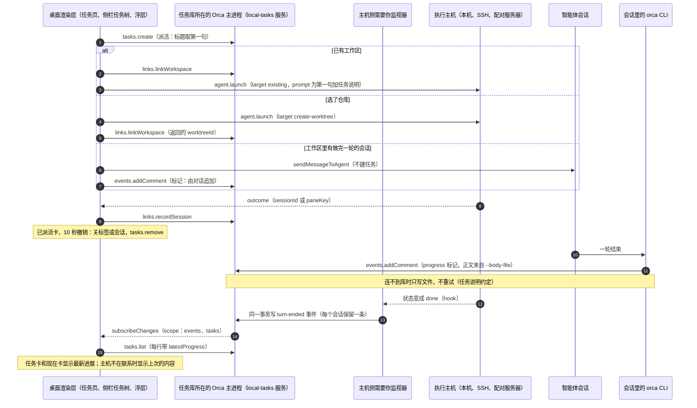
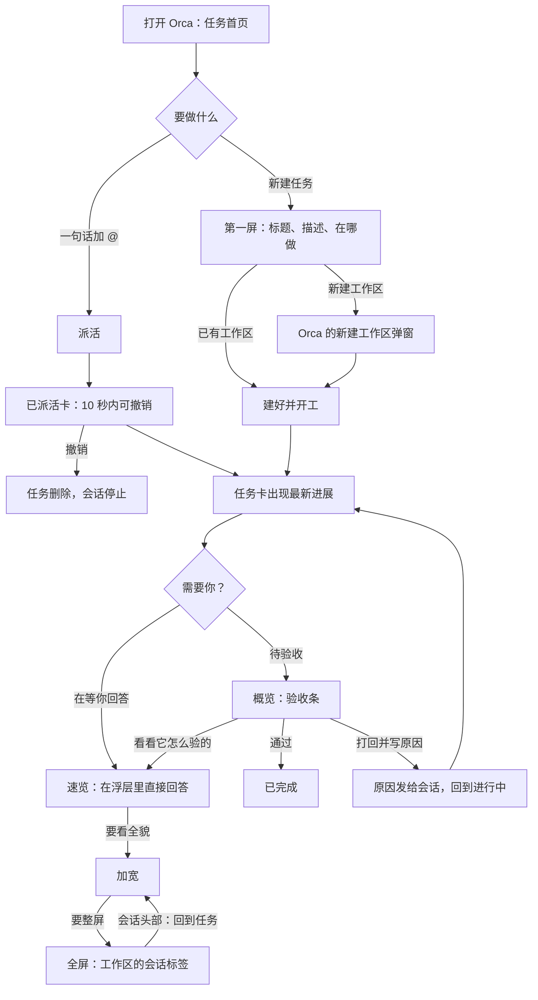
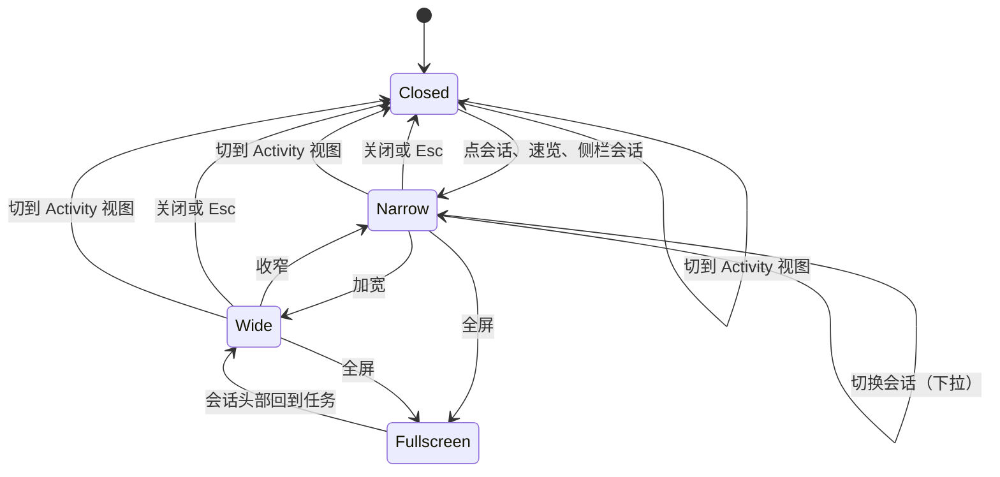

# 任务为主的工作流技术方案

- 需求：[本地任务管理](../requirements/本地任务管理.md) REQ-022、REQ-024、REQ-026～REQ-030，以及它们修订的 REQ-004、REQ-005、REQ-007、REQ-009～REQ-019、REQ-021（已取消）。
- 产品方案：[任务为主的工作流产品方案](../interaction/任务为主的工作流产品方案.md)；评审：[方案评审](../interaction/任务为主的工作流方案评审.md)；决策 D-011～D-014 见 [journal](../journal.md)。
- 交互原型：[interaction/prototype-task-first](../interaction/prototype-task-first/README.md)（浏览器打开其中的 `index.html`）。
- 前一版技术方案：[本地任务管理技术方案](本地任务管理技术方案.md)（切片 1、2，含 §17 主机资源化）。本文只写增量，那篇里已经定下的数据层、RPC、推送、能力协商、标识规则直接沿用，不重写。
- 代码基线：`feat/local-tasks-walkthrough-followups` @ `7319adf1d2`，它的上游基线是 `2eae220b2e`（2026-10-21）。文中 `文件:行号` 都按这个提交。
- 上游镜像 `origin/main` @ `35accd210b`（2026-11-03），比基线多 3302 个提交。文中「上游近三月改动 N 次」是对单个文件执行 `git log --since=2026-08-01 --oneline origin/main -- 文件` 的条数，用来估冲突风险。
- 路径缩写：`R/` = `src/renderer/src/`，`S/` = `src/shared/`，`M/` = `src/main/`，`CLI/` = `src/cli/local-tasks/`，`MO/` = `mobile/src/local-tasks/`。

## 0. 摘要

产品方案要把 Orca 的工作流从「先进工作区开会话」改成「先有任务，会话挂在任务上」：任务首页和侧栏任务模式、一句话派活、智能体回写进展、会话浮层、待验收。用户在评审中定了两条硬要求：**尽量复用已有能力，尽量少碰上游文件，必须新增的才新增**。

本方案按这两条做了三路代码调研，结论是：大部分能力在上游或 fork 里已经有现成实现，缺的多半只是「在现有函数上加一点」。

- **任务库和 CLI**：3a、3b 不升库版本，不加 RPC 方法。回写进展沿用现有的评论接口加一个标记；轮次结束记录沿用事件表加一种类型；待验收沿用现有的「评审」类别。
- **派活**：执行统一走手机和 CLI 已经在用的 `agent.launch`。
- **会话浮层**：终端借用 Activity 页现成的挂载方式，聊天直接挂现有的聊天视图。

全部四个切片只新开 5 处上游接缝，3a 占 4 处、3d 占 1 处。

有两处偏离产品方案，需要用户拍板（§1、§2.3）：

- 任务视图不做「概览 + 会话标签」那排标签栏。它要改上游标签栏 5 个改动频繁的文件，而会话浮层已经覆盖了它的用途。
- 手机上终端会话不能在底部抽屉里直接回答，只有聊天会话可以。

还有一个前置条件：本分支落后上游 3302 个提交。3a 开工前要先跑 `pnpm sync:upstream`，再按同步后的代码核对本文列出的接缝行。

读者重点看 §1 的结论表、§2.3 的待确认问题、§3.2 的复用评估、§5.4 的改动总览，以及 §6.3 的开工前验证。

## 1. 状态与结论

| 项             | 结论                                                                                                                                                                                                                                                                                                                                     |
| -------------- | ---------------------------------------------------------------------------------------------------------------------------------------------------------------------------------------------------------------------------------------------------------------------------------------------------------------------------------------- |
| 当前状态       | 方案草稿，待用户确认 §2.3 的 5 个问题                                                                                                                                                                                                                                                                                                    |
| 需求目标       | 切片 3a 任务为主的骨架、3b 直接派活、3c 调度与验收、3d 后续（需求 §7）                                                                                                                                                                                                                                                                   |
| 推荐方案       | 复用优先：库版本 3a/3b 不升；新增 RPC 方法只在 3c（提案）；上游接缝 3a 新开 4 处、3d 新开 1 处                                                                                                                                                                                                                                           |
| 新开的上游接缝 | `R/app-shell/AppWorkspaceShell.tsx`（浮层槽位，11 次）、`R/components/use-terminal-workspace-store-bindings.ts`（终端挂载开关，3 次）、`R/components/sidebar/index.tsx`（任务模式主体，15 次）、`R/components/sidebar/SidebarHeader.tsx`（模式按钮，9 次）；3d 另加 `M/text-generation/source-control-text-generation-types.ts`（10 次） |
| 明确不碰的上游 | 标签栏（`tab-bar-surface.tsx` 20 次等 5 个文件）、聊天消息渲染（`NativeChatMarkdown.tsx` 15 次）、聊天补全菜单（`NativeChatAutocompleteMenus.tsx` 22 次）、建工作区流程（`worktree-creation-flow.ts` 15 次）、右侧栏                                                                                                                     |
| 关键风险       | ① 落后上游 3302 个提交，接缝行号会漂移；② SSH 会话里的 CLI 可能连不到桌面库（§6.3 验证 1）；③ 终端挂进浮层的实测（§6.3 验证 3）                                                                                                                                                                                                          |

## 2. 需求调研

### 2.1 目标与范围

| 切片          | 内容                                                                                                                                                                                          | 需求                                            |
| ------------- | --------------------------------------------------------------------------------------------------------------------------------------------------------------------------------------------- | ----------------------------------------------- |
| 3a 骨架       | 侧栏任务模式与任务树；任务首页与概览（D-013 的四块）；会话浮层（D-013、D-014）；任务说明；回写进展与轮次结束记录；最新进展；CLI 扩展；去掉完成标准（D-014）；设置；手机首页卡、详情、速览抽屉 | REQ-004、005、010、012、019、021、022、026～028 |
| 3b 直接派活   | 派活输入框与 @ 候选；直接派活（已有工作区、新建工作区、发给空闲会话、多工作区、项目归属）；10 秒撤销；Cmd+J「派活…」；手机派活输入框                                                          | REQ-007、029                                    |
| 3c 调度与验收 | 调度会话与对话历史；提案（`orca task propose`）；「只问」；规则 2 三选一；「任务在等你」；验收条、通过与打回；范围去向；衍生问题                                                              | REQ-013、014、023～025、030                     |
| 3d 后续       | 生成摘要；截图附件与随手记；「设为目标」；定时派活                                                                                                                                            | REQ-020、022 的生成摘要                         |

范围外：一个任务多个工作区、编排、Automations 改造、上游标签栏与聊天渲染的任何改动。

### 2.2 来源

- 需求、产品方案、评审、原型（见文首）。
- 三路代码调研（2026-11-03，只读）：任务库与 RPC 与 CLI、桌面侧栏与标签与浮层、派活与调度与手机。结论已并入 §3，下文引用的 `文件:行号` 都来自这三份调研，关键几处已二次核对。
- Multica 调研：本机 `.docs/本地任务管理调研/2026-10-30-multica/README.md`（回写约定、CLI 报错写给智能体看）。

### 2.3 未决问题

| #   | 问题                                                                                                                                                                                                                                                                        | 建议                                                                                                                                     | 状态     | 负责人 | 下一步                      |
| --- | --------------------------------------------------------------------------------------------------------------------------------------------------------------------------------------------------------------------------------------------------------------------------- | ---------------------------------------------------------------------------------------------------------------------------------------- | -------- | ------ | --------------------------- |
| Q1  | **任务视图要不要「概览 + 会话」标签栏**（REQ-026）。产品方案里，任务模式下点任务，主区顶部是一排标签：「概览」加上这个任务的各个会话。要实现它，得改上游标签栏 5 个文件，上游近三月合计改了 43 次。D-013 之后，看会话、操作会话都在浮层里完成，这排标签只剩「全屏」一个用途 | 不做。点任务进概览；会话都开在浮层里；「全屏」直接切到工作区原有的标签；在会话头部现有的任务 chip 里加「回到任务」（§5.6 M8、§3.4 对比） | 待用户定 | 用户   | 定了再改 REQ-026 和原型 d13 |
| Q2  | **手机的终端会话能不能在抽屉里直接回答**（REQ-028）。手机会话页整套依赖路由参数，终端视图带 WebView 和键盘抬升，嵌不进抽屉。聊天视图可以嵌                                                                                                                                  | 聊天会话在半屏抽屉里回答；终端会话点开直接进会话页                                                                                       | 待用户定 | 用户   | 定了再改 REQ-028 和原型 m5  |
| Q3  | **「待验收」状态怎么来**（REQ-024 写的是「新增默认状态，老项目也补上」）                                                                                                                                                                                                    | 不新增状态，评审类别的第一个状态就是待验收；新项目的默认状态名从「评审中」改成「待验收」；老项目的状态名是用户数据，不改                 | 待用户定 | 用户   | 定了再改 REQ-024            |
| Q4  | **待验收条目要不要「稍后提醒」**。现有的「看过、稍后提醒」只能挂在会话上（表 `local_task_attention_state` 按会话外键），挂在任务上要改表                                                                                                                                    | 3c 不做；待验收条目在通过或打回后自然消失                                                                                                | 待用户定 | 用户   | 定了再改原型 d1             |
| Q5  | **SSH 会话里能不能回写**。旧 relay 时代，SSH 主机上的终端里调不了 `orca task`（`M/ssh/legacy-relay/legacy-relay-cli-server.ts:39-59`）。orcad 时代，那台主机终端里的 CLI 很可能连的是 orcad 自己的库，而不是存着这个任务的桌面库                                            | 先做 §6.3 验证 1。要是连不到，SSH 会话只靠轮次结束记录（最后一句话）显示进展，任务说明要求每轮最后一句写成三段式结论                     | 待验证   | 实现者 | 开工前验证 1                |

### 2.4 已确认结论

- D-012～D-014 的全部产品决定（任务模式里用速览浮层；概览只剩四块；速览就是对话的小边框模式；不要完成标准）。
- 从任务发起的会话，默认直接发送（D-012），默认值在设置里。
- 调研中按「复用优先、少碰上游」自行定下的实现决定（不改变产品行为）：
  - CLI 正文参数用上游惯例 `--body` / `--body-file`（`src/cli/command-body-input.ts:23-49`），不另造 `--file`。
  - 提案命令放进现有的 `task` 命令组，叫 `orca task propose`，不新开顶层 `dispatch` 命令：上游已有 `orchestration dispatch`，容易混淆；而且放进 `task` 组，`M/startup/cli-command-names.ts` 不用改。
  - 「调度说明」不做按会话注入的 skill：上游的 skill 注入对所有结构化聊天全局生效。改用 fork 命令 `orca task guide`，任务说明里让智能体运行它。

## 3. 技术调研

### 3.1 现状摘要

前一版方案和 §17 已经说明，这里只列和本方案直接相关的事实：

- **任务库**：
  - 每台 Orca 一份 SQLite 库，schema 版本 5（`M/local-tasks/local-tasks-schema.ts:7`）。
  - 库的版本比程序新时只读打开（`M/local-tasks/local-tasks-database.ts:49-56`），所以升版本会让降级的旧 Orca 变成只读。
- **RPC**：33 个方法；参数是 zod schema（`S/local-tasks/local-tasks-rpc-params.ts`）；写入带 `clientOperationId` 幂等。
  - 写入来源由传输层判定：`M/local-tasks/local-tasks-rpc-caller.ts:7-14`。远程 CLI 走 websocket，身份是 `paired-device`，会被记成 `desktop`。
- **变更推送**：`scopes` 是严格枚举（`S/local-tasks/local-task-result-schemas.ts:212`），新加 scope 会让旧客户端整条消息解析失败；`failureSchema` 也是严格枚举（`:160`）。
- **事件**：
  - 共 15 种 kind（`S/local-tasks/local-task-types.ts:63-78`）。
  - 客户端用 `salvagingArray` 解析事件列表，遇到不认识的 kind **静默丢掉那一条**（`S/local-tasks/local-task-read-schemas.ts:117,145-147`），桌面和手机一样。
  - 只有 `comment` 能编辑、删除。
- **轮次结束的数据**：
  - 主机侧的 `LocalTaskAttentionMonitor` 订阅智能体状态，在 `judgeSession`（`M/local-tasks/local-task-attention-monitor.ts:200-268`）里判定「做完一轮」；
  - 最后一句话只记在内存（`M/local-tasks/local-task-pane-memory.ts`），重启就没了；
  - `lastCompletedAssistantMessage` 只在渲染层有，主机侧只有 `lastAssistantMessage` 和 `lastAssistantMessageIsToolOutput`。
- **CLI**：
  - 5 个子命令（`CLI/local-task-command-specs.ts`）；新命令要同时登记到 `CLI/local-task-handler-group.ts:5` 的 `keys`。
  - `task status` 接受已完成类别（`CLI/local-task-cli-handlers.ts:146-168`）。
  - `task current` 只按当前目录找工作区（`:71-134`）。
  - 终端里可以拿到 `ORCA_PANE_KEY`、`ORCA_TAB_ID`、`ORCA_WORKTREE_ID`（`M/ipc/pty/spawn-pane-env.ts:41-72`），聊天型会话还有 `ORCA_AGENT_SESSION_ID`（`M/runtime/structured-session-child-env.ts:122-133`）。
- **prompt**：唯一生成函数是 `buildLocalTaskAgentPrompt`（`S/local-tasks/local-task-agent-prompt.ts:13-36`）。桌面开会话、开始做，手机开始做、开会话，共 5 条路径都调它。
- **规则 2**：项目字段 `rules.prMergedCompletes` 存在整数列 `rule_pr_merged_completes` 里；只由桌面渲染层触发（`R/local-tasks/local-task-link-maintenance.ts:110-139`）。
- **桌面主区**：
  - `AppWorkspaceShell.tsx` 的内容行里，左边是工作台（`TerminalWorkbenchContainer`）加 `ActivePage`；右侧栏是它的兄弟节点，在 `tasks` 视图下整个卸载（`AppWorkspaceShell.tsx:231`）。
  - 切 `activeView` 不卸载工作台，但隐藏的工作区 30 秒后会冷停放；挂进 portal 的工作区不停放（`R/components/terminal-parking-pass-candidates.ts`）。
- **侧栏**：`R/components/sidebar/index.tsx:181-209` 在 `SidebarAgentsList` 和 `WorktreeList` 之间二选一；虚拟列表的行是封闭联合，键盘导航、拖拽、定位都围绕工作区写。

### 3.2 已有能力与复用评估

每条按「直接复用 → 在现有函数上加一点 → 必须新增」判断。选「必须新增」的，写明现有候选为什么不行。

| 需求点                                      | 已检查的候选（路径）                                                                                                                                                                               | 结论                       | 理由                                                                                                                                                                                                    |
| ------------------------------------------- | -------------------------------------------------------------------------------------------------------------------------------------------------------------------------------------------------- | -------------------------- | ------------------------------------------------------------------------------------------------------------------------------------------------------------------------------------------------------- |
| 回写进展                                    | `events.addComment`（`M/local-tasks/local-tasks-service.ts:242-246`，`M/local-tasks/local-task-event-store.ts:80-94`）                                                                             | 加一点                     | 参数加可选标记，写进现成的 `payload` 列，kind 还是 `comment`。不加 RPC、不加 kind：旧客户端会把它显示成普通评论，不会丢；旧主机会剥掉标记，记成普通评论，降级无害                                       |
| 轮次结束记录                                | 事件表 `appendLocalTaskEvent`；`local_task_sessions` 加列                                                                                                                                          | 加一点（事件表）           | 新增一种 kind `turn-ended`，旧客户端静默丢掉；不升版本。加列方案要升 v6，旧 Orca 会变只读，不选                                                                                                         |
| 重启后最后一句话还在                        | `judgeSession` 的内存 `prose`                                                                                                                                                                      | 加一点                     | 内存为空时读库里的轮次结束记录，`attention.get` 的 `lastMessage` 自然跨重启，客户端不改                                                                                                                 |
| 任务卡上的最新进展                          | `tasks.list` 行；`attention.get` 快照                                                                                                                                                              | 加一点                     | `tasks.list` 每行加可选字段 `latestProgress`。列表本来就按 `tasks` scope 重读，旧客户端会剥掉这个字段                                                                                                   |
| 待验收                                      | 评审类别（`S/local-tasks/local-task-model.ts:40`）                                                                                                                                                 | 直接复用                   | 只改新项目的默认状态名（Q3）                                                                                                                                                                            |
| 需要你里的「任务在等你」                    | `buildLocalTaskNeedsYouRows`（`R/local-tasks/local-task-needs-you-rows.ts:49`）、手机 `readLocalTaskHomeAttention`（`MO/local-task-home-attention.ts:38`）                                         | 加一点                     | 在 `S/` 写一个纯函数，按评审类别推导，两端调用；主机不改                                                                                                                                                |
| CLI 拒绝写已完成                            | `CLI/local-task-cli-handlers.ts:150`；`M/local-tasks/local-task-update.ts:79`                                                                                                                      | 加一点                     | CLI 侧必拦，所有调用方都管用；主机侧对 `source==='cli'` 再兜底一次，只拦得住本机 CLI                                                                                                                    |
| `task current` 先按会话找                   | `findLocalTaskSessionForPane`（`R/components/local-tasks/LocalTaskSessionChip.tsx:22-37`）                                                                                                         | 加一点（挪到 `S/`）        | CLI 读到会话关联后，用环境变量匹配                                                                                                                                                                      |
| `create --parent`、`link`、`update --title` | `tasks.create`、`links.linkWorkspace`、`tasks.update` RPC                                                                                                                                          | 直接复用                   | 只加 CLI 命令                                                                                                                                                                                           |
| 正文从文件读                                | `readCommandBody`（`src/cli/command-body-input.ts:13-49`）                                                                                                                                         | 直接复用                   | 参数沿用 `--body-file`                                                                                                                                                                                  |
| 任务说明                                    | `buildLocalTaskAgentPrompt`                                                                                                                                                                        | 加一点                     | 加第三个可选参数，一处改动覆盖 5 条路径                                                                                                                                                                 |
| 调度说明的 skill                            | 原生聊天 visuals 插件、`agentArgs`、`skills install`                                                                                                                                               | 不复用，改用 CLI 命令      | 前者对所有结构化聊天全局生效，按会话注入要改上游 `structured-agent-launch-composition.ts`（13 次）；`agentArgs` 只对终端生效；`skills install` 装进全局目录                                             |
| 能力位 v2                                   | `M/local-tasks/local-tasks-runtime-capability.ts:9-11`                                                                                                                                             | 加一点                     | 只改 fork 文件，上游 `orca-runtime-get-status.ts:153` 那行不动                                                                                                                                          |
| 侧栏任务模式                                | fork「按任务分组」（`R/local-tasks/local-task-sidebar-groups.ts`）；`SidebarAgentsList` 外壳                                                                                                       | 必须新增主体               | 按任务分组的子行只能是工作区卡片，显示不了视图行、没有工作区的任务、会话行和「未关联任务的会话」；虚拟列表的行是封闭联合。改为新开第三种侧栏主体，内容复用 `LocalTaskNav` 的视图和计数                  |
| 侧栏模式按钮                                | 选项菜单里现有的接缝 `workspace-options-menu-items.tsx:94`                                                                                                                                         | 新开接缝                   | 用户明确要放在标题行（2026-11-02）                                                                                                                                                                      |
| 任务视图                                    | 方案 B：标签栏伪标签，先例是 `clientHostedBrowserRows`；方案 C：任务页加浮层                                                                                                                       | 推荐 C（Q1）               | 见 §3.4                                                                                                                                                                                                 |
| 概览                                        | `R/components/local-tasks/LocalTaskDetail.tsx`（fork 文件）                                                                                                                                        | 加一点（改布局）           | 删右栏 `LocalTaskDetailProperties.tsx`；`LocalTaskWorkspaceCard.tsx` 压成头部一行                                                                                                                       |
| 浮层容器                                    | 右侧栏 `right-sidebar/`；Sheet `ui/sheet.tsx`；`AgentDashboardDrawer`                                                                                                                              | 必须新增（1 处接缝）       | 右侧栏只能推开、不能覆盖，`tasks` 视图下被卸载，切到别的标签页还会卸载面板；Sheet 只能覆盖，关闭就卸载，终端会重挂                                                                                      |
| 浮层里的终端                                | `activity-terminal-portal.ts`（`setActivityTerminalPortals`）、`TerminalOverlaySlot`；`requestBackgroundTerminalWorktreeMount`（`R/components/terminal/background-terminal-worktree-mount.ts:36`） | 直接复用 + 1 行接缝        | Activity 页已经这样把别处的终端挂进来，能输入；只是启用条件写死了 `activeView === 'activity'`（`R/components/use-terminal-workspace-store-bindings.ts:64-66`）                                          |
| 浮层里的聊天                                | `NativeChatView mode="structured"`（`R/components/native-chat/NativeChatView.tsx:13-32`）                                                                                                          | 直接复用                   | 不依赖祖先 Context；会话记录的读取按会话共享                                                                                                                                                            |
| 全屏                                        | `revealLocalTaskSession`（`R/local-tasks/local-task-session-reveal.ts`）                                                                                                                           | 直接复用                   | 就是现在「打开会话」的行为                                                                                                                                                                              |
| 派活输入框                                  | 聊天补全菜单（只能列文件，选项组件没导出）、PR 评论的 `MentionTextarea`（绑定 GitHub 用户）、新建工作区的智能输入（只认 URL）                                                                      | 必须新增（fork）           | 没有通用的 @ 组件。复用 `ui/command.tsx`（cmdk）和 `findMentionQuery`（`R/components/pull-request-page/mentions/query.ts:3`），不复制上游私有组件                                                       |
| @ 候选数据                                  | `listLocalTaskWorkspaceChoices`（`LocalTaskWorkspacePicker.tsx:51`）、`reposForLocalTaskProject`、`isLocalTaskHostInContact`、`buildLocalTaskPaletteItems`、`useSidebarHostScopeOptions`           | 加一点                     | 把按项目取改成跨项目汇总，再加一层在联系过滤                                                                                                                                                            |
| 派活执行                                    | `launchLocalTaskSession`；composer 执行器 `runBackgroundWorktreeCreation`；Automations 的 `createWorktree` + `launchAgentBackgroundSession`；`agent.launch` RPC                                    | 直接复用 `agent.launch`    | 手机和 CLI 都用它；已有工作区和新建工作区共用；返回 `sessionId`/`paneKey`。`launchLocalTaskSession` 传不了第一句、会跳转、只返回布尔值；composer 执行器会强制打开面板，要改上游；Automations 只能开终端 |
| 发给空闲会话                                | `sendLocalTaskReply` / `sendMessageToAgent`                                                                                                                                                        | 直接复用                   | —                                                                                                                                                                                                       |
| 撤销                                        | `closeUnifiedTab`、`closeStructuredAgentSession`、`cancelStructuredAgentLaunch`、`tasks.remove`；toast 写法 `activity-clear-completed.ts:183`                                                      | 直接复用                   | 只是组合起来再加计时                                                                                                                                                                                    |
| 调度会话                                    | `launchAgentInNewTab` + `FLOATING_TERMINAL_WORKTREE_ID`                                                                                                                                            | 直接复用                   | 结构化聊天能开在浮动伪工作区；子进程的 CLI 默认连本桌面（`structured-session-child-env.ts:136-160`）                                                                                                    |
| 提案卡                                      | 聊天的 markdown 扩展位（写死了 visuals）、`::orca-visual`（沙箱 iframe）、工具结果渲染                                                                                                             | 必须新增（聊天视图外）     | 聊天里没有可注册的卡片位，iframe 里做不了「确认」                                                                                                                                                       |
| 提案存储                                    | 库偏好、事件表                                                                                                                                                                                     | 必须新增（v6 表）          | 提案不属于某个任务；偏好的 key 规则放不下 id                                                                                                                                                            |
| 生成摘要                                    | `runGenerationRequest`；Jira 摘要模板（`jira-issue-summary-requests.ts:73-100`）                                                                                                                   | 加一点                     | `operation` 联合要加一个值（上游接缝）；不新增设置键                                                                                                                                                    |
| 默认首页                                    | `M/active-view-preference.ts`；`ui-slice-hydration-sanitizers.ts:172`；`openLocalTaskPage`                                                                                                         | 加一点（fork）             | 在 `LocalTasksSyncGate` 里加一个启动绑定，不碰上游                                                                                                                                                      |
| 设置                                        | `LocalTasksSettingsPane.tsx`、库偏好                                                                                                                                                               | 加一点（fork）             | 手机要读的项经 `localTasks.status` 暴露，做法同 `sourceHidden`                                                                                                                                          |
| 手机抽屉                                    | `MobileNativeChatOverlay`、`useMobileNativeChatController`、`BottomDrawer`；会话页整套                                                                                                             | 聊天加一点；终端不嵌（Q2） | 会话页依赖路由参数（`mobile/src/session/use-mobile-session-foundation.ts:21-34`）                                                                                                                       |

### 3.3 与产品方案前提不符的事实

1. **SSH 会话回写**：见 Q5。
2. **远程 CLI 的写入来源**：通过 `--environment` 或 `--pairing-code` 连过去的 CLI，主机记成 `desktop`（`M/runtime/rpc/rpc-caller-identity.ts:38-45`）。所以「拒绝 CLI 写已完成」必须在 CLI 侧拦截，主机侧只能兜底。
3. **升库版本的代价**：旧 Orca 打开会变只读，旧 CLI 写入会被拒（`CLI/local-task-cli-library.ts:102-107`）。所以 3a、3b 不升版本，3c 的提案表才升 v6。
4. **不能加新的变更 scope，也不能给桌面返回新的 failure code**：两者都是严格枚举。新写入都复用现有 scope；需要通知「提案变了」时发 `scopes: null`，表示全部重读（前一版方案 §5 已支持）。
5. **任务视图标签栏的代价**：Q1。
6. **手机终端抽屉**：Q2。
7. **浮层与 Activity 页共用一个模块级的 portal 列表**：两个视图互斥。切到 Activity 视图时浮层关闭，并清空自己发布的目标。

### 3.4 候选思路对比

**任务视图（Q1）**

| 方案          | 做法                                                                                                                                                          | 上游接缝                                                                                                                                                           | 终端重挂                     | 产品差异                                                                      |
| ------------- | ------------------------------------------------------------------------------------------------------------------------------------------------------------- | ------------------------------------------------------------------------------------------------------------------------------------------------------------------ | ---------------------------- | ----------------------------------------------------------------------------- |
| B（产品原稿） | `terminal` 视图下激活任务的工作区；标签栏按任务过滤；最前面插一个「概览」伪标签，盖在标签组主体上                                                             | `tab-bar-surface.tsx`(20)、`TabBar.tsx`(9)、`use-tab-bar-item-actions.ts`(6)、`WorkspacePaneOverlayLayers.tsx`(3)、`use-tab-bar-item-projection.ts`(5)，合计 43 次 | 不重挂                       | 无。另有已知瑕疵：⌘1-9、Ctrl+Tab 仍会激活被隐藏的标签                         |
| **C（推荐）** | 点任务进 `tasks` 视图的概览；会话开在浮层（速览 → 加宽）；「全屏」= 现有的 `revealLocalTaskSession`，切到工作区原有的标签；会话头部的任务 chip 加「回到任务」 | 0（浮层槽位和终端开关是浮层本来就要的）                                                                                                                            | 全屏时重挂一次，B 方案也一样 | 全屏后看到的是工作区完整的标签栏，不按任务过滤；「+」改成概览头部的「开会话」 |

**会话浮层容器**：右侧栏不能覆盖，`tasks` 视图下会被卸载；Sheet 关闭即卸载，终端会重挂；只剩新开一个槽位。槽位里同一个 DOM 节点，窄态是 flex 子元素（把主区推开），加宽态改成绝对定位（覆盖）。portal 的目标节点不变，所以宽度切换不重挂。

**派活执行**：选 `agent.launch`，理由见 §3.2。

### 3.5 关键约束（来自仓库规则）

- `AGENTS.md`「Remote Host Reads」：不重连、不重试，主机不在联系就不读。派活、撤销、浮层读取都只在主机在联系时进行；浮层不在联系时显示上次的内容，写「未连接」。
- `AGENTS.md`「Remote Wire Compatibility」：新字段可选；不加 stream opcode；主机发布内容的变化要考虑旧客户端。见 §3.3 第 3、4 条。
- `AGENTS.md`「SSH Use Case」与 `docs/reference/fork-maintenance.md` 第 7 条：每台机器拥有什么写清楚（§5.2 机器归属）；SSH 场景要真机验证。
- `AGENTS.md`「Fork Maintenance」：新代码放在功能自有路径；上游文件只在登记过的接缝改；用到的上游模块登记进 `dependsOn`。
- `AGENTS.md`「Folder Workspace Use Case」：派活到文件夹项目，只能选已有的文件夹工作区，CLI 建不了文件夹工作区。
- `AGENTS.md`「Design System」：浮层、输入框用 `ui/` 下的原语和 `main.css` 的 token。
- `AGENTS.md`「Tests」：判断智能体状态的规则要用真实采集的状态样本。

### 3.6 未知项处置

| 未知项                                                          | 处置                                                                                                                 |
| --------------------------------------------------------------- | -------------------------------------------------------------------------------------------------------------------- |
| SSH 会话里 CLI 连哪个库                                         | 开工前验证 1；结果决定 Q5                                                                                            |
| SSH、配对服务器上 done 那一行的 `lastAssistantMessage` 是否送达 | 开工前验证 2；前一版方案开工前验证 4 只覆盖了等待原因                                                                |
| 从 `tasks` 视图把从没激活过的工作区终端挂进浮层                 | 开工前验证 3；用 `requestBackgroundTerminalWorktreeMount` 先挂载                                                     |
| `NativeChatView` 在标签组外挂载（含远程主机）                   | 开工前验证 4                                                                                                         |
| 桌面渲染层第一次调用 `agent.launch`                             | 开工前验证 5；手机和 CLI 已在用，桌面已声明 `agent.launch.v2`（`M/ipc/desktop-renderer-runtime-capabilities.ts:64`） |
| 同步上游后接缝是否还在原处                                      | 前置条件：先 `pnpm sync:upstream`                                                                                    |

## 4. 交互链路

### 4.1 系统交互图



图覆盖派活三种分岔、回写、轮次结束、推送与重读。读图重点：

- 所有写入都落在任务库所在的那台 Orca；会话在执行主机上启动。
- 回写有两条来源：智能体主动用 CLI 写，以及主机在一轮结束时记下最后一句话。两条都汇到任务行的 `latestProgress`。
- 观测点：任务时间线上的事件（派出、回写、轮次结束、撤销），以及 `subscribeChanges` 的 scope。

### 4.2 用户动线图



覆盖派活、新建、速览、加宽、全屏、验收、撤销、打回这几条路径。验收关注点：任何一步都不离开任务；全屏之后能回到任务。

### 4.3 浮层状态



状态由 fork 的浮层 store 维护（§5.6 M8）。

- Narrow 和 Wide 共用同一个 DOM 目标，宽度切换不重挂。
- 进入 Fullscreen 时撤掉 portal，终端回到自己的标签，重挂一次。
- 主机不在联系时状态不变，内容区显示上次的内容和「未连接」。

## 5. 方案设计

### 5.1 设计原则

1. **复用优先**：先找上游或 fork 已有的；能加一点就不新写；新写的只放在功能自有路径。
2. **少碰上游**：上游接缝每处只放一个挂载点或一个条件；业务逻辑都在 fork 文件里；不扩展上游的联合类型（前一版方案 §1 第 5 条）。
3. **混合版本安全**：3a、3b 不升库版本，不加 RPC 方法、scope 和 failure code；新字段都是可选的；新事件 kind 只给「旧客户端丢了也不影响」的记录用。
4. **主机拥有执行**：写入落在任务库所在的那台；会话的启动、停止、读取在执行主机上；主机不在联系时只显示，不重试。
5. **一处生成**：prompt、需要你判定、待验收推导、会话匹配都放在 `S/`，桌面、手机、CLI 共用。

### 5.2 仓库规范、既有逻辑与机器归属

规范来源：`AGENTS.md`；`docs/reference/fork-maintenance.md`；`config/fork-features.jsonc` 里的 `local-tasks` 条目（126 条接缝，`ownedPaths` 共 14 项）；`config/architecture-policies.jsonc` 的 `local-tasks` 策略；前一版方案 §4.1～§4.3（RPC 写法、Bun 下的 sqlite 测试）、§12（接缝登记）。

| 东西                                                                 | 在哪台机器                                                  |
| -------------------------------------------------------------------- | ----------------------------------------------------------- |
| 任务、事件（含 progress 评论和 turn-ended）                          | 任务库所在的 Orca：桌面、`orca serve` 或 SSH 主机上的 orcad |
| 提案、对话列表（3c，v6 表）                                          | 桌面的任务库（调度会话只在桌面）                            |
| 设置偏好（启动打开任务页、任务说明、发送方式、调度先确认、侧栏模式） | 本机任务库的 `preferences` 表                               |
| 浮层状态、侧栏展开状态                                               | 桌面渲染层内存                                              |
| 调度会话                                                             | 桌面主进程启动的结构化聊天，目录是 `floatingTerminalCwd`    |
| 智能体会话、终端、hooks                                              | 执行主机，不改                                              |

不新增 `127.0.0.1` 端口、环境变量、执行主机上的文件或服务。

### 5.3 复用与扩展策略

- **任务库**：复用评论接口、事件表、`tasks.list`、`localTasks.status`、评审类别、规则 2 的整数列；只在 3c 加 v6 表。
- **CLI**：复用 `task` 命令组、`readTaskLibrary`、`write`、`readCommandBody`、`resolveCurrentWorktreeSelector`；加 6 个子命令（`progress`、`create`、`link`、`update`、`guide`，3c 加 `propose`）。
- **桌面**：
  - 侧栏主体加第三种，内容复用 `LocalTaskNav` 的视图、项目、计数，`LocalTaskProgress` 的状态点，以及 `buildWorktreeAgentRows`（未关联会话）；
  - 浮层终端复用 portal 和后台挂载，聊天复用 `NativeChatView`；
  - 全屏复用 `revealLocalTaskSession`；
  - 派活复用 `agent.launch` 和关联写入；
  - 撤销复用关标签、删任务和 toast 写法。
- **手机**：复用 `startLocalTaskInNewWorkspace`、`openLocalTaskSession`、`sendLocalTaskReply`、`MobileNativeChatOverlay`、`BottomDrawer`。
- **不做的平行实现**：不另写聊天 UI、终端渲染、标签系统、新建工作区表单、@ 弹层组件、文本生成管线。

### 5.4 仓库改动总览

标注：`[新增]` 新文件；`[修改]` 改既有文件；`[复用]` 只调用、不改；`[删除]` 删文件。带「上游接缝」的是 `ownedPaths` 之外的文件。

```text
src/
├── main/
│   ├── local-tasks/
│   │   ├── local-task-attention-monitor.ts      [修改] 收集轮次结束，在 refreshNow 的事务里落库；内存为空时读库（3a）
│   │   ├── local-task-turn-records.ts           [新增] 轮次结束记录：每个会话删旧写新、按会话读取（3a）
│   │   ├── local-task-pane-memory.ts            [复用]
│   │   ├── local-task-event-store.ts            [修改] kind 白名单加 turn-ended；评论 payload 带 progress 标记；不允许编辑或删除 progress 评论（3a）
│   │   ├── local-task-latest-progress.ts        [新增] 按任务取最近一条 progress 评论或 turn-ended（3a）
│   │   ├── local-task-store.ts                  [修改] 行带 latestProgress；不再读 criteria（3a）
│   │   ├── local-task-mutations.ts              [修改] criteria 只写 []；CLI 来源不能进已完成类别（兜底）（3a）
│   │   ├── local-task-update.ts                 [修改] 同上（3a）
│   │   ├── local-task-criteria-fold.ts          [新增] 打开库时把已有 criteria 追加到描述末尾，用 meta 标记保证只做一次（3a）
│   │   ├── local-tasks-service.ts               [修改] addComment 透传标记；status 加 taskBrief、sessionSend（3a）
│   │   ├── local-tasks-runtime-capability.ts    [修改] 同时通告 v1 和 v2（3a）
│   │   ├── local-task-pull-request-context.ts   [修改] 去掉 criteria（3a）
│   │   ├── local-task-rules.ts                  [修改] 规则 2 三选一（3c）
│   │   ├── local-task-project-store.ts          [修改] 读出三态（3c）
│   │   ├── local-task-project-mutations.ts      [修改] 写入三态（3c）
│   │   ├── local-tasks-schema.ts                [修改] v6：提案表、对话表（含总管面板与收件箱游标）、盯着的任务表（3c）
│   │   ├── local-task-proposals.ts              [新增] 提案的增、列、决定；提案项按 kind 校验（3c）
│   │   ├── local-task-dispatcher-inbox.ts       [新增] 总管收件箱：盯着的任务、按游标取事件、需要你变化（3c）
│   │   └── local-task-summary-generation.ts     [新增] 生成摘要（3d）
│   ├── runtime/rpc/methods/local-tasks.ts       [修改] proposals.*、dispatcher.inbox/watch/unwatch 方法（3c）
│   ├── runtime/runtime-rpc/fork-mobile-rpc-method-allowlist.ts [修改] proposals.*（3c）
│   └── text-generation/source-control-text-generation-types.ts [修改]（上游接缝）operation 加一个值（3d）
├── shared/
│   ├── local-tasks/
│   │   ├── local-task-types.ts                  [修改] EventKind 加 turn-ended；LocalTask 加可选 latestProgress、去掉 criteria；status 加两字段；rules 三态（3c）
│   │   ├── local-tasks-rpc-params.ts            [修改] addComment 加可选 progress；create 和 update 去掉 criteria；rules 三态（3c）；proposals 参数（3c）
│   │   ├── local-task-read-schemas.ts           [修改] 同上，客户端读取
│   │   ├── local-task-result-schemas.ts         [修改] 同上，主机结果；对外仍带 criteria: []
│   │   ├── local-task-agent-prompt.ts           [修改] 第三参数：任务说明；去掉 criteria（3a）
│   │   ├── local-task-brief.ts                  [新增] 任务说明正文与 orca task guide 全文（3a）
│   │   ├── local-task-session-match.ts          [新增] 从渲染层挪来的会话匹配，CLI 共用（3a）
│   │   ├── local-task-review-items.ts           [新增] 按评审类别推导「任务在等你」（3c）
│   │   ├── local-task-model.ts                  [修改] 新项目的评审类别默认状态名（3c，Q3）
│   │   └── local-tasks-capability.ts            [修改] 加 v2 常量（3a）
│   └── rpc-contract/rpc-params-catalog.generated.ts [修改] 重新生成（3c；3a 按校验结果决定）
├── cli/
│   ├── local-tasks/
│   │   ├── local-task-command-specs.ts          [修改] progress、create、link、update、guide（3a）；propose（3c）
│   │   ├── local-task-cli-handlers.ts           [修改] 拒绝已完成；current 先按会话找（3a）
│   │   ├── local-task-cli-write-handlers.ts     [新增] 新增的写命令（3a）
│   │   ├── local-task-cli-library.ts            [修改] 探测 v2（3a）
│   │   ├── local-task-cli-format.ts             [修改] 去掉 criteria（3a）
│   │   └── local-task-handler-group.ts          [修改] keys 加新命令（3a）
│   └── command-body-input.ts                    [复用]
└── renderer/src/
    ├── app-shell/AppWorkspaceShell.tsx          [修改]（上游接缝）内容行里加浮层槽位（3a）
    ├── components/use-terminal-workspace-store-bindings.ts [修改]（上游接缝）portal 启用条件或上浮层（3a）
    ├── components/sidebar/index.tsx             [修改]（上游接缝）任务模式主体、定位改道条件（3a）
    ├── components/sidebar/SidebarHeader.tsx     [修改]（上游接缝）模式按钮、标题（3a）
    ├── components/activity/activity-terminal-portal.ts      [复用]
    ├── components/terminal/background-terminal-worktree-mount.ts [复用]
    ├── components/native-chat/NativeChatView.tsx [复用]
    ├── components/ui/command.tsx                [复用]
    ├── components/pull-request-page/mentions/query.ts [复用]
    ├── local-tasks/
    │   ├── local-task-sidebar-mode.ts           [新增] 侧栏模式状态与偏好（3a）
    │   ├── local-task-session-panel-store.ts    [新增] 浮层状态机（3a）
    │   ├── local-task-session-panel-portal.ts   [新增] 发布和清理终端 portal 目标（3a）
    │   ├── local-task-session-reveal.ts         [修改] 打开会话默认进浮层；全屏走原逻辑（3a）
    │   ├── local-task-session-launch.ts         [修改] 加 activate 参数：开会话后在浮层打开（3a）
    │   ├── local-task-startup-page.ts           [新增] 启动时打开任务页（3a）
    │   ├── local-task-preference-keys.ts        [修改] 新偏好键（3a）
    │   ├── local-task-event-copy.ts             [修改] turn-ended、progress、派活事件的文案；系统事件分类（3a）
    │   ├── local-task-dispatch-candidates.ts    [新增] @ 候选汇总（3b）
    │   ├── local-task-dispatch-launch.ts        [新增] 派活执行（3b）
    │   ├── local-task-dispatch-undo.ts          [新增] 撤销（3b）
    │   ├── local-task-dispatcher-session.ts     [新增] 调度会话即总管：常驻唯一、Claude 以终端启动、面板映射对话（3c）
    │   ├── local-task-dispatcher-wake.ts        [新增] 盯着的任务有动态且总管空闲时写一行指针（3c）
    │   └── local-task-acceptance.ts             [新增] 通过与打回（3c）
    ├── components/local-tasks/
    │   ├── LocalTaskSidebarTree.tsx             [新增] 任务模式主体（3a）
    │   ├── LocalTaskSidebarModeButton.tsx       [新增]（3a）
    │   ├── LocalTaskNav.tsx                     [修改] 抽出视图与计数模型供侧栏复用；任务模式下页面不渲染这一列（3a）
    │   ├── LocalTaskPage.tsx                    [修改] 顶部派活输入框（3b）；任务模式下隐藏左列（3a）
    │   ├── LocalTaskDetail.tsx                  [修改] 四块布局（3a）
    │   ├── LocalTaskNowCard.tsx                 [新增] 现在卡（3a）
    │   ├── LocalTaskDetailProperties.tsx        [删除]（3a）
    │   ├── LocalTaskWorkspaceCard.tsx           [修改] 压成头部一行（3a）
    │   ├── LocalTaskCriteriaEditor.tsx          [删除]（3a）
    │   ├── LocalTaskDetailBody.tsx              [修改] 去掉完成标准（3a）
    │   ├── LocalTaskCreateDialog.tsx            [修改] 两屏流程第一屏；去掉完成标准（3a）
    │   ├── LocalTaskSessionList.tsx             [修改] 行点击进浮层（3a）
    │   ├── LocalTaskSessionChipCard.tsx         [修改] 加「回到任务」（3a）
    │   ├── LocalTaskSessionPanel.tsx            [新增] 浮层外壳与头部（3a）
    │   ├── LocalTaskSessionPanelSlot.tsx        [新增] 挂在上游槽位上的组件（3a）
    │   ├── LocalTaskSessionPanelChat.tsx        [新增] 浮层里的聊天（3a）
    │   ├── LocalTaskDispatchBox.tsx             [新增] 派活输入框（3b）
    │   ├── LocalTaskDispatchReceipt.tsx         [新增] 已派活卡（3b）
    │   ├── LocalTaskAcceptanceStrip.tsx         [新增] 验收条（3c）
    │   ├── LocalTaskDispatcherPage.tsx          [新增] 对话页（3c）
    │   ├── LocalTaskProposalCard.tsx            [新增] 提案卡（3c）
    │   └── settings/LocalTaskWorkflowSettings.tsx [新增] 设置分区（3a）；LocalTaskProjectRules.tsx [修改] 三选一（3c）
    ├── components/cmd-j/local-task-quick-actions.ts [修改]「派活…」（3b）
    └── i18n/locales/en.json、zh.json            [修改]（现有接缝，localTasks 命名空间）
mobile/src/local-tasks/
├── MobileHomeLocalTasksCard.tsx                 [修改] 最新进展一行（3a）
├── local-task-detail-view.tsx 等详情文件        [修改] 四块布局，去掉完成标准（3a）
├── local-task-form-*.ts(x)、use-local-task-subtask-batch.ts [修改] 去掉完成标准（3a）
├── local-task-session-drawer.tsx                [新增] 聊天抽屉（3a）
├── local-task-dispatch-input.tsx                [新增] 派活输入框（3b）
├── local-tasks-library-screen.tsx               [修改] 挂输入框（3b）
└── local-task-acceptance-*.tsx                  [新增] 验收（3c）
config/
├── fork-features.jsonc                          [修改] 新接缝、新 dependsOn、新测试
└── architecture-policies.jsonc                  [修改] 新接缝文件加入 local-tasks 允许名单
```

### 5.5 模块总览

| 模块                 | 职责                                         | 落点                                                              | 改动类型  | 复用基础                                                           | 扩展方式              | 切片  |
| -------------------- | -------------------------------------------- | ----------------------------------------------------------------- | --------- | ------------------------------------------------------------------ | --------------------- | ----- |
| M1 任务说明与 prompt | 每个从任务开的会话带约定                     | `S/local-tasks/local-task-agent-prompt.ts`、`local-task-brief.ts` | 修改+新增 | `buildLocalTaskAgentPrompt`                                        | 第三个可选参数        | 3a    |
| M2 回写与轮次结束    | 进展落库、最后一句话不丢                     | `M/local-tasks/*`                                                 | 修改+新增 | 评论接口、事件表、监视器的事务                                     | payload 标记、新 kind | 3a    |
| M3 CLI               | 智能体读写任务                               | `CLI/*`                                                           | 修改+新增 | `task` 组、`readCommandBody`、现有 RPC                             | 新子命令              | 3a    |
| M4 兼容与能力位      | 混合版本                                     | `M/`、`S/` 能力文件                                               | 修改      | v1 通告写法                                                        | 加 v2                 | 3a    |
| M5 去掉完成标准      | D-014                                        | 全层                                                              | 修改+删除 | —                                                                  | 字段对外保持 `[]`     | 3a    |
| M6 侧栏任务模式      | 任务树                                       | 上游 2 处接缝 + fork                                              | 新增      | `LocalTaskNav` 模型、状态点、`buildWorktreeAgentRows`              | 第三种侧栏主体        | 3a    |
| M7 任务页与概览      | 首页、概览四块                               | `R/components/local-tasks/*`                                      | 修改      | `LocalTaskDetail` 等                                               | 改布局                | 3a    |
| M8 会话浮层          | 速览、加宽、全屏                             | 上游 2 处接缝 + fork                                              | 新增      | portal、后台挂载、`NativeChatView`、reveal                         | 新槽位                | 3a    |
| M9 设置、首页、Cmd+J | 偏好与入口                                   | fork                                                              | 修改+新增 | 设置分区、库偏好、quick actions                                    | 加项                  | 3a/3b |
| M10 手机             | 首页卡、详情、抽屉、派活                     | `MO/*`                                                            | 修改+新增 | 手机启动、发送、聊天组件                                           | —                     | 3a/3b |
| M11 派活             | 输入、候选、执行、撤销                       | `R/local-tasks/local-task-dispatch-*`                             | 新增      | `agent.launch`、关联、发送、关标签                                 | —                     | 3b    |
| M12 验收             | 规则 2、任务在等你、通过与打回               | `M/`、`S/`、`R/`                                                  | 修改+新增 | 评审类别、规则 2 整数列、回复发送                                  | 三态                  | 3c    |
| M13 调度会话与提案   | 复杂请求、只问；常驻的总管：分配、管理、感知 | `R/`、`M/`、`CLI/`                                                | 新增      | 浮动伪工作区、终端与结构化会话、`NativeChatView`、提案执行复用 M11 | v6 表、收件箱         | 3c    |
| M14 生成摘要等       | 3d                                           | `M/local-tasks/`、上游 1 处接缝                                   | 新增      | `runGenerationRequest`                                             | operation 值          | 3d    |

### 5.6 模块详细设计

#### M1 任务说明与 prompt（3a）

- **落点**：`S/local-tasks/local-task-agent-prompt.ts`（修改）、`S/local-tasks/local-task-brief.ts`（新增）。
- **做法**：
  - `buildLocalTaskAgentPrompt(task, ancestors, options)`，`options.brief: boolean`。为 true 时，在上级摘要之后追加一段短说明。短说明的内容：
    - 任务编号；
    - 「需要最新内容时运行 `orca task show 编号`」；
    - 「完整约定运行 `orca task guide`」；
    - 每轮结束用 `orca task progress 编号 --body-file 文件` 写三段式结论；
    - 写不进去就把摘要写到工作区文件里，继续干活，不重试；
    - 「完成」由人点。
  - 完整约定（产品方案 §7.1 全文）是 `local-task-brief.ts` 里的常量，由 `orca task guide` 输出。
  - 派活任务（3b）还要多一句：「开工后用 `orca task update 编号 --title` 改一个不超过 30 字的短标题」。
- **调用方不改签名**：
  - 桌面 `localTaskPromptFor`（`R/local-tasks/local-task-session-launch.ts:37-43`）、`use-local-task-composer-source.ts:130`；
  - 手机 `MO/use-local-task-launch.ts:140`、`MO/local-task-create-source-start.ts:86`；
  - 这几处都从 `localTasks.status` 读 `taskBrief` 后传入。
- **开关**：库偏好 `taskBrief`，默认开；经 `localTasks.status` 暴露给手机（`preferences.*` 不在手机允许名单里）。
- **失败处理**：读不到 status 时按默认开处理。

#### M2 回写与轮次结束记录（3a）

- **落点**：`M/local-tasks/local-task-event-store.ts`、`local-task-attention-monitor.ts`、`local-task-turn-records.ts`（新增）、`local-task-latest-progress.ts`（新增）、`local-task-store.ts`、`local-tasks-service.ts`。
- **回写**：
  - `events.addComment` 收到 `progress` 后，把 `{ progress: true, sessionLinkId?, needsYou? }` 写进 payload，kind 仍是 `comment`。
  - `requireComment` 对带 progress 标记的评论拒绝编辑和删除，返回现有的 `invalid_argument`。不加 failure code。
  - 事务里同时 touch `events` 和 `tasks`，因为任务行的 `latestProgress` 变了。
- **轮次结束**：
  - 在 `judgeSession` 的 244-246 行，把「做完一轮」的会话收进 `Judgment.turnEnds`：会话关联 id、任务 id、`localTaskAttentionKey(paneKey, stateStartedAt)`、`localTaskRowWords(row, prose)`。
  - 在 `refreshNow` 152-163 行已有的写库事务里写入，规则是：
    - 同一个会话先删旧的 turn-ended，再插新的；
    - 同一个 key 不重复写；
    - 只读库跳过；
    - touch `events` 和 `tasks`，不 touch `links`，避免再触发一轮 `followLinks`。
  - 不在 `judge()` 里写：`snapshot()` 和 `markTarget()` 的读路径也会调它。
- **重启后**：`judgeSession` 207 行的 `prose` 为空时，读这个会话的 turn-ended 正文。这样 `attention.get` 的 `lastMessage` 跨重启保留。
- **latestProgress**：`tasks.list` 每行附带最近一条 progress 评论或 turn-ended：`{ kind, body, at, sessionLinkId, needsYou? }`。父任务的汇总由客户端在子孙行里取最新一条，主机不算。
- **接口约定**（zod 是本仓库 RPC 的契约语言；`S/local-tasks/local-tasks-rpc-params.ts`、`S/local-tasks/local-task-read-schemas.ts`）：

```ts
// S/local-tasks/local-tasks-rpc-params.ts
export const LocalTasksEventsAddCommentParams = z.object({
  clientOperationId, // [复用]
  taskId: id, // [复用]
  body: z.string().trim().min(1).max(LOCAL_TASK_COMMENT_MAX), // [复用]
  // [新增] 智能体回写；旧主机会剥掉这个字段，记成普通评论
  progress: z
    .object({
      sessionLinkId: id.optional(), // [新增] 回写来自哪个会话（CLI 按环境变量匹配）
      needsYou: z.string().trim().max(500).optional() // [新增] 需要你什么
    })
    .optional()
})

// S/local-tasks/local-task-types.ts
export type LocalTaskEventKind =
  | 'comment' // [复用] progress 标记放在 payload 里
  | 'turn-ended' // [新增] 每个会话保留最近一条；旧客户端解析时静默丢掉
// 其余 14 种 [复用]

export type LocalTaskLatestProgress = {
  // [新增]
  kind: 'progress' | 'turn-ended'
  body: string
  at: number
  sessionLinkId: string | null
  needsYou?: string
}

export type LocalTask = {
  // ……其余字段 [复用]
  latestProgress?: LocalTaskLatestProgress // [新增] 可选；旧主机不带
  // criteria 不再出现在客户端类型里 [修改]；主机结果对外仍带 criteria: []（M5）
}
```

- **影响落点**：
  - 生成的参数目录：按 `verify:rpc-params-catalog` 的结果决定要不要重新生成；
  - 服务实现：`M/local-tasks/local-tasks-service.ts:242`；
  - 调用方：CLI `task progress`（M3）、桌面和手机的读取（M7、M10）。

#### M3 CLI（3a；`propose` 在 3c）

- **落点**：`CLI/local-task-command-specs.ts`、`local-task-cli-handlers.ts`、`local-task-cli-write-handlers.ts`（新增）、`local-task-handler-group.ts`、`local-task-cli-library.ts`、`local-task-cli-format.ts`。

| 命令                                                    | 调用的 RPC                     | 说明                                                                                                                       |
| ------------------------------------------------------- | ------------------------------ | -------------------------------------------------------------------------------------------------------------------------- |
| `task progress REF --body-file 文件 [--needs-you 文本]` | `events.addComment` + progress | 正文用 `readCommandBody`（`-` 读 stdin）；会话关联按环境变量匹配；主机没有 v2 时照样写，并输出「主机较旧，记成了普通评论」 |
| `task create 标题 [--parent REF] [--body-file 文件]`    | `tasks.create`                 | 衍生问题（REQ-025）                                                                                                        |
| `task link REF [--worktree 选择器]`                     | `links.linkWorkspace`          | 工作区解析复用 `resolveCurrentWorktreeSelector`                                                                            |
| `task update REF --title 标题`                          | `tasks.update`                 | 带 `expectedRevision`                                                                                                      |
| `task guide`                                            | 无                             | 输出完整约定                                                                                                               |
| `task propose --body-file 文件`（3c）                   | `proposals.create`             | 见 M13                                                                                                                     |
| `task needs-you [--json]`（3c）                         | `attention.get` + 评审类别推导 | 「会话在等你」与「任务在等你」合在一份结果里，给总管读；只是 CLI，判定沿用 REQ-014 与 M12                                  |
| `task inbox [--json] [--ack 游标]`（3c）                | `dispatcher.inbox`             | 总管的收件箱，见 M13「感知」；桌面按在联系的库逐个读再合并                                                                 |
| `task watch REF` / `task unwatch REF`（3c）             | `dispatcher.watch/unwatch`     | 用户让总管盯一个已有任务                                                                                                   |
| `task list --all-hosts` / `--watched`（3c）             | 各库 `tasks.list`              | 合并所有在联系的任务库，每行带 `hostId`；不在联系的库列为「无法确认」                                                      |
| `task show REF --events N`（3c）                        | `tasks.get` + `events.list`    | 动态限量，给总管读                                                                                                         |

- **拒绝已完成**：`task status` 在 `CLI/local-task-cli-handlers.ts:150` 之后检查 `status.category === 'completed'`，抛出写给智能体看的错误，提示可用的状态、「完成要在界面上点」，以及「这一轮不要再改状态，留一条评论」。主机侧在 `M/local-tasks/local-task-update.ts:79` 和 `local-task-mutations.ts:135` 对 `source==='cli'` 兜底。
- **current 先按会话找**：`findLocalTaskSessionForPane` 挪到 `S/local-tasks/local-task-session-match.ts`，渲染层和手机改为 import 这里。CLI 用 `ORCA_PANE_KEY`、`ORCA_AGENT_SESSION_ID`、`ORCA_TAB_ID` 去匹配 `readTaskLibrary(..., {links:true})` 拿到的会话关联；找不到时退回按工作区找。
- **依赖登记**：`dependsOn` 加 `src/cli/command-body-input.ts`、`src/shared/agent-session-caller-env.ts`。
- **失败**：主机不在联系、没有任务库，沿用现有报错；不重试。

#### M4 兼容与能力位（3a）

- 在 `S/local-tasks/local-tasks-capability.ts` 加 `LOCAL_TASKS_V2_RUNTIME_CAPABILITY = 'local-tasks.v2'`。`M/local-tasks/local-tasks-runtime-capability.ts` 同时返回 v1 和 v2，并同步更新 `local-tasks.test.ts:114,160` 的断言。
- v2 的含义：认识 progress 标记和 turn-ended、行带 latestProgress、status 带 `taskBrief` 和 `sessionSend`。3c 的规则三态和提案不另立版本，客户端按字段是否存在判断。
- 客户端：桌面对配对环境用 `runtimeEnvironmentSupportsCapability` 检查；手机用 `hostAdvertisesLocalTasks` 的同一写法；CLI 照 `src/cli/reference-input.ts:95-100` 读 `status.get` 的 capabilities。
- 混合版本表：

| 组合              | 表现                                                                                                   |
| ----------------- | ------------------------------------------------------------------------------------------------------ |
| 新客户端 + 旧主机 | 没有 latestProgress，卡片退回显示会话的最后一句话；CLI 的 progress 记成普通评论；不显示规则三选一      |
| 旧客户端 + 新主机 | turn-ended 被丢掉；progress 显示成普通评论；latestProgress、新的 status 字段被剥掉；criteria 收到 `[]` |
| 旧 Orca 打开新库  | 3a、3b 版本没变，正常读写；3c 升 v6 之后旧版只读                                                       |

#### M5 去掉完成标准（3a）

- **库**：列保留，新写入只写 `'[]'`。不删列：删了之后，旧版只读打开时 `SELECT t.criteria` 会报错。
- **数据**：打开库时执行一次 `local-task-criteria-fold.ts`，把已有条目以「完成标准」小节追加到描述末尾，把列清成 `[]`，并在 `meta` 写标记保证只做一次。这不是 schema 迁移，所以 `user_version` 不变。
- **对外**：主机结果仍带 `criteria: []`，照顾旧客户端；客户端读取本来就用 `withDefault([])`（`S/local-tasks/local-task-read-schemas.ts:102`）。
- **其余触点**按调研清单删掉：
  - 桌面 `LocalTaskCriteriaEditor.tsx`，以及 `LocalTaskDetailBody.tsx`、`LocalTaskCreateDialog.tsx`、`LocalTaskPreview.tsx` 里的相关部分；
  - 手机的表单、详情、多行子任务；
  - prompt、PR 描述上下文、CLI 输出；
  - i18n 各 7 个键。
- 历史事件 kind `criteria` 和它的文案保留，旧时间线还能读。
- **测试**：桌面约 20 个、手机约 17 个测试文件里的 criteria 构造要清理。

#### M6 侧栏任务模式（3a）

- **上游接缝**：
  - `R/components/sidebar/index.tsx:181`：三元表达式外再包一层 `{localTaskSidebarBody ?? (…原逻辑…)}`。fork hook 在任务模式下返回任务树，否则返回 null。
  - `R/components/sidebar/index.tsx:153`：`useWorkspaceRevealBodyRedirect(sidebarOpen && (sidebarBody === 'agents' || localTaskSidebarBodyShowing))`。
  - `R/components/sidebar/SidebarHeader.tsx:39-58`：标题用 `useLocalTaskSidebarTitle() ?? 原标题`；按钮区开头（`:60`）插 `<LocalTaskSidebarModeButton />`。
- **状态**：
  - `R/local-tasks/local-task-sidebar-mode.ts` 记录是否任务模式，存库偏好 `sidebarTaskMode`，写法照 `local-task-sidebar-grouping.ts:31-40`。
  - 不扩展上游 `sidebarBody` 联合（它只在内存，上游近三月 16 次）。
  - 任务树监听 `SCROLL_TO_CURRENT_WORKSPACE_REVEAL_REQUEST_EVENT`：收到定位工作区的请求时退出任务模式，上游的改道 hook 随后重放这个请求。
- **内容**：
  - 顶层是 `LocalTaskNav` 原有的视图和项目，抽出它的模型供两处共用；
  - 展开视图或项目，列出任务，排序与列表一致；子任务按深度缩进，用 `SIDEBAR_TREE_INDENT` 和 `getProjectGroupHeaderPaddingLeft`；
  - 展开任务，列出会话行：`LocalTaskSessionDot` 加一句话；
  - 最底部是「未关联任务的会话」：没关联任务的工作区，用 `buildWorktreeAgentRows` 取会话。
- **交互**：
  - 选中视图或项目行：设页面 store 的 view 和 scope，并切到 `tasks` 视图；
  - 点任务：进概览（M7）；
  - 点会话：概览加浮层（M8）；
  - 「记成任务…」：打开新建任务第一屏并预填。
- **渲染**：任务数量小，不做虚拟化；外壳照 `SidebarAgentsList.tsx:127`；行高 28；选中样式用 `bg-worktree-sidebar-accent`。键盘支持 ↑↓、← →（展开或收起）、Enter。
- **主机**：主机不在联系时，任务标「未连接」，会话行置灰，不发读请求。

#### M7 任务页与概览（3a）

- **首页**：
  - `LocalTaskPage.tsx` 在任务模式下不渲染 `LocalTaskNav` 这一列；
  - 顶部派活输入框在 3b 加；
  - 列表行和看板卡显示 latestProgress 一行，父任务加子孙汇总行（REQ-012）。
- **概览**：在 `LocalTaskDetail.tsx` 上改成四块：
  - 头部：标题；属性 chips（复用 `LocalTaskFieldPickers.tsx`，没设的不显示）；工作区一行（`LocalTaskWorkspaceCard.tsx` 里的 `ChangeStats`、PR 徽标压成一行，点开有「打开工作区」「查看更改」）；一个按状态变的主按钮；「…」菜单。
  - 「现在」卡（新增 `LocalTaskNowCard.tsx`）：
    - 3c 起，验收条在最上面；
    - 有「需要你」条目时，显示「在等你什么」和速览；
    - latestProgress，`needsYou` 有才显示；
    - 每个会话一行，取自 `LocalTaskSessionList.tsx`，点击进浮层；
    - 空状态只有一行。
  - 描述、子任务：有内容才显示。
  - 动态：系统事件折叠成「系统记录 N」。分类在 `local-task-event-copy.ts`：评论、progress 评论、派活或追加指令、验收记录是一类，其余是系统记录；turn-ended 不进时间线。
- **删除**：`LocalTaskDetailProperties.tsx` 删掉，右栏取消；创建时间、更新时间放到动态底部。
- **界面文案**：不出现需求编号和机制说明。

#### M8 会话浮层（3a）

- **上游接缝**：
  - `R/app-shell/AppWorkspaceShell.tsx` 内容行（`relative flex flex-1 …`，基线约 `:167`）里，在主列之后放 `<LocalTaskSessionPanelSlot />`。
  - `R/components/use-terminal-workspace-store-bindings.ts:64-66`：`useActivityTerminalPortals(activeView === 'activity' || localTaskSessionPanelHasTerminal())`。
- **状态机**：§4.3；store 在 `R/local-tasks/local-task-session-panel-store.ts`，字段有 `mode`（closed、narrow、wide）、`sessionLinkId`、`taskId`、`requestToken`。
- **布局**：槽位组件只渲染一个容器节点。窄态是 flex 子元素，宽 420px，把主区推开；加宽态改成 `absolute inset-y-0 right-0`，宽为主区的 2/3，盖在上面。节点本身不换，portal 不重挂。宽度变化后派发 `SYNC_FIT_PANES_EVENT`。
- **终端会话**：
  1. 先 `requestBackgroundTerminalWorktreeMount({ worktreeId, tabIds: [tabId] })`，保证从没激活过的工作区也挂上终端；
  2. 再 `setActivityTerminalPortals([{ slotId, requestToken, target, worktreeId, tabId, paneKey, active: true }])`；
  3. 关闭时发布 `[]`。
  - 挂进 portal 的工作区不会被冷停放。
- **聊天会话**：按 `StructuredAgentSessionPaneOverlayLayer.tsx:36-57` 的取参方式，挂 `NativeChatView mode="structured"`。草稿按会话共享。
- **防重复**：如果这个会话的标签正是主区里可见的激活标签，就不开浮层，直接聚焦那个标签，避免同一个终端挂两处、出现两个输入框。
- **全屏**：调现有的 `revealLocalTaskSession`，同时关闭浮层。会话头部的任务 chip（`LocalTaskSessionChipCard.tsx`，现有接缝）加「回到任务」：打开概览，浮层用加宽态显示这个会话。
- **会话切换**：头部下拉列出这个任务和子任务的会话，切换时更新 `sessionLinkId` 和 `requestToken`。
- **主机不在联系**：保留上次的内容，显示「未连接」，输入行不显示；不发请求。
- **与 Activity 页**：`activeView` 变成 `activity` 时浮层关闭，并清空 portal。

#### M9 设置、默认首页、Cmd+J

- **设置**（3a）：新增 `settings/LocalTaskWorkflowSettings.tsx`，插在 `LocalTasksSettingsPane.tsx:131` 前。偏好键加进 `LOCAL_TASK_PREFERENCE_KEYS`：
  - `openTasksOnLaunch`（默认 1）
  - `taskBrief`（默认 1）
  - `sessionSend`（`submit` 或 `draft`，默认 `submit`）
  - `dispatchConfirm`（3c）
  - `sidebarTaskMode`
  - 其中 `taskBrief` 和 `sessionSend` 经 `localTasks.status` 暴露。
- **默认首页**（3a）：`R/local-tasks/local-task-startup-page.ts` 挂在 `LocalTasksSyncGate`（`:273-289`）里。`persistedUIReady` 之后，如果偏好开着，调用一次 `openLocalTaskPage()`。偏好要等库读完才知道，为了不闪一下终端视图，同步镜像一份到 localStorage。不改主进程和 `active-view.json`。
- **发送方式**：开会话对话框（`LocalTaskSessionDialog.tsx:72`）的默认值读 `sessionSend`。开始做走上游弹窗那条路，按前一版方案 §17.6，同步上游时这处接缝要重做成 `localTaskStart`，届时按设置决定提示词是直接发送还是放草稿。
- **Cmd+J**（3b）：在 `local-task-quick-actions.ts:34-62` 加「派活…」，跳到首页并聚焦输入框。

#### M10 手机（3a、3b）

- **首页卡**（3a）：`MobileHomeLocalTasksCard.tsx` 和 `local-task-home-attention.ts` 已经读了 `progress` 和 `tasks`，在此基础上加一行最新进展（取 `latestProgress`；旧主机没有时用 `localTaskSessionViews` 的 `lastMessage`）。
- **详情**（3a）：按 M7 的四块精简 `local-task-detail-view.tsx`、`local-task-detail-sections.tsx`、`local-task-work-section.tsx`；去掉完成标准（M5）。
- **速览抽屉**（3a）：新增 `local-task-session-drawer.tsx`，外壳用 `BottomDrawer`。
  - 聊天会话挂 `MobileNativeChatOverlay`，配 `useMobileNativeChatController`，参照 `use-mobile-session-native-chat-dictation.ts:70` 接好 props 和键盘；
  - 终端会话走现有的 `openLinkedLocalTaskSession`，进会话页（Q2）。
- **派活输入框**（3b）：新增 `local-task-dispatch-input.tsx`，插在 `local-tasks-library-screen.tsx:262` 之后。
  - 候选数据：`useLocalTaskWorkspaceCandidates`、`useLocalTaskProjectCatalog`、`library.tasks`；
  - 执行复用 `startLocalTaskInNewWorkspace` 和 `openLocalTaskSession`；
  - 发给空闲会话复用 `sendLocalTaskReply`；
  - 输入框下面写明「由 某桌面 执行」。
- **页面运行环境**：手机任务页和会话页都在主机下发的 web 包里，桌面更新后跟着更新。

#### M11 派活（3b）

- **候选**：新增 `R/local-tasks/local-task-dispatch-candidates.ts`。
  - 工作区：把 `listLocalTaskWorkspaceChoices` 拆出不依赖项目的部分，汇总所有项目；
  - 仓库：`reposForLocalTaskProject` 同样处理；
  - 任务：`buildLocalTaskPaletteItems`；
  - 主机：`useSidebarHostScopeOptions().hostOptions`；
  - 不在联系的条目置灰并写原因（`isLocalTaskHostInContact`）；
  - 工作区属于哪个任务：`findLocalTaskLinkForWorkspace`。
- **输入框**：新增 `LocalTaskDispatchBox.tsx`。
  - 用 `findMentionQuery` 找 @ 片段，候选弹层用 `ui/command.tsx`；
  - chip 里存确定的 id；
  - @主机只作为筛选标签，不进 chip；
  - 「派活 | 只问」开关在 3c 才出现，因为「只问」要调度会话。
- **执行**：新增 `local-task-dispatch-launch.ts`，流程见 §4.1，补充规则如下：
  - 项目归属：仓库挂在唯一一个项目下就用它；挂在多个项目下，用偏好 `dispatchLastProject` 记住的那个；一个都没有时，卡片先出「为仓库 X 建一个项目？」，确认后调现有的 `projects.create`。
  - 标题取正文第一句（截 60 字），原句放进描述。
  - 新建工作区：名称用 `suggestLocalTaskWorkspaceName`，重名时按 `getClientWorktreeCreateCandidate` 重试，写法照手机 `createWorktreeWithNameRetry`。
  - `agent.launch` 的目标：本机和 SSH 用 `{kind:'local'}` 加 `repoHostId`；配对服务器用 `{kind:'environment'}`。参数照手机 `startLocalTaskInNewWorkspace`（`MO/local-task-agent-launch.ts:132`）；`presentation` 为 `background`；`launchSource` 用手机现在用的那个值。
  - 工作区属于任务 T、T 下有「做完一轮」的会话（`progress.sessions` 里 state 为 done）时：调 `sendLocalTaskReply` 发过去，再调 `events.addComment`，payload 写 `{ dispatch: 'append' }`。卡片上给「改为建子任务另开会话」。
  - 多个工作区：建父任务，每个工作区一个子任务。这些工作区要在同一台任务库上，否则提示走调度会话（3c）。
  - 失败：启动失败时任务保留，卡片写原因，给「重试」和「删除任务」；不自动重试。
- **撤销**：新增 `local-task-dispatch-undo.ts`，toast 写法照 `activity-clear-completed.ts:183-243`，10 秒内有效。
  - 关会话：标签已经镜像回来时用 `closeUnifiedTab`；聊天还在启动中用 `cancelStructuredAgentLaunch`；还没镜像回来时，按 handle 直接调 `terminal.close` 或 `agentSession.close`。
  - 删任务：`tasks.remove`。
  - 主机不在联系时写「某主机未连接，没有撤销」，不排队。
  - 新建的工作区保留；已经改过的文件不回滚。
- **时间线**：`created` 事件的 payload 加 `{ via: 'dispatch' }`。旧客户端忽略 payload 里不认识的内容。

#### M12 验收（3c）

- **规则 2 三选一**：沿用 `rule_pr_merged_completes` 列，存 0（不动）、1（已完成）、2（待验收）。旧版只认 `=== 1`，读到 2 就当规则关闭，降级是安全的。
  - 共享类型新增 `prMergedMode`，同时保留旧的布尔字段给旧客户端。
  - 要改的地方：`M/local-tasks/local-task-rules.ts:56,72-73`、`local-task-project-store.ts:99`、`local-task-project-mutations.ts:45,85,104,119-125`、`S/` 里的参数和两个 schema、`R/local-tasks/local-task-link-maintenance.ts:122`、`LocalTaskProjectRules.tsx`、手机 `local-task-rules-section.tsx`，以及规则触发的文案。
- **任务在等你**：新增 `S/local-tasks/local-task-review-items.ts`，按评审类别推导条目。桌面 `buildLocalTaskNeedsYouRows`、手机 `readLocalTaskHomeAttention` 都调它。条目有「速览」（打开写最新进展的那个会话）和「去验收」，没有「稍后提醒」（Q4）。
- **验收条**：新增 `LocalTaskAcceptanceStrip.tsx`，内容是合入位置、改动、自检（取 latestProgress，来源可以点，点了开浮层）、在哪验收、规则当前的判定。
- **通过与打回**：新增 `local-task-acceptance.ts`。
  - 通过：`tasks.update` 改到已完成类别的第一个状态。
  - 打回：先改到进行中类别的第一个状态，再用 `events.addComment` 记下原因。原因发给每个「做完一轮」的会话（`sendLocalTaskReply`）；一个都没有时，用 `launchLocalTaskSession` 开新会话，prompt 是原因加任务说明。
  - 追问：会话一工作，验收条顶部就显示「某智能体工作中」，任务状态不变。
- **范围去向**（REQ-023）：在 v6 给任务表加 `disposition`、`disposition_reason` 两列，界面在父任务上做汇总。细节等 3c 开工前单独补一页。

#### M13 调度会话与提案（3c）

- **启动**：`launchAgentInNewTab({ worktreeId: FLOATING_TERMINAL_WORKTREE_ID, agent, prompt, promptDelivery: 'auto-submit', activate: false })`。prompt 是用户原话加调度说明，调度说明的完整内容由 `orca task guide --dispatcher` 输出。子进程里的 CLI 默认连本桌面，不需要任何配置。
  - **Claude 固定以终端启动**（2026-11-05，D-015）：`launchAgentInNewTab` 走结构化聊天还是终端取决于用户设置（`S/structured-native-chat-launch-route.ts:58` 的 `nativeChatPreferenceFor`）。Claude 的结构化聊天经 Claude Agent SDK，Anthropic 文档规定未经批准的第三方产品不能让它使用 claude.ai 登录与订阅额度，所以调度会话对 Claude 强制走终端路由。对话页照样嵌 `NativeChatView`，它接受终端标签（`terminalTabId`、`paneKey`）。Codex 可以走结构化（`codex app-server` 是 OpenAI 官方接口）。
  - **常驻、唯一**：同一 profile 只有一个调度会话（下称总管）；对话历史里的每段对话都是它的一段，不为每次请求另开会话。会话坏了或被关掉时，按记录的会话号续接（`getAgentResumeArgv`），续接不了再新开，并在第一句里附「先 `orca task inbox` 再继续」。
- **只问**：同样启动调度会话，但 prompt 里写明只读回答、不提案。
- **提案**：
  - `orca task propose --body-file 提案.json` 调 `localTasks.proposals.create`。**对话标识按面板映射**（2026-11-05 修订）：`ORCA_AGENT_SESSION_ID` 只注入结构化会话（`M/runtime/structured-session-child-env.ts:69`），终端里没有；CLI 改为传 `ORCA_PANE_KEY`，主机按启动总管时记在 `local_task_conversations` 里的面板找到对话。结构化会话也有面板标识，两种形态走同一条路。
  - 写入 v6 的 `local_task_proposals` 表，推送用 `scopes: null`。
  - 对话页（`LocalTaskDispatcherPage.tsx`）一边嵌 `NativeChatView`，一边渲染提案卡。
  - 用户确认后，由 M11 的执行模块逐项执行，不再经过调度会话。
- **对话历史**：v6 的 `local_task_conversations` 表，主键是调度会话的会话 id，按天分组。
- **机器**：调度会话只在桌面上开。局域网网页客户端没有调度会话（上游不允许它在浮动工作区开会话）。手机上可以看提案、点确认；手机发起调度要新增 `proposals.*` 以外的启动方法，3c 开工前再定。

```ts
// S/local-tasks/local-tasks-rpc-params.ts（3c）
export const LocalTasksProposalItem = z.object({
  // [新增]
  title: z.string().trim().min(1).max(200),
  target: z.discriminatedUnion('kind', [
    z.object({ kind: z.literal('worktree'), hostId: id, worktreeId: id }),
    z.object({ kind: z.literal('repo'), hostId: id, repoId: id }),
    z.object({ kind: z.literal('task'), taskId: id })
  ]),
  agent: z.string().min(1).max(64),
  prompt: z.string().trim().min(1).max(8000)
})

export const LocalTasksProposalsCreateParams = z.object({
  // [新增]
  clientOperationId,
  conversationId: id, // 调度会话的会话 id
  summary: z.string().trim().max(2000).optional(),
  items: z.array(LocalTasksProposalItem).min(1).max(20)
})

export const LocalTasksProposalsListParams = z.object({ conversationId: id.optional() }) // [新增]

export const LocalTasksProposalsDecideParams = z.object({
  // [新增]
  clientOperationId,
  proposalId: id,
  decision: z.enum(['confirmed', 'dismissed']),
  keepItemIndexes: z.array(z.number().int().nonnegative()).max(20).optional() // 用户去掉了几项
})
```

- **影响落点**：
  - 方法：`M/runtime/rpc/methods/local-tasks.ts`；
  - 参数目录：重新生成 `rpc-params-catalog.generated.ts`；
  - 手机允许名单：加 `proposals.list` 和 `proposals.decide`；
  - CLI `task propose`；
  - 桌面对话页。
- 「决定」只记状态；真正的执行由客户端调 M11 的模块完成，主机不代为执行。

**调度会话即总管：分配、管理、感知**（2026-11-05 增补，D-015）

调度会话在 3c 就是一个常驻的总管：它分配任务与会话、管理它们、感知它们的变化。它只用 CLI，读不需要确认；凡是新建或驱动，都走提案，确认后由 M11 执行（原则 2）。完整的接口与理由见本节，产品口径见产品方案 §16。

- **提案项类型**：在 `LocalTasksProposalItem` 上加 `kind`。没有 `kind` 的旧提案按 `start` 处理；`stop` 永远要确认，「直接执行」也不跳过。

```ts
// S/local-tasks/local-tasks-rpc-params.ts（3c）
export const LocalTasksProposalItem = z.discriminatedUnion('kind', [
  z.object({ kind: z.literal('start'), title, target, agent, prompt }), // 建任务、绑定、开会话（原有）
  z.object({ kind: z.literal('subtask'), parentTaskId: id, title, agent, prompt }), // 子任务，会话开在同一工作区
  z.object({ kind: z.literal('append'), taskId: id, sessionLinkId: id, text: prompt }), // 发给做完一轮的会话
  z.object({ kind: z.literal('stop'), taskId: id, sessionLinkId: id, reason: z.string().max(500) }), // 停会话
  z.object({ kind: z.literal('link'), taskId: id, target: worktreeTarget }), // 把已有工作区挂到任务
  z.object({ kind: z.literal('record'), title, target: worktreeTarget }) // 把没挂任务的会话记成任务
])
```

- **提案的执行**：执行逐项复用 M11。
  - `start`、`subtask` → `local-task-dispatch-launch.ts`；
  - `append` → `sendLocalTaskReply`，只发给做完一轮的会话；
  - `stop` → 关标签，或按 handle 调 `terminal.close` / `agentSession.close`；
  - `link` → `links.linkWorkspace`；
  - `record` → `tasks.create` + `links.linkWorkspace`。

  每项的结果写回提案行，对应任务的时间线记一条「由总管提案、你确认」。

- **盯着的任务**：
  - 总管提案建出的任务确认执行后自动加入；
  - 用户说「帮我盯着 ORC-39」时，总管用 `task watch` 加入；
  - 任务进入已完成或已取消类别后自动移出。
  - v6 表 `local_task_conversation_watches(conversation_id, task_id, added_at, added_by)` 存在**任务所在的库**里；orcad 主机和配对服务器的库只带桌面的对话 id（与 REQ-030 一致）。
- **收件箱**：不新增事件表。收件箱就是盯着的任务上 `events.id > 游标` 的事件，加上需要你判定的变化（按判定键去重）。事件包括：
  - 带 progress 标记的评论（M2）；
  - `turn-ended`（M2）；
  - 状态变化（进入评审类别即待验收）；
  - 会话结束；
  - 提案被确认或去掉。

  游标是 `local_task_conversations.inbox_cursor`，每个库各一份。RPC：
  - `localTasks.dispatcher.inbox { conversationId, cursor?, limit }` → `{ items: [{ at, taskRef, kind, summary, sessionLinkId?, needsYou? }], cursor }`；
  - `localTasks.dispatcher.watch` / `unwatch { conversationId, taskId }`。

  桌面的 `task inbox` 按在联系的库逐个读、合并、按时间排序；不在联系的库标「无法确认」，恢复联系后由那次联系触发重读一次，不定时重试。

- **唤醒**（`R/local-tasks/local-task-dispatcher-wake.ts`）：
  - 桌面渲染层本来就订阅各库的 `localTasks.subscribeChanges`；
  - 盯着的任务有变化时，2 秒内合并，**只在总管是「做完一轮」时**写一行指针，例如「有 3 条任务动态：ORC-39 回写了进展，ORC-41 待验收。运行 `orca task inbox --json`」；
  - 终端会话走现有的终端发送，结构化会话走 `agentSession.send`；
  - 每个空闲期最多一次；总管在工作、等批准、等回答，或用户正在它的输入框里打字时都不写；
  - 设置「有动态时叫醒总管」，默认开。
  - 语义照编排的指针投递（只在空闲时、最多一次），但不依赖编排：这条工作流不经编排，总管也不是编排协调者。
- **会话怎么看**：会话不单独开接口，一律挂在任务上看。
  - `task show --json` 的会话段给出智能体、终端或聊天、状态、判定（`live` / `unverifiable` / `exited`）、最后一句话、在等你什么。
  - 没挂任务的会话用现有的 `orca worktree ps --json`。
  - 用户问「卡在哪」时才用 `orca terminal read --tail 30`。
  - 总管不读会话的终端过程：省 token，也避免「会话说了什么」与「任务记的是什么」对不上。
- **不提供**：替用户批准权限请求、替用户回答会话的提问；这些由用户在速览里处理（§5.4 产品方案）。
- **只问遇到要读代码的问题**：能用 Orca 的记录回答的由总管答；要读代码的，提一份只读调查任务（`start`，prompt 写明只读）。总管在浮动伪工作区里，读不到 SSH 主机上的仓库，也不应在工作区里动手。
- **工作说明**（`orca task guide --dispatcher` 的要点）：
  1. 你理解、分配、跟进、汇报；不写代码，不在工作区里动手。
  2. 被问到任务和进度，先查记录（`task list` / `show` / `inbox`），不凭对话记忆；回答写明记录时间。
  3. 新建与驱动一律 `task propose`，一件事的几步放进一份提案。
  4. 完成由人点，你最多推进到待验收。
  5. `unverifiable` 不是失败也不是结束；主机连不上时如实说，不重试。
  6. 被唤醒后先 `task inbox --json`，只汇报需要用户知道或决定的，最后 `--ack`。
  7. 不等待、不 sleep、不轮询；没有事就结束本轮。
- **能力位**：除 `local-tasks.v2` 外再通告 `local-tasks.dispatcher-inbox`。不认识新提案项类型的旧库拒绝整份提案，而不是只执行认识的部分。

#### M14 生成摘要等（3d）

- **生成摘要**：新增 `M/local-tasks/local-task-summary-generation.ts`，照 Jira 摘要的写法。
  - 设置借用现有的 `'branchName'` 键，不新增设置键；
  - 结构化会话读 `journalSnapshot`，终端读 `terminal.read`；
  - 结果写成一条 progress 评论，payload 标 `generated: true`；
  - 唯一的上游接缝：`M/text-generation/source-control-text-generation-types.ts` 的 operation 联合加一个值，避免和别的生成请求共用同一条 lane，互相取消。
- 截图附件与随手记（REQ-020）、设为目标、定时派活：3d 开工前单独写方案。

### 5.7 实施工作包

| 顺序 | 工作包                  | 内容                                                           | 前置                |
| ---- | ----------------------- | -------------------------------------------------------------- | ------------------- |
| 0    | 同步上游                | `pnpm sync:upstream`，核对本文 4 个接缝、§17.6 的待办          | 用户同意合并 PR #76 |
| 1    | 开工前验证              | §6.3 的 1～6，证据放 `.docs/local-tasks-ui-validation/{日期}/` | 0                   |
| 2    | 3a-1 主机与 CLI         | M1～M5（不含界面）                                             | 1 的验证 1、2       |
| 3    | 3a-2 概览与浮层         | M7、M8、M9                                                     | 1 的验证 3、4       |
| 4    | 3a-3 侧栏任务模式与首页 | M6、M9 首页                                                    | 3                   |
| 5    | 3a-4 手机               | M10 的 3a 部分                                                 | 2                   |
| 6    | 3b                      | M11、M9 Cmd+J、M10 的派活部分                                  | 1 的验证 5          |
| 7    | 3c                      | M12、M13                                                       | 3b                  |
| 8    | 3d                      | M14                                                            | 3c                  |

每个工作包一个 PR，标题 `feat(local-tasks): …`，合入 `fork/integration`。每个 PR 都要更新 `config/fork-features.jsonc`（接缝的 `mustContain`、`dependsOn`、tests）和 `config/architecture-policies.jsonc` 的允许名单，并在 journal 加开发记录。

## 6. 监控、风险与测试

### 6.1 观测点

本功能没有遥测，靠这几处判断是否正常：

- **任务时间线**：派出、追加指令、回写、轮次结束（不显示在时间线上，可在开发工具里看事件列表）、验收、撤销，每一步都有一条事件，记下来源。
- **变更推送**：每次写入后，`subscribeChanges` 带出的 scope 应该是 `events`、`tasks`；提案的变化是 `null`。
- **验证脚本计数**：每轮验证脚本输出「派活 N 次、回写 N 次、轮次结束 N 次、远端读请求 N 次」。主机断开期间远端读请求必须是 0（REQ-028 验收）。
- **异常信号**：
  - CLI 被拒（已完成、没有任务库）；
  - `agent.launch` 失败的原因；
  - 撤销时「主机未连接」；
  - 浮层发布 portal 后终端没出现，开工前验证 3 要覆盖这一项。

### 6.2 风险

| 风险                                                 | 等级   | 应对                                                                                |
| ---------------------------------------------------- | ------ | ----------------------------------------------------------------------------------- |
| 落后上游 3302 个提交，接缝文件已经变了               | 高     | 工作包 0 先同步；同步后重新核对 4 个接缝和 §17.6 的待办；`mustContain` 按新代码更新 |
| SSH 会话里回写不了                                   | 中     | 验证 1；不行就走 Q5 的降级（轮次结束记录）                                          |
| portal 在 `tasks` 视图下拿不到从没激活过的工作区终端 | 中     | 先后台挂载；验证 3 不通过时，浮层里的终端会话退回成「全屏」行为                     |
| 浮层和 Activity 页共用 portal 列表                   | 低     | 视图互斥；切到 Activity 时关闭浮层并清空                                            |
| 同一个聊天在主区和浮层各有一个输入框                 | 低     | 防重复规则（M8）；草稿按会话共享                                                    |
| i18n 两个文件上游改动很频繁（en 1140 次、zh 708 次） | 中     | 只动 `localTasks` 子树；冲突在块内时按键合并                                        |
| 删列会让旧版只读打开时报错                           | 已规避 | 不删列（M5）                                                                        |
| 新 scope 或新 failure code 会让旧客户端解析失败      | 已规避 | 不新增；提案用 `scopes: null`                                                       |
| 进展评论被误编辑                                     | 低     | 主机拒绝编辑或删除带 progress 标记的评论                                            |
| 派活在主机断开时开不出会话，任务却已经建了           | 低     | 派活前先检查在联系；启动失败时卡片给「重试」和「删除任务」                          |

### 6.3 开工前验证

用一个探针脚本，在本机、SSH（root 的 `127.0.0.1:2222` sshd，见 `docs/reference/ssh-real-app-validation.md`）、配对服务器三种场景各跑一遍，隔离实例用 `ORCA_BACKGROUND_LAUNCH=1`。智能体只用桩，按 e2e 实例里 HOME 的约定隔离。

| #   | 要验证的                                                                                                 | 不成立时                                                         |
| --- | -------------------------------------------------------------------------------------------------------- | ---------------------------------------------------------------- |
| 1   | 桌面库任务开出的 SSH 会话里，`orca task show 编号` 能不能找到任务，`orca task progress` 能不能写进桌面库 | Q5 降级：SSH 工作区只靠轮次结束记录                              |
| 2   | 三种主机上，done 那一行带 `lastAssistantMessage`（Claude、Codex），用真实采集的状态样本                  | 这类主机的会话卡片只显示状态，不显示最后一句话                   |
| 3   | 从 `tasks` 视图，把从没激活过的工作区终端挂进浮层；能输入；窄、宽切换不重挂；三种主机都试                | 浮层里的终端会话改为直接「全屏」                                 |
| 4   | `NativeChatView` 在标签组外挂载（本机、配对服务器的聊天），能发送、能看到新消息                          | 浮层里的聊天会话改为直接「全屏」                                 |
| 5   | 桌面渲染层调 `agent.launch`（已有工作区、新建工作区，三种主机），返回 `sessionId` 或 `paneKey`           | 3b 改走 `launchLocalTaskSession`，加 `prompt` 和 `activate` 参数 |
| 6   | 旧客户端遇到 turn-ended 静默丢掉（补一个 shared schema 单测）                                            | 不会不成立（代码已确认），单测是为了防回退                       |
| 7   | 浮动伪工作区里以终端启动 Claude 作为调度会话，对话页的 `NativeChatView` 能正常显示与输入（3c）           | 对话页改为直接显示终端                                           |
| 8   | 从浮动伪工作区的终端里调 `orca task`，能连到桌面库，并能用 `--host` 读写 orcad 主机的库（3c）            | 总管只管桌面库里的任务，其他库只读                               |
| 9   | 向空闲的调度会话终端写一行指针：用户正在终端里打半行字时的表现、聊天视图下的显示（3c）                   | 唤醒改为对话页上的「有 N 条新动态」按钮，由用户点                |
| 10  | 跨库收件箱：orcad 主机上的库在失联与恢复时游标与去重正确（3c）                                           | 收件箱只覆盖桌面库，其他库的动态只在首页显示                     |
| 11  | 旧库收到带未知 `kind` 的提案时整份拒绝（3c）                                                             | 提案只用 `start`，其他意图改为文字建议                           |

### 6.4 自测

| 场景           | 操作                                                      | 期望                                                                     |
| -------------- | --------------------------------------------------------- | ------------------------------------------------------------------------ |
| 回写           | 桩智能体运行 `orca task progress ORC-41 --body-file p.md` | 任务卡和现在卡显示这条进展，来源是那个会话；时间线里是一条不能编辑的进展 |
| 轮次结束跨重启 | 桩会话做完一轮后重启 Orca                                 | 卡片仍显示最后一句话                                                     |
| CLI 拒绝完成   | `orca task status ORC-41 已完成`                          | 报错写明可用的状态和「完成要在界面上点」；任务状态不变                   |
| current        | 在子任务的会话里运行 `orca task current`                  | 返回子任务，不是父任务                                                   |
| 去掉完成标准   | 用带 criteria 的旧库打开                                  | 描述末尾多一个「完成标准」小节；再打开不会重复追加                       |
| 浮层           | 速览 → 加宽 → 收窄 → 全屏 → 回到任务                      | 终端内容一直连续；全屏时重挂一次；验收按钮在窄态下不被遮挡               |
| 侧栏任务模式   | 切换、展开、点视图、点会话、Cmd+J 选一个工作区            | 主区跟着筛选；最后一步自动退出任务模式并定位到那个工作区                 |
| 派活三种分岔   | 空闲工作区；正忙的工作区；有做完一轮会话的工作区          | 分别是建任务开会话、建子任务另开会话、发给那个会话                       |
| 撤销           | 派活后 10 秒内撤销；断开主机后撤销                        | 任务删除、会话停止；断开时写明「没有撤销」                               |
| SSH            | 上面各项在 SSH 工作区上再跑一遍；断开后看浮层和卡片       | 显示「未连接」；断开期间远端读请求为 0；恢复后只重读一次                 |
| 手机           | 首页卡、聊天抽屉回答、终端点开进会话页、派活              | 和桌面一致                                                               |
| 混合版本       | 新桌面连旧的配对服务器                                    | 没有 latestProgress 时退回显示最后一句话；不出现规则三选一               |

### 6.5 回归

- 切片 1、2 的测试用例：`tests/cases/本地任务管理功能测试.md`（TC-001～TC-039、TC-101～TC-113）。
- 上游能力：
  - Activity 页的终端 portal；
  - 侧栏的工作区和 agents 两种主体，以及定位请求；
  - 右侧栏；
  - 浮动终端；
  - 新建工作区弹窗；
  - 结构化聊天的发送与关闭；
  - Cmd+J；
  - 设置。
- 门禁：`pnpm tc`、local-tasks 登记的 checks、三个本地化门禁、`pnpm check:architecture-policies -- --base Fartown/main`、`pnpm check:fork-features`、`pnpm check:fork-docs`，以及 pr.yml 的静态分析和 mobile.yml 的类型检查 ratchet。

## 7. 附录与引用

- 前一版技术方案 §1～§17：[本地任务管理技术方案](本地任务管理技术方案.md)。
- 产品方案、评审、需求、journal：见文首。
- 交互原型：[interaction/prototype-task-first](../interaction/prototype-task-first/README.md)；截图脚本和点击测试在本机 `.docs/本地任务管理调研/2026-11-01/scripts/`。
- Multica 调研：本机 `.docs/本地任务管理调研/2026-10-30-multica/README.md`。
- SSH 真机验证方法：`docs/reference/ssh-real-app-validation.md`。

## 8. 变更记录

| 时间       | 变更原因                                                                           | 变更内容                                                                                                                                                            | 影响范围    | 记录人 |
| ---------- | ---------------------------------------------------------------------------------- | ------------------------------------------------------------------------------------------------------------------------------------------------------------------- | ----------- | ------ |
| 2026-11-03 | 用户要求为切片 3a～3d 写技术方案                                                   | 初稿                                                                                                                                                                | 切片 3a～3d | Claude |
| 2026-11-05 | 用户要求在本 PR 上先做一个分配、管理任务与会话、能感知的总管，任务和会话复用已有的 | M13 增补「调度会话即总管」：Claude 以终端启动、对话按面板映射、提案项类型、盯着的任务与收件箱、空闲时唤醒、工作说明；M3 加 5 条 CLI；§5.4、§5.5、§6.3 同步（D-015） | 切片 3c     | Claude |
