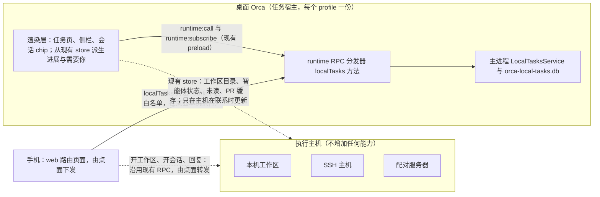
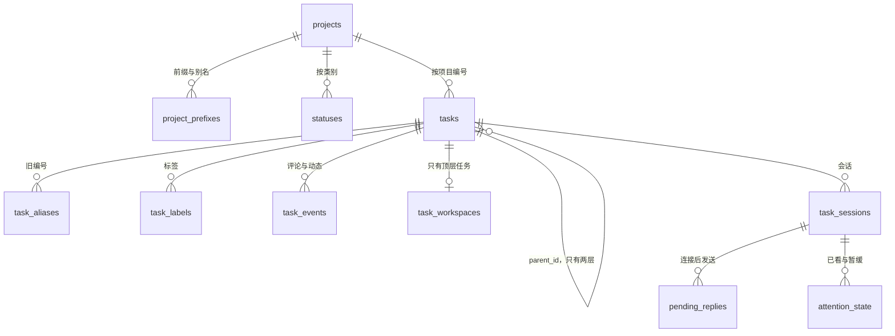

# 本地任务管理技术方案

- 需求：[本地任务管理](../requirements/本地任务管理.md)（REQ-001～REQ-018）
- 代码基线：`Fartown/fork/integration` @ `0ac223377f`。文中 `文件:行号` 都按这个提交。
- 路径缩写：`R/` = `src/renderer/src/`，`S/` = `src/shared/`，`M/` = `src/main/`。
- 调研底稿在本机 `.docs/本地任务管理调研/2026-10-26/research/`（不进仓库）：`02-桌面端接入点.md`、`03-数据RPC远程与移动端.md`。本文已经吸收了它们的结论，实现时以本文为准。

## 1. 总体设计

任务库只在用户的桌面 Orca 上：主进程里有一个 `LocalTasksService`，数据存在 profile 目录下一个独立的 SQLite 文件里。桌面渲染层和手机都通过 runtime RPC 的 `localTasks.*` 方法读写它，并订阅它的变化推送。

工作区、会话、PR 的进展**不由任务功能去读**。桌面渲染层已经有这些 store（工作区目录、智能体状态、未读、PR 缓存），它们由共享连接层按主机的联系状态维护。任务功能只从这些 store 派生显示，执行主机上不增加任何能力。

**设计要点**：

1. 任务数据一个文件，一个进程拥有：桌面 Electron 主进程。orcad 和 `orca serve` 不启动任务服务。
2. 任务功能自己不发任何远程读请求，只调本机的 `localTasks.*`。
3. 关联只记录明确的事实：从任务开的工作区和会话，以及用户手动关联的。不推断。
4. 任务功能不改 Orca 的任何事实：「标记已看」不动 Orca 的未读；删除任务不动工作区和会话。
5. 不扩展上游的共享联合类型（任务来源 `TaskProvider`、工作区链接 `WorkspaceLinkedItem.provider`、侧栏分组 `WorktreeGroupBy`、RPC 事件 `RuntimeClientEvent`）。这些类型会进入持久化或远程协议，旧版本主机会丢弃或拒绝未知值。

## 2. 机器归属

| 东西                                      | 在哪台机器                            | 说明                                                                        |
| ----------------------------------------- | ------------------------------------- | --------------------------------------------------------------------------- |
| `orca-local-tasks.db` 及其 `-wal`、`-shm` | 桌面 Orca 所在机器                    | `{userData}/profiles/{profileId}/local-tasks/`，目录 0700，文件 0600        |
| `LocalTasksService`（主进程服务）         | 桌面 Orca 主进程                      | serve 模式和 orcad 都不启动                                                 |
| `localTasks.*` RPC                        | 桌面 Orca 的 runtime RPC 分发器       | 手机经已有的配对连接访问，**不新开端口**                                    |
| 任务页、侧栏分组、会话 chip、需要你的派生 | 桌面 Orca 渲染层                      | 侧栏「按任务分组」的开关和「上次停在本地来源」存在任务库的 `preferences` 表 |
| 工作区、工作树、终端、智能体进程与 hooks  | 执行主机：本机、SSH 主机或配对服务器  | 全部是 Orca 现有的，任务功能不改                                            |
| PR 与 Checks 数据                         | 桌面 Orca 用桌面上的 Git 平台凭据拉取 | 沿用现有 `hostedReviewCache`，不读执行主机                                  |
| 「连接后发送」的暂存回复                  | 桌面任务库的 `pending_replies` 表     | 执行主机上不暂存                                                            |
| 手机上的「这台桌面是任务宿主」记录        | 手机本地                              | 只记主机 id 和机器名，用来在桌面没开时提示                                  |

新增 `127.0.0.1` 端口：无。新增环境变量：无。执行主机上的新文件、配置或服务：无。

**SSH 断开时**：任务库照常读写；会话状态点、PR 显示「无法确认」；「开始做」「开会话」不可用并说明原因；暂存回复留在桌面，等主机重新进入联系再发出（§9.3）。

## 3. 数据层

### 3.1 文件与打开方式

- 用独立 SQLite，经 `M/sqlite/sync-database.ts:72` 的 `SyncDatabase` 打开。路径用 `getOrcaProfileDirectory(profileId, userDataPath)`（`M/orca-profiles/profile-storage-paths.ts:44-49`）拼出 `local-tasks/orca-local-tasks.db`。切换 profile 会重启应用（`M/ipc/orca-profiles.ts:154`），一个进程只打开一个 profile 的库。
- 打开顺序照 `M/native-chat/agent-session-journal/journal-database.ts:55-129`：
  1. 先用不设持久 pragma 的连接读 `user_version`；
  2. 比本版 schema 新，就只读打开，任务功能进入「只读：数据库来自更新的 Orca」状态，文件一个字节都不改；
  3. 否则设置 `journal_mode=WAL`、`synchronous=NORMAL`、`busy_timeout=5000`、`foreign_keys=ON`（回读确认），然后迁移。
- 迁移：`LOCAL_TASKS_SCHEMA_VERSION` 从 1 开始；每级迁移和 `user_version` 写入放在同一个 `BEGIN IMMEDIATE` 事务里；`ALTER` 之前先查列，保证可重入。
- 文件权限用 `M/sqlite/harden-database-files.ts:4-18` 收紧，Windows 跳过。
- **不用** `M/sqlite/versioned-cache-database.ts`：它遇到版本不符或损坏会删库重建。
- **不用** profile-state.db 的 domain 文档：要改上游核心类型 `PersistedState` 和回滚导出，而且每次修改整份重写（`profile-state-database-schema.ts:16-42`）。
- 打不开（磁盘、权限、损坏）时，任务功能进入「不可用」，`localTasks.status` 带上原因；**不能让 Orca 启动失败**。

### 3.2 表结构

| 表                  | 关键字段                                                                                                                                                                                                                            | 约束                                                                            |
| ------------------- | ----------------------------------------------------------------------------------------------------------------------------------------------------------------------------------------------------------------------------------- | ------------------------------------------------------------------------------- |
| `meta`              | `task_host_id`（建库时生成的 UUID）、`revision`（每次提交加 1）                                                                                                                                                                     | —                                                                               |
| `projects`          | `id`、`name`、`orca_project_id`、`default_repo_id`、`last_execution_host_id`、`next_number`、`rule_start_moves`、`rule_pr_merged_completes`、`created_at`、`revision`                                                               | `orca_project_id` 唯一（一个仓库最多一个项目）                                  |
| `project_prefixes`  | `prefix`、`project_id`、`is_current`                                                                                                                                                                                                | `prefix` 全局唯一（旧前缀不能被别的项目使用）                                   |
| `statuses`          | `id`、`project_id`、`category`（6 类之一）、`name`、`color`、`position`                                                                                                                                                             | 每个类别至少一个，由服务层校验                                                  |
| `tasks`             | `id`（不可变 UUID）、`project_id`、`number`、`title`、`description`、`criteria`（JSON 字符串数组）、`status_id`、`priority`（0 到 4）、`parent_id`、`created_at`、`updated_at`、`revision`                                          | `(project_id, number)` 唯一；`parent_id` 指向的任务自己不能有父任务             |
| `task_aliases`      | `alias`（例如 `SHOP-12`）、`task_id`                                                                                                                                                                                                | `alias` 唯一                                                                    |
| `task_labels`       | `task_id`、`label`                                                                                                                                                                                                                  | `(task_id, label)` 唯一                                                         |
| `task_events`       | `id`、`task_id`、`kind`（`comment` 或各类动态）、`author`、`body`、`payload`（JSON）、`created_at`                                                                                                                                  | —                                                                               |
| `task_workspaces`   | `task_id`、`host_id`、`kind`（`worktree` 或 `folder`）、`instance_id`、`worktree_id`、`folder_workspace_id`、`repo_id`、`branch_snapshot`、`name_snapshot`、`host_label_snapshot`、`linked_via`（`start` 或 `manual`）、`linked_at` | `task_id` 唯一；`(host_id, instance_id)` 唯一（一个工作区最多属于一个顶层任务） |
| `task_sessions`     | `id`、`task_id`、`host_id`、`worktree_id`、`instance_id`、`surface`（`terminal` 或 `structured`）、`tab_id`、`pane_key`、`session_id`、`provider_session`、`agent`、`opened_at`、`linked_via`                                       | `pane_key` 非空时唯一                                                           |
| `attention_state`   | `item_key`（`pane_key` 加进入这次状态的时间）、`seen_at`、`snoozed_until`                                                                                                                                                           | `item_key` 主键                                                                 |
| `pending_replies`   | `id`、`task_session_id`、`item_key`、`text`、`state`（`waiting`、`sent`、`skipped`、`failed`、`cancelled`）、`created_at`、`settled_at`、`detail`                                                                                   | —                                                                               |
| `mutation_receipts` | `client_operation_id`、`result`（JSON）、`created_at`                                                                                                                                                                               | 主键；保留最近 1000 条                                                          |
| `preferences`       | `key`、`value`                                                                                                                                                                                                                      | 桌面 UI 偏好，例如 `sidebarGroupByTask`、`taskPageLocalActive`                  |

**写入规则**：

- 取号：`UPDATE projects SET next_number = next_number + 1 … RETURNING`，和插入任务放在同一事务里。删掉的编号不复用。
- 改前缀：旧前缀行改成 `is_current = 0`，并为项目内全部任务写入 `task_aliases`。
- 删除任务：在任务库里级联删除子任务、标签、动态、关联和暂存回复，不调用任何主机侧方法。
- 幂等：所有写方法带 `clientOperationId`，先查 `mutation_receipts`，命中就返回上次结果。手机断线重连可能重发写请求（`mobile/src/transport/rpc-delivery-ambiguity.ts`）。
- 并发：任务和项目带 `revision`，更新时传 `expectedRevision`；不一致时返回 `{ ok: false, code: 'stale' }`，由客户端重读。
- 搜索：数据量小，先用 `LIKE` 匹配编号、别名和标题；以后需要时再加 FTS5。
- 变更通知在 COMMIT 之后发出，回滚则丢弃（§5）。

### 3.3 已知边界

- 项目跨 profile 迁移（`M/orca-profiles/profile-project-domain-transfer*`）时，任务库不跟着走。任务项目对应的 Orca 项目不在当前 profile 时，「开始做」不可用，并提示仓库不在当前 profile。
- 新库的 schema 文件要登记到 WSL 迁移清单（`S/wsl-move/wsl-move-storage-dispositions.ts:101`、`:140`），处置是「不适用」：任务库属于桌面任务宿主，不随项目迁移。不登记，`wsl-move-dispositions.test.ts:57-73` 会失败。

## 4. 主进程装配与 RPC

### 4.1 装配

- 新文件 `M/startup/main-process-local-tasks.ts`，导出 `startLocalTasksForMainProcess()` 和 `stopLocalTasksForMainProcess()`。
- 开头 `if (state.isServeMode) return`：同时排除 `orca serve`、orcad 的浏览器 sidecar（以 `--serve` 启动，`M/orcad/electron-serve-browser-process.ts:85`）和 headless 场景。
- 同步打开数据库并注册服务，不等 `localPtyStartupReady`。`afterTerminalRuntimeStartup` 早于 `runtimeRpc.start()`（`M/startup/main-process-runtime-launch.ts:310`），手机第一次连接时服务已经就绪。
- 接缝 `M/index.ts`：`afterTerminalRuntimeStartup` 改成组合回调，先 goals、后本功能；再加一行 `app.once('will-quit', stopLocalTasksForMainProcess)`。
- 服务代码放 `M/local-tasks/`，会被 RPC 引用到，**不能 import `electron`**（`check:runtime-electron-ratchet`）。需要 Electron 的东西由 `main-process-local-tasks.ts` 注入。
- 就绪注册表照 goals（`goal-feature-readiness.ts:23-53`），状态有 `not-task-host`、`starting`、`ready`、`read-only`、`unavailable`。orcad 上 `ALL_RPC_METHODS` 里也有 `localTasks.*`，但服务没注册，`localTasks.status` 返回 `taskHost: false`，其他方法统一报不可用。

### 4.2 方法

- 参数 schema 放 `S/local-tasks/local-tasks-rpc-params.ts`，**每个 schema 单独 `export const`**。这样 `generate-rpc-params-catalog` 会索引到（先例 `S/file-attachment-upload/file-attachment-upload-params.ts`），手机能拿到参数类型，也不用改 `rpc-params-type-parity.ts`。
- 方法文件 `M/runtime/rpc/methods/local-tasks.ts` 导出 `LOCAL_TASK_METHODS`，在 `methods/index.ts` 的 `...GOAL_METHODS` 后展开；`permission: 'workspace'`。
- `S/host-operation-ownership.ts` 加 `localTasks: 'host'`；`subscribeChanges` 会被自动归为 `stream`（`:105`）。
- **不改 `M/runtime/rpc/errors.ts`**。业务冲突用返回值表达，例如 `{ ok: false, code: 'workspace_already_linked', taskRef: 'SHOP-9' }`；只有服务不可用才抛错。

| 类别     | 方法                                                                                                                                                                        |
| -------- | --------------------------------------------------------------------------------------------------------------------------------------------------------------------------- |
| 状态     | `localTasks.status`：`{ taskHost, state, reason?, revision, taskHostId }`                                                                                                   |
| 读       | `projects.list`、`tasks.list`（按项目、视图、筛选）、`tasks.get`（按 id 或「SHOP-12」）、`tasks.search`、`events.list`、`links.list`、`preferences.get`                     |
| 写       | `projects.create/update`、`statuses.upsert/reorder/remove`、`tasks.create/update/batchUpdate/move/remove`、`events.addComment/editComment/removeComment`、`preferences.set` |
| 关联     | `links.linkWorkspace/unlinkWorkspace/resolveWorkspace/recordSession/linkSession/unlinkSession/resolveSession`                                                               |
| 自动规则 | `rules.applyPrMerged`                                                                                                                                                       |
| 需要你   | `attention.list`、`attention.ack`、`attention.snooze`、`attention.publish`（只允许桌面调用）                                                                                |
| 暂存回复 | `replies.enqueue/cancel/list/settle`                                                                                                                                        |
| 流       | `subscribeChanges`、`unsubscribeChanges`                                                                                                                                    |

（表中方法名省略了 `localTasks.` 前缀。）

- `attention.publish` 和 `replies.settle` 只允许 `ctx.caller?.kind === 'desktop'` 调用，不加进手机白名单。
- 渲染层统一经 `callRuntimeRpc({ kind: 'local' }, …)` 调用，走现有 `runtime:call` 和 `runtime:subscribe` 通道（`M/ipc/runtime.ts:69-130`），**不新增 preload IPC**。封装放 `R/local-tasks/local-tasks-runtime-client.ts`，固定 `{ kind: 'local' }`，不会被按焦点路由到执行主机。

### 4.3 测试注意

`pnpm test` 用 Bun 跑 Vitest，只有**直接** import `M/sqlite/sync-database` 的测试文件才会改走 Node（`config/scripts/vitest-sqlite-runtime-scan.mjs:18-31`）。任务库的测试文件都要写一行非 type 的 `import SyncDatabase from '…/sqlite/sync-database'`。本机用 `pnpm exec vitest run --config config/vitest.config.ts` 跑的是 Node，发现不了这个问题。

## 5. 变化推送

用功能自己的流式方法 `localTasks.subscribeChanges`，**不往 `RuntimeClientEvent` 里加类型**：`emitClientEvent` 是 protected（`construction/runtime-host-services.ts:379`），而且桌面本机不消费这条事件流，加类型反而要多改上游。先例是已删除的 `issue-change-subscription.ts`（`git show 9b2108cb94^:src/main/issues/issue-change-subscription.ts`）。

- 消息：`{ type: 'ready', subscriptionId, revision, state }`、`{ type: 'changed', revision, scopes }`、`{ type: 'end' }`。`scopes` 取 `projects`、`tasks:{taskId}`、`links`、`attention`、`replies`；拿不准时发 `null`，表示全部重读。
- 订阅：先挂监听再发 `ready`；用 `registerSubscriptionCleanup(…, connectionId)` 绑定到连接，本机由 `signal` 中止。
- 桌面：`R/local-tasks/LocalTasksSyncGate.tsx` 挂在 `R/app-shell/AppBackgroundServices.tsx`（goals 的同一位置），用 `subscribeRuntimeRpc({ kind: 'local' }, …)` 订阅。每次 `ready` 全量重读（断线期间的通知不补发），`changed` 按 scope 重读。**不设定时器**。
- 手机：页面打开时订阅；`ready`、重连回放、回到前台时全量重读，`changed` 按 scope 重读。不加保底定时器。
- Windows 打包版可能在注册前就打开窗口（`main-process-runtime-launch.ts:293-300`），`subscribeChanges` 要等注册表离开 `starting` 再发 `ready`。

## 6. 能力协商与版本兼容

- 常量 `LOCAL_TASKS_RUNTIME_CAPABILITY = 'local-tasks.v1'` 放 `S/local-tasks/local-tasks-capability.ts`，不依赖任何模块，主进程和手机共用。
- **动态通告**：在 `M/runtime/orca-runtime-get-status.ts:151` 附近加一行 `capabilities.push(...localTasksRuntimeCapabilities())`，只在注册了任务服务时返回。不放进静态的 `RUNTIME_CAPABILITIES`：桌面、serve、orcad 共用那份列表，静态通告会让手机把服务器误认成任务宿主。上游浏览器身份能力也是这样处理的（`:128-131`）。
- 能力字符串只表示「这台是任务宿主，说 v1 协议」；服务是否健康看 `localTasks.status`。

| 组合                | 表现                                                                                                                                           |
| ------------------- | ---------------------------------------------------------------------------------------------------------------------------------------------- |
| 新手机 + 旧桌面     | 没有能力字符串，手机不显示任务入口，不发任何 `localTasks.*` 请求                                                                               |
| 旧手机 + 新桌面     | 原生首页没有任务卡片；主机页（web 路由，随桌面下发）里有任务入口，旧 App 经 catch-all 路由交给 shell 打开；shell 缺少所需 grant 时提示更新 App |
| 手机 + orcad 服务器 | 不通告能力，不会被当成任务宿主                                                                                                                 |
| 桌面渲染层与主进程  | 同一个构建，不协商，只看 `localTasks.status`                                                                                                   |
| 以后出 v2           | 新增 `local-tasks.v2` 并保留 v1 语义；可选字段直接加                                                                                           |

## 7. 工作区与会话的标识

### 7.1 工作区

- 存 `host_id` + `instance_id` + `worktree_id`，文件夹工作区再存 `folder_workspace_id`。`instance_id` 是主身份：持久，改名、主机重新分配时都保留（`canonical-worktree-host-reassignment.ts:53-66`）；`worktree_id` 是位置标识，兼容没有 instanceId 的旧数据。
- 解析顺序（重启、重连、迁移之后），实现放 `S/local-tasks/local-task-workspace-ref.ts`，桌面和手机共用：
  1. `(host_id, instance_id)` 精确匹配；
  2. 跨主机按 `instance_id` 匹配，覆盖 SSH 主机重新分配、迁到 orcad、服务器删除后重新添加。命中后调用 `links.resolveWorkspace` 把 `host_id` 改成新值，并写一条动态；
  3. 没有 instanceId 的旧行，按 `(host_id, worktree_id)` 用 `worktreeIdsEqual`（`S/worktree/id.ts:57`）比较；
  4. 文件夹工作区按 `(host_id, folder_workspace_id)`。
- 三态派生：
  - 主机在联系，而且这个仓库在这台主机上的目录已经应用过（`worktreeCatalogVersionByRepoHost` 有记录），却找不到：`missing`，显示「工作区已删除」；
  - 主机不在联系，或目录还没加载：`unverifiable`，显示「无法确认」；
  - 其余：`present`。

  依据是上游「问不到不等于没有」（`S/worktree/worktree-catalog-availability.ts:1-8`）。「已删除」不写库，用户「重新开始做」或「取消关联」时才改关联表，误判不会丢数据。

### 7.2 会话

- 持久化 **paneKey**（`tabId:leafId`），不存终端句柄 `term_*`：句柄每次 PTY 重启都会变（`M/runtime/pty-inventory-lifecycle-fixture.ts:30`），paneKey 是智能体状态表 `agentStatusByPaneKey` 的 key，而且稳定。结构化聊天的 paneKey 是 `structuredAgentSessionPaneKey(tabId, sessionId)`（`S/structured-agent-session-projection.ts:357-362`），结果确定。
- 新开的终端 tab 要等 pane 挂载后才有 leafId：先存 `tab_id`，等 `agentStatusByPaneKey` 里出现 `entry.tabId === tabId` 的条目，再调用 `links.resolveSession` 补上 `pane_key`。
- 存的是**客户端 store 里的** paneKey。SSH（orcad 时代）和配对服务器上，tab 是主机发布的，客户端 id 是 `web-terminal-` 加主机 tab id，和状态表的 `entry.tabId` 同一套；进程环境里的 `ORCA_PANE_KEY` 是主机原始 id，不能用（2026-10-26 实测）。
- 主机发布的 tab 在点击后 0.4 到 1 秒才出现，而且 SSH 一次启动可能多出一个迟到的默认终端。所以按 `terminalCompletion` 返回的 tabId 认领，**不能**用「列表里多出的第一个 tab」。
- 另存 `session_id`（结构化聊天，用来发消息）和 `provider_session`（辅助身份）。
- 会话行的状态：主机不在联系，显示「无法确认」；主机在联系、tab 还在但智能体已退出，显示「已结束」；主机在联系、工作区的 tab 列表里已经没有这个 tab，显示「找不到这个会话」，提供「打开工作区」；没有集成状态上报的智能体，显示「状态未知」。陈旧状态的衰减直接复用 `R/components/sidebar/worktree-agent-rows.ts:142` 的 `buildWorktreeAgentRows`。
- 刚重启时，状态先从 `last-status.json` 恢复并带 `restoredUnconfirmed`（`S/agent-status-types.ts:170-173`）。收到新事件前，这类条目只显示为「无法确认」，不进「需要你」。
- 已知问题（2026-10-26 实测）：配对服务器重启约 2 秒后，原本 `done` 的条目会自己变成 `working`，没有 hook 事件，也不带 `restoredUnconfirmed`；本机和 SSH 不会。影响是这些会话的「做完一轮，你还没看」会消失。这是上游状态投影的问题，任务功能不加本地猜测；切片 2 开工时先在上游查清原因再决定。

## 8. 桌面界面接入

### 8.1 任务页的「本地」来源（REQ-008）

不扩展 `TaskProvider`（`S/task-providers.ts:1-3`）：它会写进主机设置的 `visibleTaskProviders` 和 `defaultTaskSource`，未知值会被过滤或改回 github。

- fork 状态 `R/local-tasks/local-task-page-store.ts`（zustand vanilla，同 goals）：`localSourceActive`、`selectedTaskId`；「上次停在本地」持久化到任务库 `preferences`。
- 接缝 `R/components/task-page/SourceBar.tsx`：`:90` 的遍历前挂 `LocalTaskSourceButton`，排在 GitHub 前；`:91` 改成 `!localActive && taskSource === source.id`；`:144`、`:151`、`:209` 的条件前加 `!localActive &&`。5 到 6 行。
- 接缝 `R/components/task-page/Frame.tsx:13-15`：本地激活时渲染来源条加 fork 内容区，否则保持原样。4 行。
- 退出本地：fork store 订阅 `taskPageData.taskSource` 的变化，用户显式选了别的来源就退出。
- 已知代价：本地激活时上游任务页管线仍挂载，打开任务页仍会按 `defaultTaskSource` 预取 GitHub（`ui-slice-task-actions.ts:125-159`），和现在的成本一样。本地任务详情不进上游的前进后退历史，返回由 fork 处理。
- 单键快捷键（REQ-007）由 fork 内容区自己挂，焦点在输入框里时不生效。上游任务页只全局拦截 Escape（`R/components/use-task-page-global-effects.ts:45`），而且早于对话框执行；实现里经 `R/lib/app-keyboard-router` 注册了自己的 Escape 处理，先关最内层的本地对话框、详情或预览。
- 分组（状态、优先级、项目、不分组）和排序（更新时间、创建时间、优先级、编号）存在任务库 `preferences` 的 `taskPageGroupBy`、`taskPageSortBy`；子任务挂在父任务下时始终按编号排。
- LAN 浏览器客户端连的是配对主机，不是拥有任务库的这台桌面，所以不显示「本地」来源、设置分区，也不订阅。
- 返回值的 zod 校验放在 `S/local-tasks/local-task-result-schemas.ts`，渲染层校验 RPC 返回值、主进程回放回执时都用它，回执里存的旧结果不符合时丢弃重做。

### 8.2 左侧栏「任务」按钮上的数字（REQ-008、REQ-014）

- 接缝 `R/components/sidebar/SidebarTaskNavButton.tsx:184` 之后挂 `LocalTaskNeedsYouCount`，1 行。样式照同栏「New」徽标（`SidebarNav.tsx:244-248`），悬停和获得焦点时淡出，避免被 `:186` 的来源快捷图标盖住。
- 用户隐藏了任务按钮（`showTasksButton === false`）时，这个数字也不显示；任务页里的「需要你」视图仍然可用。

### 8.3 开始做（REQ-009）

现状（`R/components/NewWorkspaceComposerModal.tsx`）有三处做不到需求：弹窗写死了 `initialPrompt: ''`（`:142`）；「已链接的工作」只认 4 个外部来源，会写进工作区 meta 并过远程校验（`S/worktree/types.ts:39-48`）；`onCreated` 在后台创建刚开始时就被调用，而且不带参数（`R/hooks/composer-state/quick-creation-execution.ts:253-259`）。

做法：

- 打开弹窗：fork 直接调 `openModal('new-workspace-composer', data)`，和上游三个来源一样（`R/components/use-task-page-workspace-actions.ts:19-44`）。预填 `initialRepoId`、`initialWorkspaceTarget`（主机默认取 `projects.last_execution_host_id`，没有就用 `getRepoWorkspaceCreationTargetHint`）、`prefilledName`（由编号和标题生成，例如 `shop-12-order-export`）。
- **3 处接缝**：
  1. `R/hooks/composer-state/quick-creation-request.ts`：`QuickSubmitOptions` 加可选的 `launchPrompt` 和 `onCreationStarted`；
  2. `R/hooks/composer-state/quick-creation-execution.ts`：`:123` 遇到 `launchPrompt` 时用它生成 `{ prompt, draftPrompt }`；`:253` 先存下 `runBackgroundWorktreeCreation` 返回的 `creationId`，再调 `onCreationStarted(creationId)`；
  3. `R/components/NewWorkspaceComposerModal.tsx`：`ComposerModalData` 加同名字段，`:205` 透传给 `submitQuick`。
- **第 4 处接缝**：`R/lib/worktree-creation-completion.ts:21` 加 1 行，调用 fork 的事件源 `notifyWorktreeCreationCompleted({ creationId, worktreeId, primaryTabId })`。
- fork 收到完成通知后，按 `creationId` 找到任务，调用 `links.linkWorkspace` 写入主机、`worktree_id`，再从工作区目录补上 `instance_id`；选了智能体时，按 `primaryTabId` 调 `links.recordSession`。创建失败或用户取消时没有完成通知，任务上不留任何关联。
- prompt 走上游的 `buildQuickComposerStartup` 和 `resolveAgentSessionLaunchRoute`，结构化聊天、SSH、配对服务器的启动全部复用。
- 「用已有工作区」：弹窗外由 fork 提供任务侧入口，走 §8.6 的关联。
- 主机不在联系时（判定同 `R/goals/goal-host-contact.ts:16-28`），「开始做」置灰并说明原因。
- 文件夹项目：只提供「用已有工作区」，不新建（需求 §8 第 1 条的建议）。

**和需求原稿的差异**：弹窗里不显示「已链接的工作」；分支名由执行主机按用户的分支前缀设置生成（`M/ipc/worktree-branch-name.ts:56`），可能是 `zc/shop-12-order-export`。需求 REQ-009 已按此修改。

### 8.4 开会话（REQ-010）

- 用 `launchAgentInNewTab`（`R/lib/launch-agent-in-new-tab.ts:363`），传 `agent`、`worktreeId`、`prompt`、`promptDelivery`（`auto-submit` 或 `draft`）、`requestedSurface`。先例 `R/components/dashboard/launch-dashboard-agent.ts:18`。接缝 0。
- 按返回值记录会话：
  - 本机或 SSH 终端：`local-terminal{tabId}`，先存 `tab_id`，paneKey 按 §7.2 补；
  - 结构化聊天：`local-chat{tabId}`，sessionId 等 `structuredSettlement`；settlement 是 `terminal` 时（主机拒绝开聊天、改开终端），按终端记录；
  - SSH（orcad 时代）和配对服务器：`host-published`，tabId 等 `terminalCompletion`；实测它和 `agentStatusByPaneKey` 里的 tabId 是同一套（§13）。
- prompt：任务标题、描述、完成标准；子任务额外带父任务的标题和描述摘要。
- 任务还没有工作区时，先走开始做。
- 主机不在联系时，`resolveAgentLaunchExecutionContext` 返回 null；按钮提前置灰，不发起调用。

### 8.5 显示进展（REQ-012）

- 状态点：按 `pane_key` 读 `agentStatusByPaneKey`，pane 消失后读 `retainedAgentsByPaneKey`，经 `buildWorktreeAgentRows` 衰减。
- 最后一句话：`lastAssistantMessage`，下一轮开始后用 `lastCompletedAssistantMessage`（`S/agent-status-types.ts:132-141`）。
- 工作区卡：名称、主机、分支、改动统计取工作区目录；PR 和 Checks 读 `hostedReviewCache[getHostedReviewCacheKey(…)]`（key 的算法同 `R/components/sidebar/use-worktree-card-review-details.ts:51-76`），GitLab 等平台同样走这里。
- 「看改动」跳到 Orca 现有的源码管理；「打开工作区」用现有导航。
- 投影放 `R/local-tasks/local-task-progress-projection.ts`，每个组件按单个任务精确订阅，避免整表订阅导致侧栏重渲染。

### 8.6 工作区卡片、右键菜单与关联（REQ-011、REQ-016）

- 接缝 `R/components/sidebar/worktree-card-header.tsx:192`（或 `:271` 前）挂 `WorktreeCardLocalTaskChip`，1 行；按任务分组时返回 null；空间不够时截断并加 tooltip。文件夹工作区也用这张卡片。
- 接缝 `R/components/sidebar/WorktreeContextMenuView.tsx:172` 之后，单选时挂 `LocalTaskLinkMenuItem`，1 到 2 行，打开任务选择器（可搜索；已有工作区的任务置灰并说明原因；只列这个仓库所属项目的顶层任务）。
- 关联写入时由服务层校验唯一约束，冲突返回 `workspace_already_linked` 和所属任务编号。

### 8.7 侧栏「按任务分组」（REQ-016）

不把 `'task'` 写进上游的 `groupBy`：主进程 `normalizeGroupBy`（`M/persistence/applying-settings/ui-selection-normalization.ts:5-10`）会丢掉未知值。

- fork 设置 `sidebarGroupByTask` 存在任务库 `preferences`。
- 接缝 `R/components/sidebar/workspace-options-menu-items.tsx:93`：换成 fork 的包装组件，复用 `GROUP_BY_OPTIONS` 并追加「任务」；选它时只改 fork 设置，不调用 `setGroupBy`。
- 接缝 `R/components/sidebar/WorktreeList.tsx`：`:83` 在开启任务分组时给列表模型传 `'none'`；`:123` 之后用 `useLocalTaskGroupedRowModel` 按任务重排 `item` 行，插入 key 以 `local-task:` 开头的组头，最后放「未关联任务」组，并用上游导出的 `collectRenderedSidebarRowKeys` 重算行 key。约 3 行。
- 接缝 `R/components/sidebar/worktree-list/rows/virtual-row-dispatch.tsx:159` 前：`local-task:` 组头交给 fork 渲染（可折叠、可点开任务），2 行。
- 折叠的任务组在定位工作区时不会自动展开：fork 自己管理折叠状态，看到 `pendingRevealWorktree` 时展开对应的组，不改上游的 3 个 reveal 文件。
- 置顶组、导入工作树卡、创建中的行、文件夹工作区行按关联归到对应任务组，没有关联的放「未关联任务」；跨任务组拖拽不提供。
- 手机的主机侧栏读的是上游 `groupBy`，不受影响。

### 8.8 会话头部的任务 chip（REQ-016）

- 终端会话：接缝 `R/components/terminal-pane/TerminalPaneHeaderOverlay.tsx:228` 之后、当前 pane 时挂 `LocalTaskSessionChip`，传 `worktreeId` 和 `paneKey={makePaneKey(tabId, pane.leafId)}`，2 到 3 行，先例是 goals 的 `GoalSessionAction`。终端智能体切到聊天视图时这个头部还在，两种视图一处覆盖。
- 结构化聊天没有 pane 头部：接缝 `R/components/native-chat/NativeChatStructuredSession.tsx:353`（Goal 条同一位置），用文件里已有的 `paneKey`，1 到 2 行。
- chip 挂载时不能依赖 Provider（上游测试不包 Provider）：任务小卡和选择器放在只在弹层打开时才挂载的子组件里。
- `TerminalPaneHeaderOverlay.test.tsx` 的 store 夹具可能要补 fork store 的 mock，同时登记为接缝。

### 8.9 Cmd+J（REQ-007）

- 接缝 `R/components/cmd-j/quick-actions.ts`：import 并展开 `...getLocalTaskQuickActions()`（「新建任务…」「打开任务…」），2 行，先例是 goals。`isAvailable` 在 `ctx.runtimeMode !== 'local-desktop'` 时返回不可用。
- 接缝 `R/components/use-worktree-jump-palette-project-targets.ts:46-53`：追加 `...buildLocalTaskSearchActions(localTasks)`，每个任务一条动作，关键字是编号、旧编号和标题；只在输入框有内容时生成，最多 50 条。先例是 `R/components/cmd-j/plugin-quick-actions.ts`。`createLocalizedCatalog` 按语言缓存，不能放动态数据，所以动态搜索不放在静态目录里。

### 8.10 设置（REQ-001、REQ-003、REQ-013）

- 上游已有 id 为 `'tasks'` 的「Task Sources」分区，新分区用 id `local-tasks`。
- 接缝 `R/hooks/settings-navigation-workflow-sections.ts`：加分区元数据，约 12 行，先例 self-hosted-artifacts。
- 接缝 `R/components/settings/settings-page-renderer.tsx:148` 之后：调 `renderLocalTasksSettingsSection(context)`，2 行。
- 从任务页跳到设置分区需要深链，再加接缝 `R/lib/settings-navigation-types.ts` 的 `'local-tasks'`，1 行。

### 8.11 文案

用顶层命名空间 `localTasks.*`（同 goals）。`en.json`、`zh.json` 登记为接缝，`mustContain: "\"localTasks\":"`；其他语言回退英文。key 必须是字面量，过 `verify:localization-catalogs`、`verify:localization-extraction`、`verify:localization-coverage` 三个门禁。

## 9. 需要你（REQ-014、REQ-015）

### 9.1 判定

渲染层 `R/local-tasks/local-task-attention-projection.ts` 对每个挂在任务上、而且主机在联系的会话，读 `agentStatusByPaneKey[pane_key]`，按下表判定：

| 条目字段                                                                                                | 判定                                                                                                                           | 类型                 |
| ------------------------------------------------------------------------------------------------------- | ------------------------------------------------------------------------------------------------------------------------------ | -------------------- |
| `state='waiting'`，`interactivePrompt` 是 approval（`S/agent-hook-listener/interactive-tool.ts:61-69`） | Claude 申请权限                                                                                                                | 等你批准             |
| `state='waiting'`，`toolName='AskUserQuestion'` 或 `interactivePrompt` 是 questions                     | Claude 提问（终端里是菜单）                                                                                                    | 等你回答             |
| `state='waiting'`，没有 hook 的程序经 OSC 上报，`programStatus.kind` 是 permission 或 question          | 按 kind；带 hook 的智能体，OSC 只附加 `programStatus`，`state` 仍以 hook 为准                                                  | 等你批准 或 等你回答 |
| `state='waiting'`，没有 `interactivePrompt`；有 `programStatus.kind` 时按 kind                          | 原因未知。Codex 的权限请求带 `tool_name` 时有 approval，`request_user_input` 有 questions，只有不带 `tool_name` 的才落到这一行 | 等你回答             |
| `state='blocked'`，终端会话（OSC 的 auth 或无 kind）                                                    | 要登录、额度用完等                                                                                                             | 被卡住               |
| `state='blocked'`，结构化聊天会话                                                                       | 结构化会话把「需要你」投影成 blocked 且不带原因（`S/structured-agent-session-agent-status.ts:19-23`）                          | 等你回答（原因未知） |
| `state='done'`，并且 `isAgentSubjectUnread(readAgentRowTurnRecords(state), paneKey)`                    | 和仪表盘「需要你」列同一来源（`R/attention/agent-attention-acknowledgement.ts:34-42`）                                         | 做完一轮，你还没看   |

- 解析复用 `R/components/native-chat/native-chat-interactive-prompt.ts:110-121` 的 `parseInteractivePrompt`。
- 不进「需要你」：工作中；完成且已读；主机不在联系；`restoredUnconfirmed`；衰减为 `unverifiable` 或 `idle` 的行；没有挂在任务上的会话；没有集成的智能体（只有从终端标题推断出的行，`startedAt=0`）。
- 条目 key 是 `pane_key` 加 `stateStartedAt`。已看和暂缓按 key 记在 `attention_state`，**不调用 `acknowledgeAgents`**，不改 Orca 自己的未读状态。同一个会话下次进入需要你的状态时，`stateStartedAt` 变了，条目重新出现。
- 暂缓到期：渲染层按最近的到期时间设一个本地定时器，到点重新计算。这是本地计时，不读任何主机。
- 同一个任务下的多条合并成一行；导航上的数字是全局的。
- 系统通知不新增：Orca 现有的智能体通知已经覆盖这些状态。

### 9.2 操作

| 类型                                          | 可做的操作                                     |
| --------------------------------------------- | ---------------------------------------------- |
| 等你批准                                      | 打开会话、标记已看、暂缓                       |
| 等你回答（终端会话）                          | 回复、打开会话、标记已看、暂缓                 |
| 等你回答（Claude 菜单式提问、结构化聊天会话） | 打开会话、标记已看、暂缓                       |
| 被卡住                                        | 打开会话、标记已看、暂缓                       |
| 做完一轮，你还没看                            | 回复（给下一句指令）、打开会话、标记已看、暂缓 |

- 「等你批准」不提供文字回复：回复统一走 `sendMessageToAgent`（`R/lib/agent-message-send.ts:13-77`），终端路径先等 `tui-idle`，智能体卡在权限确认上时直接返回 `permission`，主机侧也会拒绝写入（`M/runtime/rpc/terminal-agent-send-guard.ts:29-30`）。需求 REQ-015 已按此修改。
- 结构化聊天的「等你回答」拿不到原因，可能其实是批准请求，所以只给「打开会话」。
- 落到「原因未知」那一行的等待也可能其实是执行确认：这时回复会被主机拒绝，显示「智能体在等确认，请打开会话处理」，文字保留。
- 送达状态取 `ActiveAgentNotesSendStatus`（`R/lib/active-agent-note-send-result.ts:3-14`）：`sent` 显示「已送达」；`unconfirmed` 显示「已发出，未确认」；`permission` 显示「在等确认，请打开会话」；其他显示失败原因。调用时传 `callerKeepsText`，失败时文字留在输入框。结构化聊天的结果是 `recorded`、`refused`、`unconfirmed`（`structured-agent-session-message-sender.ts:130-132`），同样映射。

### 9.3 连接后发送

- 主机不在联系时，回复框提供「连接后发送」，调用 `replies.enqueue` 存进桌面任务库，状态 `waiting`，可以 `replies.cancel`。
- 触发只有一个：主机**重新进入联系**。`R/local-tasks/local-task-reply-delivery.ts` 订阅 `sshConnectionStates` 和 `getReachableRuntimeEnvironmentIds`，看到这台主机从不在联系变成在联系时，对它的暂存回复逐条处理：
  1. 会话仍处在当时那次等待里（`item_key` 相同）才发送，结果写回 `replies.settle`；
  2. 状态已经变了，不发，标记 `skipped`，提示用户并保留文字。
- 不用定时器，失败不自动重试：标记 `failed`，等下一次进入联系或用户手动重试。

### 9.4 手机上的「需要你」

手机不自己判定。桌面渲染层按 §9.1 算好后，调用 `attention.publish`（只允许桌面）推给主进程，带推送时间和渲染层代次；主进程保存最近一份，剔除已看和暂缓后，经 `attention.list` 和 `changed: ['attention']` 给手机。先例是渲染层把移动端项目分组推给主进程（`M/ipc/runtime.ts:54-57`）。

桌面窗口不在时（macOS 关掉窗口后应用不退出，但渲染层没了），`attention.list` 返回 `{ verdict: 'unverifiable', publishedAt }`，手机显示「桌面窗口未打开，无法确认」，不展示过期条目。手机上的回复经桌面现有的发送路径执行，结果同 §9.2。

## 10. 自动规则（REQ-013）

- **规则 1「开始做」后移到进行中**：在主进程里和关联写入放在同一个事务：`links.linkWorkspace`，或者任务第一次 `links.recordSession` 时，如果项目开着规则、任务在待规划或未开始类别，就移到进行中类别的第一个状态，并写动态。
- **规则 2「PR 合并」后移到已完成**：
  - 渲染层看到关联工作区的 PR 满足 `state === 'merged'`，并通过分支头校验 `isCachedMergedBranchPRCurrentForWorktree`（`R/components/sidebar/worktree-card-pr-display.ts:8-22`），就调用 `rules.applyPrMerged({ taskId, provider, prNumber, headSha, clientOperationId })`。不做分支头校验，复用旧分支名时会误判。
  - 主进程检查：规则开着、是顶层任务、不在已完成或已取消类别、同一个 PR 没有触发过。触发过的 PR 记在动态里，用户之后手动改回进行中，不会被同一个 PR 再次改成已完成。
  - **刷新来源**：上游只为可见卡片和右栏当前工作区刷新 PR（`R/app-shell/use-visible-review-refresh-reporting.ts:16-34`）。接缝：在 `:17` 把「关联了未完成顶层任务、有分支」的工作区并入刷新集合，复用上游调度器的冷却和联系判定，2 行。数量通常很小（进行中的任务）；上线前评估 Git 平台的 API 预算。
  - GitLab 的合并请求没有 `confirmedContainedHeadOid`，所以只在工作区当前 head 恰好等于 MR 的 `sha` 时触发；合并后本地又有新提交的，不自动完成（2026-10-26 用真实映射函数和合成载荷确认）。Bitbucket、Azure DevOps、Gitea 未验证，按同一校验处理。
  - 文件夹工作区没有分支，不参与规则 2。
- 规则只在桌面渲染层在时触发；桌面窗口关掉期间合并的 PR，下次打开窗口、缓存刷新后再触发。

## 11. 手机端（REQ-017）

### 11.1 页面与入口

- 新页面放 web 路由 `/h/[hostId]/local-tasks`，由桌面打包下发：`mobile/app/h/[hostId]/local-tasks.tsx`（shell 路由，照 `tasks.tsx`）和 `local-tasks.web.tsx`；页面代码放 `mobile/src/local-tasks/**`。
- 接缝 `config/scripts/mobile-web-page-routes.mjs`：登记路由，`grants: ['navigate', 'storage', 'externalLink', 'haptics']`，过 `mobile-web-page-routes-contract.test.mjs`。
- 首页卡片：接缝 `mobile/src/home/MobileHomeListFooter.tsx` 挂 `MobileHomeLocalTasksCard`。原生页面，要等 App 发版；发版前从主机页进入。
- 主机页长按「关联到任务」：接缝 `mobile/src/host-screen/host-screen-overlays.tsx`，学 mobile-session-continuation 注入 actions 的写法。文件夹工作区在手机主机页不能长按（`host-workspace-list.tsx:250-252`），手机上关联文件夹工作区改从任务详情的「关联已有工作区」进入。
- 会话页任务条：接缝 `mobile/src/session/MobileSessionHeader.tsx` 标题下方，挂载时不依赖 Provider。
- 订阅释放与登记：接缝 `mobile/src/transport/rpc-client-server-subscription.ts` 的 `READY_STREAM_RELEASE_METHODS` 加一对方法；`mobile/src/transport/rpc-subscription-inventory.ts` 的 `RPC_SUBSCRIPTION_SITES` 加一条。
- 读写都用 `defineRpcOperation`；手机只 import 参数类型，不把 zod schema 打进手机包。
- 手机端没有 i18n 目录，文案是功能目录里的中英两张表，按设备语言选。
- `tasks.createSubtasks` 只带标题，表单里设了状态或优先级时，手机再追加一次 `tasks.batchUpdate`（各用自己的 `clientOperationId`）。
- 切片 1 不显示两条自动规则的开关（桌面和手机都不显示），数据字段保留。

### 11.2 只对任务宿主发请求

1. 看每台已连接主机 `status.get` 的能力里有没有 `local-tasks.v1`，有的才是任务宿主。手机记住「这台通告过」，桌面没开时提示「mbp5 的 Orca 未打开」，名称取 `HostProfile.lastKnownMachineName`。
2. 多个任务宿主时复用 `useConnectedHostPicker` 让用户选，各宿主的任务互相独立。
3. `localTasks.*`（不含 `attention.publish`、`replies.settle`）加进 `M/runtime/runtime-rpc/fork-mobile-rpc-method-allowlist.ts`。这些方法不在上游的执行主机路由表里，所以总在配对的桌面本机执行（`runtime-rpc-websocket-dispatch.ts:54`），正好就是任务宿主，不用改上游路由表。
4. 跳到工作区或会话：用任务宿主的 hostId 走现有路由；工作区在配对服务器上时加 `executionHost=runtime:{environmentId}`（`mobile/src/navigation/workspace-execution-host.ts:23-45`）。

### 11.3 手机上的开始做与开会话

- 调用手机现有的建工作区和启动智能体接口（`agent.launch`，`mobile/src/tasks/mobile-workspace-create-operations.ts:44`），prompt 由手机按 §8.4 拼好；拿到结果后调用 `links.linkWorkspace` 和 `links.recordSession`，都带 `clientOperationId`。`instance_id` 和 `pane_key` 由桌面渲染层看到工作区和状态后补上（§7）。
- 不新增「替手机开工」的主进程方法，保持执行主机不新增能力。
- 两步之间断线导致关联没写上时，任务上显示「开始做未完成」，提供「关联已有工作区」；不做自动补救。

## 12. fork 登记与接缝

### 12.1 功能自有路径

`src/main/local-tasks/**`、`src/shared/local-tasks/**`、`src/renderer/src/local-tasks/**`、`src/renderer/src/components/local-tasks/**`、`src/renderer/src/components/cmd-j/local-task-quick-actions.ts`、`src/main/startup/main-process-local-tasks.ts`、`src/main/runtime/rpc/methods/local-tasks.ts`（及同名测试）、`mobile/app/h/[hostId]/local-tasks*.tsx`、`mobile/src/local-tasks/**`、`docs/issue/本地任务管理/**`。

### 12.2 上游接缝

| #   | 文件                                                                   | 改动                                                 | 切片 |
| --- | ---------------------------------------------------------------------- | ---------------------------------------------------- | ---- |
| 1   | `M/index.ts`                                                           | 组合 `afterTerminalRuntimeStartup`，加 `will-quit`   | 1    |
| 2   | `M/runtime/rpc/methods/index.ts`                                       | `...LOCAL_TASK_METHODS`                              | 1    |
| 3   | `S/rpc-contract/rpc-params-catalog.generated.ts`                       | 重新生成                                             | 1    |
| 4   | `S/host-operation-ownership.ts`                                        | `localTasks: 'host'`                                 | 1    |
| 5   | `S/wsl-move/wsl-move-storage-dispositions.ts`                          | 登记 schema 文件和表                                 | 1    |
| 6   | `M/runtime/orca-runtime-get-status.ts`                                 | 一行动态能力                                         | 1    |
| 7   | `M/runtime/runtime-rpc/fork-mobile-rpc-method-allowlist.ts`            | 加 `localTasks.*`                                    | 1    |
| 8   | `R/app-shell/AppBackgroundServices.tsx`                                | 挂 `LocalTasksSyncGate` 和需要你、暂存回复的后台组件 | 1    |
| 9   | `R/components/task-page/SourceBar.tsx`                                 | 本地来源按钮与条件                                   | 1    |
| 10  | `R/components/task-page/Frame.tsx`                                     | 本地内容区                                           | 1    |
| 11  | `R/components/sidebar/SidebarTaskNavButton.tsx`                        | 需要你的数字                                         | 2    |
| 12  | `R/components/cmd-j/quick-actions.ts`                                  | 静态动作                                             | 1    |
| 13  | `R/components/use-worktree-jump-palette-project-targets.ts`            | 动态任务搜索                                         | 1    |
| 14  | `R/hooks/settings-navigation-workflow-sections.ts`                     | 设置分区元数据                                       | 1    |
| 15  | `R/components/settings/settings-page-renderer.tsx`                     | 设置分区渲染                                         | 1    |
| 16  | `R/lib/settings-navigation-types.ts`                                   | 设置深链                                             | 1    |
| 17  | `R/i18n/locales/en.json`、`zh.json`                                    | `localTasks` 命名空间                                | 1、2 |
| 18  | `config/scripts/mobile-web-page-routes.mjs`                            | 手机路由                                             | 1    |
| 19  | `mobile/src/transport/rpc-client-server-subscription.ts`               | 订阅释放                                             | 1    |
| 20  | `mobile/src/transport/rpc-subscription-inventory.ts`                   | 订阅点登记                                           | 1    |
| 21  | `mobile/src/home/MobileHomeListFooter.tsx`                             | 首页卡片                                             | 1    |
| 22  | `R/components/NewWorkspaceComposerModal.tsx`                           | 透传 `launchPrompt`、`onCreationStarted`             | 2    |
| 23  | `R/hooks/composer-state/quick-creation-request.ts`                     | `QuickSubmitOptions` 两个可选字段                    | 2    |
| 24  | `R/hooks/composer-state/quick-creation-execution.ts`                   | 用 `launchPrompt`；回传 `creationId`                 | 2    |
| 25  | `R/lib/worktree-creation-completion.ts`                                | 完成通知                                             | 2    |
| 26  | `R/components/sidebar/worktree-card-header.tsx`                        | 任务 chip                                            | 2    |
| 27  | `R/components/sidebar/WorktreeContextMenuView.tsx`                     | 「关联到任务…」                                      | 2    |
| 28  | `R/components/sidebar/workspace-options-menu-items.tsx`                | 分组加「任务」                                       | 2    |
| 29  | `R/components/sidebar/WorktreeList.tsx`                                | 按任务重排                                           | 2    |
| 30  | `R/components/sidebar/worktree-list/rows/virtual-row-dispatch.tsx`     | 任务组头                                             | 2    |
| 31  | `R/components/terminal-pane/TerminalPaneHeaderOverlay.tsx`（及其测试） | 终端会话 chip                                        | 2    |
| 32  | `R/components/native-chat/NativeChatStructuredSession.tsx`             | 结构化聊天会话 chip                                  | 2    |
| 33  | `R/app-shell/use-visible-review-refresh-reporting.ts`                  | 关联工作区并入 PR 刷新                               | 2    |
| 34  | `mobile/src/host-screen/host-screen-overlays.tsx`                      | 长按「关联到任务」                                   | 2    |
| 35  | `mobile/src/session/MobileSessionHeader.tsx`                           | 会话页任务条                                         | 2    |

合计 35 处（含 i18n 两个文件算一处），比产品方案估的约 11 处多：产品方案只数了渲染层的入口，没算主进程、手机传输层，以及「开始做」拿 id 和 prompt、按任务分组、结构化聊天 chip、动态搜索这些。每处都是挂载点或几行条件，业务逻辑全在功能自有目录。每处都要登记到 `seams`（`mustContain` 取挂载那一行），不在 `fork-integration-scope` 白名单的要加进去。

### 12.3 策略

- `local-tasks` 策略的 `local-tasks-worktree-scope`：`whenChanged` 和 `allowedPaths` 加 §12.1 的路径，`allowedPaths` 再加 §12.2 的全部文件。
- 照 goals 加一组依赖边界规则 `*-do-not-depend-on-local-tasks`：上游模块不得 import 本功能，只有接缝文件例外。
- `dependsOn` 登记功能代码 import 的上游模块，例如 `subscribeRuntimeRpc`、`callRuntimeRpc`、`goal-host-contact` 用的联系判定、`execution-host`、`worktree/identity`、`worktree/id`、`buildWorktreeAgentRows`、`parseInteractivePrompt`、`agent-attention-acknowledgement`、`launch-agent-in-new-tab`、`agent-message-send`、`hosted-review` 相关。跨功能复用 goals 的判定函数时也要登记。

## 13. 开工前验证

以下 4 项只影响切片 2，和切片 1 并行做。用一个探针脚本，在本机、SSH 主机（root 的 `127.0.0.1:2222` sshd，见 `docs/reference/ssh-real-app-validation.md`）、配对服务器三种场景各跑一遍，证据放 `.docs/local-tasks-ui-validation/{日期}/`。

| #   | 要验证的                           | 代码里已经能确定的                                                             | 要实测的                                                                                | 不成立时                                                   |
| --- | ---------------------------------- | ------------------------------------------------------------------------------ | --------------------------------------------------------------------------------------- | ---------------------------------------------------------- |
| 1   | 开会话后拿到的标识能对上智能体状态 | 本机、SSH 立即有 tabId，paneKey 等状态上报；结构化聊天的 paneKey 确定          | 配对服务器 `host-published` 返回的 tabId 和 `agentStatusByPaneKey` 里的是否同一套       | 配对服务器会话改用 `session_id` 或 `provider_session` 匹配 |
| 2   | 重启后能找回会话                   | paneKey、sessionId 稳定，句柄不稳定                                            | 本机 daemon 接管、SSH relay 重连、配对服务器重启后 tab 和 leaf 是否不变                 | 找不到时显示「找不到这个会话」，提供「打开工作区」         |
| 3   | PR 合并规则                        | `hostedReviewCache` 加分支头校验能支撑                                         | GitLab 合并请求的 `merged` 状态和分支头字段是否齐全                                     | 该平台不触发规则 2，界面照常显示 PR 状态                   |
| 4   | 未读和等待原因                     | 未读能按 paneKey 读；hooks 有 `interactivePrompt`，OSC 有 `programStatus.kind` | SSH 路径上 `programStatus` 是否送达渲染层；Codex 等待时是否确实不带 `interactivePrompt` | 拿不到原因的统一归为「等你回答」                           |

**结论（2026-10-26）**：真实智能体没有跑，用合成的 hook 事件和 OSC 7501 序列驱动；证据和复跑命令在本机 `.docs/local-tasks-ui-validation/2026-10-26/`，摘要见[开工前验证记录](../tests/runs/2026-10-26-开工前验证.md)。

| #   | 本机       | SSH                                      | 配对服务器                                    | 对设计的影响                                                                                                                   |
| --- | ---------- | ---------------------------------------- | --------------------------------------------- | ------------------------------------------------------------------------------------------------------------------------------ |
| 1   | 成立       | 成立                                     | 成立                                          | 不需要降级；按 `terminalCompletion` 认领 tab，存客户端 paneKey（§7.2）                                                         |
| 2   | 成立       | 成立                                     | 成立                                          | 不需要降级；配对服务器重启后条目会自己变成 `working`（§7.2 已知问题）                                                          |
| 3   | 仅代码确认 | 仅代码确认                               | 仅代码确认                                    | GitLab 只在 head 等于 MR `sha` 时触发规则 2（§10）                                                                             |
| 4   | 成立       | 成立（Codex 未验，远端菜单里没有 Codex） | 部分成立：同一终端里第二个程序的 OSC 上报会丢 | §9.1 的 OSC 行只对没有 hook 的程序成立；Codex 的「原因未知」比原稿窄；配对服务器上没有 hook 的程序第二次上报可能丢，是上游问题 |

跑真实智能体时用包装脚本隔离 HOME（e2e 实例里的 Claude 会拿到真实 HOME）；不在真实 `~/.codex` 里批准任何 hook。

## 14. 测试

| 层         | 内容                                                                                                                                                                                                        |
| ---------- | ----------------------------------------------------------------------------------------------------------------------------------------------------------------------------------------------------------- |
| 主进程单测 | 用临时目录测：打开、迁移、只读降级、编号分配、改前缀与别名、唯一约束、级联删除、回执去重、`expectedRevision` 冲突、规则 1 与关联同事务、规则 2 不重复触发。测试文件直接 import `sync-database`              |
| RPC        | `localTasks.status` 在未注册时返回 `taskHost: false`；手机能调 `localTasks.*`；手机不能调 `attention.publish`、`replies.settle`；orcad 不通告 `local-tasks.v1`                                              |
| 渲染层     | store 级测试（`createTestAppStore()`）：工作区三态、会话状态衰减与「无法确认」、需要你的 7 种判定、`restoredUnconfirmed` 不进需要你、暂存回复只在重新进入联系时发出。状态样本用真实采集的数据，不凭记忆构造 |
| e2e        | `ORCA_BACKGROUND_LAUNCH=1` 的 Playwright `orcaPage`：新建与拆分、重启后数据还在、开始做后自动关联、删除工作区后显示「已删除」、按任务分组                                                                   |
| 手机路径   | `pairMobileClient` 模拟手机走白名单读写与订阅；`pnpm --dir mobile exec vitest run` 测读取器和能力降级                                                                                                       |
| SSH 真机   | 本机工作区和 SSH 工作区各跑一遍需求里的验收：断开后显示「无法确认」、开始做不可用，恢复联系后状态对上、暂存回复发出                                                                                         |
| 配对服务器 | 服务器上的工作区和会话关联到任务；手机从任务跳到服务器上的会话                                                                                                                                              |

测试用例文档在需求确认后写到 `tests/cases/`。

## 15. 交付

| 阶段          | 内容                                                                                                     | 前置          |
| ------------- | -------------------------------------------------------------------------------------------------------- | ------------- |
| 切片 1 任务库 | 数据层、RPC、推送、能力；任务页本地来源、列表、看板、详情、评论、键盘、Cmd+J、设置；手机任务页与首页卡片 | 需求定稿      |
| 验证探针      | §13 的 4 项                                                                                              | 与切片 1 并行 |
| 切片 2 结合   | 开始做、开会话、关联、进展、自动规则、需要你、侧栏分组、卡片与会话 chip；手机对应功能                    | 探针结论      |

每个切片一个或多个 PR，都用功能 id `local-tasks`，标题 `feat(local-tasks): …`，合入 `fork/integration`。

## 16. 风险

| 风险                                                                        | 应对                                                                           |
| --------------------------------------------------------------------------- | ------------------------------------------------------------------------------ |
| 上游同步时接缝冲突，尤其是 `M/index.ts` 和 goals 共用的回调、生成的参数目录 | 接缝都登记了 `mustContain`，冲突时两个功能都保留；生成文件重新生成，不手工合并 |
| 本地激活时上游任务页仍预取 GitHub                                           | 成本和现在一样；以后需要时再改成在 `AppWorkspaceShell.tsx:77` 整页切换         |
| PR 刷新集合变大，消耗 Git 平台 API 预算                                     | 只并入未完成顶层任务的工作区；上线前统计数量                                   |
| 需要你和规则 2 依赖桌面渲染层                                               | 渲染层不在时手机显示「无法确认」；规则 2 在窗口重新打开后补触发                |
| 新增 web 路由触发手机包的资源上限                                           | 实测后按 mobile-session-continuation 的先例更新上限并登记接缝                  |
| 删掉 SSH 目标再重建、或删掉服务器再重新添加，`host_id` 失效                 | 跨主机按 `instance_id` 匹配；元数据也丢了时，提示重新关联                      |
