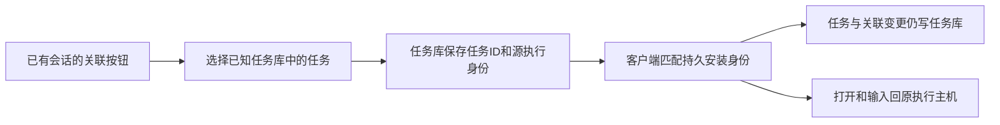

# 跨主机会话关联

关联 REQ-032、D-025、[Fartown/orca#130](https://github.com/Fartown/orca/issues/130)。

## 1. 变更边界

原先任务库只能保存自己的本机或 SSH 工作区内会话。新流程允许用户把已有会话手动关联到其他主机的任务，不更改任务的默认工作区，不迁移或重开会话。原生「开始做」「新开会话」仍按原有效工作区约束执行。

## 2. 所有权与身份

| 对象                                      | 拥有者与使用位置                                                 |
| ----------------------------------------- | ---------------------------------------------------------------- |
| 任务、评论、关联记录、变更收据、SQLite v8 | 任务库所在 Orca 的原 profile；不复制数据库                       |
| 会话进程、工作区文件、tab/pane、终端输入  | 会话的原执行 Orca 及其本机或 SSH 位置                            |
| installationId                            | Orca profile 的已有持久安装身份；不是会随重启变化的 runtimeId    |
| environmentId、镜像 tab/pane              | 当前客户端的局部路由；只在展示时派生，不写入另一台主机的持久记录 |
| 客户端展示投影                            | 当前桌面内存；通过共享连接状态解析已知源主机并跟随已发布的状态   |
| 端口、环境变量、后台服务                  | 产品不新增；验证夹具的资源只属于隔离验证进程                     |

显式跨主机关联增加 `executionOrigin={installationId, hostId, hostLabel}`。其中 hostId 只允许源 Orca 相对的 `local` 或 `ssh:<target>`。库内稳定 host key 为 `foreign:<installationId>/<encodeURIComponent(hostId)>`，tab/pane 保留源主机原始值。来源未知、身份冲突或已撤销时使用 unresolved-owner，不能回退本机。

## 3. 读写与展示

会话选择保留同工作区的现有任务族，并加入其他主机任务，显示其任务库名称。同库换关联使用既有写事务原子替换，失败时原关联不动。跨库换关联先保存新关联，再移除旧关联；旧移除结果不明时保留新关联并提示核对两边，不以响应丢失推断旧记录还在，也不自动回滚新关联而导致两边皆空。

桌面 partition 保留外部记录的 raw IDs，聚合时根据自身安装身份和共享主机缓存重新投影，避免身份晚到导致错归本机，也避免二次镜像。任务库后端不查询外部 pane 的本机 hook，不认领其窗格；桌面仅在源主机在联系时使用源状态证据显示进展。没有进程存活证明时保守处理过期状态，不能把缺行当退出。

外部回复复用原发送器，但发送前验证其目录推导出的 endpoint 与执行位置都等于已保存的来源；目录尚未到达或有同名冲突时拒绝发送，不能回退本机查询终端。paste 与 submit 前再次验证来源及路由。配对主机内的 SSH folder workspace 通过已有 HostAuthority 保存相对 SSH 位置。

手机仅从已持有且已连接客户端的可信缓存身份查找源主机；能唯一匹配才跳到源主机完整会话页。没有该缓存时禁开，外部会话不在任务库 client 上内嵌或回复，状态显示无法确认。

## 4. 兼容与风险

- 新能力为 `local-tasks.cross-host-sessions.v1`；新主机状态带可选 installationId。旧任务库不出现静默跨库写入，候选提供升级原因，原有本机关联保持。
- SQLite 从 v7 升 v8，迁移会话和 attention mark，pane 唯一性按执行 host 限定。旧版本按既有 schema 版本保护只读打开。
- 原工作区关联不放宽；跨主机关联只适用于明确手动选择已有会话。任务库失联禁写，执行主机失联禁输入及读取；功能不创建重连、重试或轮询。
- 外部会话的服务端权威进展仍是 unverifiable；桌面可用自己的源状态证据显示进展。没有可信源身份的客户端不能把另一台主机的缓存当成真实内容。
- 回退需要使用升级前任务库备份，不能将升级后的 v8 库降写成 v7；测试和交付不自动替换用户正在运行的 App。

## 5. 验证关联

标准用例见 [跨主机会话关联回归](../tests/cases/跨主机会话关联回归.md)，包括双向关联、持久身份、同名 pane 隔离、断联、手机安全路由和原生流程兼容。真实本机、配对与 SSH 证据在 `.docs/cross-host-task-associations-ui-validation/2026-11-16/`，没有执行通过的场景不记为完成。
