# D-008任务库主机资源化测试

以 [需求](../../requirements/本地任务管理.md)、journal D-008 和 [方案 §17](../../solutions/本地任务管理技术方案.md#17-主机资源化与模型调整2026-10-28d-008) 为预期来源，取代旧用例的桌面单库、两层、单仓与回复队列预期。历史 Run 不改。以下是规格，不代表实测通过。

共用环境：后台隐藏实例、新建 v4 库、独立 HOME；stub 不启动真实智能体。CDP截图，操作后以RPC/DOM为完成信号；执行器60秒/连接180秒只用于防挂起，超时须判断夹具或产品原因。每条独立准备其列明前置，不依赖其他用例顺序；结束关闭并删除自己的实例/数据，SSH撤销专用密钥并核对真实HOME快照。

### TC-201 空项目通过界面创建，任务可改状态

- 关联需求：REQ-001
- 优先级：P0
- 分级依据：核心建任务、跨端归属或会话处理链路。
- 预期来源：journal D-008、方案 §17 与上述关联需求。

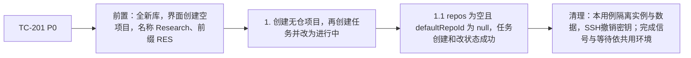

### TC-202 多仓、共享仓库、默认仓库与非法默认拒绝

- 关联需求：REQ-001
- 优先级：P0
- 分级依据：核心建任务、跨端归属或会话处理链路。
- 预期来源：journal D-008、方案 §17 与上述关联需求。

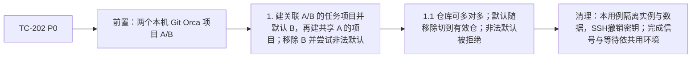

### TC-203 四层树的列表和详情

- 关联需求：REQ-004
- 优先级：P0
- 分级依据：核心建任务、跨端归属或会话处理链路。
- 预期来源：journal D-008、方案 §17 与上述关联需求。

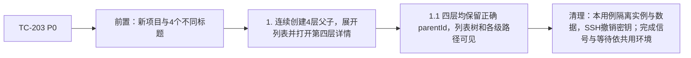

### TC-204 自己和后代成环被拒绝

- 关联需求：REQ-004
- 优先级：P0
- 分级依据：核心建任务、跨端归属或会话处理链路。
- 预期来源：journal D-008、方案 §17 与上述关联需求。

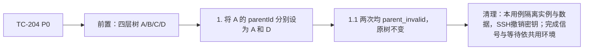

### TC-205 整棵子树跨项目移动

- 关联需求：REQ-004
- 优先级：P0
- 分级依据：核心建任务、跨端归属或会话处理链路。
- 预期来源：journal D-008、方案 §17 与上述关联需求。

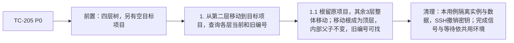

### TC-206 删除子树

- 关联需求：REQ-004
- 优先级：P0
- 分级依据：核心建任务、跨端归属或会话处理链路。
- 预期来源：journal D-008、方案 §17 与上述关联需求。

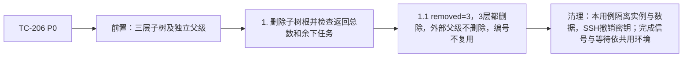

### TC-207 根任务开始做与规则一开启

- 关联需求：REQ-009、REQ-013
- 优先级：P0
- 分级依据：核心建任务、跨端归属或会话处理链路。
- 预期来源：journal D-008、方案 §17 与上述关联需求。

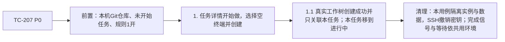

### TC-208 三级任务沿用最近祖先工作区

- 关联需求：REQ-010
- 优先级：P0
- 分级依据：核心建任务、跨端归属或会话处理链路。
- 预期来源：journal D-008、方案 §17 与上述关联需求。

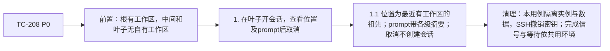

### TC-209 任意层单独开始做与规则一关闭

- 关联需求：REQ-009、REQ-013
- 优先级：P0
- 分级依据：核心建任务、跨端归属或会话处理链路。
- 预期来源：journal D-008、方案 §17 与上述关联需求。

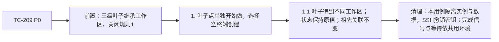

### TC-210 规则二、祖先隔离、关闭与去重

- 关联需求：REQ-013
- 优先级：P1
- 分级依据：重要分支、展示或防回归边界，可恢复。
- 预期来源：journal D-008、方案 §17 与上述关联需求。

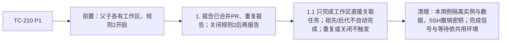

### TC-211 文件夹只用已有工作区

- 关联需求：REQ-009
- 优先级：P0
- 分级依据：核心建任务、跨端归属或会话处理链路。
- 预期来源：journal D-008、方案 §17 与上述关联需求。

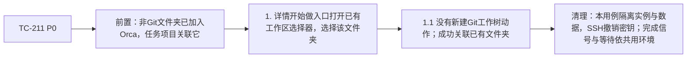

### TC-212 主机认领及批准、提问自然hook

- 关联需求：REQ-010、REQ-014
- 优先级：P0
- 分级依据：核心建任务、跨端归属或会话处理链路。
- 预期来源：journal D-008、方案 §17 与上述关联需求。

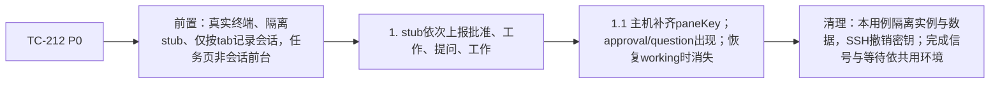

### TC-213 完成未看、暂缓到期及任务入口已看

- 关联需求：REQ-014、REQ-015
- 优先级：P0
- 分级依据：核心建任务、跨端归属或会话处理链路。
- 预期来源：journal D-008、方案 §17 与上述关联需求。

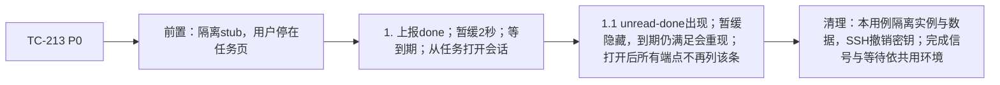

### TC-214 侧栏打开会话转发已看

- 关联需求：REQ-014、REQ-015
- 优先级：P0
- 分级依据：核心建任务、跨端归属或会话处理链路。
- 预期来源：journal D-008、方案 §17 与上述关联需求。

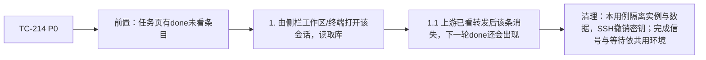

### TC-215 在线回复一次送达

- 关联需求：REQ-015
- 优先级：P0
- 分级依据：核心建任务、跨端归属或会话处理链路。
- 预期来源：journal D-008、方案 §17 与上述关联需求。

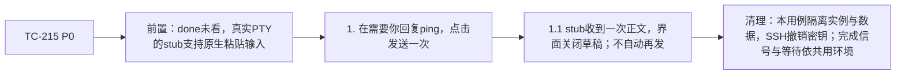

### TC-216 阻塞自然OSC

- 关联需求：REQ-014
- 优先级：P0
- 分级依据：核心建任务、跨端归属或会话处理链路。
- 预期来源：journal D-008、方案 §17 与上述关联需求。

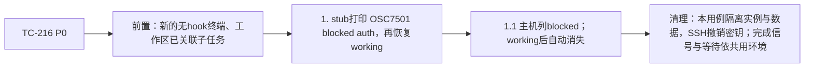

### TC-217 失败退回文字且不自动重发

- 关联需求：REQ-015
- 优先级：P0
- 分级依据：核心建任务、跨端归属或会话处理链路。
- 预期来源：journal D-008、方案 §17 与上述关联需求。

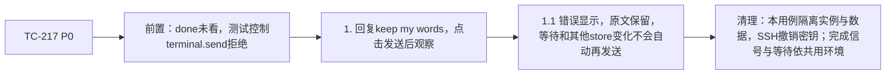

### TC-218 侧栏按最顶层归组

- 关联需求：REQ-016
- 优先级：P1
- 分级依据：重要分支、展示或防回归边界，可恢复。
- 预期来源：journal D-008、方案 §17 与上述关联需求。

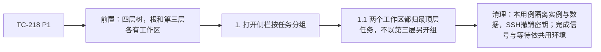

### TC-219 中英文界面

- 关联需求：REQ-001、REQ-004、REQ-018
- 优先级：P1
- 分级依据：重要分支、展示或防回归边界，可恢复。
- 预期来源：journal D-008、方案 §17 与上述关联需求。

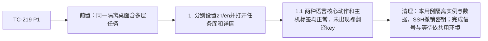

### TC-220 多仓开始做默认和仓库切换

- 关联需求：REQ-001、REQ-009
- 优先级：P1
- 分级依据：重要分支、展示或防回归边界，可恢复。
- 预期来源：journal D-008、方案 §17 与上述关联需求。

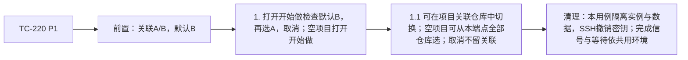

### TC-221 serve库归属和桌面读写

- 关联需求：REQ-018
- 优先级：P0
- 分级依据：核心建任务、跨端归属或会话处理链路。
- 预期来源：journal D-008、方案 §17 与上述关联需求。

```mermaid
flowchart LR
    A["TC-221 P0"] --> B["前置：新建无头serve与配对桌面，新库"]
    B --> C["1. 桌面远端创建项目任务，对照host/desktop SQLite"]
    C --> D["1.1 记录只在serve profile库，桌面本地库没有；列表可见"]
    D --> E["清理：本用例隔离实例与数据，SSH撤销密钥；完成信号与等待依共用环境"]
```

### TC-222 手机经桌面中转

- 关联需求：REQ-017、REQ-018
- 优先级：P0
- 分级依据：核心建任务、跨端归属或会话处理链路。
- 预期来源：journal D-008、方案 §17 与上述关联需求。

```mermaid
flowchart LR
    A["TC-222 P0"] --> B["前置：手机按mobile权限配对桌面，桌面连serve"]
    B --> C["1. 真实WS携带executionHost runtime环境创建和读取任务"]
    C --> D["1.1 远端库成功写入；桌面本地库没有；主机直接读取同一条"]
    D --> E["清理：本用例隔离实例与数据，SSH撤销密钥；完成信号与等待依共用环境"]
```

### TC-223 中转方法边界

- 关联需求：REQ-018
- 优先级：P1
- 分级依据：重要分支、展示或防回归边界，可恢复。
- 预期来源：journal D-008、方案 §17 与上述关联需求。

```mermaid
flowchart LR
    A["TC-223 P1"] --> B["前置：同上"]
    B --> C["1. 中转合法localTasks写；尝试preferences、未知方法、已删除replies方法"]
    C --> D["1.1 合法成功；不在手机白名单的方法被拒绝，未改变其他方法路由"]
    D --> E["清理：本用例隔离实例与数据，SSH撤销密钥；完成信号与等待依共用环境"]
```

### TC-224 同名项目同编号跨主机独立

- 关联需求：REQ-002、REQ-018
- 优先级：P0
- 分级依据：核心建任务、跨端归属或会话处理链路。
- 预期来源：journal D-008、方案 §17 与上述关联需求。

```mermaid
flowchart LR
    A["TC-224 P0"] --> B["前置：桌面和serve各有同名同前缀项目"]
    B --> C["1. 各建第一条任务并合并显示"]
    C --> D["1.1 两库编号相同但身份独立；多主机时编号旁有正确主机名"]
    D --> E["清理：本用例隔离实例与数据，SSH撤销密钥；完成信号与等待依共用环境"]
```

### TC-225 局域网网页版

- 关联需求：REQ-018
- 优先级：P0
- 分级依据：核心建任务、跨端归属或会话处理链路。
- 预期来源：journal D-008、方案 §17 与上述关联需求。

```mermaid
flowchart LR
    A["TC-225 P0"] --> B["前置：当前web产物与serve提供的runtime配对URL；观察启动水合后的页面稳定再点击"]
    B --> C["1. 隐藏网页配对serve，启动稳定后切本地任务并创建及编辑任务"]
    C --> D["1.1 只见所连接serve库，可读写；不混入桌面本地库"]
    D --> E["清理：本用例隔离实例与数据，SSH撤销密钥；完成信号与等待依共用环境"]
```

### TC-226 远端断开停止读取并恢复

- 关联需求：REQ-012、REQ-018
- 优先级：P0
- 分级依据：核心建任务、跨端归属或会话处理链路。
- 预期来源：journal D-008、方案 §17 与上述关联需求。

```mermaid
flowchart LR
    A["TC-226 P0"] --> B["前置：桌面已缓存serve任务"]
    B --> C["1. 用现有连接层断开，观察；再显式恢复"]
    C --> D["1.1 提示无法连接；不发localTasks读取/重连；缓存可看不可写，恢复自动对齐"]
    D --> E["清理：本用例隔离实例与数据，SSH撤销密钥；完成信号与等待依共用环境"]
```

### TC-227 手机直接配对无头服务器

- 关联需求：REQ-017、REQ-018
- 优先级：P0
- 分级依据：核心建任务、跨端归属或会话处理链路。
- 预期来源：journal D-008、方案 §17 与上述关联需求。

```mermaid
flowchart LR
    A["TC-227 P0"] --> B["前置：新serve提供mobile范围配对"]
    B --> C["1. 手机真实WS建项目任务，host本机读取"]
    C --> D["1.1 手机和host看到同一库，服务不依赖桌面renderer"]
    D --> E["清理：本用例隔离实例与数据，SSH撤销密钥；完成信号与等待依共用环境"]
```

### TC-228 远端需要你和回复离线行为

- 关联需求：REQ-014、REQ-015
- 优先级：P0
- 分级依据：核心建任务、跨端归属或会话处理链路。
- 预期来源：journal D-008、方案 §17 与上述关联需求。

```mermaid
flowchart LR
    A["TC-228 P0"] --> B["前置：serve真实stub完成未看，桌面和手机经中转"]
    B --> C["1. 在线回复；再done打开草稿断开端点，恢复"]
    C --> D["1.1 在线一次送达；桌面提示离线但输入可用，失败保留文字；手机禁用；恢复不自动发"]
    D --> E["清理：本用例隔离实例与数据，SSH撤销密钥；完成信号与等待依共用环境"]
```

### TC-229 手机页面多库和深层任务

- 关联需求：REQ-017
- 优先级：P0
- 分级依据：核心建任务、跨端归属或会话处理链路。
- 预期来源：journal D-008、方案 §17 与上述关联需求。

```mermaid
flowchart LR
    A["TC-229 P0"] --> B["前置：当前手机页面可运行的真实或模拟设备"]
    B --> C["1. 打开任务页切换库、展开4层、开始做/开会话"]
    C --> D["1.1 库路由正确，深层列表详情和启动流程可用，首页计数与实际库一致"]
    D --> E["清理：本用例隔离实例与数据，SSH撤销密钥；完成信号与等待依共用环境"]
```

### TC-230 旧端点能力与混合版本

- 关联需求：REQ-018
- 优先级：P1
- 分级依据：重要分支、展示或防回归边界，可恢复。
- 预期来源：journal D-008、方案 §17 与上述关联需求。

```mermaid
flowchart LR
    A["TC-230 P1"] --> B["前置：对端不通告local-tasks.v1"]
    B --> C["1. 桌面/手机尝试任务入口并记录请求"]
    C --> D["1.1 显示需要更新，不向该端点发送localTasks请求"]
    D --> E["清理：本用例隔离实例与数据，SSH撤销密钥；完成信号与等待依共用环境"]
```

### TC-231 SSH主机库文件及桌面读写

- 关联需求：REQ-018
- 优先级：P0
- 分级依据：核心建任务、跨端归属或会话处理链路。
- 预期来源：journal D-008、方案 §17 与上述关联需求。

```mermaid
flowchart LR
    A["TC-231 P0"] --> B["前置：root2222 sshd，强制命令隔离HOME，新orcad模板"]
    B --> C["1. 桌面连SSH，在远端建项目任务，核对两边库"]
    C --> D["1.1 任务文件位于SSH隔离profile；桌面库无记录；通告能力并可读写"]
    D --> E["清理：本用例隔离实例与数据，SSH撤销密钥；完成信号与等待依共用环境"]
```

### TC-232 两个客户端看SSH同一库

- 关联需求：REQ-017、REQ-018
- 优先级：P0
- 分级依据：核心建任务、跨端归属或会话处理链路。
- 预期来源：journal D-008、方案 §17 与上述关联需求。

```mermaid
flowchart LR
    A["TC-232 P0"] --> B["前置：桌面连SSH，手机mobile权限配对桌面"]
    B --> C["1. 手机携带executionHost改远端任务，桌面重读"]
    C --> D["1.1 桌面和手机看到同一持久化值，无桌面副本"]
    D --> E["清理：本用例隔离实例与数据，SSH撤销密钥；完成信号与等待依共用环境"]
```

### TC-233 SSH断开/恢复

- 关联需求：REQ-012、REQ-018
- 优先级：P0
- 分级依据：核心建任务、跨端归属或会话处理链路。
- 预期来源：journal D-008、方案 §17 与上述关联需求。

```mermaid
flowchart LR
    A["TC-233 P0"] --> B["前置：SSH远端任务已缓存"]
    B --> C["1. 通过连接层断开后观察请求，再显式重连"]
    C --> D["1.1 无法连接且不主动读；状态不变；重连自动读取同库"]
    D --> E["清理：本用例隔离实例与数据，SSH撤销密钥；完成信号与等待依共用环境"]
```

### TC-234 SSH会话认领与四类需要你

- 关联需求：REQ-010、REQ-014
- 优先级：P0
- 分级依据：核心建任务、跨端归属或会话处理链路。
- 预期来源：journal D-008、方案 §17 与上述关联需求。

```mermaid
flowchart LR
    A["TC-234 P0"] --> B["前置：SSH orcad库、真实SSH PTY隔离stub"]
    B --> C["1. 记录tab后上报四类及恢复，桌面/手机读取"]
    C --> D["1.1 主机补出原始paneKey，客户端镜像正确；四类出现消失；失联无法确认"]
    D --> E["清理：本用例隔离实例与数据，SSH撤销密钥；完成信号与等待依共用环境"]
```

### TC-235 orcad关闭任务库与退出

- 关联需求：REQ-018
- 优先级：P1
- 分级依据：重要分支、展示或防回归边界，可恢复。
- 预期来源：journal D-008、方案 §17 与上述关联需求。

```mermaid
flowchart LR
    A["TC-235 P1"] --> B["前置：已打开任务库的隔离SSH orcad"]
    B --> C["1. 结束自有orcad后核对ps和数据库锁，再重启同profile"]
    C --> D["1.1 服务解除订阅、关闭数据库且无残余；重启能打开原库"]
    D --> E["清理：本用例隔离实例与数据，SSH撤销密钥；完成信号与等待依共用环境"]
```

### TC-236 看过转发去重

- 关联需求：REQ-014、REQ-015
- 优先级：P1
- 分级依据：重要分支、展示或防回归边界，可恢复。
- 预期来源：journal D-008、方案 §17 与上述关联需求。

```mermaid
flowchart LR
    A["TC-236 P1"] --> B["前置：已打开会话，跨页面进展同步和其他store变化"]
    B --> C["1. 统计同一item的ack调用，多次无关store更新，再新一轮"]
    C --> D["1.1 同一条目正常只写一次；失败只等新的主机进展/联系再尝试，无定时重试"]
    D --> E["清理：本用例隔离实例与数据，SSH撤销密钥；完成信号与等待依共用环境"]
```
