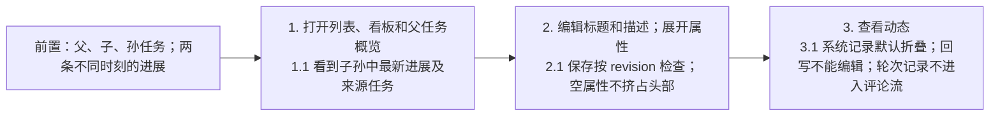
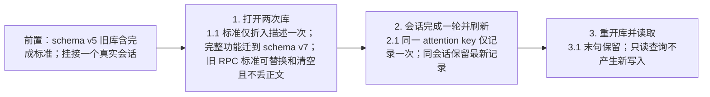
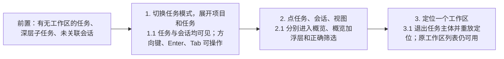
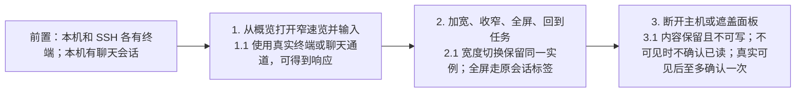
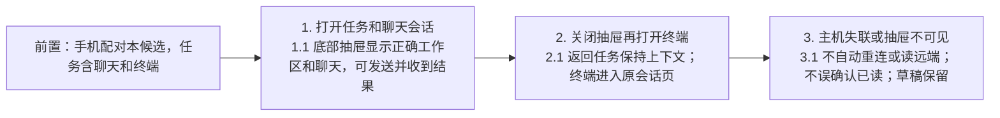
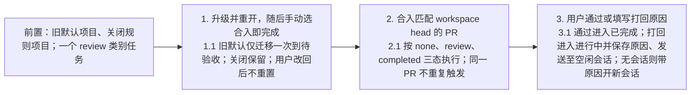
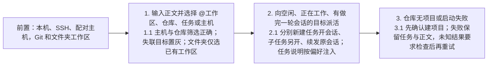
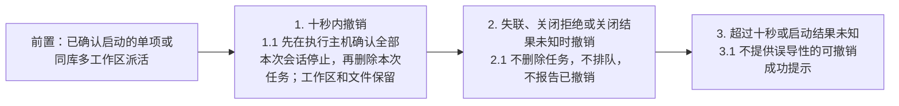
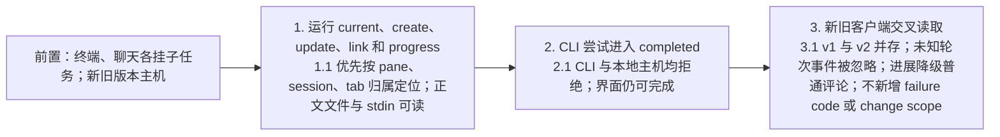

# 任务为主的工作流测试

- 需求：[本地任务管理](../../requirements/本地任务管理.md) REQ-004、005、007、009～019、022、024、026～031。
- 方案：[任务为主的工作流技术方案](../../solutions/任务为主的工作流技术方案.md) M1～M13；统一分支范围见 Journal D-017。
- 场景：桌面本机、独立 HOME 的真实 SSH 主机、配对手机；测试实例均后台运行。结果、截图、候选构建与原始日志写到 `.docs/local-tasks-ui-validation/2026-11-06/consolidation/`。
- Q1/Q2 按用户本轮确认的技术方案实现，区别于原型的标签栏及手机终端抽屉。

## 覆盖矩阵

| 需求                        | 用例           | 本轮边界               |
| --------------------------- | -------------- | ---------------------- |
| REQ-004、005、012、022、027 | TC-301、TC-302 | 概览、进展、旧数据     |
| REQ-007、016、026           | TC-303         | 侧栏与定位             |
| REQ-009、010、015、017、028 | TC-304、TC-305 | 会话浮层与手机抽屉     |
| REQ-013、014、024           | TC-306         | 待验收、合入规则       |
| REQ-007、029                | TC-307、TC-308 | 明确目标直接派活及撤销 |
| REQ-018、019、022           | TC-302、TC-309 | 主机归属、兼容、CLI    |

## 用例

### TC-301 任务概览与进展汇总

- 关联需求：REQ-004, REQ-005, REQ-012, REQ-022, REQ-027
- 优先级：P1
- 分级依据：任务当前结果及会话入口是主路径。
- 预期来源：Requirements REQ-022、D-013、D-014。

### TC-302 旧库折叠与轮次结束重启

- 关联需求：REQ-004, REQ-018, REQ-022
- 优先级：P1
- 分级依据：升级必须保留既有内容且不能重复迁移。
- 预期来源：D-014、技术方案 M2/M5。

### TC-303 侧栏任务模式与工作区定位

- 关联需求：REQ-007, REQ-016, REQ-026
- 优先级：P1
- 分级依据：任务和原工作区导航必须能往返。
- 预期来源：REQ-026、技术方案 M6。

### TC-304 桌面会话速览、输入和已读

- 关联需求：REQ-010, REQ-014, REQ-015, REQ-028
- 优先级：P1
- 分级依据：重复挂载或过早已读会丢失操作上下文。
- 预期来源：D-013、D-014、原已读规则。

### TC-305 手机聊天抽屉与终端导航

- 关联需求：REQ-017, REQ-028
- 优先级：P1
- 分级依据：手机必须从任务进入对应会话并能回答。
- 预期来源：REQ-017、技术方案 M10/Q2。

### TC-306 待验收与合入规则

- 关联需求：REQ-013, REQ-014, REQ-024
- 优先级：P1
- 分级依据：任务完成必须由用户确认，反馈不能丢。
- 预期来源：2026-11-01 已确认规则默认值、REQ-024、技术方案 M12。

### TC-307 明确目标的直接派活

- 关联需求：REQ-007, REQ-029
- 优先级：P1
- 分级依据：目标或任务归属错误会把工作发到错误位置。
- 预期来源：REQ-029、技术方案 M11。

### TC-308 派活撤销与不确定结果

- 关联需求：REQ-029
- 优先级：P1
- 分级依据：撤销不能删除仍在执行或不属于本次派活的任务。
- 预期来源：REQ-029、技术方案 M11。

### TC-309 CLI 与混合版本

- 关联需求：REQ-018, REQ-019, REQ-022
- 优先级：P1
- 分级依据：智能体必须找到自己的任务且不能替人宣告完成。
- 预期来源：REQ-019/022、技术方案 M3/M4。

### TC-310 总管提案与台账

- 关联需求：REQ-030, REQ-031
- 优先级：P1
- 分级依据：人工确认和单次执行防止重复副作用。
- 预期来源：Requirements REQ-030/031、Journal D-015/D-017。

| ID       | 前置                          | 步骤                                                  | 预期                                                             | 预期来源        |
| -------- | ----------------------------- | ----------------------------------------------------- | ---------------------------------------------------------------- | --------------- |
| TC-310.1 | 本机任务库、可用工作区        | 打开总管；生成 record/link 提案；取消一条、确认另一条 | 未确认不执行；取消不建任务；确认只运行保留项，结果进入台账       | REQ-030         |
| TC-310.2 | 两窗口打开同一提案            | 两边尝试确认/认领                                     | 仅一个执行者成功，不重复建任务                                   | REQ-030         |
| TC-310.3 | 本机与 SSH 库各有任务         | 总管 watch，写进展并读取 inbox/ack；SSH 断开再恢复    | 引用带主机命名空间；断开无功能自重连/读取；恢复跟随共享连接层    | REQ-018/031     |
| TC-310.4 | 总管空闲且有未读事实          | 右键粘贴、拖放或 IME 留草稿后离焦；再触发事实         | 有草稿不自动粘贴和提交；空闲空输入时每轮至多一个唤醒指针         | REQ-031         |
| TC-310.5 | 本机或 SSH 任务有终端会话     | 确认 stop；模拟主机关闭失败/未知                      | 仅执行主机确认 PTY 结束才记成功；失联为 unverifiable，不宣称停止 | REQ-018/030     |
| TC-310.6 | 库含旧标准A、超长合法工作区ID | legacy update B→清空；重开库；提案使用200字符ID       | 标准精确替换/清空不损正文，重开幂等；提案允许4096内ID            | REQ-004/018/030 |

人工收尾与活动执行者的并发规则由本轮独立审查提出，用户选择确认后补充预期；未确认前不把该项判为通过。
