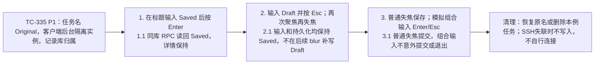
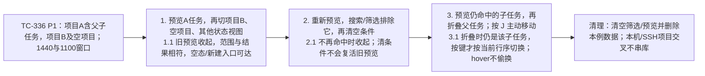
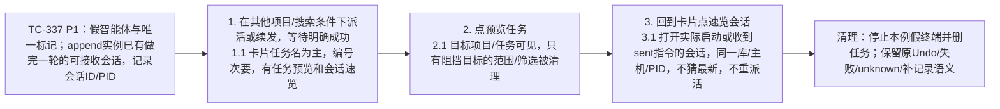
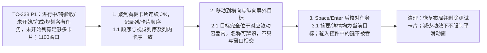
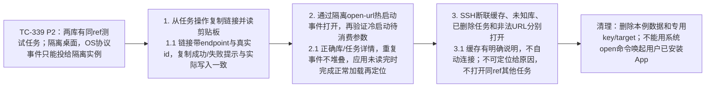
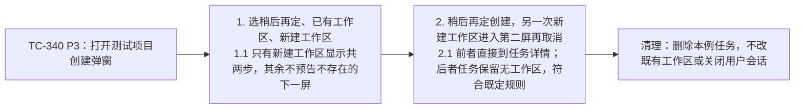
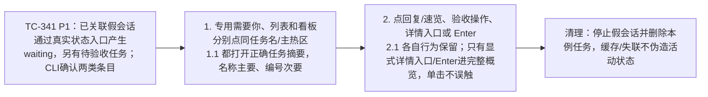
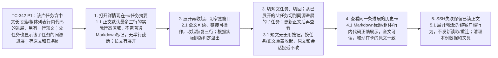

# 任务交互修复回归

预期来自 D-023、用户“都修好啊”及手机正文三行要求、STYLEGUIDE 的 Enter 提交/Esc 退出规则。执行证据属于本轮 `.docs/local-tasks-followup-fixes-ui-validation/2026-11-15/`，本文件只维护规格。

共享夹具：隔离后台客户端；本机库与通过 root sshd 连接的独立 SSH 库各有项目 A/B、任务父/子与不同状态。智能体均为不会访问真实模型的假终端；SSH 服务、库和终端属于 SSH 执行主机，客户端只显示/操作，失联不自行重连。界面动作等待可见状态或 RPC 读回，执行器单步 30 秒防挂起超时只记待查/阻断，不当产品性能阈值。副作用只清理本例拥有的数据，不关闭用户 App。

| 检查点                        | 关联需求                           | Case   | 优先级 |
| ----------------------------- | ---------------------------------- | ------ | ------ |
| 标题提交/退出、IME            | REQ-006、REQ-026                   | TC-335 | P1     |
| 范围内预览与折叠              | REQ-006、REQ-026                   | TC-336 | P1     |
| 成功回执查看实际任务/会话     | REQ-029、REQ-028                   | TC-337 | P1     |
| 看板键盘顺序/可见性           | REQ-007、REQ-026                   | TC-338 | P1     |
| 桌面任务定位链接              | REQ-026、REQ-018                   | TC-339 | P2     |
| 创建步骤提示                  | REQ-027                            | TC-340 | P3     |
| 需要你主热区                  | REQ-014、REQ-026                   | TC-341 | P1     |
| PC/手机正文三行折叠与历史格式 | REQ-005、REQ-017、REQ-022、REQ-026 | TC-342 | P1     |

规格覆盖 8 条，P1 6 条、P2 1 条、P3 1 条；不等于执行通过数。桌面操作系统全矩阵、原生焦点和手机原生壳由 Run 分别记录，不从移动 Web 窄视口推断。

### TC-335 标题 Enter 保存、Esc 退出

- 关联需求：REQ-006、REQ-026
- 优先级：P1
- 分级依据：取消改名却保存会意外修改任务身份。
- 预期来源：D-023、STYLEGUIDE 的 Enter submits / Esc backs out。
- 参数化实例：`local`、`ssh`；用对应库里的测试任务。

### TC-336 切范围不留旧预览，折叠不偷换任务

- 关联需求：REQ-006、REQ-026
- 优先级：P1
- 分级依据：陈旧或偷换的预览让用户操作错误对象。
- 预期来源：D-023。

### TC-337 派活回执直接查看任务与实际会话

- 关联需求：REQ-029、REQ-028
- 优先级：P1
- 分级依据：成功后查看结果是派活主流程；会话不能打开错对象或重复启动。
- 预期来源：D-023、REQ-029 已派活卡。
- 参数化实例：`local-launch`、`local-append`、`ssh-launch`、`ssh-append`。

### TC-338 看板键盘序与完整定位

- 关联需求：REQ-007、REQ-026
- 优先级：P1
- 分级依据：键盘高亮和随后的操作目标必须可预测、可辨识。
- 预期来源：D-023、REQ-007。

### TC-339 桌面复制链接与冷/热启动定位

- 关联需求：REQ-026、REQ-018
- 优先级：P2
- 分级依据：回访入口缺失有手动搜索绕行，但串库会造成误定位。
- 预期来源：D-023、REQ-026 详情菜单。
- 参数化实例：`local`、`ssh`；两个库可有相同 ref，名称不同。

### TC-340 创建步骤文案随选择变化

- 关联需求：REQ-027
- 优先级：P3
- 分级依据：错误步骤数影响预期，但创建能力仍可完成。
- 预期来源：D-023、REQ-027。

### TC-341 需要你名称默认任务预览

- 关联需求：REQ-014、REQ-026
- 优先级：P1
- 分级依据：需要你是高频决策入口，主热区语义应一致。
- 预期来源：D-023。

### TC-342 PC/手机正文默认三行并展开/收起

- 关联需求：REQ-005、REQ-017、REQ-022、REQ-026
- 优先级：P1
- 分级依据：用户当前手机截图的整屏正文影响主要任务浏览与会话入口。
- 预期来源：用户明确“默认显示三行，折叠/展开，pc也一样”，D-023。
- 参数化实例：`desktop-local`（1440×900 深色）、`desktop-ssh`（1100×800 浅色）、`mobile-local`（移动 Web 390×844 深色）、`mobile-ssh`（移动 Web 390×844 浅色）。移动原生/真实设备另记执行环境，不能混称。

