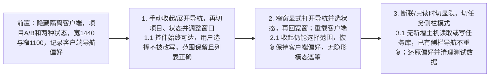
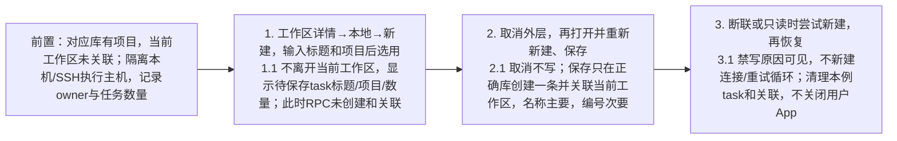
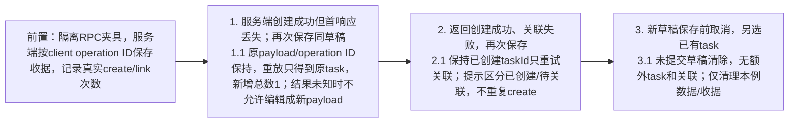
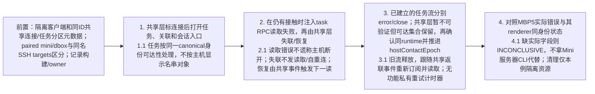

# 会话布局与导航回归

预期来源为本轮用户截图/明确要求、D-024及既有保存取消、共享连接协议。A布局与实例连续性沿TC-332修订规格执行；提醒空白属于Issue118的独立恢复功能。本文件是规格，不是通过记录。

### TC-343 手动展开和收起任务导航

- 关联需求：REQ-006、REQ-026。
- 优先级：P1。
- 分级依据：任务状态与项目是常用入口，消失或自行变化会影响浏览。
- 预期来源：D-024用户要求手动控制且保持选择。

### TC-344 工作区关联时新建任务

- 关联需求：REQ-011、REQ-018。
- 优先级：P1。
- 分级依据：缺入口会中断当前工作区的任务归属流程。
- 预期来源：用户工作区详情截图及D-024；既有草稿保存取消契约。
- 参数化实例：local-git、local-folder、ssh-workspace。

### TC-345 新建结果未知和关联失败重试

- 关联需求：REQ-011、REQ-018。
- 优先级：P1。
- 分级依据：重复创建或跨库写入会产生错误任务归属。
- 预期来源：既有mutation幂等协议及D-024保存语义。

### TC-346 任务与全局连接的同身份对照

- 关联需求：REQ-018、REQ-028。
- 优先级：P1。
- 分级依据：错报失联会阻断已连接主机上的任务操作。
- 预期来源：用户MBP5连接mini场景、D-024及共享连接层契约；实际反馈的错误文字/分区状态仍待采集。
- 参数化实例：local、ssh、paired-runtime；同名SSH target与paired runtime使用不同ID。

