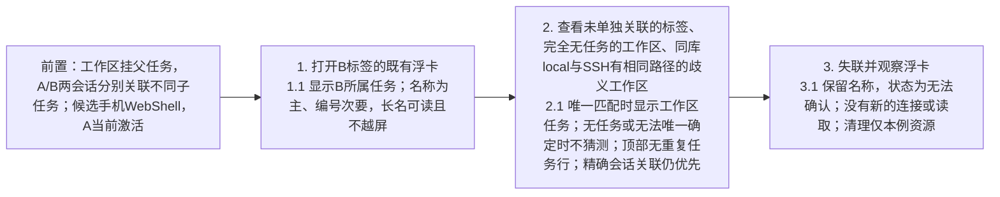
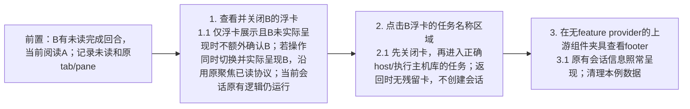
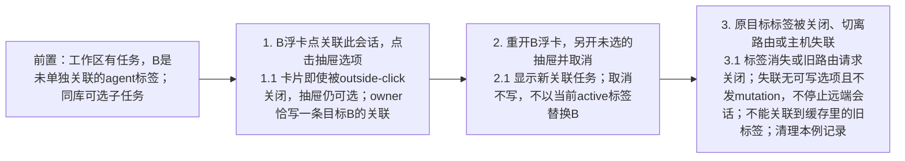
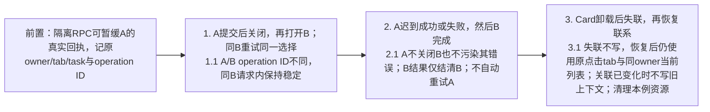

# D-025 / Issue #124

预期来源为用户手机截图及「为什么不把任务放在悬浮卡里」，沿用名称优先、主机归属、失联边界和当前会话已读协议。本文件是验收规格，不表示已经通过。各例参数化本机库与真实 SSH 执行主机库；记录客户端、执行主机、构建、task/tab/pane 与关联 ID。

### TC-347 所点标签的任务与名称层级

- 关联需求：REQ-011、REQ-016、REQ-017。
- 优先级：P1；任务归属错误会误导后续查看和关联。
- 预期来源：D-025 与既有会话优先、工作区兜底规则。

### TC-348 打开任务与已读边界

- 关联需求：REQ-011、REQ-014、REQ-017。
- 优先级：P1；路由或已读错误会丢失待处理信息。
- 预期来源：既有任务路由和已读协议，D-025。

### TC-349 卡片关联抽屉的生命周期

- 关联需求：REQ-011、REQ-017。
- 优先级：P1；点击抽屉后卡片卸载不能丢弃用户选择。
- 预期来源：既有 bottom drawer、detail card outside-click 行为与 D-025。

### TC-350 迟到结果与操作 ID 隔离

- 关联需求：REQ-011、REQ-017、REQ-018。
- 优先级：P1；旧请求结果不能关闭新抽屉或重放已完成回执。
- 预期来源：既有 mutation 幂等协议与请求生命周期。

