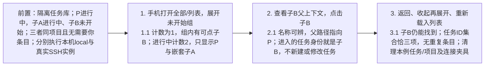
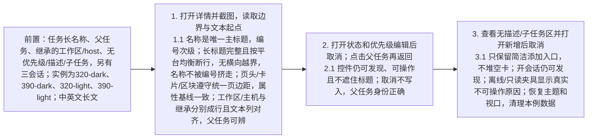
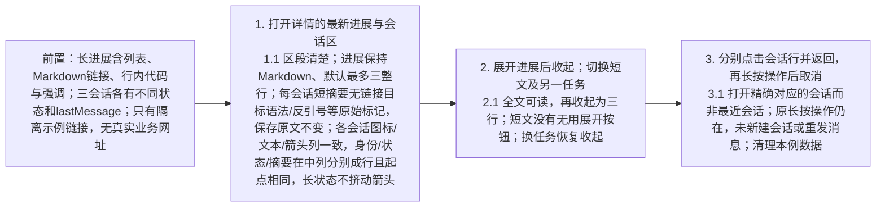
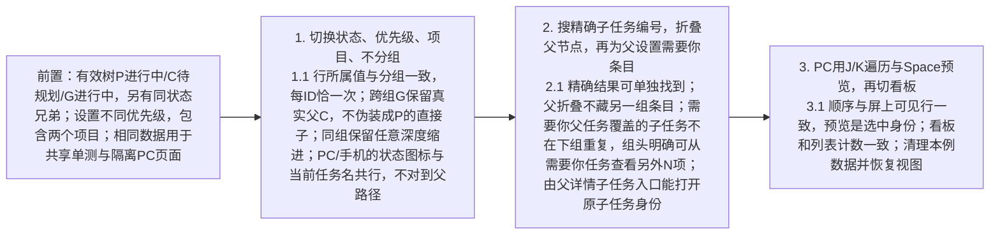
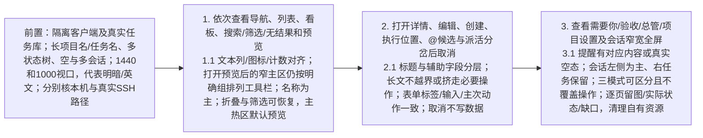
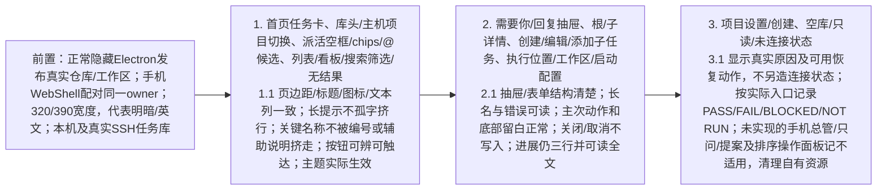

# D-029 / Issue #136

来源：用户2026-11-17两张手机截图及REQ-006/017/026。以下为规格，不是执行结果；实际构建、环境、每个输入实例、截图、原始值和未覆盖项写入本轮ignored results。

| 检查点                                 | 需求                               | 用例   | 规格范围                          |
| -------------------------------------- | ---------------------------------- | ------ | --------------------------------- |
| 跨状态非零分组可访问，同任务仅显示一次 | REQ-006                            | TC-362 | 本机及真实SSH两实例               |
| 名称层级、属性和入口保留、空区块简化   | REQ-017、REQ-026                   | TC-363 | 320/390宽度、明暗主题参数化       |
| 三行展开、完整正文与Markdown短摘要     | REQ-012、REQ-017、REQ-026          | TC-364 | 文本/链接/代码/列表与多会话       |
| 通用分组、深层父链、过滤/折叠与PC键盘  | REQ-006、REQ-007                   | TC-365 | 共享逻辑与客户端呈现分层验证      |
| PC任务界面逐页布局与交互走查           | REQ-006、REQ-007、REQ-026～REQ-030 | TC-366 | 宽窄主区、长文、空态及菜单/表单   |
| 手机任务界面逐页布局与交互走查         | REQ-017、REQ-026、REQ-027、REQ-029 | TC-367 | 320/390、主题、长文及实际可达入口 |

### TC-362 跨状态子任务在自身组可打开

- 关联需求：REQ-006、REQ-017。
- 优先级：P1。
- 分级依据：有计数却没有入口会让用户找不到已有任务，影响常用任务浏览。
- 预期来源：D-029与REQ-006当前分组契约，用户第二张截图。

### TC-363 详情层级与操作入口

- 关联需求：REQ-017、REQ-026。
- 优先级：P2。
- 分级依据：信息重复和层级错误显著降低阅读效率；状态/位置仍可操作是本次布局的必要回归。
- 预期来源：用户第一张截图、既有名称优先约定和D-029；空描述/子任务入口沿用REQ-026。

### TC-364 进展全文和会话摘要分别可读

- 关联需求：REQ-012、REQ-017、REQ-026。
- 优先级：P1。
- 分级依据：会话摘要裸露链接语法且与进展混排，妨碍识别会话；不能因整理布局丢失全文或会话入口。
- 预期来源：用户第一张截图、D-023三行规则及D-029。短摘要规则同时核列表、看板、首页及需要你；完整进展仍通过详情展开阅读。

### TC-365 共享分组及桌面交叉行为

- 关联需求：REQ-006、REQ-007、REQ-017。
- 优先级：P1。
- 分级依据：共享分组同时影响PC和手机，修复不能造成错组、重复和键盘定位错误。
- 预期来源：REQ-006、REQ-007与D-029，不使用旧空组行为作为新期望。

### TC-366 PC任务界面逐页走查

- 关联需求：REQ-006、REQ-007、REQ-026、REQ-027、REQ-028、REQ-029、REQ-030。
- 优先级：P2。
- 分级依据：散乱的工具栏、错位的属性/文本与不清楚的主操作妨碍连续浏览和任务操作，须覆盖完整流程而非只看单页。
- 预期来源：用户「整个任务界面好多类似的问题都好好看看」、STYLEGUIDE与D-022～D-024/D-029。

### TC-367 手机任务界面逐页走查

- 关联需求：REQ-017、REQ-026、REQ-027、REQ-029。
- 优先级：P2。
- 分级依据：窄屏长文、表单及抽屉容易造成相同错位和操作拥挤；详情局部通过不能代表整个手机界面可用。
- 预期来源：用户最新整界面走查要求、STYLEGUIDE与手机既有入口。

规格共6条，P1三条、P2三条；执行结果需逐实例记录。原生Android/iOS、所有主机/主题的笛卡尔积未在本文件承诺全覆盖，实际覆盖与缺口必须在Run报告中明确，不以网页视口代替原生实机。
