# 本地任务管理功能测试

- 需求：[本地任务管理](../../requirements/本地任务管理.md)
- 方案：[本地任务管理技术方案](../../solutions/本地任务管理技术方案.md)
- 场景说明：
  - **本机**：客户端和工作区都在本机。
  - **SSH**：客户端是桌面 Orca，工作区在 SSH 主机上。本机验证用 root 运行的 `127.0.0.1:2222` sshd，步骤见 `docs/reference/ssh-real-app-validation.md`。
  - **配对服务器**：工作区在 orcad 上。
  - **手机**：手机配对桌面 Orca。
- D-008 的新增与替代判据见 [D-008任务库主机资源化测试](D-008任务库主机资源化测试.md)，以方案 §17 为准；历史 Run 不改写。
- 真机证据与本轮执行记录放 `.docs/local-tasks-ui-validation/{日期}/`；本轮按用户指定在 `tests/runs/` 增加独立测试记录。

## 1. 切片 1：任务库

| 编号   | 场景                                 | 步骤                                                                                               | 预期                                                                                                                      | 覆盖             | 自动化                                               |
| ------ | ------------------------------------ | -------------------------------------------------------------------------------------------------- | ------------------------------------------------------------------------------------------------------------------------- | ---------------- | ---------------------------------------------------- |
| TC-001 | 本机、SSH                            | 没有任何任务项目时打开任务页「本地」                                                               | 列出本机仓库和 SSH 仓库对应的 Orca 项目作为推荐；确认后才创建；允许同一个 Orca 仓库关联多个任务项目；支持空项目和多仓项目 | REQ-001          | `local-tasks-service.test.ts`（多仓项目）            |
| TC-002 | 本机                                 | 建 SHOP-1、SHOP-2；把前缀改成 MALL；搜索 SHOP-1；新建项目用前缀 SHOP                               | 搜索 SHOP-1 打开 MALL-1；新项目不能用 SHOP                                                                                | REQ-002          | `local-tasks-service.test.ts`                        |
| TC-003 | 本机                                 | 在进行中类别加「联调中」；删除仍有任务的「待办」                                                   | 看板多出一列；删除时要求选一个状态承接任务；类别里只剩一个状态时不能删                                                    | REQ-003          | `local-tasks-service.test.ts`                        |
| TC-004 | 本机                                 | 建 SHOP-12，在子任务框粘贴三行；再给子任务建子任务                                                 | 一次建出 3 个子任务；允许继续建第三层及更深层，自己或祖先挂到后代被拒绝                                                   | REQ-004          | `local-tasks-service.test.ts`（多层与成环）          |
| TC-005 | 本机                                 | 删除带 3 个子任务的 SHOP-12                                                                        | 确认框写明整棵子树的总数；删除后编号不复用                                                                                | REQ-004          | `local-tasks-service.test.ts`                        |
| TC-006 | 本机                                 | 把 SHOP-12 移到 ORC 项目；搜索 SHOP-12                                                             | 整棵子树都拿到 ORC 的新编号；旧编号仍能打开                                                                               | REQ-004          | `local-tasks-service.test.ts`                        |
| TC-007 | 本机、手机                           | 改状态、优先级、标签；加、改、删评论                                                               | 动态按字段各记一条，写明来源（桌面或手机）；只有评论能改和删                                                              | REQ-005          | `local-tasks-service.test.ts`、`local-tasks.test.ts` |
| TC-008 | 本机                                 | 准备跨两个项目、含子任务的数据；切换列表和看板；按优先级、标签筛选；多选后批量改状态               | 分组、缩进正确；三处计数按需求 REQ-006 的口径对得上；「已取消」列默认隐藏                                                 | REQ-006          | 渲染层 store 测试                                    |
| TC-009 | 本机                                 | 在任务页按 C、J/K、Enter、Space、X、S、V、/；输入框里按 C；聚焦普通按钮和任务行分别按 Enter、Space | 单键按说明生效；输入框里不触发；普通按钮保留自身 Enter、Space 行为，任务行执行打开或预览                                  | REQ-007          | 渲染层测试                                           |
| TC-010 | 本机（macOS、Windows、Linux 各一次） | Cmd+J 输入「新建任务」和「SHOP-1」                                                                 | 出现「新建任务…」和对应任务；组合键按平台显示                                                                             | REQ-007          | —                                                    |
| TC-011 | 本机                                 | 任务页切到「本地」，再切回 GitHub；重启 Orca                                                       | 「本地」排在 GitHub 前；切回 GitHub 与改动前一致；重启后停在上次的来源                                                    | REQ-008          | —                                                    |
| TC-012 | 手机                                 | 在手机上新建任务、建子任务、改状态、评论；同时在桌面编辑同一任务                                   | 桌面和手机互相实时看到变化；同时编辑时后提交的一方提示「已被修改」并重读                                                  | REQ-017          | `local-tasks-service.test.ts`（stale）               |
| TC-013 | 手机                                 | 所连 Orca 关闭；手机连接不支持本地任务的旧端点；手机连接新版 orcad 服务器                          | 未连接时保留已读库并不可写；旧端点按能力提示更新且不发 localTasks 请求；新版 orcad 可读写其本机库                         | REQ-017、REQ-018 | `local-tasks.test.ts`（未注册不通告）                |
| TC-014 | SSH、配对服务器                      | 在 SSH 工作区所在项目建任务后，检查 SSH 主机的 HOME 与 `~/.orca-remote`；orcad 的 `status.get`     | 任务库在拥有项目的 SSH/orcad profile 下；桌面库没有这份记录；orcad 通告 `local-tasks.v1`                                  | REQ-018          | `local-tasks.test.ts`                                |
| TC-015 | 本机                                 | 用更新版本写过的任务库启动；把任务库目录设为不可写后启动                                           | 前者只读打开，任务可看不可改；后者任务页显示不可用原因，Orca 照常启动                                                     | REQ-018          | `local-tasks-service.test.ts`（只读）                |
| TC-016 | 手机                                 | 手机发出新建任务后立刻断网，恢复后重发同一操作                                                     | 只建出一个任务                                                                                                            | REQ-017、REQ-018 | `local-tasks-service.test.ts`（重放）                |

### 1.1 独立审查修复回归

本节为本轮修复的长期规格。预期来自当前 Requirements 与用户授权修复的 D-005；执行结果仍放独立证据目录。新增用例均为 P1，覆盖 8 个可独立判定的修复场景。

### TC-017 评论草稿与发送按任务隔离

- 关联需求：REQ-005
- 优先级：P1
- 分级依据：错误评论会进入另一任务，影响记录归属。
- 预期来源：requirements/本地任务管理.md、journal.md 的 D-006（取代 D-005 永久保留部分）。

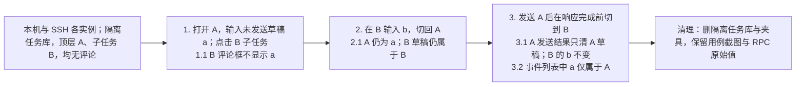

### TC-018 资源读取失败与显式重试

- 关联需求：REQ-006、REQ-017、REQ-018
- 优先级：P1
- 分级依据：首次读取错误被遮蔽会使整个任务库无法进入。
- 预期来源：requirements/本地任务管理.md、journal.md 的 D-006（取代 D-005 永久保留部分）。

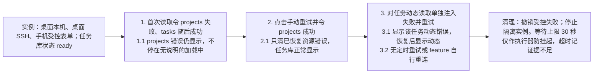

### TC-019 批量项目创建的部分成功恢复

- 关联需求：REQ-001
- 优先级：P1
- 分级依据：部分成功后隐藏失败会误导用户以为所选项目全部创建。
- 预期来源：requirements/本地任务管理.md、journal.md 的 D-006（取代 D-005 永久保留部分）。

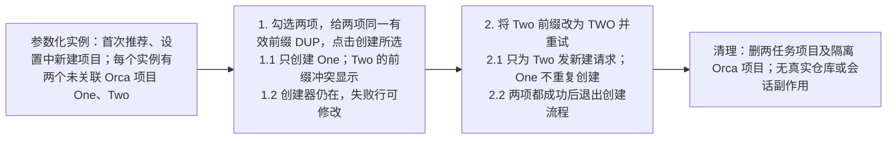

### TC-020 删除原项目后保护存活历史编号

- 关联需求：REQ-002、REQ-004
- 优先级：P1
- 分级依据：旧编号错跳会将后续操作指向另一个任务。
- 预期来源：requirements/本地任务管理.md、journal.md 的 D-006（取代 D-005 永久保留部分）。

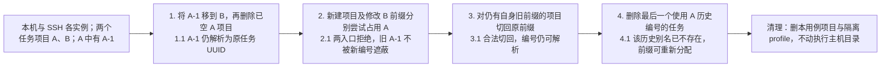

### TC-021 24 小时内大量写入和重启后的延迟重投

- 关联需求：REQ-017、REQ-018
- 优先级：P1
- 分级依据：重投重复创建会破坏任务数量与用户操作幂等性。
- 预期来源：requirements/本地任务管理.md、journal.md 的 D-006（取代 D-005 永久保留部分）。

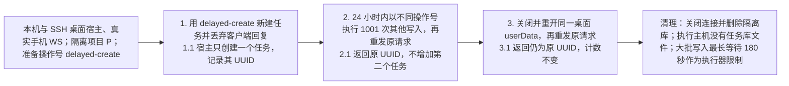

### TC-022 手机多行子任务保留全部表单属性

- 关联需求：REQ-004、REQ-017
- 优先级：P1
- 分级依据：填写的数据被当作成功保存后丢弃，损害任务内容完整性。
- 预期来源：requirements/本地任务管理.md、journal.md 的 D-006（取代 D-005 永久保留部分）。

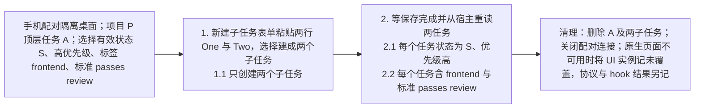

### TC-023 手机批量子任务的部分保存与未知回执恢复

- 关联需求：REQ-004、REQ-017、REQ-018
- 优先级：P1
- 分级依据：重试不得重复创建，且必须真实保存用户当前填写内容。
- 预期来源：requirements/本地任务管理.md、journal.md 的 D-006（取代 D-005 永久保留部分）。

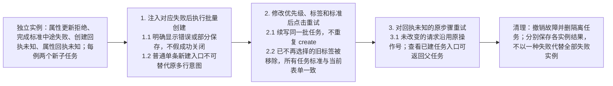

### TC-024 手机删除项目确认、权限与幂等

- 关联需求：REQ-001、REQ-017、REQ-018
- 优先级：P1
- 分级依据：项目级联删除必须准确表达范围并限制只读修改。
- 预期来源：requirements/本地任务管理.md、journal.md 的 D-006（取代 D-005 永久保留部分）。

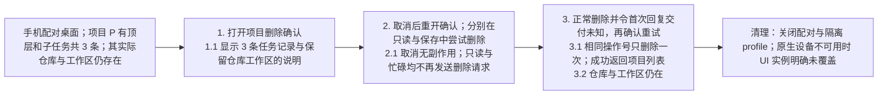

## 2. 切片 2：和工作区、会话结合

本节以 REQ-009～REQ-017、D-007 与 D-008/方案 §17 为预期来源，冲突时 §17 优先。会话事件优先由隔离 stub 合成；受控状态注入、真实 hook/OSC、实际 WebSocket、自然界面分别记录，不互相替代。只有「做完一轮，你还没看」可回复；REQ-017 验收文字中遗留的「回复等你回答」不作为本节判据。

| 编号   | 场景                    | 步骤                                                                                                                                 | 预期                                                                                                                                                                                                                                     | 覆盖             |
| ------ | ----------------------- | ------------------------------------------------------------------------------------------------------------------------------------ | ---------------------------------------------------------------------------------------------------------------------------------------------------------------------------------------------------------------------------------------- | ---------------- |
| TC-101 | 本机、SSH、文件夹项目   | 顶层任务开始做，分别选择合成默认智能体和不启动智能体；检查预填、取消、失败；SSH 断开再点；文件夹项目尝试开始做                       | git 项目沿原生 composer 预填仓库/主机/名称，只有选智能体才启动，成功后关联且正确记录主机/分支；取消/失败不留关联，改标题不改原分支；失联禁用且不重连；任意一层都能开始做，开会话沿用自身或最近上级工作区，文件夹只可关联已有工作区       | REQ-009          |
| TC-102 | 本机、SSH、配对服务器   | 两个子任务在父工作区各开会话；终端、结构化聊天、主机拒绝聊天回退终端；选择直接发送与草稿；手机各路径开会话并对比 paneKey             | 同工作区不同会话独立记录；认领实际 tab/session，挂载后 paneKey 能匹配桌面状态表，web-terminal- 不误认原始 tab；prompt 带任务与父摘要；展示方式沿原生设置；失联禁用；回退不认领无关聊天                                                   | REQ-010          |
| TC-103 | 本机、SSH               | 侧栏右键关联任务；终端及结构化聊天 chip 关联会话；测试已占用工作区、任务已有工作区；取消会话/工作区关联；离线关联；子任务换父        | 任意层任务可关联一个工作区；会话候选为工作区所属任务及全部下级；workspace_already_linked 提示所属任务编号，task_has_workspace 提示已有工作区名；取消只删关联且按范围级联；换父保留旧会话实际位置，之后新会话用新父工作区；离线不访问主机 | REQ-011          |
| TC-104 | 本机、SSH               | 检查列表/看板/详情/子任务的状态点、最后一句、已缓存 PR/Checks/统计；模拟删除工作区、会话关闭、重启找不到、未集成状态；断开再恢复 SSH | 进展复用已有缓存，无缓存不额外读取；例外分别显示已删除、已结束、找不到会话、状态未知；失联显示无法确认且任务状态不变，恢复联系后自动对上；restoredUnconfirmed 沿上游衰减且不进需要你                                                     | REQ-012          |
| TC-105 | 本机、SSH、GitLab       | 开/关两条规则后分别开始做与发布合并状态；GitLab head 与 MR sha 相等/不等；已完成/取消任务；手动改回进行中；重复发布同 PR             | 两条开关均可持久保存且关闭时不触发；开始规则与关联同事务，PR 规则只影响拥有该工作区的任务，不改其上级且跳过已完成/取消；GitLab 仅 head=MR sha 触发，动态说明原因；同 PR 不重复触发，不批量改子任务                                       | REQ-013          |
| TC-106 | 本机、SSH               | 合成批准、提问/原因未知、阻塞、完成未读四类事件；再恢复工作/已读/失联；测试未关联、未集成、重启恢复；检查数字和筛选                  | 四类条目正确出现并按事实消失；结构化聊天等待归等你回答；只有完成未读可回复，其余仅打开会话；未关联/未集成/重启未确认/失联不进需要你；任务状态不随 agent 结束改变，数字和筛选按需求口径                                                   | REQ-014、REQ-006 |
| TC-107 | 本机、SSH、手机、双窗口 | 完成未读时在线回复；断开时检查桌面提示与保留文字、手机禁用；失败退回原文；恢复后不自动发送；已看 E、暂缓 H 及到期                    | 只有完成未读可回复；客户端复用上游会话一次发送，失败保留原文；不入队、不自动重发或重连；已看写所属主机库，下次新条目再出现；暂缓到期仍满足则重现                                                                                         | REQ-015          |
| TC-108 | 本机、SSH               | 侧栏按任务分组，检查归属/未关联/折叠；定位折叠组内工作区；工作区及两类会话 chip；切回其他分组；检查排序菜单操作                      | 组头为关联顶层任务，未关联单列；定位时自动展开；按任务时卡片不重复任务编号，其他分组卡片有任务 chip；会话 chip 显示正确子任务/父任务并可打开；切回其他分组行为保持；排序菜单的可用动作应有可观察效果，无法判定的排序语义单列未知         | REQ-016          |
| TC-109 | 手机                    | 首页计数/前3条；需要你回复与左滑已看/暂缓；详情开始做/开会话/关联已有；主机长按关联与文件夹入口；会话页任务条；关闭桌面窗口          | 与桌面快照和规则一致；按紧急程度显示前3条；只有完成未读能回复，复用上游会话直接发送；可从任务跳会话；文件夹从任务详情关联；无头端点无 renderer 也可判定；未连接时无法确认；不支持能力提示更新                                            | REQ-017          |

## 3. 开工前验证

方案 §13 的 4 项在本机、SSH、配对服务器三种场景下的结论写在 `tests/runs/`，不成立的项按方案「不成立时」一列修改设计后再做切片 2。

### TC-025 回执身份、损坏拒绝与时间清理

- 关联需求：REQ-017、REQ-018
- 优先级：P1
- 分级依据：重放不得重复创建任务或伪造跨方法成功。
- 预期来源：requirements/本地任务管理.md、journal.md D-006，以及 2026-10-26 用户确认的切片 1 评审修复清单。

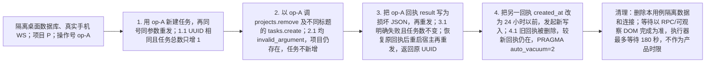

### TC-026 手机失联与 checking 保留页面

- 关联需求：REQ-017、REQ-018
- 优先级：P1
- 分级依据：断线不能销毁草稿、导航及重试操作号。
- 预期来源：requirements/本地任务管理.md、journal.md D-006，以及 2026-10-26 用户确认的切片 1 评审修复清单。

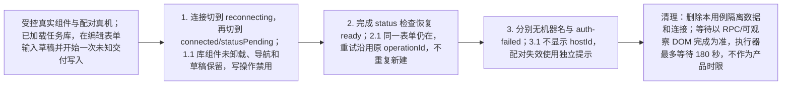

### TC-027 手机移动成功后的保存重试

- 关联需求：REQ-004、REQ-017
- 优先级：P1
- 分级依据：已完成 move 不能让后续编辑永久卡死。
- 预期来源：requirements/本地任务管理.md、journal.md D-006，以及 2026-10-26 用户确认的切片 1 评审修复清单。


### TC-028 桌面历史回放保留本地来源

- 关联需求：REQ-008
- 优先级：P1
- 分级依据：返回常用任务页不得切错来源或改掉偏好。
- 预期来源：requirements/本地任务管理.md、journal.md D-006，以及 2026-10-26 用户确认的切片 1 评审修复清单。

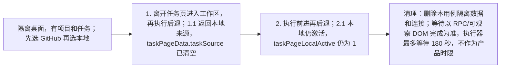

### TC-029 搜索请求只消费一次

- 关联需求：REQ-007
- 优先级：P1
- 分级依据：旧搜索请求不能持续抢走 J/K 键盘导航。
- 预期来源：requirements/本地任务管理.md、journal.md D-006，以及 2026-10-26 用户确认的切片 1 评审修复清单。

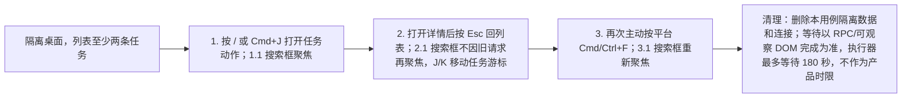

### TC-030 最后一条完成标准保存

- 关联需求：REQ-004
- 优先级：P1
- 分级依据：删除后重现会造成数据和界面不一致。
- 预期来源：requirements/本地任务管理.md、journal.md D-006，以及 2026-10-26 用户确认的切片 1 评审修复清单。

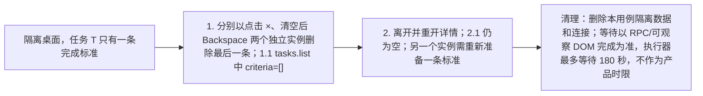

### TC-031 远端改名与设置草稿并发

- 关联需求：REQ-001、REQ-002、REQ-017
- 优先级：P1
- 分级依据：旧设置值不得覆盖手机已保存的新值。
- 预期来源：requirements/本地任务管理.md、journal.md D-006，以及 2026-10-26 用户确认的切片 1 评审修复清单。


### TC-032 批量写入与无变化边界

- 关联需求：REQ-003、REQ-004、REQ-005、REQ-018
- 优先级：P2
- 分级依据：批量操作须保持计数、上限和变化通知正确。
- 预期来源：requirements/本地任务管理.md、journal.md D-006，以及 2026-10-26 用户确认的切片 1 评审修复清单。

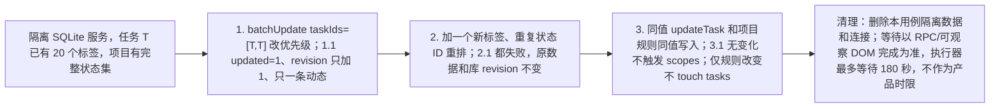

### TC-033 双端共享搜索、投影与前缀

- 关联需求：REQ-002、REQ-006、REQ-017
- 优先级：P2
- 分级依据：相同数据和查询应产生一致结果。
- 预期来源：requirements/本地任务管理.md、journal.md D-006，以及 2026-10-26 用户确认的切片 1 评审修复清单。

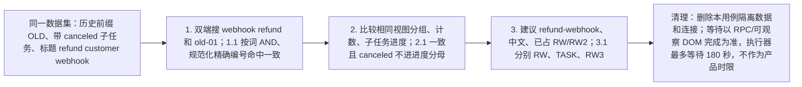

### TC-034 旧原生 App 订阅释放

- 关联需求：REQ-017、REQ-018
- 优先级：P2
- 分级依据：旧 native 不认识新释放映射也不得累积桌面监听。
- 预期来源：requirements/本地任务管理.md、journal.md D-006，以及 2026-10-26 用户确认的切片 1 评审修复清单。

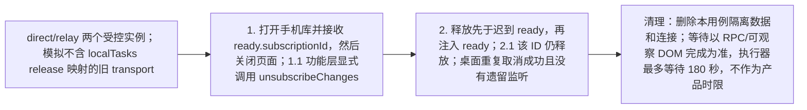

### TC-035 后续重读失败保留页面与事件独立重试

- 关联需求：REQ-006、REQ-017、REQ-018
- 优先级：P1
- 分级依据：常见临时读取错误不得销毁已编辑内容。
- 预期来源：requirements/本地任务管理.md、journal.md D-006，以及 2026-10-26 用户确认的切片 1 评审修复清单。

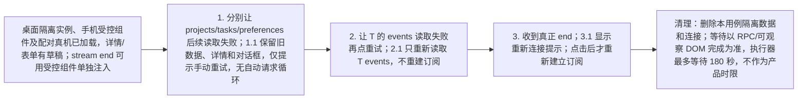

### TC-036 桌面列表与草稿操作边界

- 关联需求：REQ-004、REQ-005、REQ-006、REQ-007
- 优先级：P2
- 分级依据：键盘、折叠和任务切换应与可见对象一致。
- 预期来源：requirements/本地任务管理.md、journal.md D-006，以及 2026-10-26 用户确认的切片 1 评审修复清单。

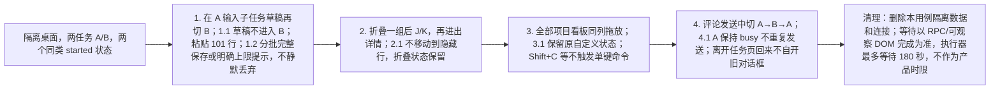

### TC-037 首页主机记忆与错误计数

- 关联需求：REQ-017
- 优先级：P2
- 分级依据：多主机并发和失败不能永久显示加载。
- 预期来源：requirements/本地任务管理.md、journal.md D-006，以及 2026-10-26 用户确认的切片 1 评审修复清单。

```mermaid
flowchart LR
    TC_37_0["手机受控组件；两台已识别任务宿主"]
    TC_37_1["1. 并发记住两台主机，重建存储读取；1.1 两台都保留"]
    TC_37_2["2. 让计数读取失败；2.1 显示失败而非一直正在读取；新宿主用 status 可选计数，旧宿主缺字段兼容回退"]
    TC_37_3["清理：删除本用例隔离数据和连接；等待以 RPC/可观察 DOM 完成为准，执行器最多等待 180 秒，不作为产品时限"]
    TC_37_0 --> TC_37_1 --> TC_37_2 --> TC_37_3
```

### TC-038 SSH 数据归属与失联无自行重连

- 关联需求：REQ-018
- 优先级：P1
- 分级依据：任务数据必须归拥有该项目的 Orca，断开不能偷偷读取。
- 预期来源：requirements/本地任务管理.md、journal.md D-006，以及 2026-10-26 用户确认的切片 1 评审修复清单。

```mermaid
flowchart LR
    TC_38_0["root sshd 127.0.0.1:2222、专用强制命令密钥、隔离 HOME/app；先快照真实 HOME"]
    TC_38_1["1. 连接 SSH 工作区，读写远端任务；1.1 数据库在 SSH orcad profile，桌面无这份记录，orcad 通告 local-tasks.v1"]
    TC_38_2["2. 显式断开 SSH，观察至少 10 秒；2.1 功能不发请求/重连，远端库显示不可连接且不可写；本机自己的库仍可写"]
    TC_38_3["3. 清理本轮实例/密钥行/隔离 HOME；3.1 ps 无本轮残留，authorized_keys 与 .orca-remote 快照一致"]
    TC_38_4["清理：删除本用例隔离数据和连接；等待以 RPC/可观察 DOM 完成为准，执行器最多等待 180 秒，不作为产品时限"]
    TC_38_0 --> TC_38_1 --> TC_38_2 --> TC_38_3 --> TC_38_4
```

### TC-039 无本地任务回调时仍创建普通工作区

- 关联需求：REQ-009、REQ-018
- 优先级：P1
- 分级依据：接缝不可阻止不关联任务的普通工作区创建。
- 预期来源：既有工作区创建行为、方案的接缝复用约束；本轮用户要求保留已有实现并完成收尾。

```mermaid
flowchart LR
    TC_039_0["工作区创建 hook 的受控夹具；不启动真实智能体；创建函数返回 creation-1"]
    TC_039_1["1. 不传 onCreationStarted 调用普通创建<br/>1.1 runBackgroundWorktreeCreation 仍调用一次"]
    TC_039_2["2. 独立实例传 onCreationStarted 回调<br/>2.1 先创建一次，再把 creation-1 通知回调，不重复创建"]
    TC_039_3["清理：卸载夹具并清空 mocks；无需用户数据清理"]
    TC_039_0 --> TC_039_1 --> TC_039_2 --> TC_039_3
```

## 4. 完整需求深审修复回归

### TC-110 无智能体开始做与删除后重新认领工作区

- 关联需求：REQ-009、REQ-011、REQ-013、REQ-018
- 优先级：P1
- 分级依据：任务创建工作区后的关联及删除清理是主要链路。
- 预期来源：requirements/本地任务管理.md 的 REQ-009、REQ-011、REQ-013；本轮修复 F-01、F-04 和详情装配缺口。

```mermaid
flowchart LR
    TC_110_0["实例 local 或 ssh：隔离桌面、无 hook 的测试仓库、同项目任务 T1/T2；SSH 用 root 2222 和 forced HOME"]
    TC_110_1["1. 打开 T1 详情，点开始做，明确选不启动智能体，再创建<br/>1.1 工作区实际建成；T1 自动关联正确宿主，默认规则转进行中"]
    TC_110_2["2. 删除 T1，再打开 T2 选择已有工作区<br/>2.1 原工作区仍存在且可选，不被旧关联禁用；选择后 T2 显示该工作区"]
    TC_110_3["3. 打开会话入口并关闭，不提交智能体启动<br/>3.1 对话框实际可见；清理隔离实例、仓库、密钥和 HOME，ps 核对残留"]
    TC_110_0 --> TC_110_1 --> TC_110_2 --> TC_110_3
```

### TC-111 失败回复原文恢复与显式再次发送

- 关联需求：REQ-015、REQ-017
- 优先级：P1
- 分级依据：发送失败不能丢失用户正在编辑的文字，恢复联系不能擅自发送。
- 预期来源：REQ-015、D-008 与方案 §17.3，取代旧队列预期；具体分支见 TC-217、TC-228。

```mermaid
flowchart LR
    A["隔离实例；live unread-done 条目，打开回复框；合成终端而非真实智能体"]
    B["1. 输入原文，令上游会话发送明确拒绝<br/>1.1 只调用一次；错误可见，回复框保留原文"]
    C["2. 改文字，再断开和恢复主机<br/>2.1 文字保留，不入队、不自动发送；只有显式再次点击才尝试"]
    D["清理：恢复受控拒绝，关闭隔离实例及其 HOME"]
    A --> B --> C --> D
```

### TC-112 换父后手机打开历史会话

- 关联需求：REQ-011、REQ-017
- 优先级：P1
- 分级依据：错误工作区导航会把用户带到其他任务上下文。
- 预期来源：REQ-011、D-007；本轮 F-03。

```mermaid
flowchart LR
    TC_112_0["SQLite 或真实配对 WS：P1/W1、P2/W2，子任务 C 在 W1 有会话 S"]
    TC_112_1["1. 将 C 改到 P2<br/>1.1 S 的实际宿主与工作区仍是 W1；之后新会话只用 W2"]
    TC_112_2["2. 经生产手机 selector 与导航函数打开 S<br/>2.1 URL 指 W1，保留 S 的 paneKey；不同 runtime 主机取 S 的 executionHost"]
    TC_112_3["清理：关闭内存库或隔离配对连接、实例；不启动真实 agent"]
    TC_112_0 --> TC_112_1 --> TC_112_2 --> TC_112_3
```

### TC-113 结构化启动回退与精确会话认领

- 关联需求：REQ-010、REQ-012
- 优先级：P1
- 分级依据：记录错误会话会使进展和后续操作针对错误对象。
- 预期来源：REQ-010、REQ-012、方案的真实启动结果规则。

```mermaid
flowchart LR
    TC_113_0["受控既有 structured launch 模块；分别返回 chat(sessionId)、terminal(tabId)、none，不启动真实 agent"]
    TC_113_1["1. 通过创建完成路径传递 settlement<br/>1.1 chat 只认领相同 sessionId；host decline 按终端结果；none 不挂会话"]
    TC_113_2["2. 启动失败后出现同 agent 的无关 chat<br/>2.1 不把该 chat 关联给任务；普通不带任务回调的创建仍执行一次，见 TC-039"]
    TC_113_3["清理：卸载夹具、恢复 mocks 与订阅，不修改用户数据"]
    TC_113_0 --> TC_113_1 --> TC_113_2 --> TC_113_3
```
