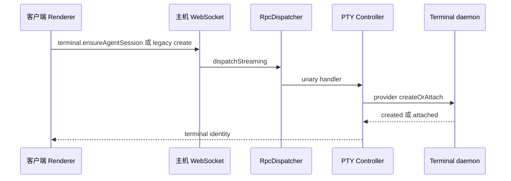

# 终端创建日志原版覆盖审计

| 项目       | 内容                                                      |
| ---------- | --------------------------------------------------------- |
| 对象与目的 | 核对原诊断提交在当前基线的真实覆盖范围，关联 REQ-801～803 |
| 类型       | 机制型                                                    |
| 范围       | Renderer 恢复入口、paired RPC、PTY 与 daemon 的日志关联   |
| 不在范围   | 历史入口归因、恢复策略与进程所有权修复                    |
| 快照       | 原诊断 05e420719b9；集成基线 ce4b4c54a35；描述补齐前事实  |

## 1. 结论先行

- 原版是本地提交，不在集成分支，不能作为生产已生效的证据。
- 当前 paired WebSocket 走 `dispatchStreaming`；原诊断只包装 `dispatch`，因此实际主机入口存在漏记。
- Renderer 有自动 sleeping、cold restore 与 generic paired 标记，没有 AI Vault 历史恢复专属标记。
- 原 allowlist 不读取 nested placement、operation、mutation、spawn intent；`id:` worktree selector 与原始 ID 的摘要也不同。
- 这些静态事实不能证明历史 19:12 是哪个入口发起。

## 2. 技术链路

原版 `dispatch` 的入口 span 与上述调用不相交。底层 provider 和 daemon 的记录仍可出现，但不能代替 method、request 和 caller 的入站记录。原 paired wrapper 仅在创建前记录，没有返回主机 Tab 的闭环；同一 provider 并发创建无法只靠时间唯一配对。

`launchSourceFrames` 仅保留八个以内的 bundle 文件名和行列号，不含函数名，也没有打包 source-map 反解证明。它是辅助指纹，不是业务入口的可靠替代。

## 3. 冲突与未知项

| 项目               | 静态确认的边界                                                                   |
| ------------------ | -------------------------------------------------------------------------------- |
| automatic sleeping | 原版有 requested/created，但没有 unified 可见性及 pendingActivationSpawn 差异    |
| cold restore       | 原版入口所在函数已被上游拆分为 deferred 包装与实际 spawn；旧接缝不能直接覆盖冲突 |
| 主机早接回         | 当前基线由 adoptStablePane 执行；原版旧 reservation 代码不是当前行为             |
| mixed peers        | 现有 wire 字段可读，旧 peer 没有字段时只能记录缺失，不能补造来源                 |
| 历史现场           | 旧版本未部署日志，无法追溯未记录的创建入口                                       |

## 4. 验证状态

已回读原诊断模块、当前 WebSocket 分发边界、历史恢复与冷恢复入口。审计本身没有部署或运行生产应用；后续真实测试结果独立记入 Test Run，不把代码存在性检查当运行证明。

## 5. 关键文件索引

| 章节 | 文件                                                                                             | 符号与职责                          |
| ---- | ------------------------------------------------------------------------------------------------ | ----------------------------------- |
| 1、2 | `src/main/runtime/runtime-rpc/runtime-rpc-websocket-dispatch.ts`                                 | 调用 dispatchStreaming              |
| 1、2 | `src/main/runtime/rpc/dispatcher.ts`                                                             | 两种 RPC 分发边界                   |
| 1、2 | `src/main/terminal-launch-diagnostics/launch-trace.ts`                                           | 原 RPC allowlist 与 span            |
| 1、3 | `src/shared/terminal-launch-diagnostics/launch-evidence.ts`                                      | 身份 allowlist 与候选观察           |
| 1、2 | `src/renderer/src/lib/launch-ai-vault-session.ts`                                                | 历史恢复的本地与 paired 分支        |
| 2    | `src/renderer/src/terminal-launch-diagnostics/paired-terminal-launch.ts`                         | 原 paired 创建前日志                |
| 2    | `src/renderer/src/terminal-launch-diagnostics/launch-origin.ts`                                  | origin 枚举与安全栈位置             |
| 3    | `src/renderer/src/lib/sleeping-agent-session-launch.ts`                                          | 自动恢复实际创建                    |
| 3    | `src/renderer/src/components/terminal-pane/pty-connection/deferred-cold-restore-and-snapshot.ts` | cold restore 实际 spawn 与 deferral |
| 3    | `src/main/ipc/pty/runtime/spawn.ts`                                                              | 当前 stable-pane 接回与创建         |

## 6. 关联文档与过程件

- [需求](../requirements/requirement.md)
- [开发记录](../journal.md)
- 本轮原始证据与脚本：`.docs/terminal-launch-diagnostics-ui-validation/2026-10-22/`
