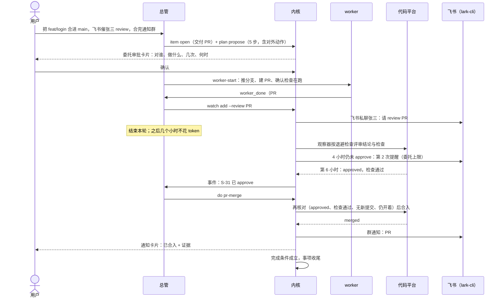

# 典型任务走查：方案够不够

用户给的六个典型任务：盯监控；把一个 PR 合进去（建 PR → 飞书催人 review → 假定半天后才点 approve → 合入 → 通知）；开发 xx；查 xxx；通知别人在做；一天后问「xx 开发到什么程度了」。并追问：怎么保证跟进正常、会话不乱、压缩之后还记得、PR 合入是真完成而不是被搁置、拿不到 approve 事件怎么办。

本文逐个走一遍，作为 [总体方案](超级智能体总体方案.md) 各切片的验收剧本。

## 0. 结论：初稿不够，补了五样

| 缺口（初稿）                                             | 后果                                                 | 补上的机制                                                                    |
| -------------------------------------------------------- | ---------------------------------------------------- | ----------------------------------------------------------------------------- |
| 只有「跟进关系」和卡片，没有一个**必须收尾**的对象       | 总管忘了、被压缩了、某一步没触发，事情就悄悄停在半路 | **事项**：完成条件由内核核对，只有三种收尾；**看门狗**不变量（方案 4.8）      |
| PR/CI 只靠 worker 去读或条件复查；没有「外部状态」的来源 | 别人点 approve 没人知道；监控异常没人发现            | **观察器**：确定性检查、不花 token、只在变化时说话；看不到时请用户确认（4.9） |
| 对外动作每次都要审批                                     | 「催两次再合入」要点三四次卡片，不如自己干           | **委托**：一次确认计划，计划内的具体动作直接执行（4.10）                      |
| 进度靠总管自己的对话上下文                               | 压缩、重启后答不上「xx 做到哪了」                    | **事项进展记录** + 规则「先查账本」+ 唤醒邮件带事项编号（4.8）                |
| 会话与事情之间没有确定的对应                             | 多个 worker、多个工作区，谁是谁说不清                | 派工带事项编号、一事项一工作区、会话按 `S-12·短名` 命名（4.8）                |

另外把「对外发飞书、建 PR、合入」从第五期提前到切片 3（4.11）；飞书**入站**（读别人的回复）仍在第五期。

## 1. 「帮我盯一下监控」

**总管做**

1. 开事项 `S-21 盯监控`，类型「盯监控」。
2. 问清一次（一张问题卡片，给推荐项）：
   - 盯什么：URL、指标命令、日志关键字；
   - 什么算异常；
   - 异常时做什么：只告诉我 / 派人查原因 / 需要时重启（重启要先问）；
   - 盯到什么时候。
3. 建观察器：公网可达的 URL 用 `http`；某台 SSH 主机内网才能访问的服务（那台主机上的 `127.0.0.1:xxxx`），用 `command --host ssh:<那台>`。

**内核做**

- `http` 观察器在总管所在机按频率检查。
- `command` 观察器建成那台 SSH 主机上的一条自动化，用它的 precheck 跑检查命令。调度归主机，总管所在机合盖也照跑。
- 状态变化时产生事件：首次异常、恢复。持续异常不重复通知；恢复时更新原来那张卡片。

**异常时**

- 首次异常唤醒总管。
- 按用户选的处理方式：通知用户；或派一个调查 worker 去那台主机读日志（委托内），结果汇总后通知。
- 重启属于「停止与删除」，发审批卡片。

**完成条件**：用户说停，或到截止时间。

**SSH 断开时**

- 那台主机上的自动化照常运行。
- 总管所在机读不到结果时，事项标「无法确认」，不当成正常，也不当成异常。
- 重新联系上后读一次。

**用到**：事项、观察器 `http`/`command`、自动化 precheck、卡片合并（切片 1、2）。

## 2. 「把这个 PR 合进去」：建 PR → 飞书催 review → 半天后 approve → 合入 → 通知

**完成怎么保证**

- 事项类型「交付 PR」的完成条件是观察器看到 `merged` 且通知已发出。总管说「好了」不算。
- 在 `merged` 之前，事项始终处于「进行中」「等外部」「等你」三者之一，每种都有活的触发（I-1），早报里天天看得到。
- 委托里写了「最多催 2 次」。2 次之后仍未 approve，到预期时间（默认 1 个工作日）触发 I-2：给用户发「张三一天没 review，需要你出面吗」，并附选项：换人 / 再等一天 / 取消。不会悄悄放着，也不会无限催。

**拿不到 approve 事件**

- 主路径：观察器经 Orca 已有的托管评审读取轮询评审结论，GitHub、GitLab、Gitea 等都适用。确定性检查，不花 token，只在 `review_required → approved` 时说话。
- 看不到时（没权限、令牌过期、被限流）：触发 I-4，给用户发卡片「看不到 PR#123 的评审状态：令牌过期」，附「他已经批准了 / 我去看看 / 取消」。
- 用户点「已批准」后，事项进入合入步骤；合入前内核仍要核对一次。合入后以观察器看到 `merged` 为准；还是看不到，就请用户确认「已合入」，并在事项里写明是「用户确认」。
- 张三在飞书里回「点了」：第一期读不到。用户在总管对话里说一句，或点卡片按钮。第二期接飞书入站后自动识别。

**分岔**

| 情况                     | 总管 / 内核怎么做                                                                  |
| ------------------------ | ---------------------------------------------------------------------------------- |
| 出现 `changes_requested` | 唤醒总管 → 派 worker 按评审意见修改（同一工作区、同一 worker）→ 修完回到等 approve |
| approve 之后又有新提交   | 内核合入前核对不通过，不合；唤醒总管：重新请求 review（委托内）或问用户            |
| 检查红了                 | 唤醒总管 → 派 worker 修，或问用户                                                  |
| 用户选「我自己合」       | 第 4 步换成给用户的提醒卡片；观察器看到 `merged` 即完成                            |
| 总管所在机合盖           | 这台机器上的观察器暂停；醒来后立即查一次，错过的提醒不补发第二遍                   |
| 仓库在 SSH 主机上        | worker 在 SSH 主机推送；PR 状态读取按托管评审现有的执行主机路由（V-6）             |

**用到**：事项、委托、观察器 `review`、对外动作「飞书发送」「建 PR」「合入」、看门狗 I-1、I-2、I-4（切片 1～3）。

## 3. 「你去开发 xx」

**总管做**

1. 开事项 `S-12 开发 xx`。
2. 在项目所在主机建本地任务，写清验收条件。
3. 开一个工作区（一事项一工作区）。
4. 派一个主 worker（`S-12·xx`），规格写清：改哪些、不许动哪些、验收证据。
5. 较大的活设一个 Goal，「推进到验收通过」交给 Goal。

**内核做**

- 跟进 worker 与 Goal；看门狗 I-3：worker 停下 30 分钟没有汇报就是「停滞」，唤醒总管。

**worker 的提问**

- 能从任务说明或用户已有的决定（`memory/decisions.md`）推出来的，总管直接回答。
- 推不出来的，发问题卡片问用户。
- worker 在终端里的权限请求（「允许执行吗」）不替用户批准，作为「需要你」交给用户。

**完成条件**：Goal 验收通过；或 worker 交付并附证据，且用户点了验收（可在偏好里设为免验收）。

**之后**：需要合入时，总管提议接着走第 2 节的流程，作为同一事项的后续步骤，或另开一个交付 PR 事项并互相关联。

**用到**：事项、本地任务、编排、Goal、看门狗 I-3（切片 0、1；Goal CLI 由 Goal 功能补）。

## 4. 「你去查 xxx」

**总管做**

1. 开事项 `S-40 调查 xxx`。
2. 派一个只读 worker，规格写明不修改文件、不对外发东西，交付一份带来源的报告。
3. 调查涉及某台主机的就派到那台主机（例如查 SSH 主机上的日志）。

**完成条件**：报告已作为通知卡片送达用户，报告文件保存在事项目录里。

**停滞或卡住**：同开发（I-3）。

**用到**：事项、编排（切片 0、1）。

## 5. 「通知一下大家这个在做了」

- 这是对外动作，第一次需要确认：发给谁（人或群）、说什么。
- 可以作为某个事项计划里的一步写进委托（例如「开工时在群里同步一句，完成时再同步一句」），之后按委托自动执行。
- 发送由内核调用总管所在机上用户自己的 `lark-cli` 完成，回执记进事项；失败就告诉用户，不静默重试。

**用到**：对外动作「飞书发送」、委托（切片 3）。

## 6. 一天后问：「xx 开发到什么程度了」

1. 总管不靠对话记忆（规则 11），先 `orca super item find xx`。
2. `item show S-12` 返回：
   - 用户原话；
   - 计划，以及当前第几步；
   - 状态及原因，例如「进行中：worker 在跑」；
   - 最近几条事实及时间：worker 最近一次汇报、工作区最近一次提交、Goal 验收进度、PR 状态、观察器结果；
   - 下一个触发、预期时间、未关的卡片。
3. 总管据此回答，例如：「S-12 进行中，codex 在 orca-login 工作区，验收 6 项过了 4 项，最近一次汇报是 3 小时前，最近提交 40 分钟前；预计今天下班前交付。」
4. 事实陈旧时如实说：「最近 6 小时没有新事实，worker 停在等你回答」，并附上那张卡片。
5. 总管会话被压缩、Orca 重启、甚至总管会话重建过，答案都一样，因为它来自账本而不是对话。

**用到**：事项、进展记录、`item find/show`（切片 1）。

## 7. 横向的五个保证

| 用户的问题                  | 保证来自                                                                                                    | 谁来保证        |
| --------------------------- | ----------------------------------------------------------------------------------------------------------- | --------------- |
| 跟进是正常的                | 看门狗 I-1：每个未收尾事项必须有活的触发，否则判「无人跟进」并报警；I-3：worker 停下没汇报判「停滞」        | 内核代码        |
| 会话不乱                    | 派工带事项编号、事件按派工编号落到事项；一事项一工作区一主 worker；会话命名 `S-12·短名`；不碰用户自己的会话 | 内核 + 编排     |
| 压缩之后还记得              | 事实在账本：事项、进展记录、卡片；规则「先查账本」；唤醒邮件带编号；`AGENTS.md` 常驻上下文                  | 内核账本        |
| PR 合入是真完成、不是被搁置 | 完成条件 `merged` 由观察器核对；只有三种收尾；逾期 I-2 报给用户；早报列出全部未收尾事项                     | 内核代码        |
| 拿不到 approve 事件         | 观察器轮询托管评审（确定性、不花 token、退避）；看不到时 I-4 请用户确认；合入前、合入后都再核对             | 内核 + 用户确认 |

## 8. 分工：同样是「交代一件事」，落在哪条道

总管只碰控制面（Orca 自己的记录），不碰工作面（仓库、日志、主机环境），见方案 3.5。

| 用户说                                    | 落在哪条道 | 怎么做                                                                                 |
| ----------------------------------------- | ---------- | -------------------------------------------------------------------------------------- |
| 「S-12 做到哪了」                         | 直接答     | `read item S-12`，按账本回答                                                           |
| 「PR#123 现在什么状态」                   | 直接答     | `read pr 123`（托管评审，控制面），一句话回答；不派任何会话                            |
| 「把 S-12 改成进行中」「明早 9 点提醒我」 | 直接答     | 改本地任务状态；建复查                                                                 |
| 「告诉 worker 用 pnpm 别用 npm」          | 直接答     | `amend S-12`，生成新版派工单发给原 worker                                              |
| 「看看 minizc 上那个会话卡在哪」          | 直接答     | `read session`（状态与终端最后 30 行，监督用）；看不出原因再问是否派人细查             |
| 「orca 仓库 main 最近合了什么」           | 探查员     | `ask-scout`：在 orca 的工作区里做一次只读的无界面续接运行，30 秒内回 10 行以内带提交号 |
| 「登录逻辑在哪个文件」                    | 探查员     | 同上，回 `文件:行`                                                                     |
| 「这个报错是什么原因」                    | worker     | 要翻日志、复现，开调查事项，只读 worker                                                |
| 「把这个 typo 改一下」                    | worker     | 会改工作区；哪怕一行，也由 worker 在工作区里改并提交，事项可追溯                       |
| 「跑一下测试看过不过」                    | worker     | 要跑命令；有事项的发给原 worker                                                        |
| 「再找个 codex 独立评审一下 S-12」        | worker     | 同一事项第二个 worker，写明并行理由「独立评审」                                        |

线画在「碰不碰工作面」上，而不是「事情大不大」上：总管自己只读 Orca 的记录；要看仓库就问探查员，要动仓库就派 worker。

**要不要把 Claude / Codex 做成 subagent**：不在总管内部做（总管 CLI 的子 agent 够不着 SSH 主机上的仓库，前台运行时压住唤醒，不挂事项，用户看不到，总管一重启就丢），而是当「外部执行者」用，分两种形态：

- **轻量只读问答**：用「外部 subagent」——内核在正确主机的工作区里起一次无界面运行，续接同一会话，一问一答、跑完即退出，总管最多同步等 30 秒。
- **开发、调查、评审**：用交互式 worker 会话，人能看、能接手、能在终端里批准权限。

真正保证结果可靠的是约束（派工单、结构化结果、内核核对、事项与看门狗），不是形态：subagent 一样会谎报「做完了」。

**像 subagent 一样交接**（方案 4.14）：

- 进：一份自包含、有版本号的派工单文件。
- 出：一条结构化回执（`worker_done`：结果、三句话、报告文件指针、改动文件、证据）。
- 总管只读回执，不读过程。
- 回执里的声明由内核按主机与平台事实核对：提交、PR、状态、派工单版本，对不上就不算完成。

## 9. 仍然保证不了的（如实写明）

- **总管所在机合盖或关机**：这台机器上的观察器、复查、日程暂停，醒来后补查一次；SSH 主机上建成自动化的监控不受影响。要 24 小时在线，靠切片 5 把总管搬到常开主机。
- **飞书里的回复**：第一期读不到，需要用户转告或点卡片。
- **平台本身不可见**：没有权限读 PR 时，只能靠用户确认，并在事项里标明「用户确认」。
- **护栏不是安全边界**：同一系统用户下，worker 或总管仍可能绕过 `orca` 直接运行 `gh`、`lark-cli`。第一道护栏让这类命令必须经用户批准，但它防的是误操作，不防恶意。
- **评审人一直不点**：总管不会替人点，只会按委托提醒，到期交给用户决定。
