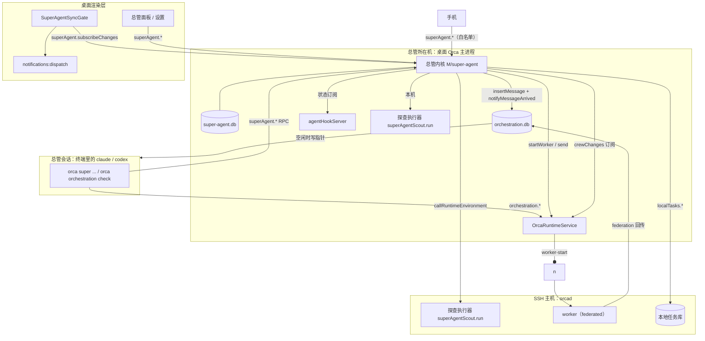

# 超级智能体技术方案

状态：草案，以 journal 中 D-001～D-011 的推荐项为前提；任一决策改选时同步本文。产品与架构见 [总体方案](超级智能体总体方案.md)，验收剧本见 [典型任务走查](典型任务走查.md)。

本文写到能照着开工的程度：切片 0～3 精确到文件、函数与表；切片 4、5 只到模块。路径缩写：

| 缩写 | 路径                                         |
| ---- | -------------------------------------------- |
| `M`  | `src/main`                                   |
| `S`  | `src/shared`                                 |
| `R`  | `src/renderer/src`                           |
| `C`  | `src/cli`                                    |
| `MO` | `src/main/runtime/orchestration`             |
| `RO` | `src/main/runtime/rpc/methods/orchestration` |
| `MB` | `mobile/src`                                 |

凡标「（已核实）」的调用点已在 `fork/integration` 3439e2ef9 上读过代码；标「（V-n）」的在开工前验证（§17）。

## 1. 总体设计



- **总管内核**只在总管所在机（默认桌面）的主进程里运行；`orca serve`、orcad、orcad 的浏览器 sidecar 都不启动内核。
- **探查执行器**是唯一的主机侧服务：桌面主进程和每台 orcad 各注册一份，只做「在本机某个工作区里跑一次只读的无界面运行」。
- 内核不新开端口，不新增 preload IPC；渲染层与手机都走现有的 runtime RPC（`callRuntimeRpc` / `subscribeRuntimeRpc`，`{ kind: 'local' }`）。

## 2. 机器归属

| 事物                               | 机器                 | 位置 / 通道                                                                                                 |
| ---------------------------------- | -------------------- | ----------------------------------------------------------------------------------------------------------- |
| 总管内核、账本                     | 总管所在机（H）      | `getOrcaProfileDirectory(profileId)/super-agent/super-agent.db`                                             |
| 总管工作区、记忆、派工单、报告副本 | H                    | `…/super-agent/home/`、`…/super-agent/items/<事项>/`                                                        |
| 总管会话（终端 PTY）               | H                    | 文件夹工作区「总管」里的一个终端标签                                                                        |
| 总管的编排 Run 与收件箱            | H                    | H 的 `orchestration.db`                                                                                     |
| 本机 worker 的派工与会话           | H                    | H 的 `orchestration.db` 与终端                                                                              |
| SSH 主机 worker 的会话、状态与判定 | SSH 主机             | orcad；派工记录在 H（`dispatch_contexts` + `federated_dispatches`），主机侧有 `remote_dispatch_attachments` |
| 探查运行（进程）                   | 工作区所属主机       | 本机：H 主进程；SSH：该主机 orcad，经 `callRuntimeEnvironment` 调用                                         |
| PR/MR 状态读取                     | 仓库所属主机         | 该主机 runtime 的 `hostedReview.forBranch`                                                                  |
| 本地任务库                         | 项目所属主机         | 各自 `localTasks.*`（本地任务 D-008）                                                                       |
| 飞书发送（`lark-cli`）             | H                    | H 上用户登录的 `lark-cli`                                                                                   |
| 桌面通知                           | H                    | 渲染层经 `notifications:dispatch`                                                                           |
| 手机推送                           | H                    | 通知投递服务内的 `dispatchMobileNotification`                                                               |
| 环境变量                           | 各自会话所在主机注入 | 总管会话的 `ORCA_TERMINAL_HANDLE`、`ORCA_PANE_KEY`、`ORCA_AGENT_LAUNCH_TOKEN` 由 H 注入                     |

内核对 SSH 主机与配对服务器的任何调用，都先查联系状态（§7.1），不在联系就不发、不重试，判为 `unverifiable`。

## 3. 代码布局

| 路径                                                           | 内容                                                                                                                                                                    |
| -------------------------------------------------------------- | ----------------------------------------------------------------------------------------------------------------------------------------------------------------------- |
| `S/super-agent/`                                               | 类型、RPC 参数 schema（每个单独 `export const`）、能力常量、纯规则（事项状态、看门狗、分工、动作分级、委托核对、观察器判定）、派工单与回执的 schema、总管工作区模板文本 |
| `M/super-agent/`                                               | 内核：生命周期与就绪、账本、事件收集、事项与看门狗、总管会话管理、唤醒投递、派工与回执、探查客户端、观察器、卡片、裁决与对外动作                                        |
| `M/super-agent-scout/`                                         | 主机侧探查执行器（桌面与 orcad 共用），只依赖 `process-host` 与工作区解析                                                                                               |
| `M/startup/main-process-super-agent.ts`                        | 主进程装配：`startSuperAgentForMainProcess()` / `stopSuperAgentForMainProcess()`                                                                                        |
| `M/runtime/rpc/methods/super-agent.ts`、`super-agent-scout.ts` | RPC 方法表                                                                                                                                                              |
| `C/super-agent/`                                               | `orca super` 命令规格与处理组                                                                                                                                           |
| `R/super-agent/`、`R/components/super-agent/`                  | 同步门、总管面板、设置分区                                                                                                                                              |
| `MB/super-agent/`、`mobile/app/h/[hostId]/super-agent.tsx`     | 手机首页卡片与卡片页                                                                                                                                                    |
| `skill-guides/super-agent.md`                                  | 总管技能指南（生成进 `C/bundled-skill-guides.ts`）                                                                                                                      |

`M/super-agent/` 与 `M/super-agent-scout/` 会被 RPC 引用，**不 import `electron`**（`check:runtime-electron-ratchet`）；需要 Electron 的东西由 `main-process-super-agent.ts` 注入。

## 4. 数据层

### 4.1 文件与打开方式

照本地任务（其技术方案 §3.1）：

- 独立 SQLite，经 `M/sqlite/sync-database.ts` 的 `SyncDatabase` 打开；路径 `getOrcaProfileDirectory(profileId, userDataPath)` + `super-agent/super-agent.db`。
- 打开顺序照 `M/native-chat/agent-session-journal/journal-database.ts`：
  1. 先读 `user_version`；
  2. 比本版新就只读打开，内核进入 `read-only`；
  3. 否则 `journal_mode=WAL`、`synchronous=NORMAL`、`busy_timeout=5000`、`foreign_keys=ON`，然后迁移。
- 每级迁移与 `user_version` 写入同在一个 `BEGIN IMMEDIATE` 事务。
- 用 `M/sqlite/harden-database-files.ts` 收紧权限；不用 `versioned-cache-database.ts`（它遇到版本不符会删库重建）。
- 打不开时内核进入 `unavailable`，`superAgent.status` 带原因；**不能让 Orca 启动失败**。
- 事项目录 `…/super-agent/items/<事项>/` 放派工单、报告副本、探查答案；随事项收尾保留 90 天后清理（可设）。

### 4.2 表结构

不做完整的事件溯源重放：变更与审计记录在同一事务里写入，当前状态表同步更新。事项的「状态」不落库，读取时由事实推算（§8）；只有收尾结果落库。

| 表               | 关键列                                                                                                                                                                                                                                                                     | 说明                                           |
| ---------------- | -------------------------------------------------------------------------------------------------------------------------------------------------------------------------------------------------------------------------------------------------------------------------- | ---------------------------------------------- |
| `router`         | 单行：`agent`、`worktree_id`、`tab_id`、`pane_key`、`terminal_handle`、`run_id`、`provider_session_id`、`generation`、`state`                                                                                                                                              | 总管会话与它的 Run                             |
| `events`         | `id`、`source`、`external_key`（与 `source` 联合唯一，去重）、`host_id`、`object_ref`、`item_id`、`summary`、`hops`、`received_at`、`payload_json`                                                                                                                         | 进入内核的每个事件                             |
| `items`          | `id`（`S-<n>`）、`title`、`request_text`、`kind`、`done_condition_json`、`expect_by`、`outcome`（空 / done / cancelled / failed）、`outcome_reason`、`evidence_json`、`created_at`、`closed_at`、`revision`                                                                | 事项                                           |
| `item_aliases`   | `item_id`、`alias`                                                                                                                                                                                                                                                         | 检索用                                         |
| `item_log`       | `id`、`item_id`、`at`、`source`、`kind`、`text`、`ref_json`                                                                                                                                                                                                                | 进展记录                                       |
| `item_links`     | `item_id`、`kind`（task / workspace / dispatch / scout / pr / goal / automation / watcher / timer / card）、`ref_json`、`role`、`active`                                                                                                                                   | 事项关联                                       |
| `dispatches`     | `dispatch_id`、`item_id`、`run_id`、`task_id`、`host_id`、`agent`、`role`、`brief_revision`、`reason`、`federated`、`started_at`、`settled_at`、`outcome`、`receipt_json`、`verification_json`                                                                             | 每次派工                                       |
| `briefs`         | `item_id`、`revision`、`path`、`sha256`、`created_at`                                                                                                                                                                                                                      | 派工单版本                                     |
| `cards`          | `id`、`item_id`、`key`、`kind`（question / notice / approval / mandate）、`urgency`、`title`、`body`、`options_json`、`recommend`、`status`（open / answered / resolved / expired）、`answer_json`、`answered_via`、`created_at`、`deliver_after`、`resolved_at`、`reason` | `item_id + key` 在 open 状态下唯一             |
| `timers`         | `id`、`item_id`、`kind`（at / until / schedule）、`at`、`condition_json`、`deadline`、`cron`、`tz`、`next_fire_at`、`status`                                                                                                                                               | 复查与日程                                     |
| `watchers`       | `id`、`item_id`、`kind`（review / http / command）、`host_id`、`target_json`、`schedule_json`、`last_state_json`、`last_checked_at`、`unverifiable_streak`、`status`                                                                                                       | 观察器                                         |
| `mandates`       | `id`、`item_id`、`plan_json`、`card_id`、`status`、`uses_json`                                                                                                                                                                                                             | 委托                                           |
| `actions`        | `id`、`item_id`、`class`、`kind`、`target_json`、`host_id`、`trigger_event_id`、`basis`（auto / approval:<卡片> / mandate:<委托>）、`status`（pending_approval / executing / done / refused / failed / unverifiable）、`result_json`、`created_at`                         | 动作与审计                                     |
| `scout_sessions` | `id`、`project_key`、`host_id`、`worktree_id`、`agent`、`provider_session_id`、`questions`、`created_at`、`retired_at`                                                                                                                                                     | 探查续接会话                                   |
| `budget_days`    | `day`、`workspaces_created`、`sessions_created`、`wakes`、`scout_runs`                                                                                                                                                                                                     | 每日计数与分工统计                             |
| `op_receipts`    | `client_operation_id`、`method`、`params_hash`、`result_json`、`at`                                                                                                                                                                                                        | 写入幂等，24 小时清理（本地任务 D-006 的做法） |

### 4.3 已知边界

- 账本只在 H；换一台机器当总管所在机（切片 5）需要导出导入，不做同步。
- 账本不保存 worker 的对话与终端内容，只保存回执、证据与指针。

## 5. 主进程装配与 RPC

### 5.1 装配

- `main-process-super-agent.ts`：
  - `isOrcadSidecarLaunch()` 或 `state.isServeMode` 时直接返回；
  - 否则打开账本、注册内核服务、注册本机的探查执行器；
  - 注入 `runtime`、`agentHookServer`、`getRegisteredSshState`、电源恢复事件、`lark-cli` 路径。
- 接缝 `M/index.ts`：在本地任务之后调用 `startSuperAgentForMainProcess()`，并加 `app.once('will-quit', stopSuperAgentForMainProcess)`。
- 接缝 `M/integration-builds/orcad-fork-services.ts`：`registerCleanup(startOrcadSuperAgentScout(runtime))`，SSH 主机上只注册探查执行器。
- 就绪状态：`not-home`（这台不是总管所在机）、`starting`、`ready`、`paused`、`read-only`、`unavailable`。

### 5.2 方法

参数 schema 放 `S/super-agent/super-agent-rpc-params.ts`，方法表 `SUPER_AGENT_METHODS` 在 `M/runtime/rpc/methods/index.ts` 里展开；`permission: 'workspace'`；业务失败用返回值 `{ ok: false, code }`，只有服务不可用才抛错。

| 类别       | 方法（省略 `superAgent.` 前缀）                                                                    | 谁能调                     |
| ---------- | -------------------------------------------------------------------------------------------------- | -------------------------- |
| 状态       | `status`、`overview`                                                                               | 总管、渲染层、手机         |
| 控制面读取 | `read.item`、`read.worker`、`read.pr`、`read.session`、`read.task`、`read.goal`、`read.automation` | 总管、渲染层               |
| 事项       | `items.open`、`items.find`、`items.list`、`items.note`、`items.close`                              | 总管                       |
| 事项（人） | `items.cancel`、`items.accept`                                                                     | 渲染层、手机               |
| 派工       | `dispatch`、`amend`                                                                                | 总管                       |
| 探查       | `scouts.ask`、`scouts.openInteractive`                                                             | 总管 / 渲染层              |
| 卡片       | `cards.ask`、`cards.notify`、`cards.resolve`                                                       | 总管                       |
| 卡片（人） | `cards.list`、`cards.answer`                                                                       | 渲染层、手机               |
| 时间       | `timers.later`、`timers.cancel`、`schedules.create`、`schedules.list`、`schedules.remove`          | 总管（删除日程需用户确认） |
| 观察器     | `watchers.add`、`watchers.remove`                                                                  | 总管                       |
| 委托与动作 | `plans.propose`、`actions.do`                                                                      | 总管                       |
| 记忆与历史 | `memory.add`、`memory.list`、`history`、`why`                                                      | 总管、渲染层               |
| 总管会话   | `router.ensure`、`router.rebuild`、`router.pause`、`router.resume`                                 | 渲染层                     |
| 设置       | `settings.get`、`settings.set`                                                                     | 渲染层                     |
| 流         | `subscribeChanges`、`unsubscribeChanges`                                                           | 渲染层、手机               |

主机侧另有 `superAgentScout.run`、`superAgentScout.status`（`M/runtime/rpc/methods/super-agent-scout.ts`），由工作区所属主机执行。

**调用方识别**：

- 「总管」专属的方法要求调用方是总管终端。处理函数用 `runtime.verifyOrchestrationCompatibilityCaller(ctx.orchestrationCompatibilityEvidence)`（`MO/terminal-authority/verify-orchestration-compatibility-caller.ts:20`，已核实）取得 `{ terminalHandle, paneKey, launchTokenHash }`，再与 `router` 表比对。
- CLI 目前只给 `orchestration.*` 方法附带这份证据（`C/runtime/client.ts:142`，已核实）。接缝：把判断改为同时覆盖 `superAgent.` 前缀。
- 「人」的方法只接受 `ctx.caller.kind` 为桌面或手机的调用，终端里的调用一律拒绝——总管不能替用户回答卡片、取消事项、改设置。

`S/host-operation-ownership.ts` 增加 `superAgent: 'desktop'`、`superAgentScout: 'host'`（接缝，V-15 核对取值）。

### 5.3 测试注意

照本地任务：直接 import `M/sqlite/sync-database` 的测试文件才会改走 Node；账本测试都写一行非 type 的 import。

## 6. 总管会话

### 6.1 首次建立：`router.ensure`

幂等，同一 profile 只允许一个总管。

1. 写总管工作区 `…/super-agent/home/`（目录不存在就建）：
   - `AGENTS.md`：总管规则（总体方案 §3.4），模板在 `S/super-agent/templates/`；用户覆盖的段落保留，模板升级时提示差异。
   - `CLAUDE.md`：一行 `@AGENTS.md`。
   - `.claude/settings.json`：权限白名单（V-9）。允许 `Bash(orca super:*)` 与 `Bash(orca orchestration check:*)` / `inbox` / `reply`；拒绝 `Edit` / `Write` 写总管工作区以外的路径；其余 `Bash` 需批准；禁用子 agent 工具。
   - `.codex/config.toml`：只读沙箱以外仅放行 `orca` 命令（V-9）；Orca 的工作区信任写入会让 Codex 读取这份项目配置。
   - `memory/decisions.md`、`declined.md`、`preferences.md`。
2. 建工作区并启动，一次调用：`agent.launch`（`M/runtime/rpc/methods/agent-launch.ts:296`，已核实），参数：
   - `target: { kind: 'create-folder-workspace', create }`，需要一个项目组：先 `projectGroup.create({ name: '总管' })`；
   - `surface: 'terminal'`；
   - `agent`；
   - `agentArgs`：来自设置；
   - `prompt: { text: <开场提示>, delivery: 'submit' }`。
3. 从结果 `outcome: { kind: 'terminal', handle, paneKey }` 记下终端身份。`executeAgentLaunch` 固定 `viewMode: 'terminal'`（执行器 :288），之后用 `session.tabs.setTabProps { viewMode: 'chat' }` 切成聊天视图。
4. 建 Run：`createBoundRun` / `db.createRun({ objective: 'super-agent', coordinatorHandle, coordinatorPaneKey })`（`MO/db/runs/run-create.ts:7`，已核实），记下 `run_id`。
5. 第一次唤醒：内核投递一条「开场」事件（§7.3），总管读取 `AGENTS.md` 后运行 `orca super status`。

### 6.2 恢复与重建

- **Orca 重启**：终端标签随工作区会话恢复；PTY 不在时，冷恢复按钩子记下的会话号自动续接（`claude --resume <id>`、`codex resume <id>`，`R/components/terminal-pane/pty-connection/cold-restore-resume-startup.ts`，已核实）。Run 按 `pane_key` 绑定（`isEquivalentPaneKey`），不需要重绑。
- **标签被关掉或会话坏了**：`router.rebuild`：
  - 有会话号时用 `getAgentResumeArgv` 续接，没有就新开；
  - `bindRun`（`MO/db/runs/run-binding.ts:14`）把 Run 绑到新面板；
  - `generation + 1`。
- **恢复说明**：每次恢复或重建后，内核投递一条恢复事件，列出未收尾事项、未关卡片、结果未确认的动作，要求「先核对现状再重复任何外部动作」。

### 6.3 手机

- 手机上的聊天视图是每台设备自己的偏好（`MB/session/use-mobile-session-view-mode.ts:50`，默认 `terminal`）。
- 需要一处接缝：总管工作区的标签在手机上默认用聊天视图（V-16）。

## 7. 事件进来与唤醒出去

### 7.1 事件来源与联系判定

| 来源         | 接法（已核实处标注）                                                                                                                                                                                                                                                                                                                                 |
| ------------ | ---------------------------------------------------------------------------------------------------------------------------------------------------------------------------------------------------------------------------------------------------------------------------------------------------------------------------------------------------- |
| 编排         | 订阅 `runtime.crewChanges`（`M/runtime/construction/runtime-service-state.ts:244`，同步、只带分面不带内容，已核实）；收到后按 `dispatches` 表重读 `db.getDispatchContextById`、`db.getTask(id).result`、`db.getMessageById`。**不用**不带类型过滤的 `runtime.waitForMessage('run:…')`：它会压住投给总管的指针（`MO/mailbox-pointer-delivery.ts:90`） |
| 本机会话状态 | `agentHookServer.subscribeStatusChanges`（`M/agent-hooks/server/server-listeners.ts:123`，已核实），只保留被跟进的 `paneKey`；读快照用 `getStatusSnapshotForPane`                                                                                                                                                                                    |
| SSH 会话状态 | orcad 托管的主机经运行时环境订阅 `session.tabs.subscribe`，只在主机在联系时订阅（V-13）                                                                                                                                                                                                                                                              |
| 本地任务     | 各主机的 `localTasks.subscribeChanges`，只订阅在联系的主机                                                                                                                                                                                                                                                                                           |
| 主机联系     | SSH：`getRegisteredSshState(targetId)`（`M/ssh/targets/ssh-target-registry.ts:61`，已核实）取当前值；变化事件目前只广播给渲染层（`M/ipc/ssh/ssh-renderer-broadcast.ts:42`），需要一处接缝给主进程监听者分发（V-13）。配对服务器：沿用运行时环境的连接状态（V-13）                                                                                    |
| 时间         | 内核调度器：只挂一个 `setTimeout` 到最近的到期时间，变化时重算；系统休眠恢复时立即重算（用主进程现有的恢复广播，V-13）                                                                                                                                                                                                                               |
| 卡片回答     | `superAgent.cards.answer`                                                                                                                                                                                                                                                                                                                            |

联系判定统一封装成 `inContact(hostId)`，规则照本地任务的 `bindLocalTaskHostSessions`（`M/local-tasks/local-task-host-session-binding.ts:41`）：本机恒为真，SSH 要 `connected`，配对服务器要处于已连接。

### 7.2 合并

同一事项 2 秒内的事件合成一批；一次唤醒最多带 20 条，其余在下一次唤醒时带上。

### 7.3 唤醒投递

```ts
db.insertMessage({
  from: 'super-agent-kernel',
  to: `run:${runId}`,
  runId,
  type: 'status',
  subject: '[S-12 登录页] worker 交付：成功',
  body: '<不超过 600 字的事件卡，每条一行，带「read: orca super read item S-12」>',
  payload: JSON.stringify({ superAgent: 1, events: [/* 事件编号 */] })
})
runtime.notifyMessageArrived(`run:${runId}`, 'status')
```

- `insertMessage`（`MO/db/messages/message-insert.ts:25`）与 `notifyMessageArrived`（`M/runtime/terminal/lifecycle/floating-session-liveness.ts:184`）都已核实。
- `from_handle` 只是文本；`type` 只受表的 CHECK 约束（等于 `MESSAGE_TYPES`）；`status` 不走派工结算逻辑，`payload` 是不限 schema 的文本。所以**不新增消息类型**（V-2 已解决）。
- 编排只在总管空闲时向终端写指针，并经数据库预留保证最多投递一次（已核实）。总管随后运行 `orca orchestration check` 读到这批事件。

## 8. 事项、状态推算与看门狗

- 纯函数 `S/super-agent/item-state.ts`：输入事项的事实快照（关联派工及其状态与判定、Goal、观察器、复查、未关卡片、最近汇报），输出总体方案 §4.8 的状态与原因。桌面面板、手机、总管读到的都是同一个函数的结果。
- 完成条件核对 `S/super-agent/done-conditions.ts`：按类型核对。`items.close --done` 先跑这一步，不通过返回 `{ ok: false, code: 'done_condition_unmet', detail }`。
- 看门狗 `M/super-agent/items/watchdog.ts`：
  - 每次事件后对相关事项运行一次，另外每 10 分钟全量运行一次；
  - 只做本地计算，不读任何主机；
  - 违反 I-1～I-5 时写一条事件，按总体方案 §4.8 的规则唤醒总管或发卡片。
- 编号 `S-<n>`：单调递增，存在 `items` 里，不复用。

## 9. 派工与回执

### 9.1 `superAgent.dispatch`

1. 校验：事项存在且未收尾；`reason` 必填；分工规则（`S/super-agent/delegation-rules.ts`，纯函数）——只读问题转为 `scouts.ask`，同事项已有在跑或可唤醒的 worker 时需要 `parallelReason`；预算（§13.3）。
2. 生成派工单 `items/S-12/brief-r<n>.md` 并记入 `briefs` 表。worker 可能在 SSH 主机上，读不到 H 上的文件，所以**派工单正文直接作为 `spec` 传入**（上限 8 KB）；文件只是 H 上的存档。
3. 调用 `startWorker(params, { runtime, orchestrationMutation })`（`RO/worker/workers.ts:46`，已核实），参数：
   - `spec`；
   - `taskTitle: 'S-12·<短名>'`；
   - `from: <总管终端 handle>`，`run: <总管 Run>`；
   - `worktree`、`agent`、`displayName`；
   - 工作区在 orcad 托管的 SSH 主机或配对服务器上时，传 `on: <环境>`。这时必须带 `orchestrationMutation`（`federation/federated-worker-start.ts:52`）。
4. 需要保留时调用 `orchestration.workerRetain`（keep-open 在 CLI 层实现，内部调用要自己做，已核实）。
5. 从结果读 `{ runId, taskId, dispatchId }`；终端身份在 `effects[]` 的 `{ kind: 'terminal', role: 'agent' }` 里（已核实），写入 `dispatches` 表。

### 9.2 `superAgent.amend`

- 生成下一版派工单。
- worker 仍在跑：经 `orchestration.send` 发到 `dispatch:<id>`，类型 `status`。
- worker 已结束、且不是 federated：同样 `send`，编排会把它变成后续任务（`RO/messaging/worker-follow-up.ts:43`，只接受 status / dispatch / handoff，已核实）。
- federated 且已结束：编排拒绝 `send`，改为新派一次，派工单写明接续上一份回执。

### 9.3 回执读取与校验

- 派工结算后，`task.result` 是 JSON（`MO/lifecycle-reconciliation.ts:257`，已核实）：`outcome`、`body`、`filesModified`、`reportPath`、`messageId`；`payload` 在 `db.getMessageById(messageId)` 里。
- 约定 `payload` 为 `{ superAgent: 1, item, briefRevision, evidence: { commits, pr, checks: [{ cmd, exit }] }, questions }`。由派工单的「交付格式」段教给 worker：worker 前言已说明用 `--payload`，派工单补充字段约定。
- 校验用 `S/super-agent/receipt-schema.ts`。不合格时不重做业务，按下列顺序补救（补交通道的最终做法在 V-11 定）：
  1. 若 `reportPath` 存在，从报告文件的固定 JSON 头里读取证据；
  2. 否则把回执标为「缺证据」，唤醒总管，由总管用 `amend` 请 worker 补交。

### 9.4 事实核对

| 声明       | 核对方式                                                                                           |
| ---------- | -------------------------------------------------------------------------------------------------- |
| 已结束     | 主机上的智能体状态与 `terminal.agentStatus`；仍在跑就把回执标「待核实」，等它停下                  |
| 提交号     | 在 worker 工作区所属主机上做 git 读取，确认对象存在且在该分支上（经现有工作区 git 读取 RPC，V-17） |
| 改动文件   | 同一主机 git diff 的文件列表与 `filesModified` 比对                                                |
| PR         | `hostedReview.forBranch`（§11.1）                                                                  |
| 派工单版本 | `payload.briefRevision` 与 `briefs` 表的最新版本比对                                               |

结果写进 `dispatches.verification_json`，完成条件核对会读取它。主机不在联系时不核对，标 `unverifiable`。

### 9.5 用户直接在 worker 会话里说话

- `workerTerminalUserInput` 已是空操作（`RO/worker/worker-keep-open.ts:47`，已核实），不能用。
- 改用智能体钩子记录的用户提交：状态条目里的 `prompt`，在提交时由钩子写入。凡是不来自编排投递的提交，判为「用户直接指示」，产生事件交给总管（V-12）。

## 10. 探查员

### 10.1 主机侧执行器 `superAgentScout.run`

```ts
type ScoutRunParams = {
  worktreeId: string
  agent: 'claude' | 'codex'
  providerSessionId?: string
  question: string // 内核拼好的提示：问题 + 输出格式 + 只读要求
  timeoutMs: number // 上限 120000
  maxOutputBytes: number // 上限 1 MB
}
type ScoutRunResult =
  | { ok: true; answer: ScoutAnswer; providerSessionId: string; durationMs: number }
  | { ok: false; code: 'timeout' | 'invalid_output' | 'spawn_failed' | 'not_found'; detail: string }
```

- 在本机解析工作区路径，经 `runProcess`（`src/packages/process-host/src/run-process.ts:43`，已核实）运行，带 `timeoutMs` 与 `maxOutputBytes`。这与 Goal 守卫、验收草稿的做法相同（`M/goals/goal-acceptance-draft-runner.ts:72`）。
- **Claude**：`claude -p <提示> --output-format json [--resume <id>]`，加 `--allowedTools`：读、搜、`git log`、`git show`、`git diff`、`git status`、`git blame`；再加现有的后台隔离参数 `claudeBackgroundArgs`（`--strict-mcp-config --settings {"disableAllHooks":true}`，`S/claude-background-run-isolation.ts:5`），避免探查运行产生钩子状态噪音。
  - **不用** Goal 守卫的「跳过权限 + 禁用编辑工具」写法：那种写法下 shell 仍可写文件。改用白名单：无界面模式下名单外的工具会被直接拒绝（V-10）。
  - 输出 JSON 的 `result` 是答案文本，`session_id` 是会话号。
- **Codex**：`codex exec [resume <id>] --cd <工作区> --sandbox read-only --skip-git-repo-check --output-schema <schema 文件> --output-last-message <文件> <提示>`。resume 与 `--output-schema` 能否同用、会话号从哪里取，待 V-10 实测。
- 答案结构 `ScoutAnswer = { answer, sources[], confidence, needsWorker, reportPath? }`，用 `S/super-agent/scout-answer-schema.ts` 校验；不合格时续接同一会话重写一次，仍不合格返回 `invalid_output`。

### 10.2 内核侧客户端

- 按 `(项目, 主机)` 选取或新建 `scout_sessions`；同一会话串行，排队上限 5；每台主机最多 2 个并发（可设）。
- 路由：本机直接调用进程内执行器；orcad 托管的 SSH 主机与配对服务器经 `callRuntimeEnvironment(userDataPath, selector, 'superAgentScout.run', params)`（`M/ipc/runtime-environments/runtime-environment-transport-routing.ts:44`，已核实）。主机必须在联系中，且通告了 `super-agent-scout.v1` 能力（§15）；否则返回「连不上」或「该主机的 Orca 版本不支持」。不支持时改派一个只读的交互 worker（形态 C）。
- `scouts.ask` 带 `waitMs`（默认 30000，上限 60000）：时限内完成就直接返回答案；否则返回 `{ status: 'running', askId }`，完成后作为事件唤醒总管。
- 累计 20 个问题后退役该会话；`scouts.openInteractive` 在该工作区里用 `agent.launch` 加续接参数打开交互会话。

## 11. 观察器

### 11.1 `review`

- 调用仓库所属主机 runtime 的 `hostedReview.forBranch`（`M/runtime/rpc/methods/hosted-review.ts:12` → `readHostedReviewForBranch`，`M/source-control/hosted-review.ts:45`，已核实）。参数带 `branch` 与对应平台的 `linked*PR` 编号。
- 本机直接调；orcad 托管的主机经 `callRuntimeEnvironment`。`resolveGitRouteForHost` 遇到 `runtime` 路由会抛「不可派发」（`hosted-review-execution-host.ts:10`），所以必须由那台主机自己读。
- 取 `state`、评审结论、检查结果与 head 提交，与 `last_state_json` 比较，只在变化时产生事件；`approved` 时记下当时的 head 提交，供合入前核对（§13.4）。
- 频率按总体方案 §4.9 退避；`active: false` 走平台的低频节奏；限流或鉴权失败计入 `unverifiable_streak`，不加速重试。

### 11.2 `http`

- 在 H 主进程发请求，超时 10 秒；按状态码、正文关键字或 JSON 字段阈值判定；首次异常与恢复时产生事件。

### 11.3 `command`

- **第一步（切片 2）**：由内核在目标主机在联系时按频率调用主机侧的 `superAgentScout.check`（与探查执行器同一服务，只跑一条带超时的命令，返回退出码与尾部输出）。限制：桌面合盖或主机失联期间不检查，如实标「无法确认」。
- **第二步（切片 2 后半）**：要在桌面合盖时也照跑的，建成那台主机上的一条自动化。
  - precheck 用 `orca super watch-check --id <W> -- <命令>`：这是一条只在本机运行的 CLI 子命令，状态存在主机的 `~/.orca/super-agent-watch/<W>.json`，只在状态变化（首次异常、恢复）时放行；
  - 放行后的智能体运行只负责「读变化、写结论」，结果经自动化运行记录在联系时回到内核。
  - 这样持续异常不会反复拉起智能体，也不会重复通知（V-18）。

## 12. 卡片与送达

- 卡片服务 `M/super-agent/cards/`：去重键、合并窗口、免打扰（`deliver_after`），只有到了可送达时间的卡片才发出「可送达」变化。
- **桌面通知**：渲染层的 `SuperAgentSyncGate`（挂在 `R/app-shell/AppBackgroundServices.tsx`）收到可送达的卡片后，调用现有的 `notifications:dispatch`。字段：
  - `source: 'agent-task-complete'`；
  - `paneKey`：总管的终端，点击回到总管；
  - `attentionKey`：卡片编号，绕过按工作区去重；
  - `worktreeLabel: '总管'`；
  - `agentState`：问题用 waiting，通知用 done。
    不新增通知来源枚举（`S/notification-settings-types.ts:36`，已核实）。
- **手机推送**：通知投递服务本身按设置在桌面离开时转发到手机（`dispatchMobileNotification`，`M/notifications/notification-delivery-service.ts`，已核实），内核不另发。V-3 要核实总管面板关闭、窗口隐藏时渲染层仍在运行，否则改为主进程直接投递（接缝）。
- **卡片列表**：桌面面板与手机卡片页读 `cards.list`、写 `cards.answer`；回答写成事件进入 §7.3 的唤醒。

## 13. 裁决、委托与对外动作（切片 3）

### 13.1 动作分级

`S/super-agent/action-classes.ts` 定义动作种类到级别的表（需求 REQ-2307）。「是不是总管自己建的」看 `dispatches` 与 `actions` 记录，由代码判断。

### 13.2 `superAgent.actions.do`

处理顺序：

1. 定级；
2. 若事项有生效的委托，核对动作、对象、次数、时间窗；
3. 委托覆盖就执行；否则「自动」级执行，「先问」级生成审批卡片并返回 `pending_approval`，「禁止」级拒绝；
4. 用户批准后，内核**重新核对对象与联系状态**再执行；批准 24 小时内有效、只对卡片上写明的对象有效。

### 13.3 预算

- 并发：`dispatches` 中未结算且属于总管 Run 的派工计数；探查另计。
- 每日：`budget_days`。
- 跳数：`events.hops` 沿「事件 → 动作 → 派工 → 回执事件」链传递，超过 8 拒绝派工并发卡片。

### 13.4 对外动作的执行器

| 动作              | 实现（已核实处标注）                                                                                                                                                                                                                                           |
| ----------------- | -------------------------------------------------------------------------------------------------------------------------------------------------------------------------------------------------------------------------------------------------------------- |
| 删工作区          | 现有 `worktree rm` 对应的 RPC，按工作区所属主机路由                                                                                                                                                                                                            |
| 关终端、停 worker | `terminal.close`、`orchestration.workerStop`；`stop_unknown` 不视为已停                                                                                                                                                                                        |
| 本地任务写入      | 各主机的 `localTasks.*`，带 `clientOperationId`                                                                                                                                                                                                                |
| 建 PR/MR          | `hostedReview.create`（RPC 已存在，已核实）                                                                                                                                                                                                                    |
| 合入              | GitHub `github.mergePR`（默认 squash，`M/github/client/merge/merge-pr.ts:13`）、GitLab `gitlab.mergeMR`（`M/gitlab/merge-request-state-mutations.ts:96`），均已核实；Gitea、Bitbucket、Azure DevOps 没找到合入实现，这些平台委托里的合入步骤只能是「提醒你合」 |
| 合入前核对        | 再读一次 `hostedReview.forBranch`：评审结论 `approved`、检查通过、head 等于 approve 时记下的提交、仍为 open；任一不满足就不合                                                                                                                                  |
| 飞书发送          | 在 H 上用 `runProcess` 调用 `lark-cli`（命令模板在设置里；身份按 D-008）；回执写入 `actions.result_json`                                                                                                                                                       |

### 13.5 第二道护栏

在 RPC 分发处加一处接缝：调用方证据等于总管终端、且方法属于破坏性方法表时，没有内核签发的一次性令牌就拒绝，并提示改用 `orca super do`（V-14）。

## 14. 界面

### 14.1 桌面

- **对话**：总管就是侧栏里「总管」项目组下的文件夹工作区，打开就是它的终端标签（聊天视图）。不另做嵌入式聊天页。
- **总管面板**（右侧栏面板，挂法照 Goal 的面板，V-15），三栏：
  - 需要你：卡片，加上本地任务的「需要你」；
  - 事项：状态、最近事实、下一个触发；
  - 活动：账本时间线与每日分工统计。
- **侧栏角标**：未处理卡片数。
- **设置分区**：总管用的智能体、主动性档位、动作级别、预算、免打扰、日程、暂停、记忆文件入口、`lark-cli` 命令模板。挂法照本地任务的设置分区。
- **文案**：`en.json` / `zh.json` 增加 `superAgent` 段，并加入插件语言包的保护键。

### 14.2 手机

- 首页卡片（挂在 `MB/home/MobileHomeTasksAndAutomations.tsx`，照本地任务）：未处理卡片数、进行中事项数；点进卡片页 `/h/[hostId]/super-agent`。
- 卡片页：回答、关闭卡片；事项列表只读。
- 「和总管对话」跳到现有会话页，打开总管工作区。

## 15. 能力协商与版本兼容

| 能力                   | 谁通告                                                         | 用途                     |
| ---------------------- | -------------------------------------------------------------- | ------------------------ |
| `super-agent.v1`       | 只有总管所在机（动态，`M/runtime/orca-runtime-get-status.ts`） | 手机显示总管入口与卡片   |
| `super-agent-scout.v1` | 注册了探查执行器的桌面与 orcad                                 | 内核判断某主机能否跑探查 |

| 组合                       | 表现                                                                          |
| -------------------------- | ----------------------------------------------------------------------------- |
| 新手机 + 旧桌面            | 没有 `super-agent.v1`，手机不显示入口                                         |
| 新桌面 + 旧 orcad          | 没有 `super-agent-scout.v1`，该主机的轻量问题改派只读交互 worker              |
| 内核调用的编排内部函数改变 | 这些函数在 `dependsOn` 里登记，同步上游时由门禁报出；每处调用都有单元测试覆盖 |

## 16. fork 登记与接缝

### 16.1 功能自有路径

§3 的全部路径。

### 16.2 预计的上游接缝

切片开工时逐个核实，并写进 `config/fork-features.jsonc` 与 `fork-integration-scope`：

| 文件                                                                                | 内容                                                     | 切片 |
| ----------------------------------------------------------------------------------- | -------------------------------------------------------- | ---- |
| `M/index.ts`                                                                        | 启动与退出                                               | 0    |
| `M/runtime/rpc/methods/index.ts`                                                    | `...SUPER_AGENT_METHODS`、`...SUPER_AGENT_SCOUT_METHODS` | 0    |
| `S/rpc-contract/rpc-params-catalog.generated.ts`                                    | 生成                                                     | 0    |
| `S/host-operation-ownership.ts`                                                     | `superAgent`、`superAgentScout` 的归属                   | 0    |
| `M/runtime/orca-runtime-get-status.ts`                                              | 两个能力                                                 | 0    |
| `M/integration-builds/orcad-fork-services.ts`                                       | orcad 注册探查执行器                                     | 0    |
| `C/runtime/client.ts`                                                               | `superAgent.*` 也附带调用方证据                          | 0    |
| `C/specs/index.ts`、`C/handler-group-manifest.ts`、`M/startup/cli-command-names.ts` | `orca super`                                             | 0    |
| `skill-guides/super-agent.md`、`C/bundled-skill-guides.ts`                          | 技能指南（生成）                                         | 0    |
| `S/wsl-move/wsl-move-storage-dispositions.ts`                                       | 账本在 SQLite 清单里                                     | 0    |
| `R/app-shell/AppBackgroundServices.tsx`                                             | `<SuperAgentSyncGate />`                                 | 1    |
| 右侧栏面板注册、侧栏角标（文件待 V-15）                                             | 总管面板                                                 | 1    |
| 设置分区三处（照本地任务）                                                          | 设置                                                     | 1    |
| `R/i18n/locales/en.json`、`zh.json`、`S/plugins/languages/protected-copy-keys.json` | 文案                                                     | 1    |
| `M/runtime/runtime-rpc/fork-mobile-rpc-method-allowlist.ts`                         | 手机可调方法                                             | 1    |
| 手机首页、路由配置三处、订阅释放（照本地任务）                                      | 手机卡片页                                               | 1    |
| `MB/session/use-mobile-session-view-mode.ts`                                        | 总管标签默认聊天视图（V-16）                             | 1    |
| `M/ipc/ssh/ssh-renderer-broadcast.ts`                                               | SSH 状态变化分发给主进程监听者（V-13）                   | 2    |
| RPC 分发处                                                                          | 第二道护栏（V-14）                                       | 3    |

### 16.3 策略

- `super-agent` 策略的 worktree 规则加入 §3 的路径与上表接缝。
- `fork-integration-scope` 白名单同步。
- `dependsOn` 登记内核直接调用的上游模块：编排 db 与 worker、agent launch、hosted review、通知类型、runtime environment 路由等。

## 17. 开工前验证

| 编号 | 内容                                                    | 状态     | 做法                                                                                             |
| ---- | ------------------------------------------------------- | -------- | ------------------------------------------------------------------------------------------------ |
| V-1  | 桌面总管派到 SSH 主机的 worker 怎么回到收件箱           | 代码已明 | orcad 托管主机用 `worker-start --on`，消息经 federation 回传；在 `127.0.0.1:2222` 夹具上实跑一次 |
| V-2  | 内核投递事件不加消息类型                                | 已解决   | `insertMessage` + `notifyMessageArrived`，类型 `status`                                          |
| V-3  | 桌面通知与手机推送的投递位置                            | 待验证   | 窗口隐藏时渲染层是否仍运行；不行则主进程直接投递                                                 |
| V-4  | Goal 是否有可订阅的推送                                 | 待验证   | 读 `goals.*` 的流式方法                                                                          |
| V-5  | 终端聊天视图显示总管（含指针行）                        | 待验证   | 真机                                                                                             |
| V-6  | SSH 仓库的 PR 状态读取                                  | 代码已明 | 由仓库所属主机自己的 `hostedReview.forBranch` 读取；在夹具上实跑                                 |
| V-7  | 各平台合入能力                                          | 代码已明 | GitHub、GitLab 有；其余没有                                                                      |
| V-8  | `lark-cli` 身份                                         | 待确认   | D-008                                                                                            |
| V-9  | 两种 CLI 的权限配置能否表达总管约束                     | 待验证   | 在 Claude Code 与 Codex 上实测 `.claude/settings.json` 与 `.codex/config.toml`                   |
| V-10 | 探查的无界面续接、只读白名单、结构化输出                | 待验证   | 两种 CLI 实测，含 `codex exec resume` 与 `--output-schema`                                       |
| V-11 | 回执证据的补交通道                                      | 待定     | 读结算代码，确定「报告文件 JSON 头」与 `amend` 补交哪种为主                                      |
| V-12 | 用户直接对 worker 说话的识别                            | 待验证   | 钩子 `prompt` 与编排投递文本的区分                                                               |
| V-13 | 主进程侧的联系变化事件与电源恢复事件                    | 待验证   | 找现有分发点，没有就在 `ssh-renderer-broadcast.ts` 加接缝                                        |
| V-14 | RPC 分发处的令牌护栏                                    | 待验证   | 读 `rpc/dispatcher.ts` 与权限档                                                                  |
| V-15 | 右侧栏面板与主机归属取值                                | 待验证   | 照 Goal 面板的注册点                                                                             |
| V-16 | 手机端总管标签默认聊天视图                              | 待验证   | 读 `use-mobile-session-view-mode.ts` 的默认与覆盖                                                |
| V-17 | 内核在 worker 所在主机上做 git 读取的现有 RPC           | 待验证   | 找工作区 git 读取方法（状态、日志、对象存在）                                                    |
| V-18 | `orca super watch-check` 作为自动化 precheck 的放行语义 | 待验证   | 读 `precheck-runner.ts` 的退出码约定                                                             |

## 18. 测试

- **纯规则**（Vitest）：事项状态推算、完成条件、看门狗 I-1～I-5、分工规则、动作分级与委托核对、观察器判定、回执与探查答案的 schema、cron 与错过补跑。
- **账本**：迁移、只读打开、并发写、幂等回执。
- **RPC**：调用方识别（总管 / 人 / 其他终端）、业务失败码、手机白名单。
- **编排集成**：用测试 runtime 走一遍 `createRun → startWorker → worker_done → crewChanges → 回执解析`；`insertMessage + notifyMessageArrived` 对空闲与忙碌的总管终端的投递。
- **探查执行器**：用脚本模拟 `claude` / `codex` 的输出，覆盖超时、超量、不合格输出、续接会话号。
- **e2e**（`ORCA_BACKGROUND_LAUNCH=1`，不抢焦点）：`router.ensure` 建出工作区、标签与 Run；重启后同一会话；卡片回答链路。
- **真机**：本机与 SSH（`docs/reference/ssh-real-app-validation.md` 的夹具与隔离实例）各跑一遍走查剧本；证据放 `.docs/super-agent-ui-validation/<日期>/`。
- **分工回归剧本**：30 条带标注的请求，在真 CLI 上跑，记录总管走的道与期望是否一致；改总管规则或升级 CLI 后重跑。

## 19. 切片任务拆解

| 切片 | 任务                                                                                                                                                                                                                       | 验收                                                                            |
| ---- | -------------------------------------------------------------------------------------------------------------------------------------------------------------------------------------------------------------------------- | ------------------------------------------------------------------------------- |
| 0    | 账本与就绪；`router.ensure/rebuild`；模板与权限配置；Run 绑定与唤醒投递；`superAgent.status/overview/read.*/items.*/dispatch/amend`；回执读取；探查执行器（本机与 orcad）与 `scouts.ask`；`orca super` CLI；技能指南；能力 | 走查 §3 开发、§4 调查、§8 分工表在本机与 SSH 各通过；V-1、V-9、V-10 完成        |
| 1    | 事项状态推算、完成条件、看门狗；卡片与送达；同步门、总管面板、设置、文案；手机首页与卡片页；`history/why`；事实核对                                                                                                        | 走查 §6 一天后问进度、§7 横向保证；REQ-2314、REQ-2317 用例通过                  |
| 2    | 复查与日程、错过补跑、早报；观察器 `review` / `http` / `command` 第一步，然后第二步；联系变化事件                                                                                                                          | 走查 §1 盯监控；REQ-2304、REQ-2306、REQ-2315 用例通过                           |
| 3    | 动作分级与 `actions.do`、审批卡片、委托、预算与跳数、暂停；对外动作执行器（飞书、建 PR、合入）；第二道护栏                                                                                                                 | 走查 §2 PR 催审与合入、§5 通知；REQ-2307、REQ-2308、REQ-2316、REQ-2318 用例通过 |
| 4    | 记忆命令、主动性档位、建议卡片、按规则执行                                                                                                                                                                                 | REQ-2310、REQ-2311                                                              |
| 5    | 飞书入站；总管所在机迁移（账本导出导入、内核在 `orca serve` 上运行）                                                                                                                                                       | REQ-2313                                                                        |

依赖其他功能：本地任务补 `orca task create/link`（切片 0 前，本地任务分支）；Goal 补 `orca goal` CLI（用 Goal 之前，Goal 分支）。

## 20. 风险

| 风险                                                                                      | 处理                                                                     |
| ----------------------------------------------------------------------------------------- | ------------------------------------------------------------------------ |
| 内核直接调用编排的内部函数（`insertMessage`、`startWorker`、`createRun`），上游改动会打断 | 全部登记进 `dependsOn`；每个调用点有单元测试；同步上游时看接缝与依赖报告 |
| 用户正在总管终端里打字时，指针被写进去                                                    | 编排只在智能体安定时投递；真机验证聊天视图下的表现（V-5）                |
| 探查的无界面运行在不同 CLI 版本上参数不一致                                               | 参数拼装集中在执行器，按 CLI 版本探测；不支持时改派只读交互 worker       |
| federated worker 结束后不能再 `send`                                                      | `amend` 对 federated 改为新派一次，派工单写明接续                        |
| 订阅额度消耗                                                                              | 事件合并、条件复查、探查进程空闲不运行；设置页显示每日唤醒次数与探查次数 |
